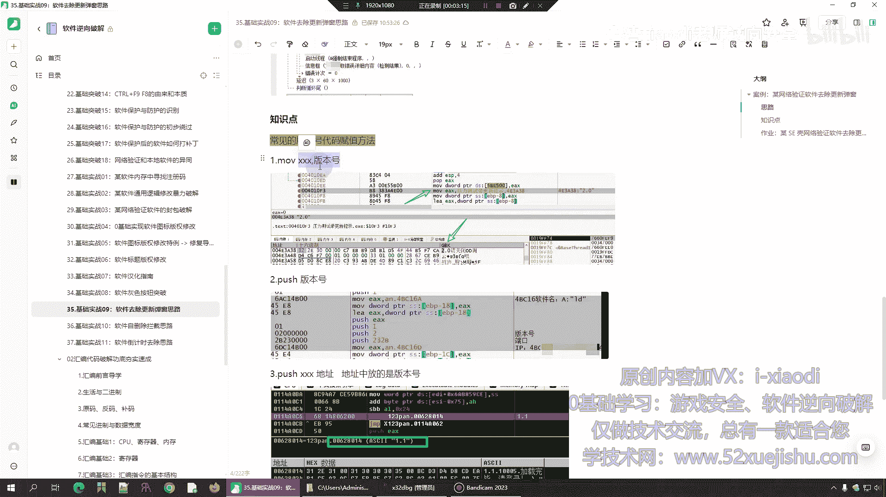
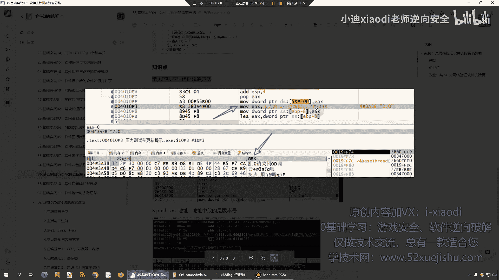
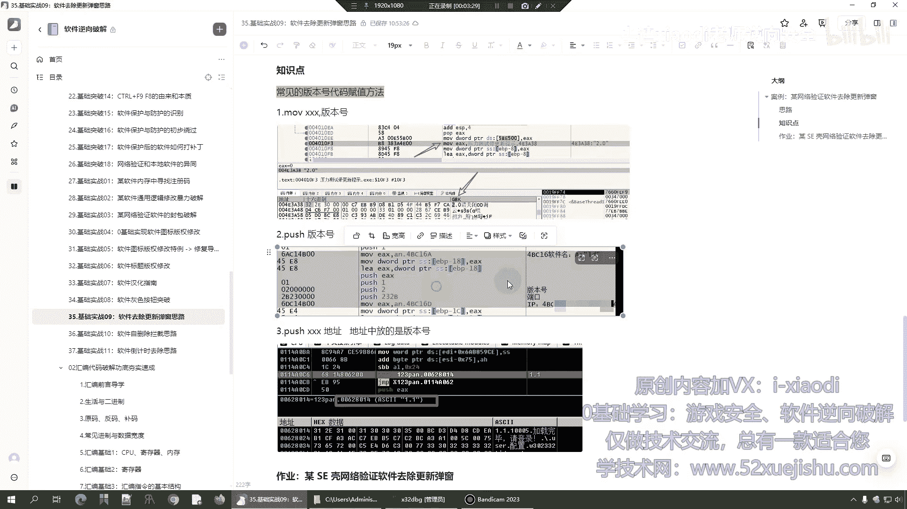
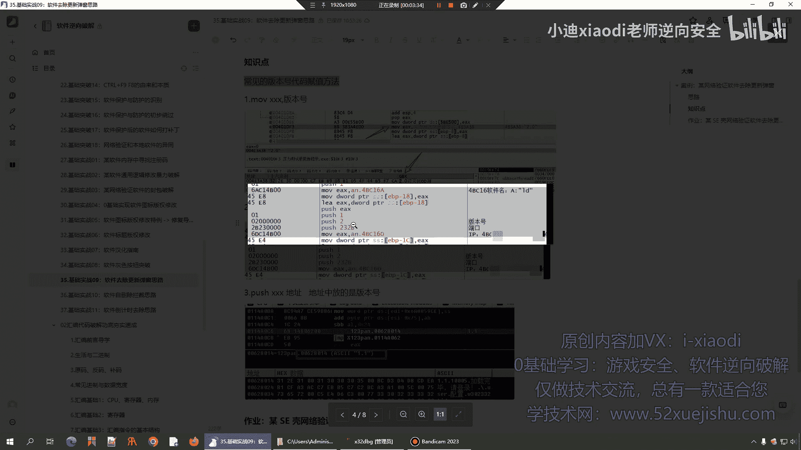
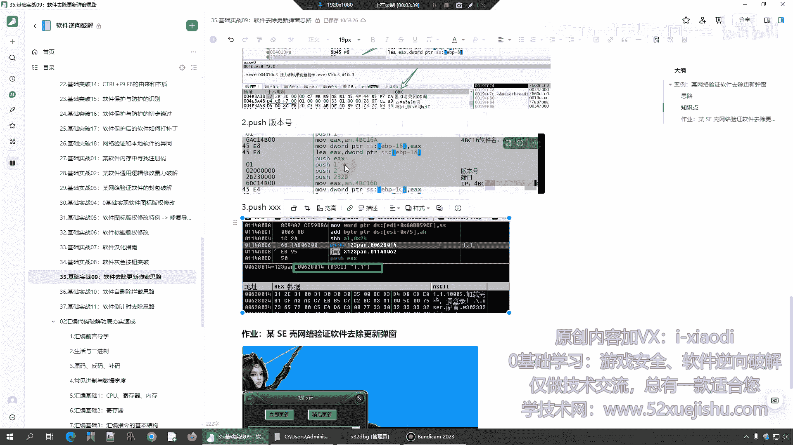
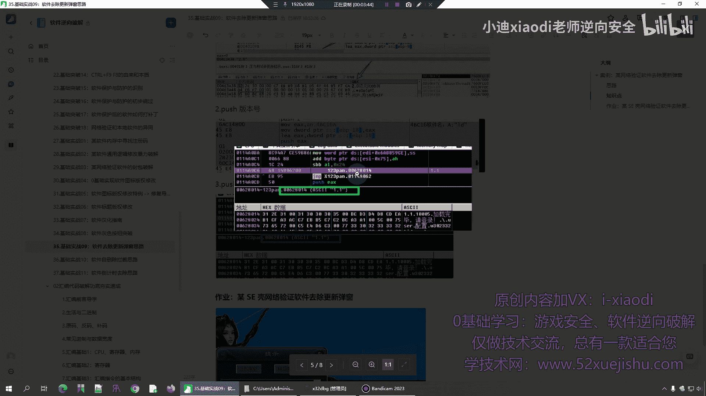
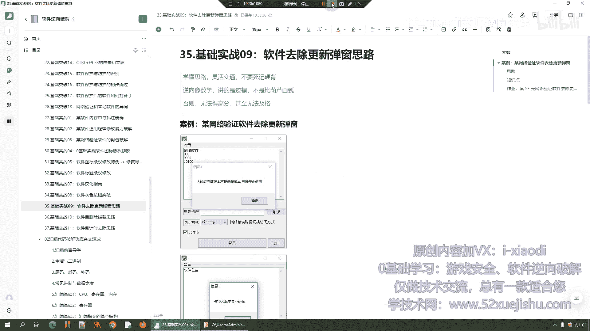

# 🔧 软件逆向破解教学：实战篇：网络验证软件去除更新弹窗

大家好，我是小迪老师。在本节课中，我们一起来学习软件去除更新弹窗的思路。逆向技术不能靠死记硬背，而是要理解思路，灵活变通。逆向就像解数学题，核心在于逻辑推理，而不是照着例子照葫芦画瓢。如果只记住了表面步骤，却不明白背后的逻辑，遇到问题时就会手足无措，最终不仅拿不到高分，甚至可能无法及格。

今天我们要讲的案例，是一款带有网络验证功能的软件。这款软件在检测到版本号不是最新版本时，会通过弹窗阻止旧版本继续使用。假设我们有这样一款软件，它已经推出了新版，但你依然想用老版本。此时程序通常会提示“当前版本不是最新版本已被停止使用”，或者提示“版本号不存在”。具体来说，旧版本号可能是1.0，而官方更新后不再允许你使用1.0。我们要解决的，就是让程序认为当前版本是合法版本。

面对这种问题，可以从以下两个方向入手。第一个方向是直接修改版本号。这是最简单的思路，因为程序以前是1.0，官方更新后可能变成了2.0，我们只需要在内存中把最新的版本号修改回1.0，程序就会认为版本合法，从而正常使用。第二个方向是寻找校验版本号的代码，然后暴力修改跳转逻辑。不过，暴力修改并不是一个好选择。越是暴力解决问题，后续出现的问题往往越多，甚至可能让前面的修改全部失效。因此，在任何情况下都不推荐暴力破解，能绕过就绕过，以柔克刚。

为什么不能采取暴力方式解决？我们先看看程序为什么会提示更新。当点击“试用”按钮时，程序会弹出版本更新提示。原因是程序内部带有版本号相关指令，这个版本号会与某些代码组合，然后发送到服务器。服务器收到请求后，会给本地软件返回一个内容。本地软件根据这个返回内容，决定是否载入功能窗口。从这个流程可以看到，服务器返回内容会参与一个全局token的赋值。当功能窗口载入之后，全局token又参与一次校验，校验结果被赋值给一个检测结果。接下来，这个检测结果会不断进行错误检测。程序根据检测结果，可能要求软件强制退出，也可能弹出错误信息。整个校验流程非常多，也非常复杂。所以，我建议大家不要暴力干掉校验逻辑。就像暴力解决了一个人，可能会招来三五个人的反扑，后续更难处理。这个校验关系可以概括如下：

```text
服务器返回内容 -> 全局 token
功能窗口载入 -> 全局 token 参与校验 -> 检测结果
检测结果异常 -> 强制退出 / 错误提示
```



在修改版本号之前，先要弄清楚版本号在程序中的几种常见赋值方式。常见的方式有三种，理解它们之后，就能在调试时快速定位到版本号数据。下面我分别说明一下。

1. 使用 `mov` 指令，把版本号直接放到内存地址或寄存器中。  
2. 使用 `push` 指令，把版本号直接压入栈中。  
3. 使用 `push` 指令，压入一个地址，这个地址里存放着版本号。  



可以直接用代码感受一下这三种形式：









```asm
; 方式一：mov 直接赋值版本号
mov ESI, 0x4E3138        ; 把版本号地址放入 ESI，0x4E3138 中存放的是 "2.0"

; 方式二：push 版本号
push 2                    ; 版本号 2 直接压入栈

; 方式三：push 地址，地址中存放版本号
push 0x4E3138            ; 压入地址，该地址里存着版本号
```

这三种方法是最常见的版本号赋值形式。每个程序的具体实现可能略有不同，因此重点还是掌握思路，灵活变通，不要死记硬背。

接下来，我们进入实战环节。先把目标程序运行起来。启动程序后，点击“试用”按钮，程序会提示“版本号不存在”。这说明程序确实在检查版本号。如果我们把版本号相关内容去掉，再次点击试用，程序不会给出任何提示，还可以取得一个到期时间。这个差别非常关键，它说明程序已经在判断版本号是否合法。

下面开始实际修改。先在调试工具中打开“文件”菜单，点击“附加”，选择目标进程并双击。然后点击“符号”，切换到程序的主模块。这时可以搜索当前模块的字符串，搜索之后就能找到版本号。版本号可能是“2.0”，也可能只是“2”，不同程序有差异。注意，这个版本号是程序当前使用的最新版本号，而我们的老版本号是1.0。

在这个例子里，代码复制版本号的方式是使用 `mov` 指令，直接把“2.0”放到 ES 寄存器中。同时，地址 `0x4E3138` 中存放的就是版本号字符串“2.0”。可以在内存窗口中跳转到这个地址，看到“2.0”的显示。如果看到的内容和自己的显示方式不一样，比如是别的编码，可以在菜单里选择“16进制”，找到“代码页”，选择“GBK”（原视频里说的“JBK”通常就是指这种代码页），然后点击确定，中文提示就可以正常显示了。接下来要把版本号从“2.0”改为“1.0”。在 ASCII 编码中，“2”对应的十六进制是 `0x32`，“1”对应的十六进制是 `0x31`。所以只需要把内存中 `0x32` 改成 `0x31`，版本号就变成了“1.0”。

修改之后，你会发现暂时没有效果。原因在于这段内存属性是只读的。只读的意思就是不允许修改。不过我们可以修改内存保护属性。打开 Cheat Engine，选择目标进程，然后查看内存。跳转到地址 `0x4E3138`，在地址上鼠标右键选择“复制”，然后在地址输入框中右键选择“转到地址”，粘贴刚才复制的地址并确定。查看内存属性，可以看到它是“只读”。这时可以再次鼠标右键，选择“分页内存可写”，把页面改成可写状态。改完之后，再把 `0x32` 改成 `0x31`，版本号就真正变成了“1.0”。

修改完成之后，就可以打补丁了。打补丁有两种选择：一种是直接在当前工具中打静态补丁，另一种是参考我们之前视频中讲过的动态补丁方法。这里先使用直接修补文件的方式。选择“修补文件”，然后更新提示，选择“写一个去除”，保存文件。保存后，把原程序退出。此时这个修改过的文件就是我们自己的程序了。运行它，点击“试用”，可以看到程序成功进入，说明更新弹窗已经被成功去除。

留一道作业给大家。某SE壳程序是一个带有保护壳的软件，它有软件防护功能，同时也使用了网络验证，需要去除更新弹窗。它的提示形式和我们今天看到的可能不一样，但可以使用同样的思路来分析。这里给大家一个小提示：这种加壳程序不能直接用静态补丁，需要使用动态补丁。具体可以参考第24-25集讲过的“带壳软件如何打补丁”的方法。作业题目我会放到论坛对应的帖子上，大家可以去下载，亲手实践一下。这个形式有很多种，大家一定要学会灵活变通，不要死记硬背。



本节课中，我们一起学习了网络验证软件去除更新弹窗的完整过程。从问题背景、解决思路、版本号赋值方式，到实际调试、修改内存和打补丁，每一步都是在巩固逆向的基本功。希望你能把这一课的思路用在更多实际场景中。我们下期再见。
