# 软件逆向破解实战：第1章：移除进程定时器与时间限制绕过

## 概述

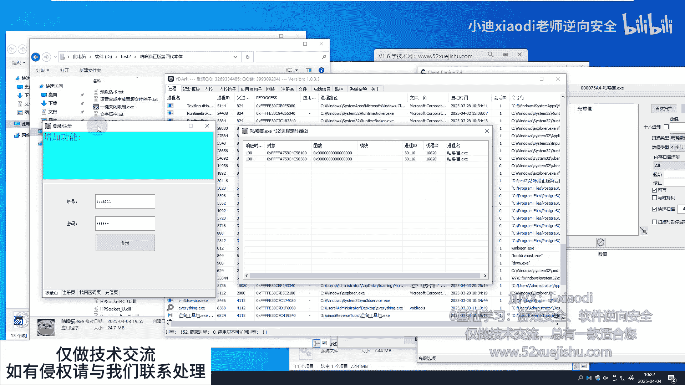

在本节课中，我们将一起探讨如何移除进程定时器，以及如何对一个带有网络验证和卡密功能的软件进行逆向分析与破解。我们会从工具介绍开始，逐步深入到Windows内核原理，最后实际操作修改软件代码，编写一个自动化补丁工具。整个过程会尽量用大白话讲解，确保初学者也能跟上思路。

## 技术路线梳理：从工具层面开始

我们要想弄清楚整个技术的脉络，应该先从工具层面去了解。这次用到的工具名为**WDARK**，其中“WD”可能是作者名字的字母缩写，而“ARK”则是这类工具的统称。工具包里有多个ARK工具，我们来看看它们分别是什么。

以下是几款常见的ARK工具介绍：

- **OpenARK**：Open代表开放的意思，这个工具是开放源代码的，你可以搜索并下载相关源码学习其中的技术。作者的理念就是开放的，源码完全公开。
- **PYARK**：PYARK叫做飘云ARK，国内有一个技术实力很强的论坛叫飘云阁，团队里有一群非常厉害的兴趣爱好者开发了这款工具。
- **WDARK**：就是我们本次主要使用的工具，功能与前两者大同小异。

这些工具都有一个显著的共性，就是名字里都有“ARK”。那ARK到底是什么意思呢？其实ARK是**Anti-Rootkit**的缩写。Rootkit是一种特殊类型的恶意软件，而Anti在英语中表示“反”的意思。所以ARK就是反恶意软件工具。本质上它是一个正义的工具，但很多朋友可能会把它拿去做其他用途，这属于个人自由。ARK工具非常强大，它的内核模式堪称Windows的root用户。你理解手机root模式就知道了——root之后你的权限就变高了，所以ARK工具也具有非常高的操作权限，这些权限与内核息息相关。

## 移除定时器的原理：内核权限的介入

既然提到了权限，那我们就来解决一个关键问题：移除定时器的操作是如何实现的？我直接问了一下ChatGPT，它的回答是：移除操作通常涉及Windows内核调试器的原理。你看，“内核”这个词又出现了。

定时器在Windows内核中用于执行延迟操作，恶意软件可能会利用定时器来执行隐藏或恶意任务，因此安全工具需要检测并移除这些定时器。杀毒软件中基本上都包含这类功能。

现在我们就知道了一个基本事实：权限高的东西往往与内核相关。接下来，我们需要理解Windows操作系统的权限分级。

## Windows内核层级：Ring0与Ring3

在Windows操作系统中，权限分为两个级别，分别是**Ring0**和**Ring3**。Ring0简称为R0，Ring3简称为R3。我们来看图理解一下层级关系。

Ring3在最外层，Ring0在内层。这里的“内核”就是英文**Kernel**的意思。谁具有更高的权限呢？答案是Ring0，也就是内核层，拥有最高权限。Ring3位于应用层，什么是应用层呢？就是QQ、微信、浏览器、录屏软件、笔记软件等所有普通应用程序所处的层级，它们的权限并不高。

只有Ring0权限高。那问题来了：如果我们要操作定时器，应该通过哪一层呢？移除定时器的操作通常涉及Windows内核定时器的管理，而定时器在内核中执行延迟操作，所以我们需要在内核层也就是Ring0层去操作。Ring3层做不了这件事，没有办法移除。Ring0层可以给Ring3层提供接口让你使用，但更高权限的操作，比如移除定时器，Ring3做不到。

可以把Ring0想象成领导，Ring3是员工。员工的所有权利都是领导下发的，并不是天生就具备的。领导给员工一个小权限，让他干活，员工尝到甜头，但当领导不满意的时候，随时可以把员工辞掉。所以你要清楚谁是大王，Ring3是小王，Ring0是大王，所有的权利都是Ring0给的。


## 分析目标软件：认识应用程序与驱动文件

接下来，我们来分析一下这个软件。打开软件所在目录，会发现一个后缀为`.exe`的文件，这毋庸置疑是一个普通的应用程序，跟QQ、微信等软件一样。那这个exe文件运行在哪一层呢？既然是应用程序，它就运行在Ring3层。

再仔细看目录下还有其他文件，比如后缀为`.sys`的文件。很多朋友可能不认识这个文件，可以右键点击查看属性，会发现它是“系统文件”。这说明什么呢？普通的应用程序运行在应用层，但它可以加载系统文件。这个系统文件是作者自己写的，它叫内核文件，也叫驱动文件。ARK工具会加载内核程序，然后通过这套内核程序去进行更高级别的操作。

用一个比喻来说：Ring3层的程序相当于一个主子，它安插了一个“狗腿子”到Ring0层，通过这个狗腿子去办事。它自己能直接办吗？不能，必须借助狗腿子。.sys文件就是狗腿子，exe就是它的主子，主子通过狗腿子去操作更高级别的东西，其中就包括定时器的操作。

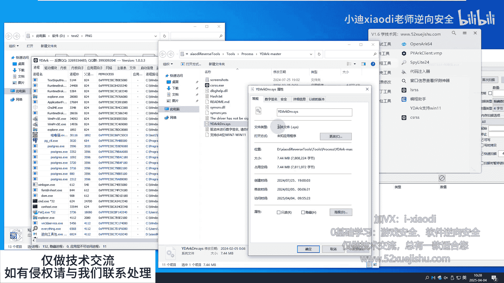

## 驱动开发的困境：系统兼容性问题

如果我们要自己编写程序去移除定时器，用普通的应用程序能做吗？做不到。就算你用C或者C++去编写一个普通的应用程序，也是做不到的。那怎么办呢？我们只能去开发内核程序，也就是开发`.sys`驱动程序。这种程序是使用C/C++开发的，但它有一个问题：不同版本的操作系统不兼容。

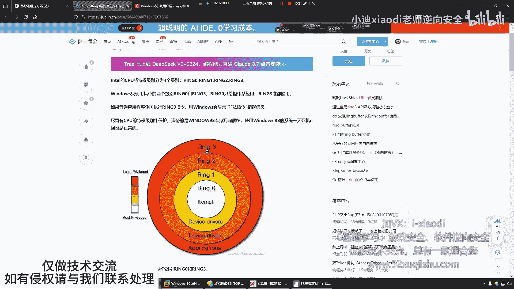

举个例子，打开一个ARK工具，可能会看到“加载驱动失败”的提示。它加载的就是`.sys`文件，为什么失败？因为不支持当前的操作系统版本，所以驱动加载失败，所有功能都无法使用。

更麻烦的是，即便你成功编写了驱动，还要面对不同操作系统内核版本的兼容性。如果驱动不兼容，要么系统拒绝加载，要么直接蓝屏。为什么会蓝屏？因为`.sys`驱动运行在Ring0层，它崩溃了，整个操作系统也会跟着崩溃。

写驱动这条路实在太麻烦，我们就需要另辟蹊径。

## 从代码层面入手：定位到期提示

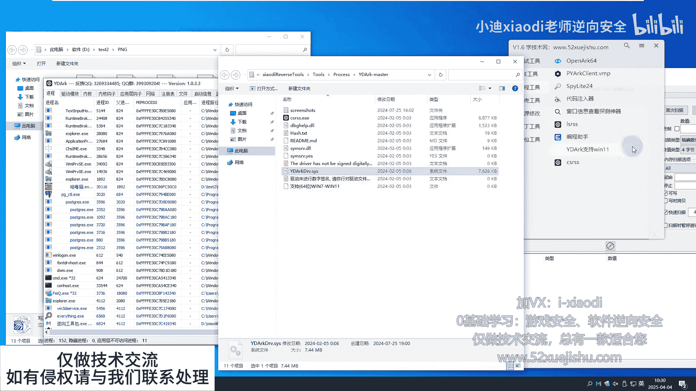

定时器是什么东西呢？它本质上是一个计时闹钟，到点了就执行相关操作。在这个软件中，定时器到点后的操作就是弹出“已过期”之类的提示，限制功能使用。


为了弄清楚代码层面的逻辑，我们可以使用**x64dbg**（简称DBG）这个调试工具来分析。打开DBG，附加咕噜猫这个进程，点击“符号”标签，切换到模块视图，然后搜索当前模块中的字符串。

以下是搜索到的重要提示字符串：

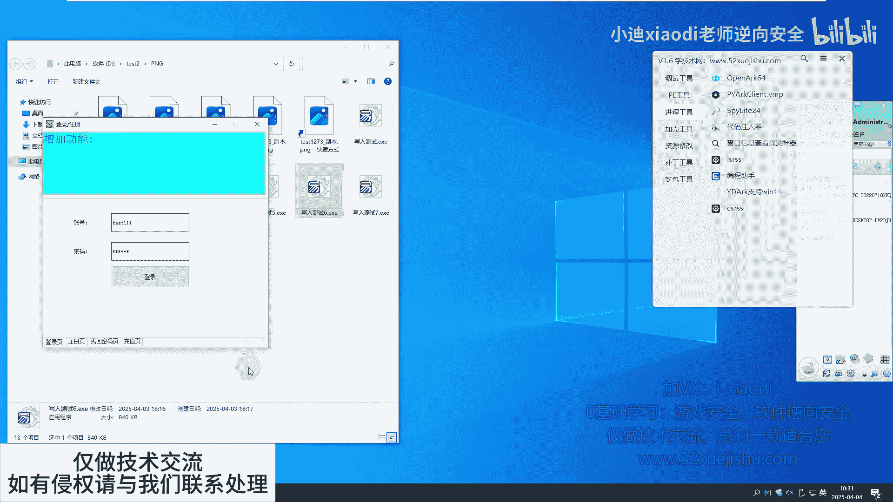

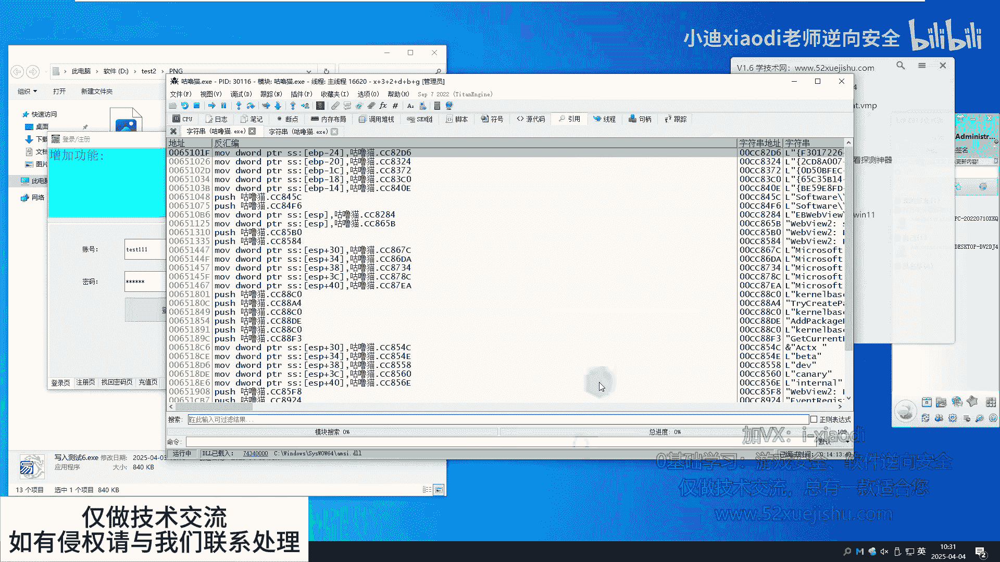

- **“几小时就到期了”**：这是一个关键提示，说明软件会在某个时间点弹出这个文本。
- **“已到期”**：这是另一个重要的到期提示。
- **其他格式的到期文本**：例如“XX已到期”这类提醒信息。

双击“几小时就已到期”这个字符串，往上看代码，会发现这里有一个非常大的跳转。这个跳转可以跳过“几小时就已到期”的提示。定时器到时间后，会执行到这段判断代码，然后继续执行，最终弹出提示。

如果我们从代码层面修改，比如把这个跳转指令`JZ`改成`JMP`，也就是无条件跳转，那么定时器执行到这里的时候就直接跳走，不再往下走，提示就不会弹出，进程也就不会退出。为什么？因为一般来说，软件会在这里提示到期，然后在下边执行进程退出的操作。我们全部绕过，它自然就不退出了。

再来看“已到期”这个提示，往上看也有一个跳转。这个跳转同样与到期逻辑相关，所以把这个地址的`JZ`也改成`JMP`即可。

## 处理基址随机化：使用CE计算偏移

修改跳转的时候要注意一个问题：这个地址是否是随机地址？一般来说，一个32位exe可执行程序的基址是`00400000`，但这里我们看到的是`00650000`，说明它可能启用了**ASLR（地址空间布局随机化）**机制。

那怎么处理呢？可以打开**Cheat Engine**（简称CE），跳转到这个地址，点击“查看”菜单，勾选“显示模块地址”。这样就能看到它原来是“咕噜猫.exe”加上一个偏移量。虽然基址是动态加载、动态计算的，但偏移是不变的。

比如说，原始的跳转指令是`7F56`，要把它改成`EB56`。以上是其中一处的修改。

## 定位关键指令：具体修改代码

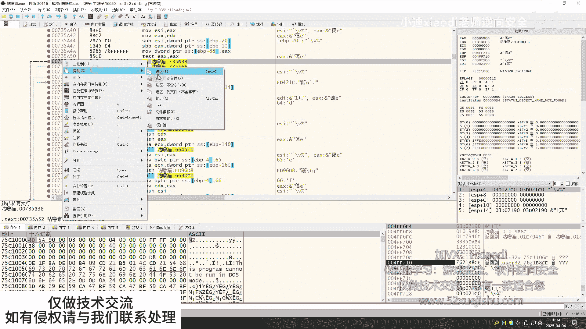

我们来看具体的代码位置。第一个重要跳转位于`E5A52`，原来的机器码是`0F8F E00000`，共6字节，要把它改成`JMP`指令。`JMP`生成的代码为5字节长度，所写操作码为6字节长度。我们生成的比原来的短，所以空间足够，剩下一字节用`NOP`（空操作）填充，`NOP`什么都不做。把`0F8F E00000`改成`EB 11 90 90 90`，就完成了这一处的修改。

第二个修改点是`73B7D0`，把`75 56`改成`EB 56`即可。`75`是`JNZ`（非零跳转）的机器码，`EB`是`JMP`的机器码，改成`EB`后强制跳转，就跳过了到期提示。

修改完成后，定时器的相关代码就不再生效了。它原本的提示和退出功能全部被跳转绕过，定时器也就失去了意义。


## 编写自动补丁工具：调用Windows API

现在我们来写一个自动打补丁的工具，代码很简单，核心逻辑如下所示：

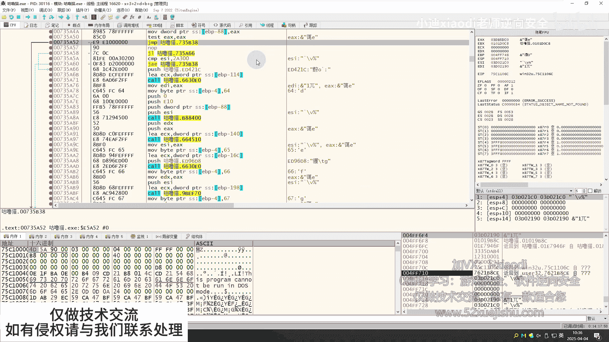

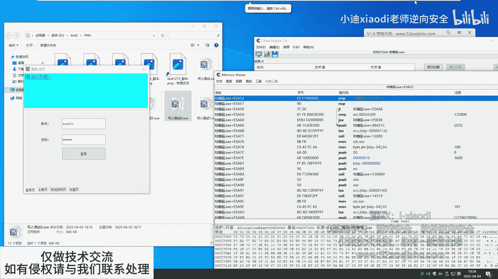

```c
// 1. 获取模块基址（动态获取，适配ASLR）
DWORD_PTR baseAddr = GetModuleHandle("咕噜猫.exe");

// 2. 计算两个补丁地址（模块基址 + 偏移）
DWORD_PTR patchAddr1 = baseAddr + 0xE5A52;   // 第一处跳转
DWORD_PTR patchAddr2 = baseAddr + 0x73B7D0;  // 第二处跳转

// 3. 读取内存，验证原始机器码
BYTE buffer[6];
ReadProcessMemory(hProc, (LPVOID)patchAddr1, buffer, 1, NULL);
if (buffer[0] == 0x0F) {
    // 校验通过，继续执行
}

// 4. 修改内存属性（因为代码段通常是只读的，需要改为可写）
VirtualProtectEx(hProc, (LPVOID)patchAddr1, 6, PAGE_EXECUTE_READWRITE, &oldProtect);

// 5. 写入补丁数据
// 第一处：EB 11 90 90 90 90（JMP + NOP填充）
WriteProcessMemory(hProc, (LPVOID)patchAddr1, "\xEB\x11\x90\x90\x90\x90", 6, NULL);
// 第二处：EB 56（JMP）
WriteProcessMemory(hProc, (LPVOID)patchAddr2, "\xEB\x56", 2, NULL);
```

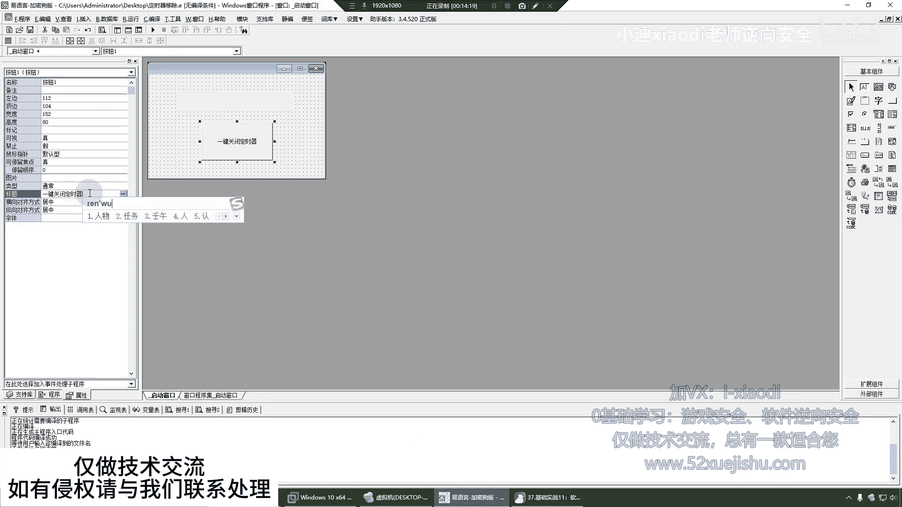

整个流程分为四步：获取模块地址、修改内存属性、写入补丁数据、验证结果。

以下是这个工具的具体操作流程：

1. 先取到咕噜猫.exe的模块地址，这个地址有可能是动态加载的，所以我们动态获取，保证适配不同系统环境。
2. 模块地址加偏移，实际上就是一次简单的加法运算，得到两个补丁地址。
3. 读内存检查原始机器码，如果读取到的是`75 56`或`0F 8F`，说明读取正确，可以继续。
4. 修改内存属性，因为代码段默认是“可执行和只读”状态，不允许直接写入，必须先改成“可读可写可执行”，否则写入会失败。这些参数都是固定的标准写法。
5. 修改数据，把补丁字节写入指定地址，然后弹出“补丁成功”的提示。

为什么需要修改内存属性呢？一般来说，代码段都是只读的，只允许执行和读取，不允许写入。如果我们直接写入就会出问题。通过`VirtualProtectEx`修改内存属性，把相关的参数填进去，就可以正常写入了。修改属性时，首先它是一段代码，所以要保持“可执行”，然后因为我们需要写入，所以要加上“可读写”权限。

## 实际测试与验证

写完之后，我们来实际测试一下。把DBG关掉，打开咕噜猫，点击工具上的“一键关闭定时器”按钮，可以看到提示“补丁成功”，说明写入成功。

这时去验证一下地址：第一处`E5A52`的机器码已经改成了`EB 11`，第二处`73B7D0`也改成了`EB 56`。这样我们就实现了一个移除定时器的操作，把它的相关任务成功干掉。

## 总结

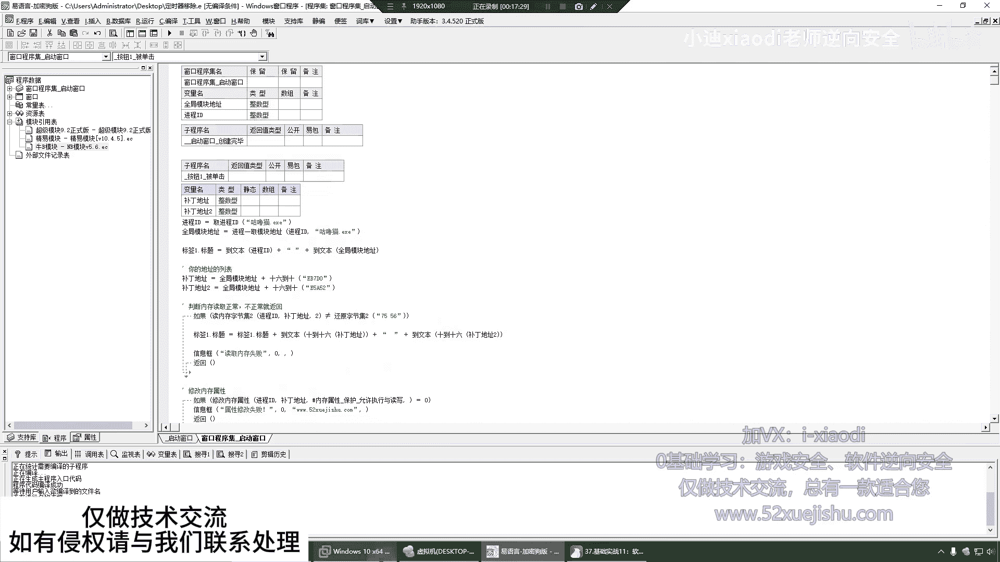

本节课中，我们一起学习了如何分析并破解一个带有时间限制的软件。我们认识了ARK工具，理解了Ring0和Ring3的权限差异，分析了定时器触发到期提示的逻辑，通过修改关键跳转指令绕过了时间限制，最后编写了一个自动打补丁的工具。


回顾整个技术路线：因为Ring3层无法直接操作内核定时器，而编写内核驱动又面临着复杂的系统兼容性问题，所以我们选择从应用层直接修改定时器的回调代码——让定时器即使触发，也无法执行“提示到期”和“退出进程”的逻辑。每一步的推导过程都很重要：你要知道为什么这样做，如果这条路走不通，应该换什么方法。这样才能真正掌握逆向分析的思路，而不是仅仅会照着教程点几个按钮。
