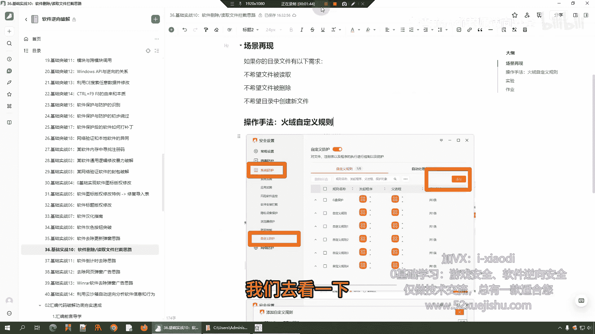
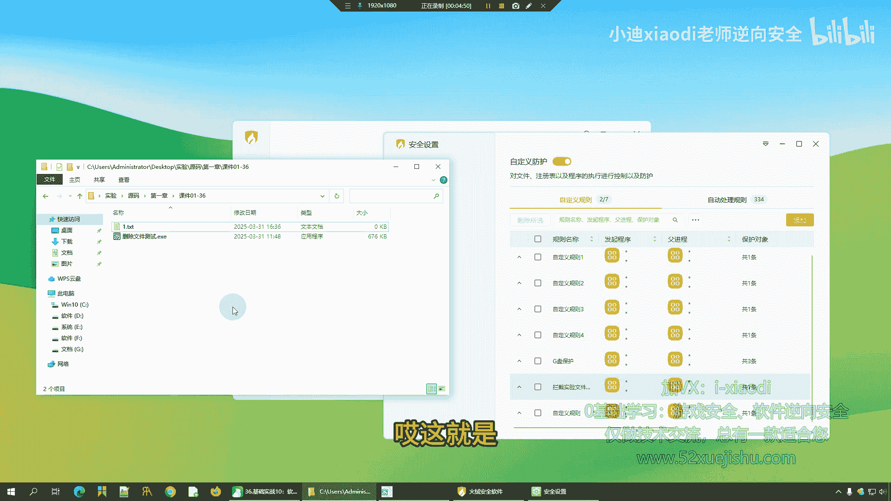
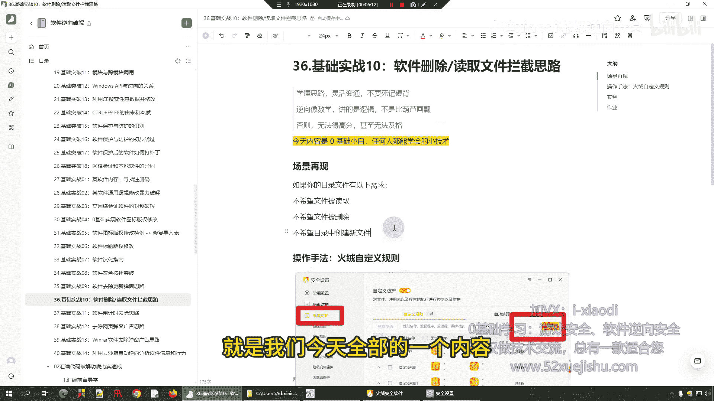

# 🛡️ 软件逆向破解实战教程：第1章：软件删除读取文件拦截思路

## 📚 课程概述

在本节课中，我们将学习如何拦截软件对文件的删除和读取操作。这是一种非常实用的技术，零基础的小白乃至没有任何编程经验的普通用户，都可以轻松掌握。我们会使用一款名为“火绒”的安全软件，通过配置自定义防护规则，实现对指定文件或文件夹的全面保护。整个过程不需要编写任何代码，只需要通过图形化界面点击操作即可完成。

这个技术在实际生活中有很多应用场景。比如你有一些重要文件不想被某个程序读取或修改，或者你想保护系统关键文件不被病毒木马破坏，又或者你想研究某个恶意软件的行为，阻止它对文件进行操作。这些需求都可以通过今天学习的内容来实现。

## 🎯 需求场景演示

假设你的目录文件有以下几种需求：第一，不希望文件被读取；第二，不希望文件被删除；第三，不希望目录中创建新文件。那么怎么去操作呢？我们通过一个具体的例子来演示。

我们来看一个实际的场景。现在有一个软件，这个软件可能是任何软件，你就把它当成任意一个软件即可。这个软件会做什么事情呢？它会删除当前文件夹下的 `1.txt` 这个文件。你把 `1.txt` 想象成任意文件都可以，我们只是拿它来做示例。这个软件的行为就是，当你点击界面上的“删除文件”按钮，它就会自动执行删除操作。

我们实际操作一下。首先，目录中存在 `1.txt` 这个文件。点击软件中的“删除文件”按钮，观察一下效果，可以看到 `1.txt` 就不见了，它被成功删除了。如果你想重新试验一下，可以新建一个文本文档，然后再点击“删除文件”，这个新文件同样会被删除。

这个程序的逻辑非常简单，就是调用了系统提供的文件删除功能。你可以把这个示例程序延伸到各种场景中，比如游戏防护程序，各种软件保护系统，或者一些病毒木马程序，原理都是一样的。你想要拦截或者禁止软件对文件进行修改、删除、读取，都是可以实现的。同理，别人写的软件也可以用同样的方式来保护自己，防止被外部程序篡改或删除。

## 🔥 火绒安全软件介绍

怎么去操作呢？方法非常简单，我们需要借助一个工具，叫做“火绒”。什么是火绒呢？大家可以自行到网上搜索了解一下。它是一款免费的杀毒软件，自带了很多实用的安全防护功能，其中就包括我们今天要使用的“自定义防护”功能。

下载并安装火绒的过程非常简单，去官网下载安装包，然后默认安装就可以了，不需要任何特殊设置。安装完成之后，你的电脑就多了一层安全防护。需要注意的是，火绒本身是一款杀毒软件，它在提供安全防护的同时，也为我们提供了灵活的规则定制能力，这正是我们今天要实现的目标所需要的。

## ⚙️ 配置自定义防护规则

安装完成后打开火绒，可以看到主界面。这个界面有一个特色功能，就是可以调节软件界面的亮度或切换皮肤主题，外观设计比较灵活。我们今天关注的重点不是外观，而是它的防护功能。

在火绒主界面中，点击右上角的“设置”按钮，进入设置页面。在设置页面中，找到“系统防护”这一项，点击进入。在“系统防护”的选项卡中，可以看到一个叫做“自定义防护”的选项。自定义防护功能默认可能是关闭状态，需要手动开启，开启之后规则才会生效。

接下来，点击“添加”按钮来创建一条新的防护规则。在添加规则之前，记得确认“自定义防护”的总开关已经打开了。点击添加之后，会进入规则编辑界面。

### 🔧 设置规则名称

首先需要给规则起一个名字，起一个能表明用途的名称，方便以后识别和查找。比如“拦截实验文件夹删除”，或者更具体的“拦截删除文件”之类的名称。规则名称可以自由填写，它只是这个规则的标识符，不会影响实际的功能逻辑。

### 🖥️ 指定发起程序

接下来需要指定“发起程序”。发起程序就是我们要限制哪个软件的行为。比如我们选择示例程序，怎么选择呢？你需要找到这个程序的路径，把路径复制下来，然后在发起程序的输入框中粘贴并回车，程序就会自动被添加进来，然后点击“打开”确认选择。

假设我们选择的发起程序就是刚才那个会删除 `1.txt` 的示例程序。那么，我们建立的规则就是专门针对这个程序的，只要它尝试执行删除操作，就会被火绒拦截下来。其他程序的删除操作则不受这条规则的影响。

### 📂 添加被保护对象

然后，我们需要添加“被保护对象”。被保护对象就是我们不希望被操作的文件或文件夹。同样地，我们找到实验文件夹里面的内容，比如我们要保护 `1.txt` 这个文件，那就把它添加进来。

被保护对象的添加方式与发起程序类似，找到文件所在位置并选定即可。如果你要保护整个文件夹，也可以直接选择文件夹。这个功能非常灵活，可以根据实际需求勾选不同的保护范围。

### ✍️ 选择保护动作

添加完保护对象之后，可以看到下方有几种可勾选的保护动作，包括：**创建**、**读取**、**修改**、**删除**。这些都是文件可以被执行的常规操作。你可以根据自己的需求自由勾选。比如今天要演示拦截删除和读取，那么就把“读取”和“删除”勾选上。如果你不希望该文件被任何程序创建或修改，也可以把这几个选项全部勾选上。

### 📋 选择处理方式

配置完上述内容之后，点击“保存”，规则就初步创建完成了。保存之后，规则列表中就会出现一条新的规则。此时我们还需要注意一个关键选项——处理方式。处理方式有两种：一种叫做“询问我”，另一种叫做“直接阻止”。

选择“询问我”时，当程序触发该规则时，火绒会弹出一个提示窗口，询问你要如何处理，你可以选择“阻止”或者“允许”。选择“直接阻止”时，火绒不会弹出任何提示，会直接禁止程序的操作，这种方式更加安静，但灵活性较低。

我们这次选择“询问我”，因为这样可以更直观地看到拦截的整个过程。点击“保存”完成配置。

## ✅ 验证拦截效果

配置完成后，我们来验证一下效果。再次运行刚才那个示例程序，点击“删除文件”按钮，观察会发生什么现象。可以看到，火绒立刻弹出了一个拦截提示，告诉我们有程序试图删除被保护的文件。这时候你就可以进行选择，点击“阻止”或者“允许”。

我们点击“阻止”试试。阻止之后回头看文件夹，可以看到 `1.txt` 依然健在，没有被删除。也就是说，这个程序的删除动作被成功拦截了。

我们再试一种情况：如果我们自己手动去删除这个文件，会不会被拦截呢？我们手动删除试试看。直接右键点击 `1.txt`，选择删除。你会发现，手动删除完全没有问题，文件直接被删除了。因为这条规则指定的发起程序是那个示例软件，我们的文件管理器（explorer.exe）并不是发起程序，所以不会受到规则限制。

那么问题来了：如果我们不知道删除行为到底是由哪个程序发起的，不知道行为的主体者是谁，该怎么办呢？这种情况在排查恶意软件时经常遇到。

### 🌟 使用通配符规则

解决方法也很简单，我们可以修改规则，把“发起程序”设置成一个通配符。双击规则，进入编辑页面，将发起程序的路径删除掉，然后输入一个星号 `*`，保存即可。如果留空不填，系统会提示“发起程序不能为空”，所以必须填写内容。星号 `*` 在规则中代表通配符，表示匹配任何程序。

使用通配符的含义是：**任何程序**的删除行为都会被拦截，不管是谁来的都不行。这个规则就像一个没有感情的拦截机器，任何人都不能删除被保护的文件。这个功能在实际使用中非常方便，适合保护一些重要的个人文件，不希望被任何程序修改或删除。

配置好通配符规则后，我们再测试一下。现在手动删除 `1.txt`。点击“删除”并确认。可以看到，这次连手动删除也被拦截了。弹出了阻止提示，点击“阻止”。刷新一下文件夹，文件依然没有被删除。我自己手动删除都没有成功，可见这个规则确实是一个“不讲道理的拦截机器”，任何程序来了都不行。这就是这个功能的强大之处。

## 🧠 作业与拓展思路

以上就是火绒拦截软件删除或读取文件的操作手法。这个功能可以应用在很多方向，比如保护个人隐私文件、防止勒索病毒加密文件、阻止软件弹窗更新等。大家可以根据自己的需要，灵活运用这个功能进行拓展。

为了巩固所学内容，这里布置两个作业，供大家练习和思考：

第一个作业：思考如何从软件逆向的层面直接干掉删除代码。这里给大家提供一个提示：系统中有一个API函数叫做 `DeleteFile`，代码形式为 `DeleteFileA` 或 `DeleteFileW`。一个软件如果要删除文件，大概率会调用这个函数。你可以在该函数上下断点，通过调试器回溯调用栈，找到相关代码，将跳转条件修改或直接填入 `NOP` 指令（空指令）填充清空，从而让删除操作失效。这样就从软件逆向的层面解决了删除代码的问题，而不再依赖外部工具。

第二个作业：思考火绒的实现原理。大家可以自行搜索一些关键词进行拓展研究，比如“内核级拦截文件删除”或“驱动拦截文件删除”。理解了驱动级别的概念，再回来看火绒这种用户态安全软件的运作机制，会有一个更深刻的认识。

## 💬 总结

本节课中我们一起学习了如何使用火绒的自定义防护功能来拦截软件对文件的删除和读取操作。我们从具体场景出发，演示了如何添加规则、指定发起程序、指定被保护对象、勾选保护动作以及设置处理方式。通过配置，我们成功阻止了程序对文件的删除行为。此外，我们还介绍了使用星号通配符来匹配所有程序的方法，实现了无差别的文件保护。最后，我们留下了两个拓展作业，一个是逆向层面的代码级绕过思路，另一个是驱动层面的底层实现原理研究。希望大家通过练习，能够更加灵活地运用这些技术，保护自己的文件安全。

我们下期再见。
