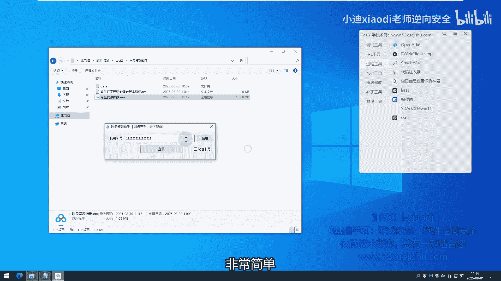
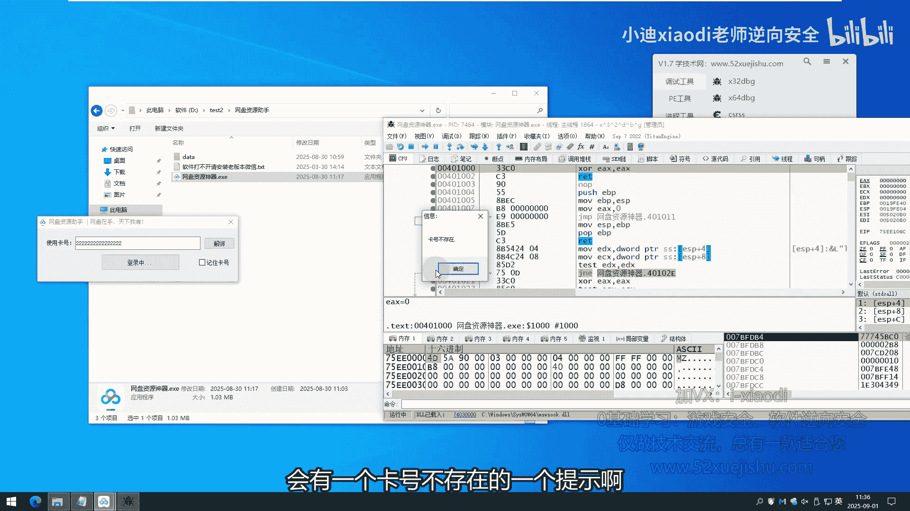
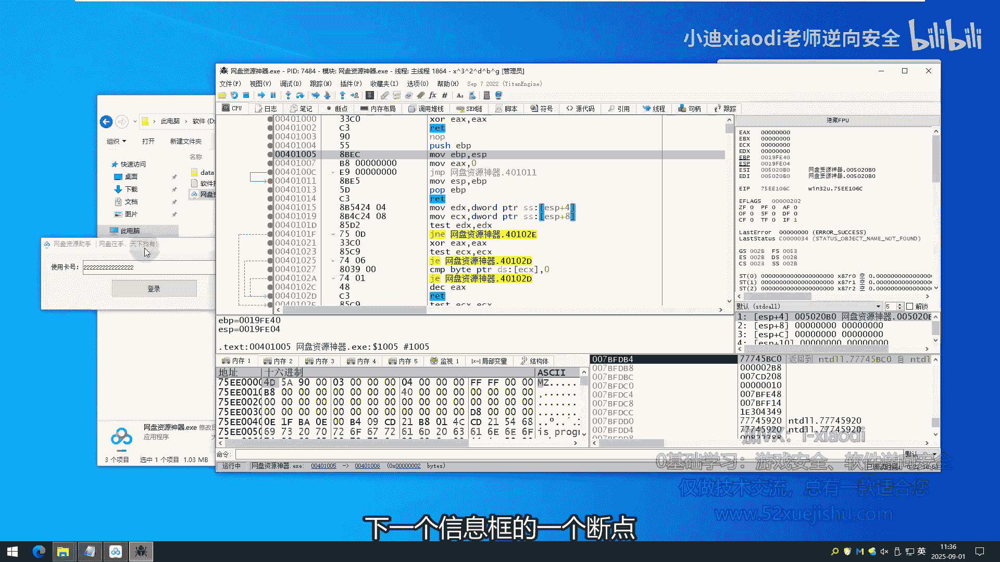
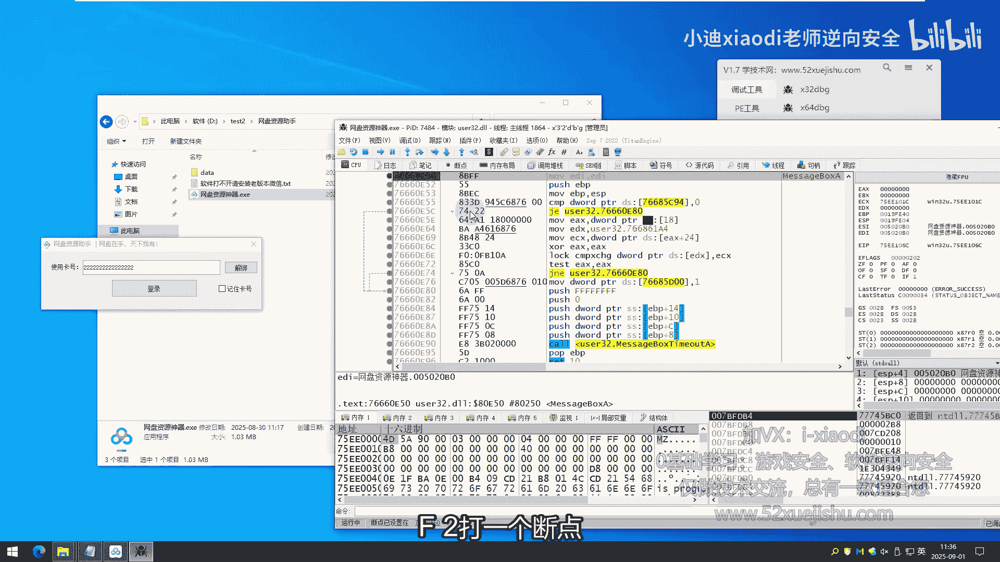
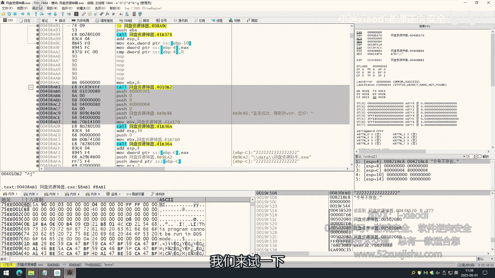
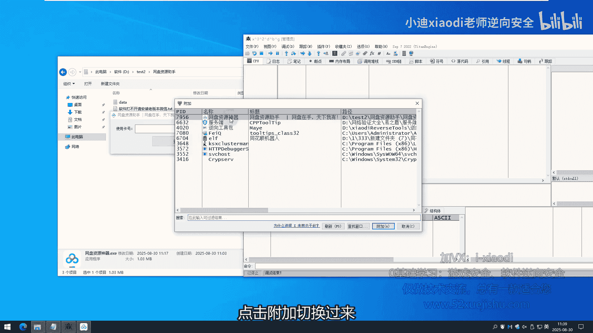
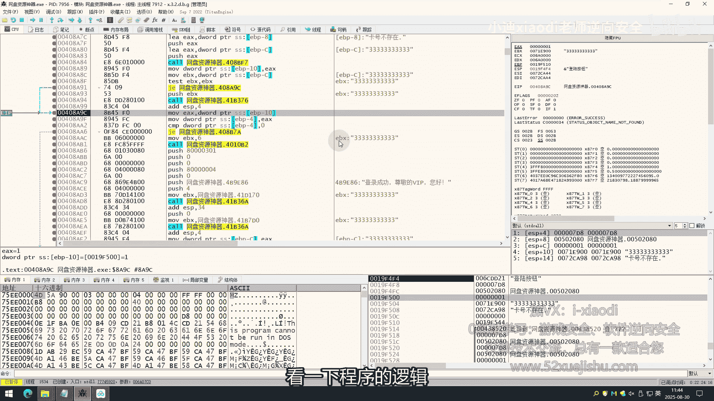
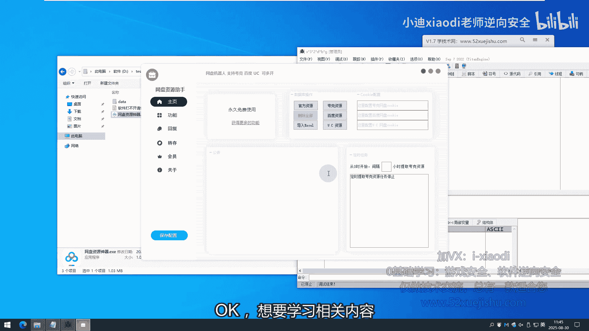

# 软件逆向破解教程：01：两种通杀方法，绕过卡密验证 🛠️

在本节课中，我们将学习软件逆向破解的两种通用方法，目标是通过修改程序逻辑来绕过卡密验证。我们会用到调试工具附加进程、下断点、单步跟踪，并修改关键代码或返回值。郑重声明，本内容仅用于网络安全技术交流，切勿用于非法用途。

## 一、先认识一下今天的目标程序 🎯

我们以一个小软件作为演示。运行程序后，它要求我们输入卡号和卡密，然后点击登录。但我们手上没有有效的卡密，随便输入一个卡号，点击登录，程序提示“卡号不存在”。这个提示本身就是一个重要线索，因为程序必然通过某个判断来决定是否弹出这个提示。我们要做的就是找到这个判断，强行改变它的结果。

要分析这个程序，我们需要一个调试工具。常见的工具有OllyDbg、x64dbg等，这里我们以传统的调试器为例。现在的调试器和目标软件是分开的两个进程，怎么让它们建立起联系呢？很简单，点击“文件”菜单，选择“附加”，在弹出的进程列表中双击目标软件，然后点击“附加”按钮。接着切换到“符号”或者“模块”标签，找到程序的主模块，一般我们都在主模块中分析代码。

## 二、第一种方法：直接修改跳转指令 🚀

“附加”成功后，我们回到软件界面，再次点击登录。程序会弹出“卡号不存在”的提示框。这个提示框在Windows中通常是通过MessageBoxA函数弹出的。所以，我们可以在调试器中找到MessageBoxA这个API函数，并在它的入口处下一个断点。断点是什么？简单说，断点就是程序执行到某个指定位置时会被强行暂停的点。用代码表示：`断点 = 中断地址 + 暂停执行`。你只需要在调试器的代码窗口中找到`MessageBoxA`这一行，按下F2键，就打好断点了。

接下来，切换回软件窗口，再次点击登录。程序就会在断点处中断下来。然后我们连续按几次`Ctrl+F9`（执行到返回）和`F8`（单步跳过），目的是返回到调用MessageBoxA的上一级代码中。随着我们不断单步返回，屏幕上会逐渐显示出程序传递给MessageBoxA的字符串参数，比如“卡号不存在”，再往上翻还能看到“登录成功”“尊敬的VIP你好”等相关的字符串。这些字符串附近，往往就是关键判断代码。

我们找到了一个跳转指令，它刚好会跳过“登录成功”的分支。也就是说，程序在判断卡号是否存在时，如果条件不成立，就跳转到失败提示；如果不跳转，就会进入成功逻辑。那么破解方法就很直白了：把这个跳转指令“抹掉”，让它永远不跳转，这样程序无论输入什么都会执行登录成功的流程。操作方法是：在跳转指令上点击鼠标右键，选择“二进制”，然后选择“用NOP填充”。NOP是一条空指令，它什么都不做，代码形式上写成`0x90`。用NOP填充后，跳转就被废掉了。

为了验证效果，先让程序运行起来，然后直接点击登录。此时程序直接弹出“登录成功，尊敬的VIP你好”，点击确定后，虽然程序可能会闪退，但功能窗口已经加载出来了。这就是第一种破解方法，简单粗暴。

## 三、第二种方法：修改函数返回值 💡

除了修改跳转，我们还能从函数返回值入手。再运行一次程序，同样点击“附加”，切换主模块。这次我们在`MessageBoxA`附近的关键调用处下一个断点，具体位置是执行到判断之前。然后按F2，再点击登录，程序就会在断点处停下。接下来我们按F8单步执行，观察程序的运行逻辑。刚开始几步没有明显信息，继续单步，直到某个操作执行后，编辑框中的卡号出现在了寄存器或堆栈中。这说明这一句代码的作用就是获取编辑框的内容，即我们输入的卡号。

获取到卡号之后，程序应该会把它发送到服务器进行校验。继续单步，当我们走到某一行时，发现程序返回了“卡号不存在”的结果。这里要记住一个关键知识点：在Windows程序中，函数返回值通常存放在EAX寄存器中。如果返回的值是`0`，一般代表失败；如果是`1`，代表成功。用公式表达就是：`返回值==0 → 失败，返回值==1 → 成功`。此时我们看到EAX中的值是0，那破解思路就来了：我们直接把这个0改成1，让程序认为校验通过了。

具体操作：在调试器中修改EAX寄存器的值为1，然后继续按F8单步执行。你会发现程序沿着成功分支继续走，最终也到达了“登录成功”的逻辑。运行程序，点击登录，果然提示“登录成功，尊敬的VIP你好”。这样我们就用第二种方法也破解了软件。

## 四、两种方法的对比与总结 📝

回顾一下，我们学会了两种通杀方法：第一种是找到关键跳转，用NOP填充，强制不跳转；第二种是找到函数返回值，把0改成1，模拟成功状态。两种方法的本质都是篡改程序在运行时的逻辑，从而绕过卡密验证。用一句话概括：逆向破解 = 找到验证逻辑 + 修改关键判断或返回值。

本节课中，我们一起学习了软件逆向破解的两种通用方法：修改跳转指令和修改函数返回值。我们需要掌握的核心动作包括：附加进程、下断点、单步跟踪、识别关键字符串、NOP填充、修改寄存器值。这些基础操作是逆向分析的敲门砖。只要扎实练好基本功，面对类似的软件验证，你就能举一反三，灵活运用不同的破解思路。最后再次强调，请将技术用于合法合规的网络安全工作，不要用于非法入侵或破坏。
