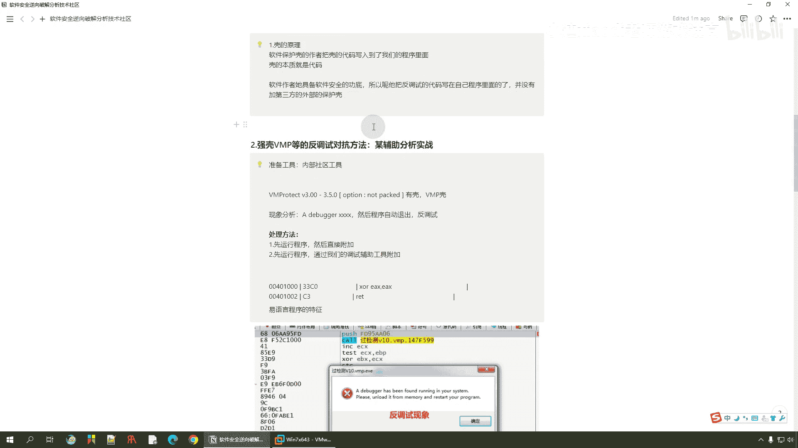

# 🔧 小白软件安全破解反汇编逆向工程师：强壳VMP等的反调试对抗方法

## 🎯 本节概述

在本节课中，我们将要学习如何应对带有强壳（比如VMP壳）的程序的**反调试对抗**方法。上一节课我们讲到，有些程序会加壳，而壳会对我们的分析工作产生一些影响，比如它带有反调试功能。那么反调试有没有具体的、真实的案例可以看呢？有的。今天我们就来学习第二节课——强壳VMP等的反调试对抗方法，通过一个**某卡密辅助分析实战**的案例来讲解。我们将一步步分析一个带有VMP壳的辅助程序，看看它是如何检测调试器的，以及我们有哪些方法可以绕过它的检测，最终成功对程序进行动态调试和分析。

---

## 🔍 熟悉程序与查壳分析

首先，拿到一个程序之后，我们拿这个程序来举例子。这个程序是“过检测V10点VMP点exe”，运行之后它就是一个辅助程序。我们先把它关闭，然后进行查壳操作。

将程序拖入查壳工具后，我们需要查看三个部分：第一个部分是**入口区段**，第二个部分是这里，第三个部分是这里。看一下入口区段，可以看到有“t段”（代码段）、“IDATT段”（只读数据段）、“beta段”（数据段）、“RSRC”（resource资源段）这几个区段。这些看起来没有什么问题，但是程序多了两个乱七八糟的区段，这两个区段是我们从来没有见到过的——正常的程序是不会存在这两个区段的。这是第一个有异样的地方。

接下来看第二个部分。这里显示“VM protect”，也就是**VMP壳**，它是一个VMP壳，然后这边有VMP壳的官网链接。VMP壳说明了这是一个加壳了的程序。我们可以把这个信息进行复制，这是我们探测到的信息。注意，这里如果提示“not packet”的话，你不需要管它，不要被它误解了。只有哪里提示“无壳”的时候才代表没有加壳——只有这里提示“not packet”才是没有加壳的。这里它说的是“no unpack”，意思是**有壳但没有能力探测到**，并不是无壳。所以在看到后边有一个选项的时候，不要被它误解，但凡它前边出现了这样一个字样，它就是一个有壳的东西。好的，这个程序就是有壳的，而且是一个VMP壳。

那么接下来，我们去看一下它的具体现象，来做一下现象分析。

---

## 🚫 反调试现象分析

首先，我们常规的方法是打开我们的**x32dbg**调试器，然后把程序拖进来，点击运行。这时候你会发现什么？程序弹出一个对话框，提示“debugger has been found running in your system”——意思就是检测到了你系统中正在运行调试器。所以说这个程序就跑不起来了，它会立马退出。这就是一个**反调试**现象。

我们将这个图片截图粘贴到这里，让大家看到这个反调试提示。点击确定之后，程序就退出了。

那么怎么去对抗呢？对抗的方法其实也很简单。这个现象分析下来，过程就是：程序检测调试器（Debugger）→ 发现调试器 → 弹出提示 → 程序自动退出。整个流程就是这样一个**反调试逻辑**。

处理方案有两个，下面我们来详细讲解这两个处理方法。

---

## 🛠️ 处理方法一：先运行程序再直接附加

第一种处理方法是这样的：先运行程序，然后**附加（Attach）**，也就是直接附加到正在运行的进程上。我们来试一下这个方法。

首先，先运行目标程序，让它正常启动。然后回到调试器，点击“文件”→“附加”，选择目标进程。附加成功之后，程序可不可以正常运行呢？可以看到程序运行没有问题。

那么此时此刻，我们尝试一下下断点。我们先随便输入一些内容，点击“登录”按钮。你会发现，程序当我点击登录的时候，它又退出了。这说明它这个**检测调试器的操作是无时无刻不在进行的**——就是说在点击登录的时候，它也会检测你的调试器。我们再来运行一次，再试一下。先运行程序，点击“文件”→“附加”，附加上了，然后随便输入内容点击登录，你会发现——看到没有？程序退出了。

这说明什么呢？说明**先运行程序然后直接附加**这一招是行不通的。

---

## 🧰 处理方法二：通过调试辅助工具附加

那么怎么办呢？第二种方法是：先运行程序，然后通过我们的**调试辅助工具**来附加。我们有一个社区内部的调试辅助工具，怎么使用呢？

这个工具大家可能有疑问，但一般来说，在你加入社区的时候，我们都会给你发一个使用文档，你按照使用文档来操作就可以了。具体怎么办呢？我们的调试器（x32dbg.exe）不是在这里吗？我们可以打开它的安装目录，找到那个目录。然后打开我们的调试辅助工具之后，点击“添加”，然后把这个调试器（x32dbg.exe）所在的文件夹找出来，选中这个文件夹下的这个文件——这个就是我们的x32dbg调试工具，对不对？添加好了之后，这个辅助工具就会把这个x32dbg的目录添加进去。然后你在这里双击，双击之后，这边就会出现“被调试进程”“保护调试器”“异常过滤”等选项，这些功能就把调试器给保护起来了。

保护起来之后，我们就可以运行这个目标程序了。来试一下：找到我们的实验程序“过检测V10”，然后运行它。接着在调试器中点击“文件”→“附加”，附加成功。这个时候我们再随便输入一些内容，点击“登录”，你会发现——检测不到我们的调试器了！程序弹出一个提示框：“卡号不存在”。

好的，“卡号不存在”是一个什么东西呢？这是一个**信息框（MessageBox）**，对不对？既然它是一个信息框，那我们就可以下一个断点来分析它。在调试器中找到 `MessageBoxA` 这个函数（即 **`int MessageBoxA(HWND hWnd, LPCSTR lpText, LPCSTR lpCaption, UINT uType)`** 这个API），下个断点（按F2键）。点击“登录”按钮，看到没有？程序弹出“卡不存在”的对话框，所有相关的调用就断下来了——这时候我们已经成功地**断在了信息框相关代码处**，可以进行后续分析了。

---

## 🧬 程序特征分析与插件辅助

当然了，对于这个程序来说，它是一个什么程序呢？它是一个**E语言（易语言）**编写的程序。E语言的程序比较好处理，怎么比较好处理呢？它直接用这个插件就可以——看到没有？你可以看到它内部的窗口载入、删除、所有的窗口，我们都可以看到。这是一个易语言的程序，这个易语言的入口特征非常明显。

我们再来看一眼：把程序打开，附加到调试器中，点击“符号”选项卡，双击“模块”这个位置。符号的起始位置附近，可以看到 `XOR EAX, EAX` 和 `RET` 这样的指令——这两行代码就是一个典型的**易语言程序入口特征**。复制选区后可以看到，这就是易语言程序的特征。

所以看到它是一个易语言程序，我们可以直接使用这个 `EWND` 插件，直接就暴力地对窗口进行破开了。

---

## 🌐 网络验证与封包分析思路

今天的重点主要是讲带有强壳的程序怎么去处理。对于**网络验证程序**来说，它还有一些更简单的方法去破解，就是通过**封包**的形式。

为什么要通过封包呢？因为网络验证程序嘛，它必然会和服务器进行通信，传输网络数据包。所以说，我们可以通过分析它的网络数据包的传输来搞定它。比如说，你这边能看到IP地址——这个应该就是它服务器的地址。如果你搞过POST请求、搞过封包分析、写过封包程序的话，大家可能就会知道——这边应该就是**发包、收包**的逻辑，然后去获取服务器返回的卡密合法性结果，等等之类的。

看到没有？这个程序是需要用到一些网络协议来进行通信验证的。

---

## ✅ 本节总结

本节课中，我们一起学习了如何对抗带有VMP强壳程序的**反调试机制**。我们首先使用查壳工具确认了目标程序加的是VMP壳，然后实际体验了它的反调试现象——检测到调试器后弹出提示并自动退出。接着，我们对比了两种处理方法：第一种“先运行程序再直接附加”的方式会因为程序持续的调试器检测而失败；第二种通过**调试辅助工具**保护调试器后再附加，成功绕过了检测，并且能够正常地下断点、分析 `MessageBoxA` 等信息框调用。最后，我们还认识了**易语言程序的特征**（入口处的 `XOR EAX, EAX` 与 `RET`），以及此类网络验证程序通过**封包分析**来处理的思路。希望这节课的内容能帮助你在面对带壳程序时，不再被反调试吓倒，而是有条不紊地进行分析。我们下节课再见。
