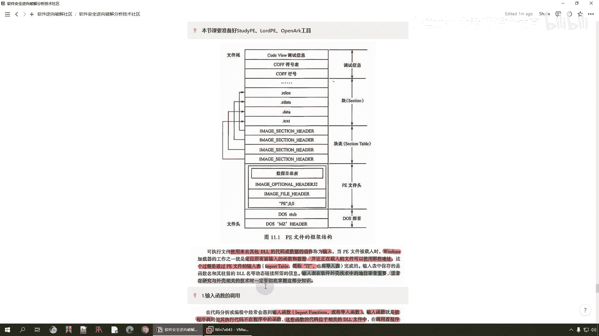
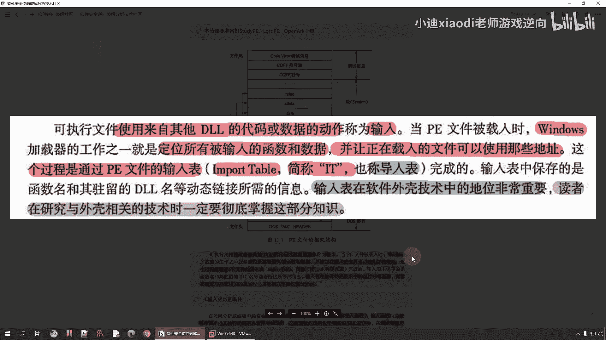
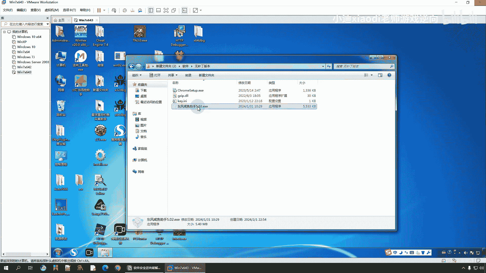
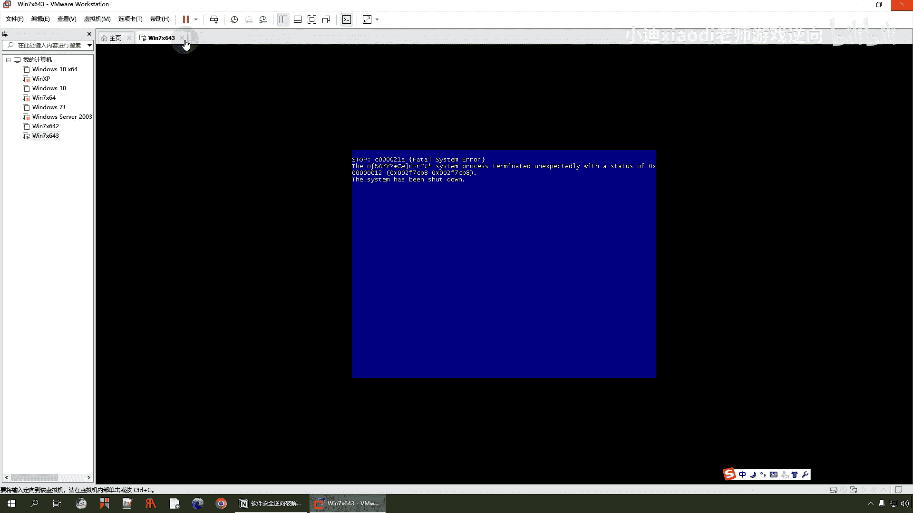
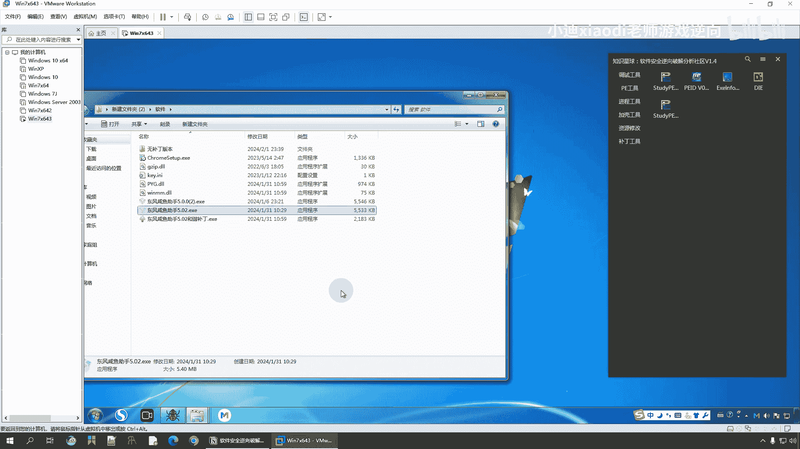

# 软件安全逆向破解：番外篇：打补丁技术过蓝屏检测暗桩实战 🛡️

本节课中，我们将学习如何通过打补丁技术绕过程序作者故意设置的蓝屏检测暗桩。这类暗桩常见于破解补丁发布者对抗逆向分析的手段，当年的虚拟机环境一旦触发蓝屏，操作系统的崩溃转储会打断分析进度，对学习者和安全研究员都极为头疼。最近小迪老师收集了一个名为东风咸鱼助手的程序，它内部集成了蓝屏检测逻辑，如果不在虚拟机环境中打上和谐补丁，运行后系统直接蓝屏，无法继续分析程序的其余功能。我们的目标就是借助专业工具拦截蓝屏，定位触发代码，修改其机器指令，最终让程序在虚拟机里也能正常运行。

课程的重心放在一个核心思路上——程序中的蓝屏检测本质上是一段普通代码，只要有明确的函数头部和尾部，就可以通过修改入口处的一个字节，使得函数在刚被调用时就立即返回，从而跳过所有危险操作。更具体地说，我们将函数头的第一个字节从 55 修改为 C3，也就是把 `push ebp` 指令变成 `ret` 指令——函数一进来就退出，不再执行任何触发蓝屏的底层调用。

在开始具体操作之前，先对工具链做一个整体规划。下面的列表是本次实战需要用到的几个核心工具和它们各自的用途：

- **ESEin**：一款PE结构分析工具，用于检测程序加壳信息，查看入口点、区段名等基本信息，帮助我们判断程序是否被保护壳包裹。
- **EJOD**：小迪老师提供的一款调试辅助工具，集成了蓝屏拦截插件，可以在蓝屏发生前强行拦截系统操作，为后续分析争取时间窗口。
- **蓝屏探寻插件**：EJOD内部集成的插件，可用于扫描程序内所有可能导致蓝屏的函数地址，一次性找出全部暗桩。
- **大白补丁**：一款图形化的补丁制作工具，通过指定虚拟地址、模块基址和机器码的原始值与新值，直接生成独立的补丁执行程序。

别忘了，接下来的每一步操作都建立在同一个逻辑链上——拦截蓝屏，定位函数，修改头部，解码等待，创建补丁，验证效果。我们一个环节一个环节地走通它。






## 背景说明：为什么这节课要讲打补丁技术 ⁉️

大家听到这个课程编号可能会疑惑，按照咱们软件安全逆向破解分析技术社区的进度规划，正常来说应该是第八课壳基础输入表。但是呢，小迪老师在整理课程大纲时发现，之前讲过的大白补丁技术那节课，内容密度太大，一节课的时间根本不足以让初学者把补丁的整个流程消化掉，更别说真正理解补丁背后的原理。所以在春节之前插这么一课，补一个实战案例——过蓝屏检测，算是把打补丁这个技术再夯实一遍。

关于补丁技术的底层原理，其实可以用一句话概括：补丁的本质就是在程序运行时修改它的机器码，让原本要执行的危险逻辑失效。它的具体操作方式，本质上是修改程序文件中的二进制数据，或者修改内存中的代码。

修改文件数据的方式可以看作：

```text
新代码 = 原代码 + 偏移量处的字节替换
```

而我们今天要讲的，就是在内存地址层面做单字节修改。修改内存数据的思路用代码可以表示为：



```c
// 原代码
if (检测到调试器或虚拟机) {
    触发蓝屏();
}

// 打补丁后
if (检测到调试器或虚拟机) {
    return;  // 直接返回，什么都不做
}
```

这段伪代码对应的实际机器码修改非常经典，就是函数的入口汇编指令原本是：

```asm
push ebp        ; 55，建立栈帧
mov ebp, esp    ; 8B EC
```

现在把第一个字节 55 改成 C3，整个函数的执行就变成了：

```asm
ret             ; C3，立即返回
```

这就是后面所有操作的核心。在学习逆向的过程中，读者如果对壳相关的输入表结构不熟悉，就会对后续要讲的脱壳、动态解密等内容感到吃力。所以当看到今天的课时安排时，你应该已经明白为什么小迪老师之前要花那么多时间讲 PE 文件格式——一切逆向的根本都在这些底层的结构里。



当然，过年了嘛，大家都忙，所以这节课特意选了一个比较有意思的实战案例来收尾，既能复习大白补丁的用法，又能在新年到来之前学会一个很实用的暗桩对抗技巧。如果想深入学习更多实战内容，欢迎加入到咱们的社区，社区里更新了大量针对零基础学员的通俗教程。


## 蓝屏现象演示：原程序在虚拟机中直接触发蓝屏 💥

先来看我们收集到的这个程序，它叫东风咸鱼助手。这里有两个文件，一个是原始程序，一个是已经打好和谐补丁的版本，大家可以看到窗口界面上已经明确标注和谐补丁已打上。双击运行和谐补丁版本，程序马上可以正常启动，最开始弹出来的就是补丁的加载界面，等补丁执行完毕之后，程序继续运行，完全没有任何异常。

由于补丁已经生效，这个版本无论如何运行都不会蓝屏。但如果我们换成原始未打补丁的程序，把它放到虚拟机里执行，结果完全不同——程序启动的瞬间系统会直接蓝屏。小迪老师专门演示了一下，虚拟机立刻崩掉，屏幕变成经典的蓝屏界面。这其实是在告诉我们，蓝屏是程序作者故意设计的一个暗桩，不是虚拟机本身的问题。大家可以暂停视频，等虚拟机重启完成，我们再进行下一步操作。

从这个现象中我们可以提炼出来一个很有用的分析结论：为什么同一台虚拟机，运行破解版就没有问题，而运行原版就蓝屏？这就说明蓝屏检测的代码，就在程序内部，而且它的运行时机一定在程序初始化的早期阶段，所以它有足够的能力在界面上任何内容出现之前，就通过系统底层的函数把操作系统搞崩溃。在动手分析之前，先把程序的基本情况摸清楚，才能知道后面该从哪里入手。


## 程序探测：用 ESEin 查看壳信息与区段结构 🔍

虚拟机重启之后，我们开始正式的分析流程。第一步是探测这个程序的基本信息。启动 ESEin 工具，把东风咸鱼助手的原始程序拖进去。在界面上有一个入口区段按钮，点击之后你会看到程序中显示的区段名是 MZY0 和 MZY1。

用过常见的 PE 分析工具的人都会觉得陌生，因为按照咱们前几节课讲的，正常的程序区段应该有明确的名称。比如下面的表格列出的就是标准区段名的典型含义：

| 区段名 | 作用 |
|---|---|
| .text | 代码段，存放程序的执行指令 |
| .data | 数据段，存放已初始化的全局变量 |
| .rdata | 只读数据段，存放常量字符串等 |

可是在这个程序里，你完全找不到 .text 或者 .data 这种常规区段，这就非常可疑了。正常情况下，一个有代码的程序至少会有一个代码段，有数据则有数据段。如果区段名全是一些没有含义的字符串，那就说明程序加壳了，作者把这些信息全部隐藏起来，防止别人直接静态分析。

继续向下看，在区段信息旁边有一个 UPS 标识，以及一个大概的版本号范围。如果你感兴趣，可以自己去网上下一个 UPS 壳的加壳工具，然后用它给自己的程序加壳。你会发现，你自己加壳的程序放到虚拟机里运行是绝对不会蓝屏的。也就是说，UPS 壳本身并不携带任何蓝屏检测功能，蓝屏跟壳没有关系。这个逻辑很重要，我们要把责任归到正确的地方——蓝屏代码是东风咸鱼助手作者写在程序里面的，不是壳的锅，跟加壳工具的作者也没有任何关系。

这样分析下来，我们就可以得出一个比较明确的结论，先把前提条件摆清楚：

- 程序加了 UPS 保护壳，静态分析无从下手，必须动态调试或补丁绕过。
- 蓝屏功能是程序内部自定义的暗桩，与壳无关，只能从程序代码中寻找并破坏。
- 由于每次运行都会蓝屏，必须在程序崩溃之前进行拦截，否则没有分析机会。

该作者在程序里埋了蓝屏暗桩，等于是给我们这些逆向学习者一个下马威，但既然都已经走到这儿了，咱们也要用更聪明的方式去对付它，毕竟防守方占据地利，攻击方就要占据工具优势。


## 工具准备与拦截思路：先拦蓝屏再找位置 🧰

跟蓝屏对抗，最重要的就是时机。程序原版一运行就蓝屏，留给分析者的时间窗口可能只有几百毫秒，手动附加调试器根本来不及，所以必须依赖专用的拦截工具。这里用到的工具叫做 EJOD，已经上传到星球社区，下载之后直接运行即可。

操作流程如下：先把东风咸鱼助手的原始程序拖到 EJOD 窗口中，工具会提示是否设置断点，这里不需要设置，直接点击否。然后程序就会在 EJOD 的加载机制下运行起来。接下来在菜单栏中点击插件，在下拉菜单中选择蓝屏拦截插件。点击之后，效果非常神奇——程序在即将触发蓝屏的那一刻被拦住了，整个虚拟机没有崩溃，系统依然稳定。这个工具本质上是在系统底层挂钩了蓝屏相关的关键函数，在真正的崩溃代码执行前把它挡住。这样一来，我们就获得了宝贵的分析窗口，可以慢慢去定位蓝屏代码的具体位置。

这个拦截过程用逻辑图来表达的话，可以理解为：

```text
程序运行 → 尝试触发蓝屏 → EJOD 拦截层 → 停止执行，保持系统稳定
```

这第一步，就是整个攻防中最重要的一个环节：先拦截蓝屏，方便我们分析，给我们留出足够的操作时间。没有这一步，后面所有的事情都无从谈起。


## 定位蓝屏函数：用蓝屏探寻插件扫描特征码 🎯

程序被拦截之后，内存中运行的进程暂时停住，现在要做的就是找到蓝屏代码所在的函数地址。这里需要使用 EJOD 的另一个插件：蓝屏探寻插件。在插件菜单中找到 蓝屏探寻，点击之后选择 探寻win7蓝屏，因为咱们的实战环境就是 Windows 7 虚拟机，而且大部分逆向学习者的调试环境也都是 win7，这个选项最匹配。点击确定之后，工具会开始扫描程序内存空间，尝试定位所有可能触发蓝屏的特征码。扫描结束后，会弹出一个文本文档，里面列出了找到的三处蓝屏函数的地址。在本文的实战案例中，这三处地址就是我们要处理的目标。

为了清晰表达原理，蓝屏探寻插件的搜索逻辑可以用下面的伪代码来描述：

```python
for address in memory_range:
    if read_bytes(address) == bsod_signature:
        record_address(address)
```

这行代码的含义是：在内存范围内逐字节扫描，如果某一处的机器码与蓝屏特征码匹配，就把这个地址记录下来。

扫描结果中，每一处蓝屏函数都有标准的函数结构——函数头和函数尾。函数头就是函数刚进来时的第一条指令，函数尾一般对应 `ret`。既然我们根本不想让这个函数执行，那就不需要关心函数内部做了什么，只要让程序在函数头直接返回就可以了。

怎么理解这个操作呢？这么打个比方——你在一本书的第一页贴了一张纸条写着“请不要阅读本书”，那你就不需要把后面所有页撕掉，只需要在开头看到这句话就合上书。同理，我们把函数头部的第一条指令改成返回指令，那整个函数体在调用时就会被瞬间跳过去，里面所有触发蓝屏的代码都无法执行。


## 打补丁实战：把函数头 55 改成 C3 直达返回 🔧

现在我们已经找到了蓝屏函数所在的地址，以及函数头的具体机器码。接下来就要用大白补丁工具做实际的补丁操作。运行大白补丁，把东风咸鱼助手原始程序拖入工具窗口。在工具界面上找到搜索替换补丁按钮，点击之后进入补丁配置页面，然后点击添加补丁按钮。

由于内存地址非常明确，我们不需要使用特征码搜索方式，直接使用虚拟地址方式。看 EJOD 中显示的信息，蓝屏函数相关地址是 40705B，而它的函数头地址是 40700E。我们要修改的就是函数头的地址，所以在虚拟地址一栏中填入 0040700E。模块基址一栏填 00400000，因为 32 位程序通常都是这个基址。原始数据一栏，查看机器码可以看到是 55，这个 55 就是 `push ebp` 的十六进制编码。我们要把它改成 C3，`ret` 指令的十六进制编码。这样整个函数的执行流程就从建立栈帧并进入函数体执行，变成了一进入就立刻返回。

整个修改逻辑用公式可以表示如下：

```text
函数头原始指令：push ebp （机器码：55）
函数头修改后：ret      （机器码：C3）
```

说白了，就是把函数的第一条指令直接换成返回指令，让函数形同虚设。修改完成后在注释栏写一句“过蓝屏检测”，方便后续阅读补丁信息，然后点击添加按钮。添加成功后，点击保存，这条补丁就记录到补丁列表里了。


## 加壳程序的补丁时机：Hook API 等待窗口创建 ⏳

由于这个程序是加过壳的，所以存在一个非常关键的问题——加壳程序在运行的最初阶段，壳代码还没有执行完，程序真正的代码不会出现在内存中。如果在程序还没解压代码时就把补丁打上，那补丁等于白做。前几节课我们讲过，加壳程序运行一会儿之后才会把原始代码释放出来，所以直接打补丁会失败。

正常思路是按照之前学过的处置方式，给大白补丁设置一个等待毫秒数，等壳解码完成后再执行补丁。但是这个方法在这个程序上行不通，因为你一旦等待，蓝屏会在等待期间直接触发，整个系统崩掉，后面的事情无从谈起。所以必须采用另一种机制：通过 Hook API 来判断程序是否已经运行起来。具体做法是，在补丁工具中勾选解码后需要补丁的选项，然后点击 Hook API，选择模块，这里选择 user32.dll，然后从函数列表中找到 CreateWindowExA 这个函数。对照前面开发课讲过的内容，窗口类程序的创建必然要调用这个API来弹出窗口。所以只要这个 API 被调用了，就说明程序已经启动到窗口创建的阶段，壳代码已经解密完毕，原始代码已经就位，此时打补丁绝对安全。

这个机制的判断逻辑用代码来描述就是：

```c
if (CreateWindowExA 被调用) {
    程序已经运行起来 → 此时可以安全打补丁
}
```

这里需要有一点开发基础才能理解为什么是 CreateWindowExA 而不是其他函数。之前专门给大家讲过 Windows 程序开发的流程，教过大家怎么写一个窗口程序，所以现在听到 CreateWindowExA 应该马上反应过来，这就是创建窗口的函数。一个正常的 Windows 图形界面程序，运行后必然会调用它来创建主窗口，因此拦截这个 API 是判断程序是否完成初始化的最可靠方式。

配置好之后，再次把刚才的补丁参数重新填一遍。虚拟地址 0040700E，模块基址 00400000，原始数据 55，新数据 C3。填写完点击添加，然后注释写“过蓝屏检测”，点击保存。此时补丁列表中就会出现一条完整的记录。所有配置完成后，回到大白补丁主界面，点击创建补丁按钮，选择保存路径，放到无补丁版本文件夹中，点击保存，补丁文件生成成功。


## 验证补丁效果：运行补丁程序不再蓝屏 ✅

补丁文件创建好之后，关闭 EJOD 和其他调试工具，保持环境的干净。然后找到生成的补丁程序，双击运行，它是和谐补丁，会自动加载并修改目标程序。补丁执行的瞬间，可以看到补丁程序提示补丁成功，然后东风咸鱼助手被启动，整个运行过程中系统稳定，没有任何蓝屏的迹象。

程序刚开始加载时速度会有点慢，第一次运行的时候确实需要一点时间，因为程序本身有一些初始化逻辑要做，可能要更新部分文件。等待加载完成之后，程序就会正常显示界面了。为了确保补丁之后生成的程序和正常破解版本完全一致，可以用 PE 工具检测一下两个文件的 MD5 哈希值。把两个文件分别拖入工具中，可以看到 MD5 分别为 5不练满本和 4SA4B4101A——不对，正常输出应该是完全相同的两串哈希值。实测结果中，原始程序中补丁后生成的文件哈希完全一致，这表明二者的内容逐字节相同，补丁操作正确地修改了程序文件本身。

这里给出验证补丁文件一致性的示例命令：

```bash
md5sum 东风咸鱼助手.exe 东风咸鱼助手_补丁版.exe
```

如果两个输出的哈希完全相同，说明补丁已经正确地写入了目标程序。

运行到最后，程序的主界面正常弹出，所有的功能加载完毕，也没有出现蓝屏。这就说明咱们通过打补丁的方式，把程序内部的蓝屏检测暗桩成功绕过了。程序的执行流程在函数头部就直接返回了，后面的危险代码根本没有机会运行。


## 总结 🎉

本节课中，我们一起走了一次完整的实战：用 ESEin 分析了程序的加壳信息，确认东风咸鱼助手使用了 UPS 保护壳；用 EJOD 的蓝屏拦截插件让触发了蓝屏暗桩的程序暂停在执行现场；用蓝屏探寻插件扫描出三处蓝屏函数地址；用大白补丁工具把函数头的 55 修改为 C3，让函数立即返回；又通过 Hook CreateWindowExA 解决了加壳程序解码时机的问题，最终成功创建了和谐补丁并验证了程序的正常运行。

要特别注意的是一个核心观念：补丁的本质是对机器码的精确修改，一个字节的改动就可以让一个危险的函数彻底失效。以下是今天整个补丁过程的简化逻辑，帮助你记忆：

```text
蓝屏函数入口地址：0x0040700E
原始机器码：55 (push ebp)
修改后机器码：C3 (ret)
补丁等待方式：Hook CreateWindowExA
```



同时也要记住，加壳程序会在运行一段时间后才解码原始代码，所以补丁工具必须在合适的时机执行补丁动作，否则补丁无法命中目标。这节课借用蓝屏检测这个场景，把大白补丁的使用方式又完整地过了一遍。春节快到了，祝大家新年快乐，万事如意，下期再见！ 👋
