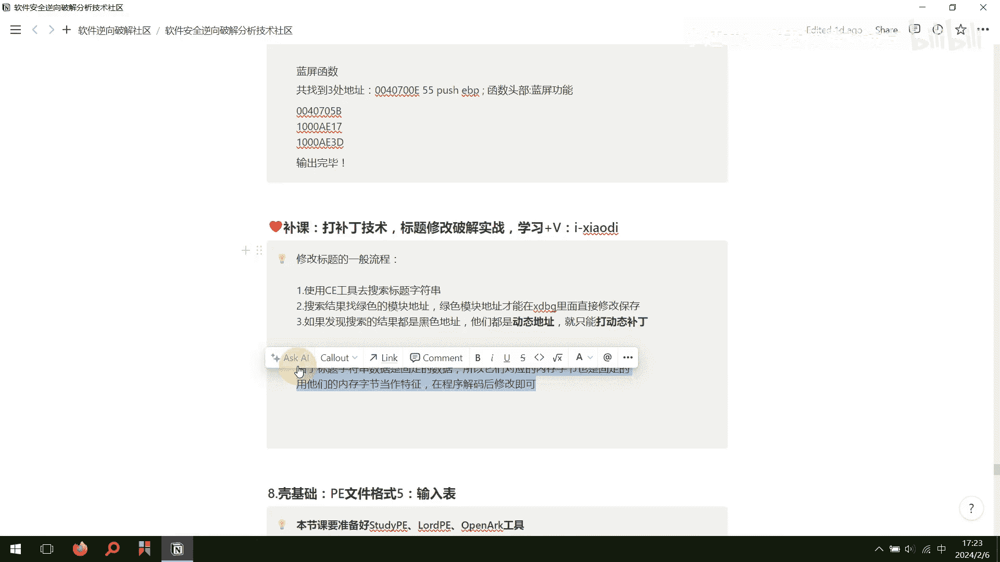
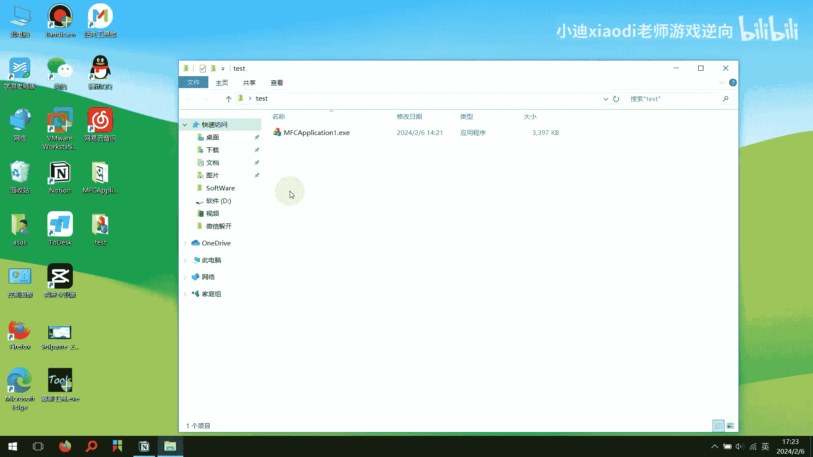
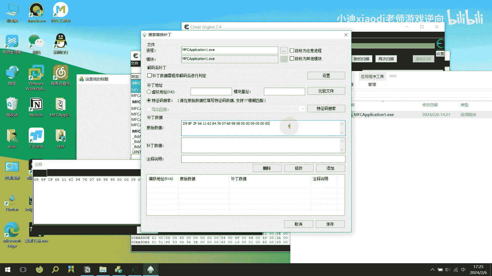
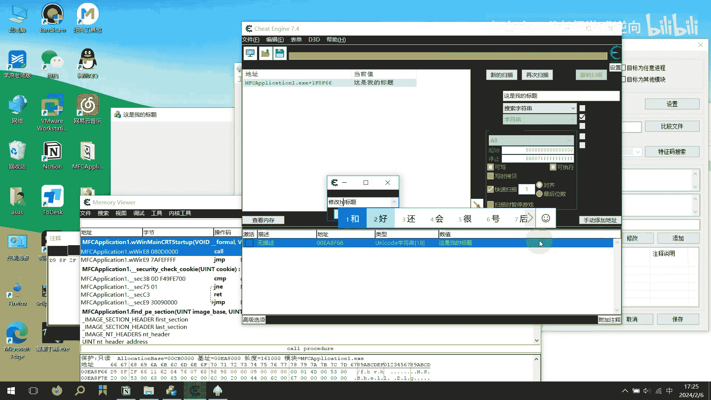
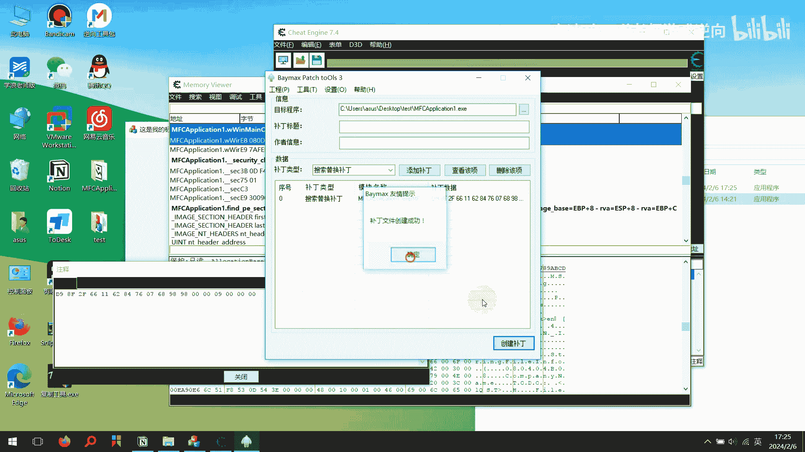
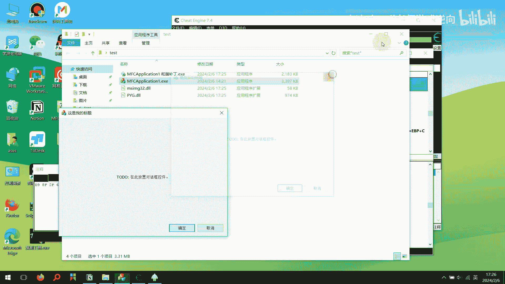
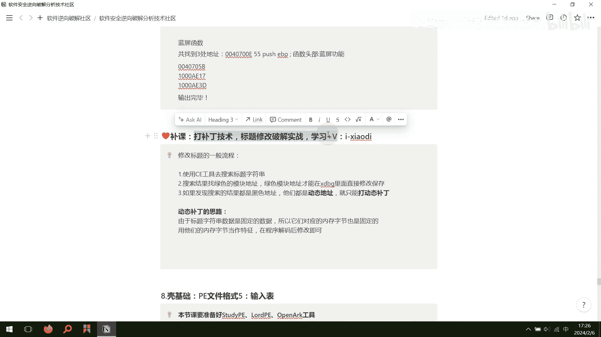

# 🔧 小白软件安全破解反汇编逆向工程师：第六章：补课2：打补丁技术与标题修改破解实战

大家好，我是小迪老师。学习软件安全，就找小迪老师。今天这节课是《软件安全逆向破解分析技术》第六章“高级进阶逆向分析技术”的第二次补课，主题是打补丁技术与标题修改破解实战。

在本节课中，我们要把上节课讲过的打补丁技术应用到标题修改上。我们会先回顾修改标题的一般流程，然后解释动态补丁为什么能生效，最后用“大补丁”工具完成一次真正的标题修改破解。内容不复杂，但每一步都非常实用，新手也能跟着做下来。

## 一、从旧知识引入：打补丁技术能做什么？

在上一节课中，我们已经知道，打补丁技术可以用于过检测，也可以过蓝屏检测。换句话说，补丁就是针对程序二进制内容进行定向修改的手段。今天我们来讨论它的另一个典型应用：标题修改破解。

### 1.1 修改标题的一般流程

修改标题的常规步骤其实很固定。不管是什么程序，大体上都逃不出下面这几步：

1. 使用 CE 工具搜索目标标题字符串。
2. 观察搜索结果里的地址颜色：
   - 绿色地址是静态地址，可以直接在 x32dbg 或 x64dbg 里修改并保存。
   - 黑色地址是动态地址，没办法直接保存，只能打动态补丁。
3. 如果只能拿到动态地址，就使用“特征码 + 替换”的方式制作补丁。


这里最核心的概念是静态地址和动态地址的区别。静态地址固定不变，改完就能直接写进文件；动态地址每次运行都可能变化，所以不能直接保存修改。对于动态地址来说，唯一的办法就是打动态补丁。

### 1.2 为什么动态补丁能生效？



为什么动态地址不能保存，却可以用补丁来改呢？思路其实很简单。标题字符串数据是固定数据，字符串内容不会变化，所以它们对应的内存字节也是固定的。把这些固定字节当作特征，程序解码后，我们就可以在内存中定位到它，然后修改它。

用大白话说，标题在内存里留下的“指纹”是固定的。我们只要在内存中按这个指纹去找人，找到以后把原来的字节改成新标题的字节就行。用公式表达就是：



```
特征码 = 原始标题字符串对应的内存字节序列
补丁操作 = 用新标题字节序列替换内存中匹配到的特征码
```

也就是说，动态补丁并不是修改文件里的某个固定偏移，而是让程序运行起来之后，再根据特征码去找到目标内存并完成改写。

## 二、实战：用大补丁修改程序标题

理论说完了，下面进入实战。我们准备一个实验程序，程序运行后显示的标题是“这是我的标题”。这个实验程序不需要多复杂，随便拿学习社区里的一个程序来练习就可以了。

### 2.1 用 CE 搜索标题字符串

首先运行实验程序，确认窗口标题是“这是我的标题”。然后打开 CE 工具，选中目标进程，把扫描类型改成“字符串”，输入“这是我的标题”。

直接搜索可能搜不到。遇到这种情况不用慌，可以依次尝试以下操作：

- 勾选 UTF-8 选项，再搜索一次。
- 如果还是没有结果，就调整一下界面上的“W”选项；这个选项和可写内存相关，如果标题字符串位于只读区域，默认过滤条件可能会把它漏掉。
- 再勾选 UTF-16 选项，继续搜索。

这些选项其实是在告诉 CE 用什么样的编码来解释字符串。程序可能使用 ASCII、UTF-8 或 UTF-16 中的某一种来存储标题，所以多试几种编码就能命中。本实验中，最后就是通过 UTF-16 搜索拿到了地址。

找到地址后，鼠标右键选择“浏览相关内存区域”，就能直接跳到字符串所在的位置。在这次的例子里，我们来到了 F66 这个位置。可以看到，这段标题数据一共占 18 个字节。按照“09 后面跟着 3 个 0”的样子来观察，这就是标题字符串在内存中的原始存储形态。

接下来，把这段原始字节数据复制到剪贴板，然后在 CE 中点击“附加注释”，把数据粘贴进去。这样做的目的是拿到干净的原始字节序列，为后面制作补丁做准备。



### 2.2 在大补丁工具中制作补丁

现在打开“大补丁”工具，把实验程序直接拖进工具窗口。选择“搜索替换补丁”，点击“添加补丁”。



在补丁设置界面，先把刚才复制的原始数据粘贴到“原始数据”一栏。接着修改标题，把“这是我的标题”改成“修改后的标题”，点击确定。工具会自动生成修改后的字节数据。

选中生成的新数据，鼠标右键复制，再把这份最新字节粘贴到“替换数据”一栏。你会看到原始数据和替换数据之间存在明显差异，这个差异正是标题被改变的本质。

接下来，先不勾选“解码”选项，直接点击“添加”。然后点击“保存”，在补丁启动方式里选择“补丁启动不弹窗”，接着点击“创建补丁”，把补丁保存到指定文件夹。保存成功后，运行补丁。

### 2.3 验证补丁效果



运行补丁后，可以看到补丁注入成功。再启动实验程序，窗口标题已经变成了“修改后的标题”。原程序的标题是“这是我的标题”，现在变成了“修改后的标题”，说明修改完全生效。

这个方法几乎适用于所有程序。不管是游戏、软件还是其他可执行文件，只要标题字符串在内存中是以固定字节存在的，都可以用同样的思路去改。

## 三、总结



本节课中，我们一起回顾了打补丁技术的用途，也完成了标题修改破解的实战操作。需要记住的核心要点如下：

1. 绿色地址是静态地址，可以直接保存修改；黑色地址是动态地址，只能打动态补丁。
2. 标题字符串对应的内存字节是固定的，因此可以作为特征码。
3. 使用“搜索替换补丁”工具，把原始数据替换成新数据，就能实现标题修改。



可以说，我们之前学过的标题修改技巧，今天升级到了“大补丁”工具的基础上，让修改不再局限于静态地址。本期内容就到这里，我是小迪老师，我们下期再见。
