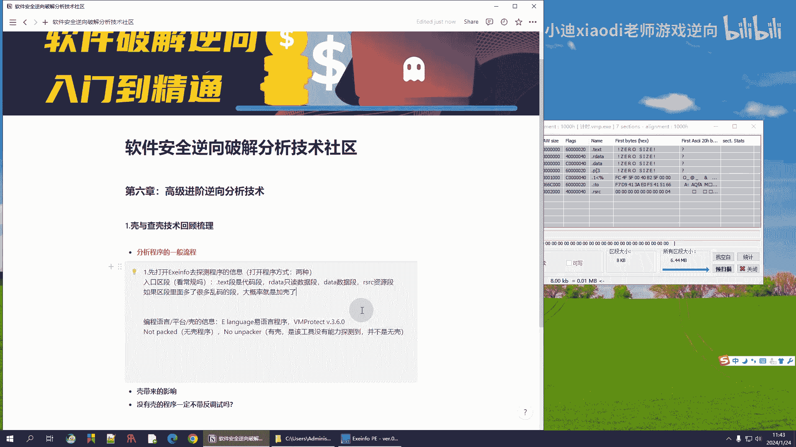
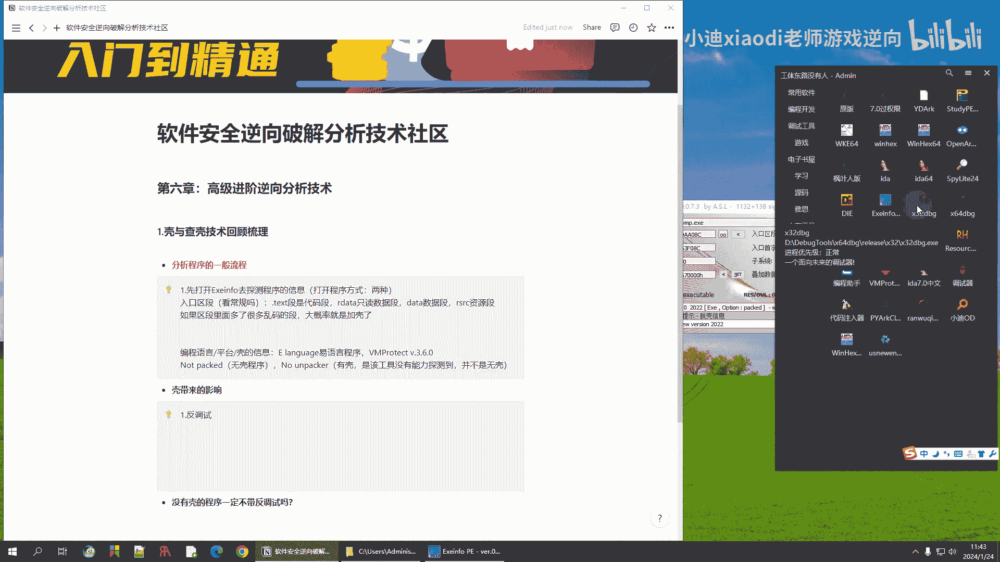
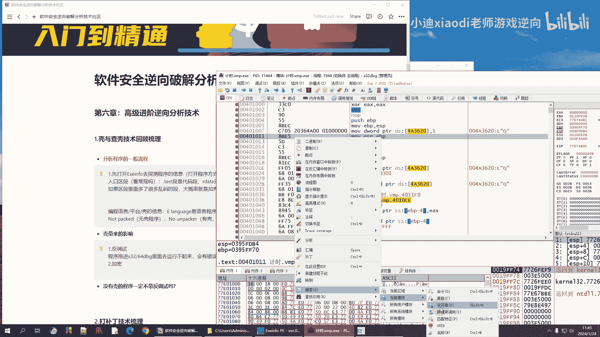
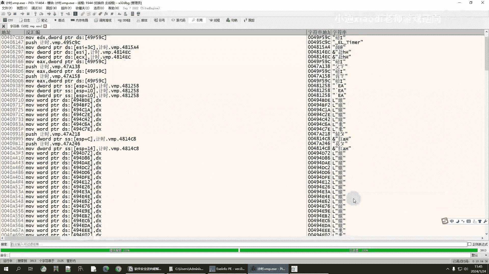
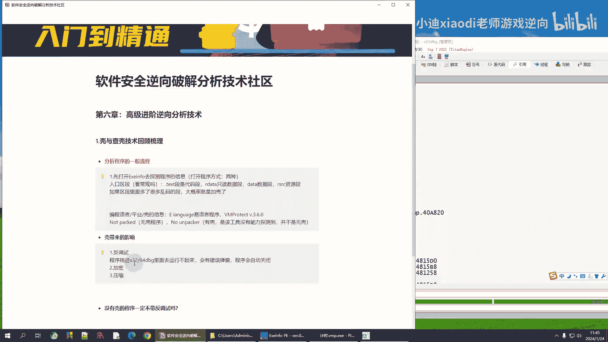
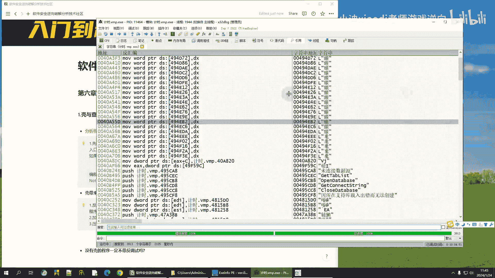
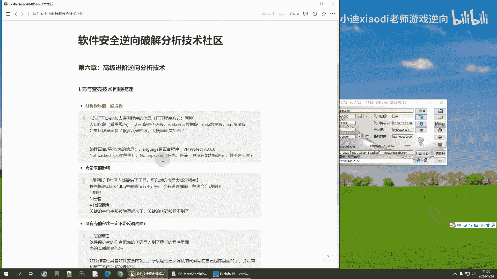

# 小白软件安全破解反汇编逆向工程师2024最新：第六章：壳与查壳技术回顾梳理与程序分析方法

  

在本节课中，我们将要学习高阶逆向分析技术中的壳与查壳技术。主要内容包括三个部分：第一部分是分析程序的一般流程，也就是拿到一个程序之后，正确的分析步骤应该是什么；第二部分是壳带来的影响，我们之前虽然接触过壳的概念，但今天会做一个整体的归纳；第三部分是回答一个很多同学都疑惑的问题：没有壳的程序一定不带反调试吗？带着这三个问题，我们开启第六章的学习。

  

## 一、分析程序的一般流程

  

拿到一个程序之后，应该怎么去分析呢？这里我们先整理一个总体的思路。首先，第一步要做的，就是打开一个叫 EXEin 的工具去探测程序的信息。EXEin 是一个查壳非常好用的工具，在之前的课程中我们也经常提到它。这个工具在工具包中都有，同学们可以自行找到。

  

打开 EXEin 之后，有两种方式去加载程序。以下是这两种打开方式的具体说明：

  

- 第一种方式是直接将程序文件拖入到 EXEin 的窗口中。比如我们这里用“计时点EE”这个程序来演示，直接拖过去即可。
- 第二种方式是点击界面上的文件夹按钮，通过文件选择对话框来打开程序。这个按钮在界面上很明显，点开后找到目标程序并打开就可以了。

  

注意，EXEin 不仅可以探测 EXE 程序，也可以探测 DLL 程序。所以无论是可执行文件还是动态链接库，都可以用这个工具来查看信息。

  

程序加载进来之后，我们需要观察几个关键部分。实际上要观察三个部分：入口区段、语言信息、以及区段列表。我们先来看最下面的位置，这里显示的是“notote packet”。如果提示的是“notote packet”，那就说明这是一个无壳程序，也就是没有加壳的程序。记住这一点，它是一个无壳程序。

  

然后再往上看，上面那一栏显示的是语言信息，也就是这个程序是用什么编程语言开发的，或者说是在什么编程平台上开发的。编程语言或平台的信息，我们需要记录下来。再往上看，可以看到入口区段是“点test”。点test段是什么段呢？点test段就是代码段，存放代码的段。

  

接着点击界面上的某个位置，就会看到四个区段。这四个区段如果你感到熟悉，说明前面的课程内容学得不错；如果感到陌生，建议回头去看看汇编程序开发的那部分内容，这些都在我们社区中。以下是常规程序必备的几个区段及其作用：

  

- 点text段：代码段，存放程序的机器指令。
- 只读数据段：存放只读的数据，比如常量字符串。
- 数据段：存放可读写的全局变量等数据。
- 资源段（RSRC段）：存放资源，比如窗口界面、图片等。

  

回顾一下什么是资源。资源就是窗口的界面，比如这个窗口界面、这个图片，它们都属于资源的一部分。所以这就是常规的代码段。因此，我们看入口区段的常规与非常规，看到上面这些常规区段，就知道这是一个健康的程序必备的段。

  

再看一下编程语言信息，这里显示的是“E language”。E language 是什么呢？E language 就是易语言，这个程序是用易语言开发的，易语言是一个中文编程工具。你可以去百度搜一下“易语言”就能找到。它后面还有一个网址，这个网址是开发工具的网址，这些信息都会显示在 notote packet 中。记住，notote packet 表示无壳程序。

  

我们再来看另一个程序，这个程序是加了壳的。拖过来之后，如果加了壳，这边就会提示一个壳的名称，比如“VIP3.0”。这时候第二栏显示的就是壳的信息，而不是开发语言的信息。这个东西就是一个保护壳，比如 VMP 保护壳。然后再看下面，它显示的是“no unpacker”，但这并不是说无壳。注意，no unpacker 的意思是它的信息库、数据库中没有这个壳的特征，找不到匹配项，可能是因为这个壳比较新，或者经过了一些修改。所以 no unpacker 并不是无壳，而是该工具没有能力探测到。反过来想，常规的编程平台就那么一些，这个工具已经做得很强大了。凡是一个正常的程序，它都能探测出编程语言。如果能探测出编程语言，那也能探测出有没有壳，因为用编程语言开发出来的原版程序就是无壳的。如果它提示 no unpacker，大概率是有壳但探测不到，而不是无壳。

  

然后再看入口区段，点击一下，你会发现有常规的点text、点idata、点data、点rsrc这些段，但同时也多出几个乱码一样的段。如果你发现一个程序多出了乱七八糟的区段，就可以猜测它大概率是加了壳，里面肯定有东西了。所以这里总结一下：如果区段列表里面多了很多乱码的段，那大概率就是加壳了。这就是分析程序的一般流程：先打开 EXEin，然后查看有没有壳，再看入口区段以及区段信息。

  

## 二、壳带来的影响

  

接下来我们说说壳带来的影响。壳能带来哪些影响呢？这里总结为四个主要影响。首先是反调试。什么是反调试呢？我们打开一个程序，再打开调试器，比如 x32dbg 或 x64dbg，把程序拖进去运行。如果程序能直接拖进去并运行起来，说明这个程序没有反调试，或者说反调试做得不到位。反调试会造成一个现象：程序拖进调试器后运行不起来，弹出一个错误提示。如果有错误弹窗，那就是有反调试，程序会进一步自动关闭。程序自动关闭了，我们就没有办法继续分析了，这就是反调试对我们分析的阻碍。

  

第二个影响是加密。加密可以怎么理解呢？我们可以在调试器中搜索字符串，比如点击“符号”或“字符串”选项，搜索当前模块的字符串。如果搜索字符串时发现不了关键信息，里面基本上看不到有用的信息，那就是被加密了。关键字符串都被隐藏起来了。

  

第三个影响是压缩。压缩和加密差不多，压缩之后，关键的信息、关键的字符串也都看不到，全部被隐藏起来了。所以加密和压缩有点像，都是把关键字符串隐藏起来。

  

第四个影响是代码混淆。有一些程序的代码段会变成乱码，乱七八糟的东西，你直接看根本看不出来它是干什么用的。比如你看到“DECCECSRNC”这样的内容，你觉得这正常吗？不正常。代码会被混淆，关键代码都看不到了。这就是壳带来的四个主要影响。

  

对于反调试，我们社区内部提供了工具，可以对抗市面上一大部分强壳。对于压缩壳，后面的课程会讲到如何去解压，也就是如何脱壳。对于加密和代码混淆，后面也会讲如何从加密和代码混淆中找到关键信息，并利用这些关键信息把程序破解掉。反调试很重要，所以我们有工具来应对。如果你真的想学习这门技术并掌握它，确实需要一个强大的工具，欢迎大家加入我们的学习社区。

  

## 三、没有壳的程序一定不带反调试吗

  

最近有一个问题很多同学感到疑惑：没有壳的程序一定不带反调试吗？我们来讲解一下。首先，要想到壳的原理是什么。壳的原理是：软件保护壳的作者，把壳的代码写入到我们自己的程序里面。软件保护壳本身是一个程序，它实际上是把一些代码写入到我们的程序中，让壳的代码和我们的程序融为一体，这就是壳的原理。所以壳的本质是什么？壳的本质就是代码。

  

既然壳的本质是代码，那么有些软件的作者是不是可以把代码直接写在自己的程序里面呢？当然可以，它不需要加壳。市面上有一些壳属于第三方的壳，但软件作者完全可以把保护代码、检测调试器的代码直接写在自己的软件里面。如果这个软件作者具备软件安全的功底，那么他就可以把反调试的代码写在自己的程序里，而不去加第三方外部的保护壳。所以，没有壳的程序不一定就不带反调试，不一定就没有加密，不一定就没有混淆。没有壳的程序照样可以具备那些东西。

  

因此，没有壳的程序就一定那么好破解吗？不一定。如果软件作者具备软件安全的功底，他完全可以把这些保护代码写在自己程序里，给你造成一些难度上的误解。所以，大家不要以为没有壳就万事大吉了。

  

## 总结

  

本节课中，我们一起学习了三个重要内容：第一，分析程序的一般流程，也就是用 EXEin 工具查看程序是否加壳、入口区段是否常规、编程语言信息等；第二，壳带来的影响，主要包括反调试、加密、压缩和代码混淆，这些都会阻碍我们的分析；第三，没有壳的程序不一定不带反调试，因为软件作者可以把保护代码直接写在程序内部。通过这节课的梳理，希望大家回去之后自己好好整理一下这些知识点。下一节课，我们将继续梳理打补丁技术。之前我们讲过打补丁技术，它主要应用在有壳的程序中，因为有壳的程序无法直接在调试工具里保存代码和数据，所以需要通过外部的补丁工具来处理。好，今天的内容就到这里，我们下次再见。
