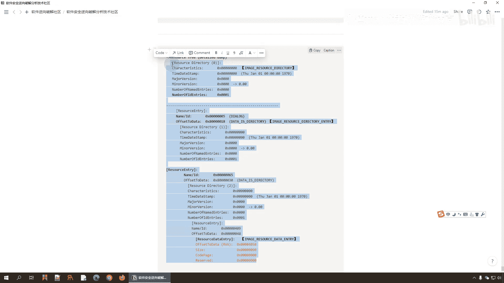

# 🔐 小白软件破解反汇编逆向安全工程师2024最新：12.壳基础：PE文件格式9：资源，资源表解析

## 📖 课程说明与概述


大家好，我是小李老师。学习软件安全逆向破解技术可以跟随本课程。目前加入学习有优惠：基础版社区199元，高级版社区249元。高级版相比基础版增加了C语言Windows程序开发内容，包括C语言和Windows程序界面开发；毕业设计是游戏辅助开发，物美价廉。现在加入学到就赚到。广告到此结束，下面进入本节课正文。

本节课我们学习第六章“高级进阶逆向分析技术”中的第十二课：壳基础——PE文件格式9之资源与资源表解析。我们会从资源的概念入手，说明资源在PE文件中的位置，介绍资源表的树状目录结构，给出核心数据结构，并通过一个实验程序完整走一遍从资源目录到资源数据的解析流程。学完以后，你应该能够独立手动解析一个简单PE文件的资源表。

## 🖼️ 什么是资源？

Windows程序的各种界面统称为资源。例如，对话框、位图、图标、菜单等，这些都属于界面，也统统都是资源。可以这样理解：只要程序运行后你能看到的可视化元素，基本都属于资源范畴。

资源部分在PE文件的所有结构中是最复杂的，但它仍然是一种结构，而且与其他结构有相似之处。不必担心，讲解到最后你会豁然开朗，甚至有柳暗花明的感觉。资源也像其他结构一样，以类似表格的形式存放。导入结构有导入表，导出结构有导出表；资源的存放结构则称为资源表（Resource Table）。资源表非常重要，因为它存储了程序的图标、位图、字符串以及各种UI元素。有了这些资源，程序才能更漂亮、更人性化。

## 🌳 资源表的树状目录结构

资源表的结构有点像Windows资源管理器中的目录：这里有一个节点，节点下面还有很多子节点；一个节点可以继续展开，再展开。一层层看下去，就像一棵树，树枝不断分叉。因此，资源表是一个树状结构。


这个树状结构一共有三级，你只需要记住三层就可以了。第一层是资源类型层，第二层是资源名称层，第三层是资源语言层。这些术语不需要一开始就扣得太细，看完后面的实例自然就明白了。

另外，每个资源最终都会指向一个资源数据条目。这个条目中包含资源内容、资源大小以及其他元数据。换句话说，无论目录在前面怎么嵌套，拆到最后一定会找到一个资源数据。

## 📂 资源在PE文件中的位置与访问方式

资源数据存储在PE文件的资源段中。之前我们经常提资源段：.text是代码段，.rdata是只读数据段，.data是数据段，而RSRC就是资源段（Resource）。程序如果想要访问资源，开发者可以通过Windows API完成。例如FindResource用来查找资源，LoadResource用来加载资源。在逆向过程中，我们可以对这些API函数下断点，以便观察程序对资源的访问。资源访问相关函数还有很多，可以自己搜索学习。

## 🧩 核心数据结构

资源表中所有目录和条目都由结构体定义。Windows中各种对象几乎都可以用结构体描述，资源表也不例外。掌握以下三个结构是解析资源表的关键。


### IMAGE_RESOURCE_DIRECTORY

资源类型这一层使用的结构叫IMAGE_RESOURCE_DIRECTORY，中文可称为资源目录结构。它的长度固定为16字节，共有6个字段。

```c
typedef struct {
    DWORD Characteristics;
    DWORD TimeDateStamp;
    WORD  MajorVersion;
    WORD  MinorVersion;
    WORD  NumberOfNamedEntries;
    WORD  NumberOfIdEntries;
} IMAGE_RESOURCE_DIRECTORY;
```

其中最后两个字段比较重要。NumberOfNamedEntries是使用名字的资源条目个数，NumberOfIdEntries是使用ID数字的资源条目个数。两者相加就是当前目录下所有资源条目的总数。

```text
TotalEntries = NumberOfNamedEntries + NumberOfIdEntries
```

### IMAGE_RESOURCE_DIRECTORY_ENTRY


资源目录中的每一个节点都由一个IMAGE_RESOURCE_DIRECTORY结构以及紧随其后的若干个IMAGE_RESOURCE_DIRECTORY_ENTRY结构组成。到底有多少个ENTRY，由前面计算出的资源条目总数决定。这个ENTRY结构只有两个字段，共8字节。

```c
typedef struct {
    DWORD Name;
    DWORD OffsetToData;
} IMAGE_RESOURCE_DIRECTORY_ENTRY;
```


Name字段在第一层目录中表示资源类型，第二层表示资源名称，第三层表示代码页编号或语言ID。另外，Name字段的最高位也有类似规则：最高位为0时，Name直接作为ID使用；最高位为1时，低位作为指针指向字符串。具体情况需要结合数据具体分析。

OffsetToData是指针，它的最高位含义如下。

- 最高位为1时，低位数据指向下一层目录块的起始地址。
- 最高位为0时，指针指向IMAGE_RESOURCE_DATA_ENTRY结构。

需要特别注意：这个指针计算偏移量时，是相对于资源区块起始位置计算的，而不是从PE文件最开头计算。

### IMAGE_RESOURCE_DATA_ENTRY


走到目录最后一层后，会看到一个名为IMAGE_RESOURCE_DATA_ENTRY的数据映射结构。它一共16字节，由4个DWORD组成。


```c
typedef struct {
    DWORD OffsetToData;   // 资源数据的RVA
    DWORD Size;           // 资源数据大小
    DWORD CodePage;       // 代码页
    DWORD Reserved;       // 保留字段
} IMAGE_RESOURCE_DATA_ENTRY;
```

## 🔬 实例解析资源表

在上一节中，我们介绍了资源表的核心结构。这一节我们通过实验程序来实际走一遍解析流程。

分析PE文件时，我们通常先看数据目录表。数据目录表的第一项是导出表，第二项是导入表，第三项就是资源表。数据目录表中的IMAGE_DIRECTORY_ENTRY_RESOURCE条目会给出资源数据的RVA和大小。

实验程序中，资源表条目的RVA是0x00004000。使用文件位置计算器转换，可以得到文件偏移0x800。从0x800开始，先读取16字节的IMAGE_RESOURCE_DIRECTORY。观察最后两个WORD：0x0001和0x0000。0x0001说明使用ID的资源条目个数为1，0x0000说明使用名字的资源条目个数为0。因此资源条目总数为1。

```text
NumberOfNamedEntries = 0
NumberOfIdEntries = 1
TotalEntries = 0 + 1 = 1
```

既然总数是1，说明这个目录节点后面只跟一个IMAGE_RESOURCE_DIRECTORY_ENTRY。下面我们逐层展开它。

### 第一层：资源类型

在16字节目录结构之后，紧接着就是这个8字节的ENTRY。实验程序中，该ENTRY的8个字节为：05 00 00 00 18 00 00 80。第一个DWORD是Name，值为0x00000005。资源类型以ID定义，数值在1到16之间属于系统预定义。查表可知，5代表对话框（RT_DIALOG）。这说明我们的实验程序有一个对话框资源，运行后确实会看到一个对话框。

第二个DWORD是OffsetToData，值为0x80000018。要判断最高位是否为1，可以把该值放到计算器的程序员模式中转换成二进制。二进制最左边就是最高位，这里最高位为1。最高位为1时，低位0x18是下一层目录块的偏移量。资源区块起始位置是0x800，所以下一层目录块地址为：

```text
0x800 + 0x18 = 0x818
```

把目录块看作文件夹，0x818就是下一层文件夹。这一层文件夹的结构与上一层相同，依然是16字节目录结构加8字节ENTRY。

### 第二层：资源名称

在0x818处，我们可以看到新的目录块。先是16字节的目录结构，后面跟8字节的ENTRY。这一层ENTRY的Name字段是0x41，也就是十进制的65。65大于16，不属于系统预定义类型，但这并不影响解析，说明它不是系统预定义资源类型。

接下来的OffsetToData是0x80000030。最高位仍然是1，所以低位0x30是下一层目录偏移量。下一层目录块地址为：

```text
0x800 + 0x30 = 0x830
```

0x830处的结构同样还是16字节目录结构加8字节ENTRY。

### 第三层：资源语言

到了0x830，我们继续按相同方式解析。ENTRY的Name字段是0x0409，表示语言ID。这里的OffsetToData变成了0x00000048。

此时最高位是0。最高位为0时，这个指针不再指向下一层目录，而是指向IMAGE_RESOURCE_DATA_ENTRY。该偏移同样相对于资源区块起始位置计算，因此数据映射结构位于：

```text
0x800 + 0x48 = 0x848
```

### 定位资源数据

在0x848处，我们看到的就是IMAGE_RESOURCE_DATA_ENTRY结构。从该地址往后读16字节，正好是4个DWORD。

第一个DWORD是0x00004058，这是资源数据的RVA。将0x4058转换为文件偏移，得到0x858。在0x858处可以看到资源数据的起始内容，例如 01 00 FF 等，这就是对话框资源的真实数据。第二个DWORD是0x00000090，说明该资源数据大小为90字节。第三个DWORD是0，第四个DWORD也是0，表示CodePage和Reserved都没有使用。读取这90字节，就能看到完整的对话框资源数据。

## 📋 整体结构回顾

通过上面的例子，整个资源表结构可以概括为三层：资源类型层、资源名称层、资源语言层。第一层资源类型紧跟一个资源名称，资源名称又紧跟一个资源语言。每一层都是“目录结构+目录条目”的结构。三层结束之后，最终会指向IMAGE_RESOURCE_DATA_ENTRY，再到真实资源数据。

如果给这三层目录分别用颜色标注，可以看到每一层都有一对目录和条目，红绿配对，连续三层，最终到达数据。这样理解会简单很多。每一层使用的结构名称我们已经介绍完，整体并没有想象中那么困难。


## 🎯 总结与练习


本节课中，我们一起学习了PE文件格式中的资源部分。我们首先明白了资源就是程序的界面元素，接着认识了资源表的三层树状结构，然后详细讲解了IMAGE_RESOURCE_DIRECTORY、IMAGE_RESOURCE_DIRECTORY_ENTRY和IMAGE_RESOURCE_DATA_ENTRY三个核心结构，最后通过实验程序完整走了一遍从数据目录表到资源数据的解析流程。



大家回去之后，可以自己动手手动解析一个简单程序。如果没听懂也没有关系，后面会有补课安排。先从简单程序练起，之后我们会逐步提高难度。现在加入社区还有优惠：基础版社区199元，高级版社区249元，抓紧加入。本课内容就到这里，我们下期再见。

