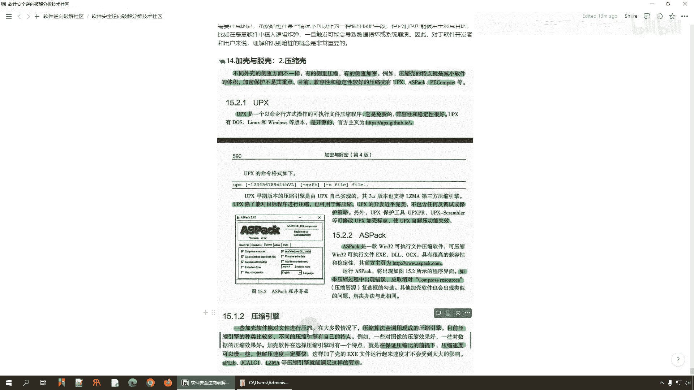

# 小白软件破解逆向安全工程师：14：加壳与脱壳：2：压缩壳 📦

## 概述 🎯

在本节课中，我们将学习软件逆向工程中一个非常重要的主题——压缩壳。上节课我们初步了解了壳的概念，知道了壳就像是自然界中种子或乌龟的外壳一样，起到保护内部程序的作用。而今天我们要深入探讨的压缩壳，则是壳家族中最基础、最常见的一种类型。通过对压缩壳的学习，你将掌握如何识别程序是否被压缩壳保护，以及如何使用相关工具进行加壳和脱壳操作。

## 壳的概念回顾 🐢

上节课我们已经学习了壳的基本概念。壳这个词其实非常形象，你可以想象一下大自然里的种子壳，或者乌龟的壳，它们都是用来保护内部重要部分的。软件中的壳也是类似的道理，它在程序和系统之间增加一层包装，用来保护程序的核心代码和数据不被轻易查看和修改。

壳的种类很多，在上节课中我们介绍了三种主要类型：第一种是压缩壳，第二种是由压缩壳衍生出的加密壳，第三种则是更高级的虚拟机技术保护壳。这三类壳的保护强度和安全级别是逐步递增的，但今天我们会把注意力集中在最基础的压缩壳上。理解了压缩壳，后面学习加密壳和虚拟机壳就会轻松很多。

## 压缩壳的基本概念 🔍

### 什么是压缩壳

压缩壳，从名字就可以看出，它的核心功能就是对你的代码、数据以及资源进行压缩。就像我们日常生活中压缩被子、压缩海绵一样，把体积尽量减小。压缩壳的主要目标就是减小软件的体积，这一点非常重要，因为体积更小的软件在传输和存储时都更加方便。

压缩壳的种类有很多，不同的压缩壳侧重方向也不同。有的壳注重压缩率，能把文件压得很小；有的壳则比较侧重于加密保护，虽然也压缩，但主要目的是隐藏程序的真实代码。不过对于压缩壳来说，加密保护并不是它的重点，压缩体积才是它的核心使命。

### 压缩壳特点公式

压缩壳的工作逻辑可以用下面这个公式来理解：

```
压缩壳 = 压缩算法 + 加壳逻辑

加壳结果 = 压缩代码 + 压缩数据 + 压缩资源 + 新的入口点
```


这个公式告诉我们，压缩壳做的事情其实就两大步：先用压缩算法把程序的各个部分压小，再给程序加上一个新的壳入口，这样程序运行时就会先执行壳的代码，把真正的程序解压出来再运行。

### 常见的压缩壳

在目前的软件安全领域中，兼容性和稳定性表现比较好的压缩壳有UPX、ASPack、PComp等。其中最常见、最常用的是前两者，UPX和ASPack，这两款工具在逆向工程圈子里几乎是无人不知的。

## UPX压缩壳详解 ⭐

### 什么是UPX


首先我们来详细了解一下UPX，看到这个名字你一定要熟悉，因为它是目前最流行的开源压缩壳。UPX是免费的，它的兼容性和稳定性都相当不错，而且最重要的是它是开源的。开源是什么意思呢？开源就是开放源代码的意思，别人把代码都给你了，这对学习者来说是一个绝佳的学习机会。你可以直接阅读UPX的源码，了解一个压缩壳内部是如何工作的，这是非常好的学习资料。


UPX也有自己的官方网站，你可以在百度上搜索它的官网，或者在浏览器中直接输入它的网址访问。在官网上你可以下载到最新版本的工具以及查看相关的技术文档。


### 压缩引擎概念

这里涉及到一个重要的概念——压缩引擎。壳这项工作其实是依赖于压缩引擎来完成的，可以理解为压缩引擎就是壳的心脏。UPX早期版本的压缩引擎是它自己实现的，这需要大量的算法优化工作。后来随着UPX的不断更新迭代，它也开始支持一些第三方的压缩引擎。

不同的压缩引擎有不同的特点和适用场景，常见的有以下几个：

- **AP Lab**：一款注重压缩率的引擎，能把文件压得很小
- **JCALG one**：压缩速度比较快，适合对时间要求高的场景
- **LZMA**：这是大家很熟悉的经典算法，压缩率高，在7-Zip等工具中广泛应用

这些压缩引擎各有优劣，有的压缩率更高，有的速度更快，UPX通过支持多种引擎，让用户可以根据自己的需求来选择。

### UPX操作界面

在我们的工具包中，为大家准备了三款UPX相关的第三方程序，分别命名为工具1、工具2和工具3。这三款工具虽然界面不同，但功能都是相同的，都能实现对程序的加壳和脱壳操作。

第一款工具的界面非常简洁，打开之后就能看到一个主界面，你可以直接把要处理的文件拖拽进去。在界面上可以看到压缩引擎的选项，比如LZMA，这就是我们刚才提到的那个经典压缩引擎。

第二款工具在点击高级选项后，可以看到更多详细的设置。这里有LZMA压缩引擎的选项，还有一些其他的功能选项，比如野蛮压缩、压缩资源、压缩导出模块、去除重定位等。所谓去除重定位，就是把程序的一些位置信息去掉，这样程序加载时就会固定在某个地址，能够提高一定的安全性。此外还有强制压缩的选项，可以强制对某些不常规的文件进行压缩处理。第三款工具最简洁，没有什么复杂的选项，只提供了压缩图标、最大压缩和解压文件这几个基本功能，非常适合新手使用。


其实你还会发现一个有趣的事情，这些压缩工具不仅可以用来压缩程序，也可以用来解压程序，是双向的工具。

## UPX实操演示 🛠️

### 加壳操作

接下来我们进行实际的加壳操作演示。首先使用第一款UPX工具，直接把要压缩的程序拖拽到界面中，界面上会显示压缩模式，然后点击开始按钮。

压缩过程很快就完成了，压缩完成后你会发现程序的大小明显变小了。然后我们运行这个程序，程序能正常运行，没有任何影响。这说明UPX压缩壳加得比较成功，既减小了体积，又保证了程序的可用性。

压缩壳是否影响程序的区段信息，我们用PE工具来查看一下。打开PE工具，把压缩后的程序拖进去，点击区段选项，你会看到原来的代码段和数据段都消失了，取而代之的是两个新的区段，叫做UPX0和UPX1。

如果看到这两个区段名字，你就要立刻意识到这是一个UPX加壳程序。

### 脱壳操作

前面我们提到这种压缩工具不仅可以压缩，还可以解压，下面来验证一下。先关掉PE工具，重新打开UPX工具，把程序拖进去后点击解压缩按钮，再点击开始。

解压完成后，程序又变回了之前的体积。我们运行这个程序，程序正常运行，说明用工具压缩的程序可以完整地还原回来。这个过程是可逆的，这也就是为什么说脱壳这件事是可逆的，只要工具支持，就能还原。

再次用PE工具查看信息，这次区段变得非常干净，又还原成了原来的区段结构，所有的代码段和数据段都恢复原样了，说明壳脱得很彻底。

### 第二款工具操作

接下来看第二款UPX工具。运行工具后，点击打开文件，文件也可以拖拽到界面上。在“版本”选项中可以选择不同的UPX版本，比如UPX 3.91，这里选择哪个版本都可以。在“选项”中可以点击进入高级设置，有一些野蛮压缩等选项。使用默认设置，先尝试一下极端野蛮压缩。

选择好选项后，点击压缩，再点击执行。野蛮压缩完成后，程序的体积变成了388KB，比之前用第一款工具压缩的结果还要大一些。用PE工具查看区段，区段特征还是UPX0和UPX1这两个区段，所以看到这个特征就知道它是UPX的壳。

文件类型也变了，所在区段的信息都变了。再测试能否解压，直接点击打开文件，拖拽进去后执行解压操作。工具会自动识别到这个程序已经被压缩了，自动勾选上解压的选项，然后点击执行。解压后程序运行没有问题，打开PE工具查看区段也没问题，所以整个过程也是可逆的。

### 第三款工具操作

第三款工具的操作方式更简单，点击“添加”按钮，找到目标文件夹，选择程序打开。然后选择最大压缩模式，这里也可以选择最快压缩，根据需求来定。点击“开始”按钮即可执行。

压缩后程序的大小变成了298KB，这是三款工具中最小的，说明这款工具的压缩效率是最高的。运行一下程序，不影响正常运行。再看一下区段信息，PE工具中的区段已经变成了壳的区段特征，原来的代码段和数据段都消失了，这就是加壳后的区段变化特征。

然后进行解压操作，还是选择这个文件，点击“解压文件”按钮，然后点击开始。解压后程序又变成了668KB，运行程序正常，打开PE工具查看区段，区段也还原了。所以这三款UPX工具都是可以正常使用的。

## ASPack压缩壳详解 🎯

### ASPack简介

最后我们再来看一下ASPack，这也是一款压缩壳工具。ASPack的官方主页在界面中可以找到，如果你在使用过程中出现错误，可以取消勾选“压缩资源”选项。因为使用这个壳去压缩资源的时候，可能会出现一些问题。

### ASPack操作

打开ASPack工具，可以看到有压缩的选项，还有一个“是否压缩资源”的选项，可以勾选上压缩资源。区段的名称在这里是可以修改的，默认有预设的名字，比如说可以改成“小迪”，这样压缩出来的壳区段就会叫“小迪”。

打开文件操作上，ASPack不支持直接拖拽，点击“打开”按钮，在文件对话框中找到目标程序，选中并打开。点击压缩后，工具会自动开始压缩，自动生成一个压缩后的程序文件。

压缩完成后，可以看到程序大小变成了296KB，压缩效果不错，运行程序也非常正常。打开PE工具查看区段，可以看到原来的代码段被改成了“小迪”这个名字，还新增了一个“ADATA”区段。原来程序的代码段、只读数据段、数据段等区段都保留着，但是额外多出了这样一个压缩壳的区段。程序的运行是正常的。

### 使用Exeinfo PE探测壳信息

最后用Exeinfo PE这个工具来看一下这个加壳程序的信息。把这个文件拖进Exeinfo PE，可以发现程序入口的区段就是“小迪”，同时壳的信息也会被探测出来并显示。一般来说，实际工作中我们使用Exeinfo PE这个工具来探测程序加的是什么壳，这是非常实用的方法。

这里需要特别注意：ASPack只支持压缩，不支持解压缩。如果要对ASPack加壳的程序进行脱壳处理，用这个工具是行不通的，必须用第三方专用工具，或者手动把壳脱掉。

### 注意：加多层壳的情况

需要特别注意的是，不要给程序加好多层壳。如果你加了两层壳，这个程序可能就跑不起来了。因为每层壳都会增加程序启动时的解压工作，多层壳会让系统加载逻辑变得极其复杂，很容易导致程序崩溃或无法运行。所以实际操作中，一般加一层壳就够了。

## 总结 📝

本节课我们一起学习了压缩壳的相关知识。我们首先回顾了壳的概念，知道了壳分为压缩壳、加密壳和虚拟机保护壳三种类型。然后详细学习了压缩壳的定义和特点，理解了它的核心作用是减小软件体积，而不是加密保护。

接着我们深入了解了UPX这个最流行的开源压缩壳，学习了它的特点、压缩引擎的概念以及常见的第三方压缩引擎。通过三款不同的UPX工具的实操演示，我们掌握了如何对程序进行加壳和脱壳操作，学会了通过区段名称的变化来识别UPX壳。

最后我们学习了另一款压缩壳工具ASPack，了解了它的基本使用方法、区段名称修改功能，以及如何使用Exeinfo PE工具来探测程序所加的壳类型。同时也学习了ASPack不支持解压的局限性，以及加多层壳可能导致程序无法运行的问题。


识别压缩壳的核心方法如下：

```
判断压缩壳的特征 = 区段名称异常 + 入口点代码与原始程序不符 + 文件体积显著变化

常见压缩壳区段特征：
  UPX     -> UPX0, UPX1
  ASPack  -> 自定义名称（如小迪） + ADATA
```



希望大家回去以后把今天的实验自己动手做一遍，跟着练习一下加壳和脱壳的流程，加深对压缩壳的理解。下节课我们将继续深入探讨脱壳的具体方法和技巧。

