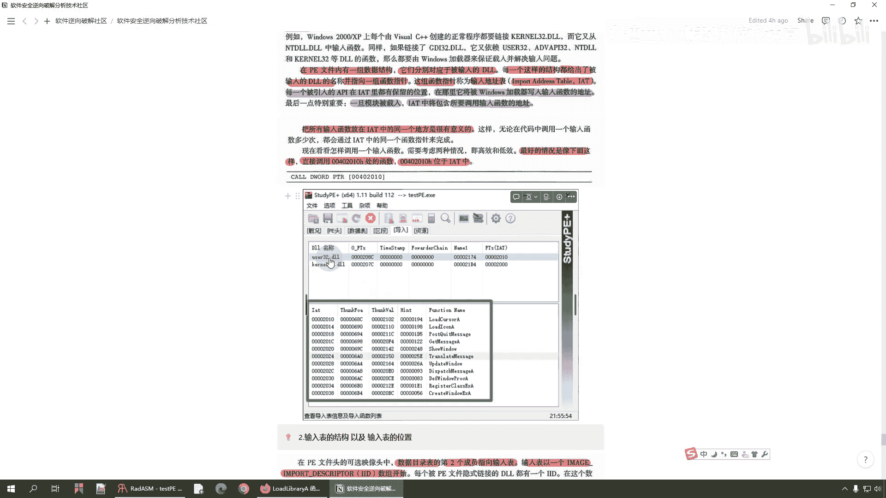
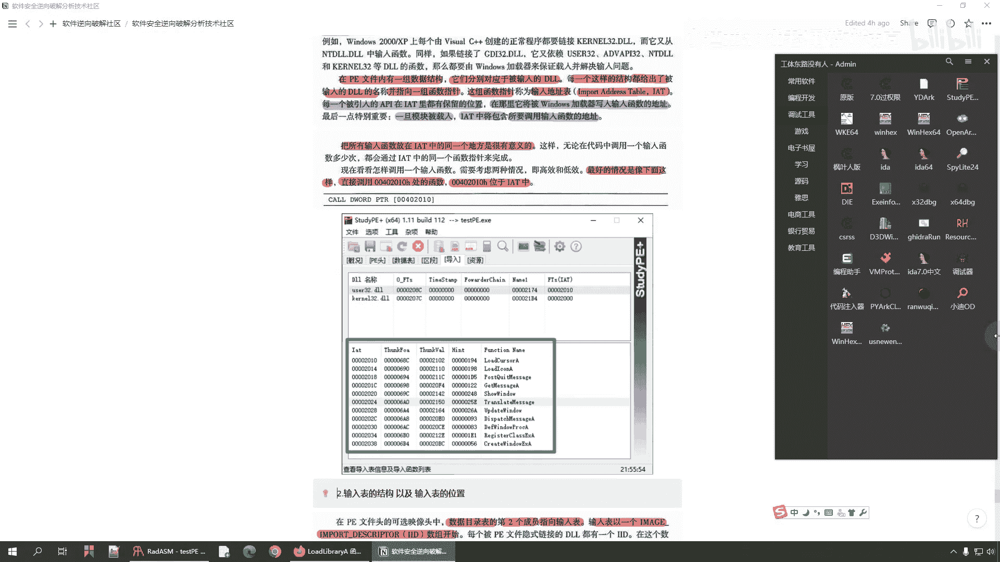
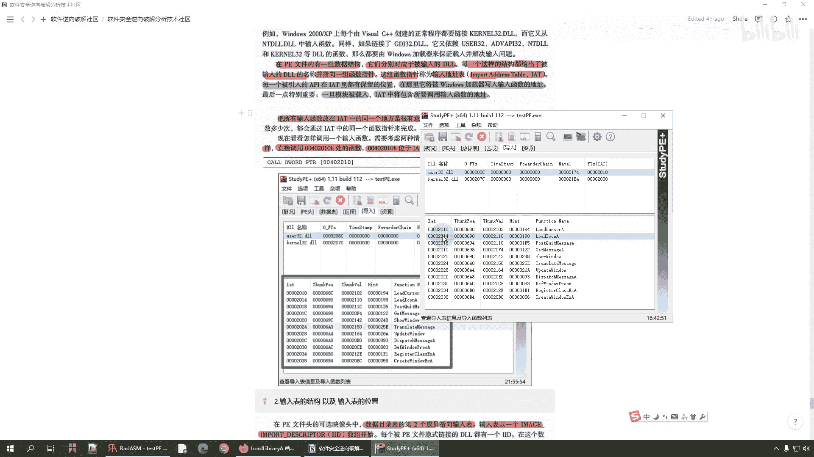
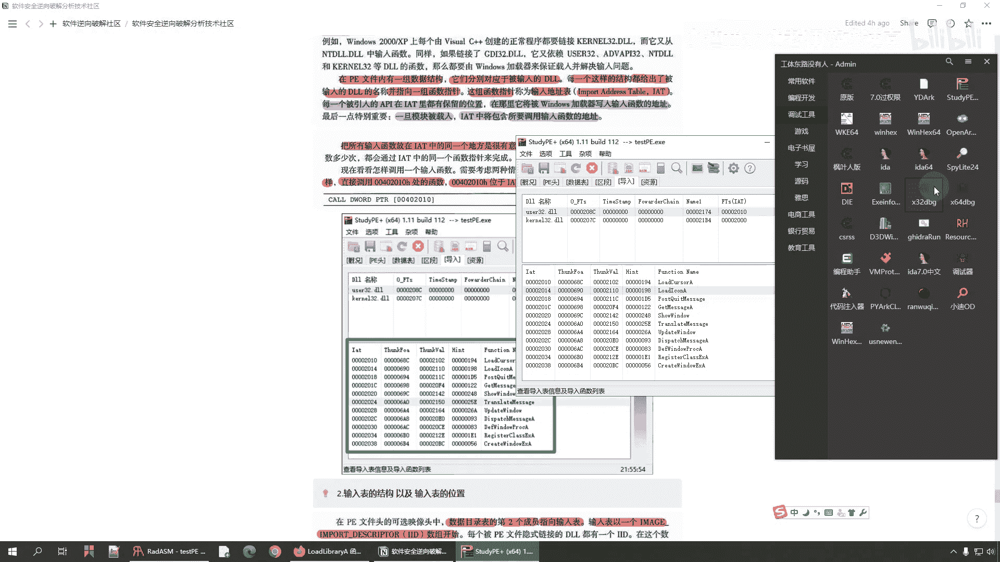
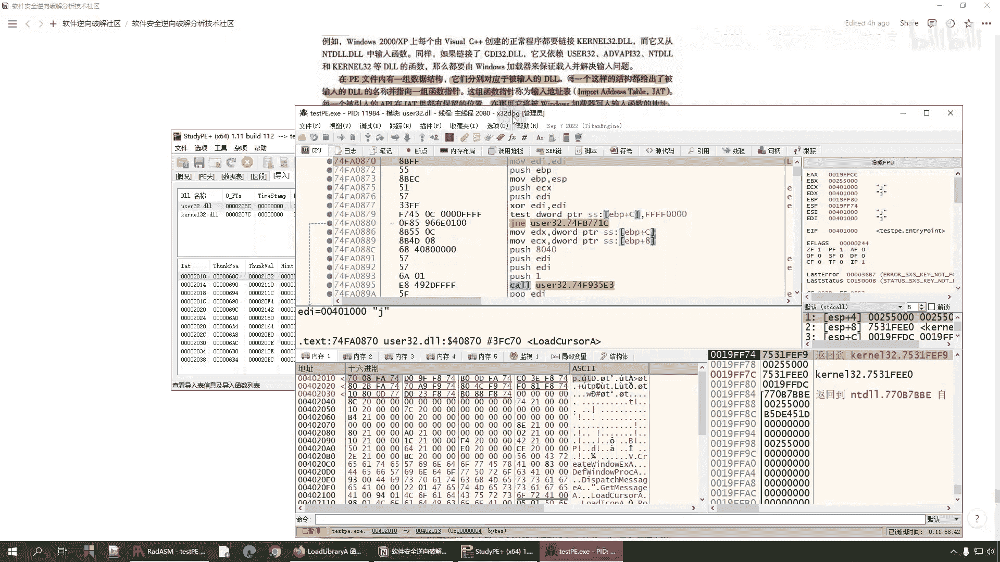
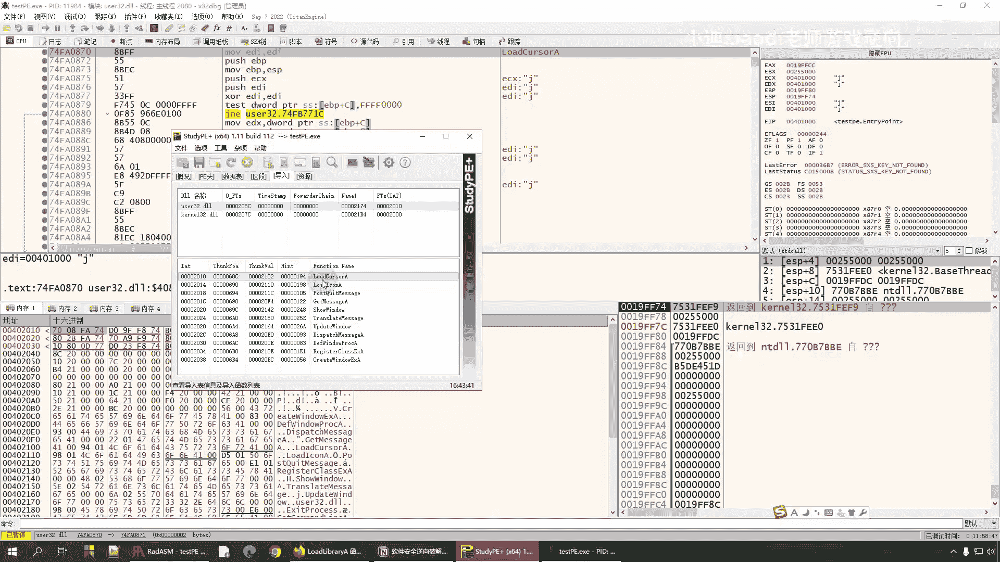
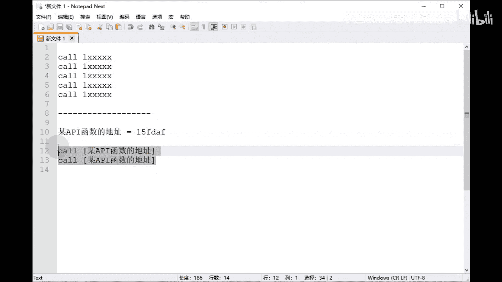
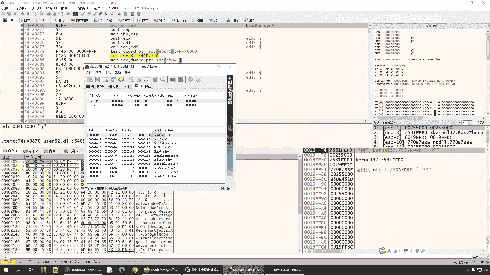
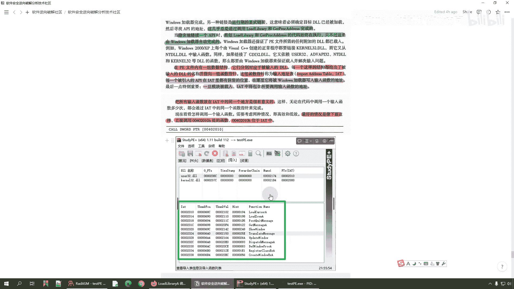

# 🛡️ 小白软件破解反汇编逆向安全工程师：第四章：PE文件结构之输入函数的调用

在本节课中，我们将要学习 PE 文件结构中的一个核心概念，也就是输入函数的调用。上一节我们初步认识了 PE 文件的基本结构，本节中就来看看程序到底是如何调用那些代码不在自己身上的函数的。我们将从输入函数的定义出发，一步步理解 Windows 加载器的链接过程、DLL 的两种加载方式、输入地址表（IAT）的作用，以及 IAT 背后那个巧妙的设计理念。学完本节之后，各位将从原理和实操两个层面彻底搞懂输入函数的调用机制，这些内容在游戏安全、软件安全、网络安全以及 CTF 比赛中都是必备的基础知识。

---

## 🔍 小白软件破解反汇编逆向安全工程师：4.1：什么是输入函数

先来看一个最基础的问题，什么是输入函数。输入函数就是被程序调用、但执行代码不在程序本体内的函数。这些函数的代码位于相关的 DLL 文件里面。举个例子，上一节我们写过的那个小程序，里面调用了一些函数。这些函数并不是我们自己写的，而是微软帮我们写好的。微软把这些函数的代码放在哪里呢？答案是在 kernel32.dll 里面。还有我们之前用到的 ExitProcess 之类的函数，同样也不是我们自己写的，同样是微软提供的。微软把函数的具体实现封装在系统 DLL 中，然后提供给所有的 Windows 程序员共用。

输入函数有下面几个明显的特点：

- 被当前程序调用，但执行代码不在当前程序的文件中
- 执行代码位于外部的 DLL 文件里
- 当前程序中只保留了函数名、DLL 文件名等少量信息

那么调用者程序中保存了什么呢？在调用者程序中，只保留了相关的函数信息，例如函数名、所在的 DLL 文件名等等。也就是说，程序本体里并没有这些输入函数的完整代码，只保留了一些线索信息，用于在程序运行时找到它们。

---

## 🤔 小白软件破解反汇编逆向安全工程师：4.2：为什么磁盘上的 PE 文件无法得知输入函数的内存地址

接下来我们思考一个关键问题。对磁盘上的 PE 文件来说，也就是对一个静态的本地文件而言，它是无法得知输入函数在内存中的地址的。这句话怎么理解？因为程序在运行的时候，光给一个函数名字是远远不够的。我们要操作一个数据，或者说调用一个东西，必须给出什么呢？必须给出内存地址才可以。

Windows 操作系统是怎么实现这一切的？答案就是靠内存。我们所有看到的东西，包括电脑播放出来的声音，所有能被感知到的数据，都是通过内存来存放和传递的。这就是计算机工作的基本方式。所以，我们一定要理解内存地址这个概念，它是整个逆向分析的基础。

回到刚才的问题。本地磁盘上的文件无法得知输入函数的地址，那肯定是有方式能够得知的，否则程序不就跑不起来了？那是什么方式？当 PE 文件被载入内存的时候，也就是程序运行起来之后，Windows 加载器才会把相关的 DLL 载入，并且将调用输入函数的指令与函数实际所处的地址联系起来。简单说，程序一跑起来，Windows 加载器就负责把函数名翻译成内存地址，然后填到该填的地方去。这个联系的过程发生在程序运行的时候，也就是在运行时进行连接的，而不是在编译或链接的时候。

---

## 📦 小白软件破解反汇编逆向安全工程师：4.3：DLL 的两种加载方式

了解了输入函数的基本概念之后，本节中我们来看看 DLL 到底是怎么被加载的。当一个程序调用某个 DLL 中的代码和数据的时候，它是被隐式连接的。一般情况下，这种连接方式就是隐式连接。什么是隐式连接？回想一下，我们运行自己写的程序时，有没有写过加载 DLL 的代码？没有。我们自己写代码的时候，从头到尾都没有去写 LoadLibrary 这样的加载语句。所以 DLL 的加载并不是明摆着呈现在代码里的，而是被隐藏在背后完成的。

举个例子，GetModuleHandle、GetProcAddress 这些 API 都位于 kernel32.dll 里面，LoadLibraryA 这个函数同样也在 kernel32.dll 里面。如果我们调用这些函数，我们并没有写任何加载 kernel32.dll 的代码，它就已经被加载进来了，这就是隐式加载的效果。

除了隐式加载，还有一种加载方式叫做显式加载。显式加载怎么去加载一个 DLL？很简单，就是通过两个 API 去完成。一个是 LoadLibrary，另一个是 GetProcAddress。这两个函数配合起来，就可以完成一个 DLL 的手动加载。整个过程可以用下面的伪代码来描述：

```c
// 显式加载 DLL 的典型流程
HMODULE hDll = LoadLibrary("kernel32.dll");              // 第一步：加载 DLL，获得模块句柄
FARPROC pFunc = GetProcAddress(hDll, "GetProcAddress");  // 第二步：按名字获取函数地址
pFunc();                                                 // 第三步：通过函数指针调用
```

DLL 的加载方式主要就是下面这两种：

1. 隐式加载：程序运行的时候由 Windows 加载器自动完成，我们感知不到
2. 显式加载：通过 LoadLibrary 和 GetProcAddress 两个 API 手动完成

一般情况下，我们写的程序在运行的时候，使用的都是隐式加载。这一点，大家心里要先有个数，后面对比输入表结构时会经常用到。

---

## 📋 小白软件破解反汇编逆向安全工程师：4.4：输入地址表（IAT）的概念

搞清楚了加载方式之后，我们再往 PE 文件内部看一看。在 PE 文件里面，有一组输入结构，这些结构分别对应于每一个被输入的 DLL。每一个这样的结构都给出了被输入的 DLL 的名称，并且指向一组函数指针。这组函数指针统称为输入地址表，英文全称是 Import Address Table，通常简称为 IAT。



下面是一个输入地址表的示意结构：



```
输入结构（Import Structure）
 ├── DLL 名称：kernel32.dll
 ├── 指向的函数指针数组（也就是 IAT）
 │    ├── [0] → GetModuleHandleA
 │    ├── [1] → GetProcAddress
 │    ├── [2] → LoadLibraryA
 │    └── ...
 └── DLL 名称：user32.dll
      ├── [0] → LoadCursorA
      └── ...
```

这个东西听起来比较抽象，怎么去理解它？其实很简单。打开一个 PE 分析工具，把我们的程序加载进去，然后找到导入这一栏。点击导入选项的时候，就会发现出现了一个表格。这个表格就是输入地址表。输入地址表表达的意思是：我这个程序用到了别人的函数，用到了某些 DLL 里面的某些函数，那么这些 DLL 以及里面被用到的所有函数，都会一一列在这个表里。

我们以 testPE 程序为例，把导入表里看到的内容简化成下面这张示意表格：

| 导入的 DLL | 导入的函数 |
|-----------|-----------|
| kernel32.dll | GetModuleHandleA、GetProcAddress、LoadLibraryA |
| user32.dll | LoadCursorA、MessageBoxA |

再去实际验证一下。打开 PE 查看工具，载入我们的示例程序，找到导入并点击一下。点击之后就会发现，程序用到了这个 DLL 里面的这些函数。这些函数就是从外边导入进来、给自己程序用的。这个表格就是传说中的输入地址表。



---



## 🔧 小白软件破解反汇编逆向安全工程师：4.5：实操：在 x32dbg 中验证 IAT 的写入过程

前面讲了 IAT 的概念，本节我们就来动手验证一下，眼见为实。PE 文件结构规定：每一个被引入的 API 在 IAT 中都有一个保留的位置。在这个保留的位置上，Windows 加载器会把输入函数的真实地址写进去。这一点非常重要，我们来实际操作一遍。

打开 x32dbg，找到我们的 testPE 程序，然后查看它的导入表。我们会发现 IAT 这一栏中有某个条目，显示的值是 20102014。这个东西是什么？实际上它就是一个内存地址。经过换算，我们得到完整的地址 00402010。在 x32dbg 中跳转到 00402010，看看这个地址里面装的是什么。跳过去之后会发现，里面存着一个数值 74FA0870。注意，这个数值在内存中是倒序存储的，也就是按照 70 08 FA 74 的顺序存放在字节里，我们把它还原成正常顺序，就得到 74FA0870。

这个 74FA0870 又是一个地址。继续跳转到 74FA0870 看一看，你看到了什么？看到的是 LoadCursorA 这个字符串。LoadCursorA 不就是导入表里对应的那个函数名吗？整个验证过程可以用下面这个式子来表示：

```text
IAT 表项（00402010） → 存储的值（74FA0870） → 指向的函数名（LoadCursorA）
```

也就是说，IAT 中的每一个保留位置，在程序加载完成之后，里面存放的就是对应输入函数在内存中的真实地址。用公式表达就是：`IAT[n] = 第 n 个导入函数的真实内存地址`。跳过去，就能找到那个函数的真实代码。

---

## 💡 小白软件破解反汇编逆向安全工程师：4.6：IAT 的设计理念：为什么采用间接调用

验证完 IAT 的真实作用之后，接下来我们说说 IAT 一个非常好的设计理念。什么设计理念？设想一下，假如我们在程序里面直接调用某个 API，假设这个 API 的地址是 0x12345678。调用一次，就是 call 0x12345678。调用两次，就是再写一个 call 0x12345678。调用三次、四次、五次，也都没有问题。五次调用其实都还算少的。

但如果有一天，我们想要修改这个 API 的地址，事情就变得麻烦了。比如说，我们想对这个 API 做 hook，把地址改成 0x1XXXXXXX。这个时候，你不仅要修改第一个调用位置，还要修改第二个、第三个、第四个、第五个调用位置。一次两次三次四次五次，忍一忍也就过去了。可是，如果你的程序里调用这个函数调用了 100 次，甚至 10000 次，那就意味着每一处调用都要去修改。那也太累了，人直接就累死了。





所以 Windows 是怎么设计的？它实际上没有让程序每次都直接调用 API 的地址，而是先把 API 函数的地址存放到一个内存单元里面，然后所有的调用都改成间接调用。也就是说，程序执行的是 call [某个内存地址]，这个内存地址里面存放的才是 API 的真实地址。这样一来，当我们需要更改某个 API 的地址时，只需要修改 IAT 中那一个存放地址的位置就够了。一改，全部生效。下面用代码对比一下这两种方式：

```c
// 方式一：直接调用 API 地址，修改代价高
call 0x12345678   // 第 1 次调用
call 0x12345678   // 第 2 次调用
call 0x12345678   // 第 10000 次调用
// 改地址时，这 10000 处全部都要改

// 方式二：通过 IAT 间接调用，修改代价低
call [0x00402010]  // IAT 表项中存的是 API 的真实地址
// 改地址时，只需要修改 0x00402010 里存的一个值
```

这就是 IAT 设计理念的精髓所在。下边所有的调用，无论是 100 次还是 10000 次，只要 IAT 里面那一个值被改了，全部都跟着改了。

---

## 👀 小白软件破解反汇编逆向安全工程师：4.7：实操总结：如何查看输入函数

课堂的最后，我们再来做一个简单的实操总结，看看输入函数到底怎么去看。方法非常简单，就是拿一个 PE 分析工具去查看程序的导入表。在工具中找到导入这个选项卡，打开之后，里面会有一张表格。存放这张表格的区域，英文叫 Import Address Table，简称 IAT，中文叫输入地址表。透过这张表，我们可以清楚地看到：当前程序依赖了哪些 DLL，又从这些 DLL 中导入了哪些函数。这些信息在逆向分析中非常常用，例如判断一个程序使用了哪些系统 API，或者定位某个关键函数在 IAT 中的位置，都是从这里入手的。



---



## 📌 总结



本节课中，我们一起学习了 PE 文件结构中与输入函数调用相关的完整知识。我们首先明确了输入函数的概念，它被程序调用，但代码本体位于 DLL 中，调用者程序只保留函数名和 DLL 文件名等信息。接着我们解释了为什么磁盘上的静态 PE 文件无法得知输入函数的内存地址，因为只有程序被加载进内存之后，Windows 加载器才能把调用指令与函数实际地址联系起来。然后我们介绍了 DLL 的两种加载方式，分别是隐式加载和显式加载，其中显式加载主要通过 LoadLibrary 和 GetProcAddress 两个 API 配合完成。之后我们重点讲解了输入地址表（IAT），并用 x32dbg 实地验证了 IAT 表项中确实存放着输入函数的真实地址。最后我们剖析了 IAT 的设计理念，也就是通过间接调用，把 API 地址集中存放在一个位置，避免在成千上万处调用点逐一修改地址。掌握了这些内容，再看导入表就非常简单了。下一节中，我们将在此基础上继续深入 PE 文件的其他核心结构，敬请期待。

