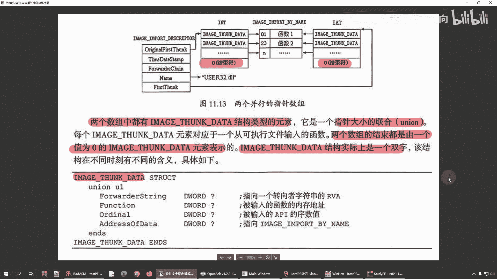
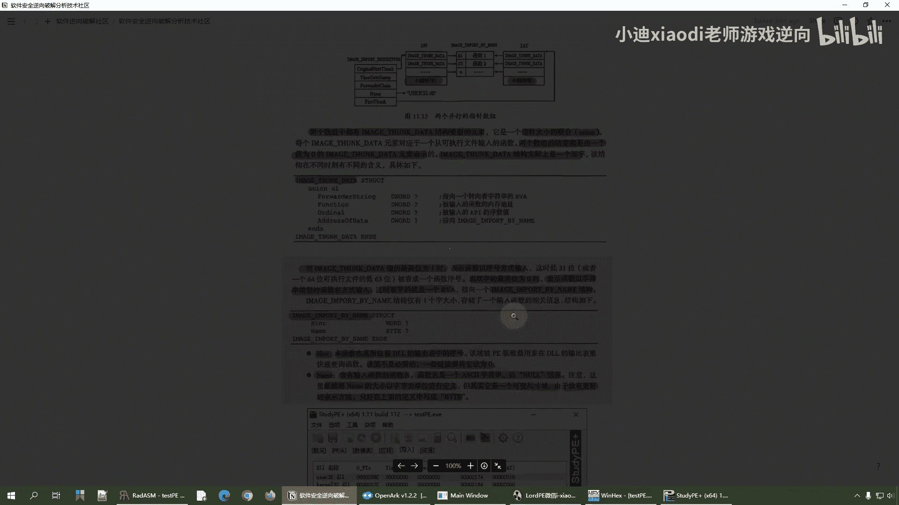
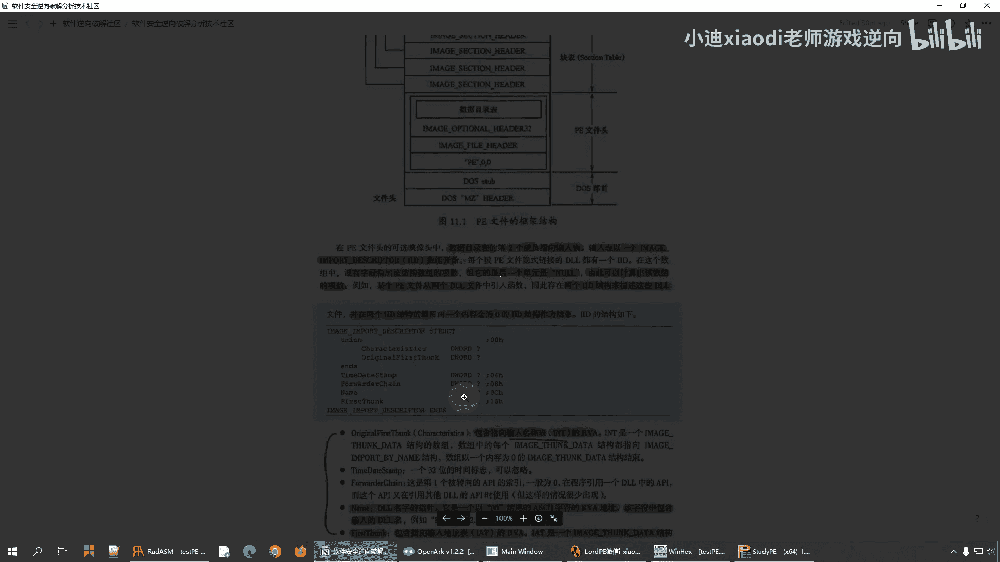
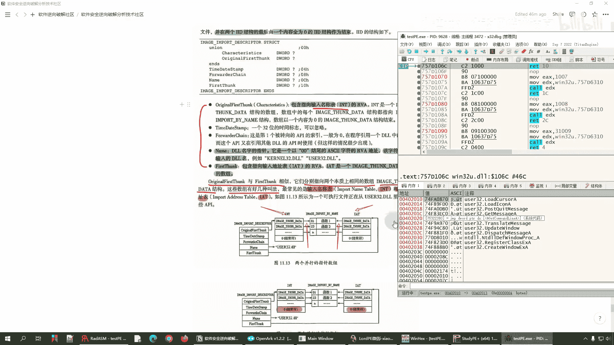
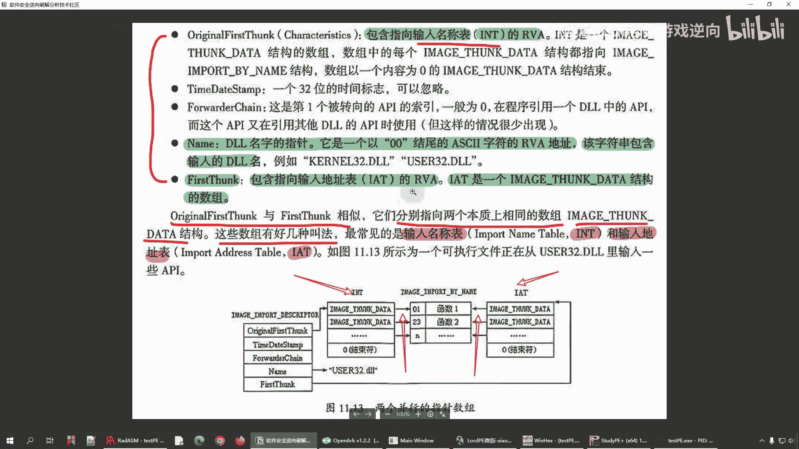
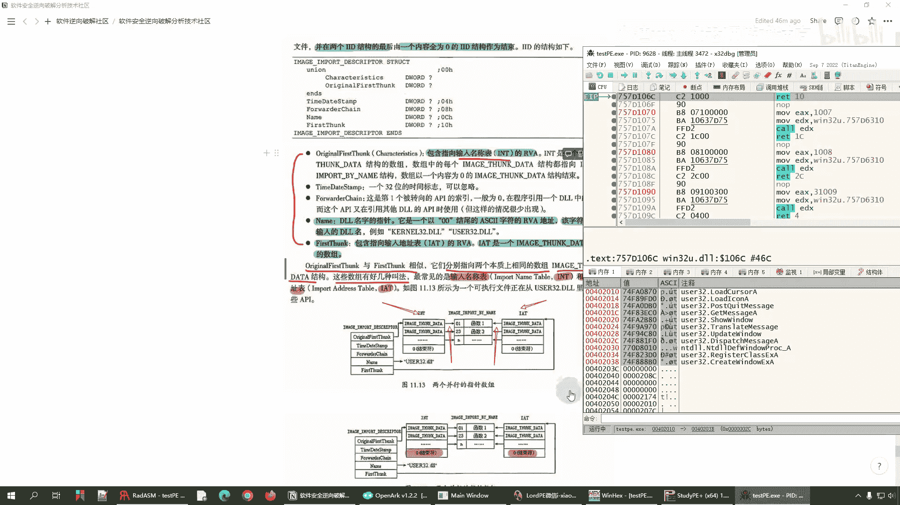
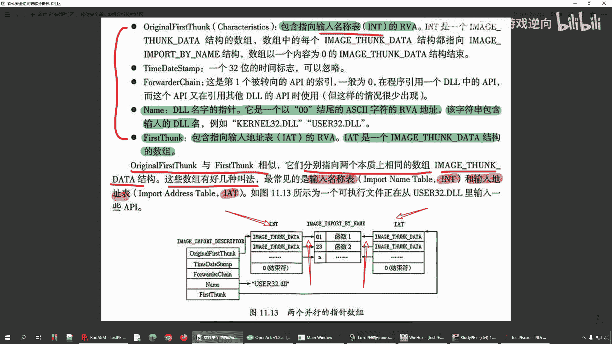
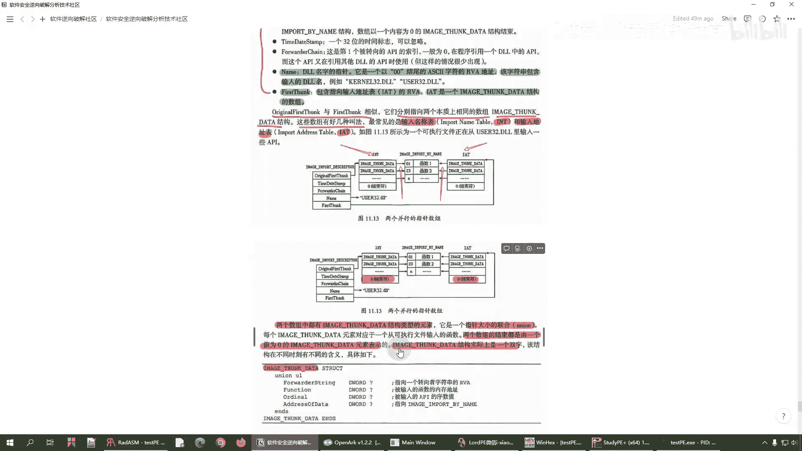

## 💻 小白软件破解反汇编逆向安全工程师：第2节：PE输入表的位置与结构

在本节课中，我们一起来学习PE文件中的输入表（Import Table）放在哪里，以及输入表内部的结构到底是什么样的。输入表是PE文件里非常核心的数据结构，我们接下来会从位置、偏移换算、结构体布局、INT和IAT几个方面把它拆开。学完之后，你就会明白一个程序在运行时是如何找到自己所需要导入的DLL和函数的。

## 📍 一、输入表的位置：数据目录表的第二个成员

先回顾一下PE文件的整体框架。PE文件有PE头，在PE头里面有一个Optional Header。把Optional Header展开之后，最下面有一张数据目录表，英文叫做Data Directory。这张表本质上是一个数组，数组里每个成员都记录了某一类重要数据的RVA和大小。

可以用下面的结构体来表示数据目录表中的每一个成员：

```c
typedef struct _IMAGE_DATA_DIRECTORY {
    DWORD VirtualAddress;   // 这个值通常是 RVA
    DWORD Size;             // 这块数据的大小
} IMAGE_DATA_DIRECTORY;
```

数据目录表中第二个成员指向的就是输入表。在PE头中，第二个成员对应的常量是 `IMAGE_DIRECTORY_ENTRY_IMPORT`，它的下标是1。可以这样写：

```text
DataDirectory[0] = IMAGE_DIRECTORY_ENTRY_EXPORT
DataDirectory[1] = IMAGE_DIRECTORY_ENTRY_IMPORT
```

把这个第二个成员展开之后，会看到两个值：一个是 VirtualAddress，一个是 Size。VirtualAddress 表示输入表在内存视角中的RVA，Size 表示输入表数据的总大小。在我们的实验程序里，输入表的 VirtualAddress 是 `0x2040`，Size 是 `0x3C`。在WinHex中也可以找到这一项，只是WinHex中看到的是文件偏移，而数据目录表里记录的是RVA，所以不能直接用。

## 📐 二、从RVA到文件偏移：0x2040 与 0x640

为什么需要换算呢？因为PE文件在磁盘上以文件偏移存放数据，而数据目录表里记录的却是相对虚拟地址RVA。RVA可以理解为“这个数据被加载进内存之后，相对于ImageBase的偏移”；文件偏移可以理解为“这个数据在磁盘文件里从文件头开始数的位置”。这两个概念不是同一个东西。

如果直接把 `0x2040` 当成VA，那么加上ImageBase `0x00400000`，就会得到 `0x00402040`。但我们现在需要的是磁盘文件里的偏移，所以不能直接在WinHex里跳 `0x2040`。有一些PE工具可能会把这一栏标成VA，这应该是工具作者理解上的差异，实际计算时还是要按RVA来处理。

可以用LordPE这类工具来换算。打开PE工具，载入实验程序，找到“位置计算器”之类的功能，在RVA一栏输入 `0x2040`，然后点击执行。计算结果是，RVA `0x2040` 对应的文件偏移是 `0x640`。换算关系可以用下面的公式理解：

```text
VA = ImageBase + RVA
文件偏移 = RVA - 所在节区RVA + 所在节区文件偏移
```

于是我们就知道了：输入表在磁盘文件中的位置是 `0x640`。打开WinHex，跳到 `0x640`，从那里开始就是输入表。

## 🧱 三、输入表的结构体数组：一个结构20字节

输入表不是一个简简单单的散装数据，而是一个结构体数组。这个结构体的名称是 `IMAGE_IMPORT_DESCRIPTOR`，每一个结构体描述一个被导入的DLL。结构体的内容如下：



```c
typedef struct _IMAGE_IMPORT_DESCRIPTOR {
    union {
        DWORD Characteristics;
        DWORD OriginalFirstThunk;   // INT 的 RVA
    } DUMMYUNIONNAME;
    DWORD TimeDateStamp;
    DWORD ForwarderChain;
    DWORD Name;                     // DLL 名字字符串的 RVA
    DWORD FirstThunk;               // IAT 的 RVA
} IMAGE_IMPORT_DESCRIPTOR;
```



这个结构体里面有一个union类型，union只占一个DWORD。再加上后面的 `TimeDateStamp`、`ForwarderChain`、`Name`、`FirstThunk`，一共是5个DWORD。因为每个DWORD是4字节，所以一个结构体的大小可以这样计算：

```text
sizeof(IMAGE_IMPORT_DESCRIPTOR) = 5 × 4 = 20 字节
```

有一点需要特别注意：这个结构体数组没有字段指出它到底有多少项。换句话说，系统并没有直接告诉我们“这里有几个DLL”。想要判断数组在哪里结束，只能看最后一项是不是20个连续的0字节。如果输入表结束了，那么结尾处一定会出现20个连续的零。

在我们的实验程序里，从 `0x640` 开始看，先取出第一个20字节，发现不是零；再取出第二个20字节，发现也不是零；到第三个20字节时，看到刚好是20个0。这说明这个程序只有两个这样的结构体，也就是只隐式链接了两个DLL。




验证这个结论也不难。使用PE工具查看导入表，或者用LordPE打开程序后点击“导入表”，可以看到导入的DLL刚好是两个。这说明我们用“连续20个0判断结束”的思路是正确的。

## 🪆 四、第一个成员：OriginalFirstThunk 与输入名称表 INT

接下来看每个结构体内部的细节。第一个成员是 `OriginalFirstThunk`，它的含义是“指向输入名称表的RVA”。输入名称表的英文是 Import Name Table，简称 INT。这里的 N 就是 Name，也就是“名称”的意思。INT 又是一个结构体数组，每个元素是 `IMAGE_THUNK_DATA`。这个结构体也是union类型，只占一个DWORD。

每个 `IMAGE_THUNK_DATA` 在正常名字导入时，总是指向另一个结构体 `IMAGE_IMPORT_BY_NAME`。这就像俄罗斯套娃一样，一个结构套着另一个结构。下面把这个结构关系写出来：

```c
typedef struct _IMAGE_THUNK_DATA {
    union {
        DWORD ForwarderString;
        DWORD Function;
        DWORD Ordinal;
        DWORD AddressOfData;    // 指向 IMAGE_IMPORT_BY_NAME 的 RVA
    } u1;
} IMAGE_THUNK_DATA;
```

`IMAGE_IMPORT_BY_NAME` 又包含两个部分，一是 Hint，二是 Name：

```c
typedef struct _IMAGE_IMPORT_BY_NAME {
    WORD Hint;        // 函数在其所在 DLL 输出表中的序号
    CHAR Name[1];     // 函数名，实际上是可变长数组
} IMAGE_IMPORT_BY_NAME;
```

Hint 是一个 WORD 类型，你可以把它理解成这个函数在DLL里的“身份证号”。DLL在导出函数时有自己的编号，程序通过这个编号可以快速定位函数。Name 在C语言结构体定义里写的是 `BYTE`，但真正的函数名字符串是可变长的。微软在C语言结构体里没有更好的办法表示可变长字段，所以只能这样占位。有人会开玩笑说做人要有底线，但这个字段的底线非常灵活，字符串实际有多长，它就可以占多长。

所以从 `OriginalFirstThunk` 出发，可以得到这样一条链：

```text
IMAGE_IMPORT_DESCRIPTOR.OriginalFirstThunk
    -> INT（IMAGE_THUNK_DATA 数组）
    -> IMAGE_IMPORT_BY_NAME
    -> Hint + Name
```

## 🔍 五、手动看一遍 INT 和 DLL 名字

现在到实验程序里手动验证一下。我们从 `0x640` 开始看第一个 `IMAGE_IMPORT_DESCRIPTOR`，其中有三个关键字段的值如下：

- `OriginalFirstThunk = 0x208C`
- `Name = 0x2174`
- `FirstThunk = 0x2010`

先说DLL名字。`Name` 字段的值是RVA `0x2174`，用PE工具换算出文件偏移是 `0x774`。在WinHex里跳到 `0x774`，就能看到DLL名字字符串，也就是 `USER32.dll`。到这里，我们就找到了第一个被导入的DLL。

接着看 `OriginalFirstThunk`。刚才看到第一个结构体的INT RVA是 `0x208C`，换算后，`0x208C` 对应的文件偏移是 `0x68C`。跳到 `0x68C`，会看到里面存着一个RVA值 `0x2102`。把这个RVA再换算成文件偏移，就是 `0x702`。

到了 `0x702`，就真正看到输入名称表里保存的函数名称了。名称表里放的自然都是函数名。你会看到 `LoadCursorA`，然后是 `LoadIconA`、`PostQuitMessage`、`GetMessageA`，一路往下走，一直到某个 `Create...` 函数。这些就是程序从 `USER32.dll` 导入的函数名字。





这一层一层套下来，确实比较容易绕晕。最好的办法是拿着PE工具反复计算RVA和文件偏移，多走两遍就会清楚。

## 🧠 六、最后一个成员：FirstThunk 与输入地址表 IAT

再看最后一个成员 `FirstThunk`。它的含义是“包含指向输入地址表的RVA”。输入地址表的英文是 Import Address Table，简称 IAT。AT 就是 Address Table，也就是地址表。

IAT 不需要在WinHex里直接看。因为 IAT 里面保存的实际上是一些内存地址，而这些地址要等程序加载运行起来之后才会被系统填进去。在程序没有运行时，或者说在磁盘文件里，这些函数地址还不会存在。



所以在实验程序运行时，我们要用调试器或者内存查看器去看IAT。刚才看到 `FirstThunk` 的RVA是 `0x2010`，加上ImageBase后得到内存地址 `0x00402010`。在调试器里跳到这个地址，就能看到一个地址表。这个地址表最后以0结束。看到一串地址后面跟着0，就表示导入的函数地址就这么多，到这里没有了。

查看INT也有类似方法。在内存中，`0x0040208C` 这个位置存放的是RVA `0x2102`，把它换算成VA就是 `0x00402102`。跳到 `0x00402102` 之后，就能看到每个函数名。每个函数名前面都有一个数字，这个数字就是Hint。比如 `0x0194` 是一个Hint，后面紧跟着对应的函数名；`0x0198` 又是下一个Hint，紧接着 `LoadIconA` 这样的函数名。字符串以0结尾，所以每找到一个0，下一个字符就是下一个Hint。整个结构就是这样环环相扣的。

## ✅ 七、总结：输入表如何确定一个函数

本节课中，我们一起学习了输入表的位置和结构。最后再用一条链总结一下整个流程：

```text
IMAGE_IMPORT_DESCRIPTOR
├── OriginalFirstThunk -> INT
│                        └── IMAGE_THUNK_DATA
│                             └── IMAGE_IMPORT_BY_NAME
│                                  ├── Hint（序号）
│                                  └── Name（函数名）
├── Name -> DLL 名字字符串
└── FirstThunk -> IAT
                  └── 程序加载后填入的实际函数地址
```

具体来说，输入表使用的是 `IMAGE_IMPORT_DESCRIPTOR` 这个结构体数组，每个结构体描述一个DLL。结构体中的第一个成员指向输入名称表INT，INT又指向 `IMAGE_IMPORT_BY_NAME`，这里存放着函数的Hint和函数名。第四个成员指向DLL名字字符串。最后一个成员指向输入地址表IAT，程序运行起来后，IAT里会填入真正的函数地址。有了DLL名字、函数名、序号和函数地址，系统就能完全确定一个导入函数。





这个内容稍微有点绕，但不用怕。你可以自己动手，用WinHex、LordPE、调试器等多个工具反复查看和分析实验程序，重点搞清“输入表在哪个位置”和“输入表整体是什么结构”这两个方向性的问题。只要把这个大方向掌握住，后面继续学习PE文件的其他结构就会轻松很多。

