# 🛠️ 小白软件破解反汇编逆向安全工程师2024最新：第1章：x64dbg字符串乱码与编码问题

在本节课中，我们将学习在逆向分析过程中遇到的 x64dbg 字符串乱码问题，并深入理解字符串编码的本质。我们会从一个常见的现象开始：在分析软件时，某些字符串显示为乱码，而我们却不知道“乱码”到底乱的是什么。其实“乱码”不是指数据本身乱了，而是指**编码**乱了。接下来，我们会通过实际演示，看看如何通过切换代码页、使用在线工具等方式解决乱码，并且搞清楚什么样的数据才是真正的字符串。这些知识是游戏安全、软件安全、网络安全以及 CTF 比赛中必备的基础。

## 一、乱码的根源：编码

最近在群里，有不少同学反映在分析软件的时候，发现一些字符串是乱码的。大家知道“乱码”这个词汇，也经常碰到乱码，但是可能并不清楚“乱码”乱的是什么码。实际上，乱掉的那个码，不是别的，正是**编码**。

为了理解编码，我们需要先从最基础的地方说起。在计算机中，所有的数据本质上只有两个数字：0 和 1。这一点大家应该都认可。计算机只认识 0 和 1，因为它的底层就是电路板，靠电流来工作。简单来说，0 表示关闭状态，也就是没有电流通过；1 表示开启状态，也就是有电流通过。所以计算机的一切信息，最终都归结为 0 和 1 的排列组合。

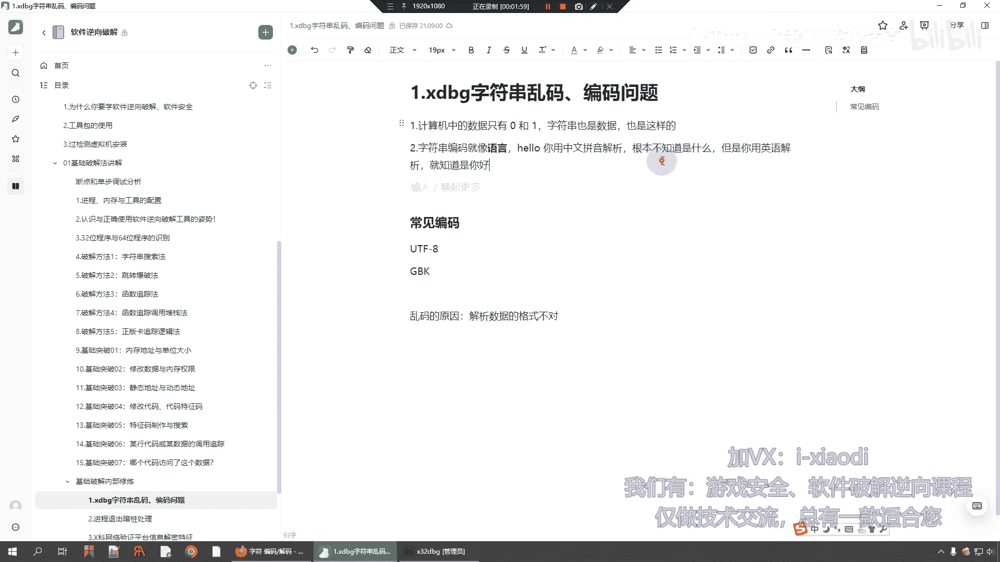

字符串本质上也是数据，它也不例外，同样是由 0 和 1 组成的。可能有同学会问：0 和 1 究竟是怎么变成我们能看懂的字符串的呢？这个问题暂时不用深究。我们只需要知道，计算机通过各种各样的形式和规则，将 0 和 1 转换成了人类能够识别的字符串。因此，字符串的本质就是 0 和 1，这一点和任何其他数据没有区别。

## 二、字符串编码是什么

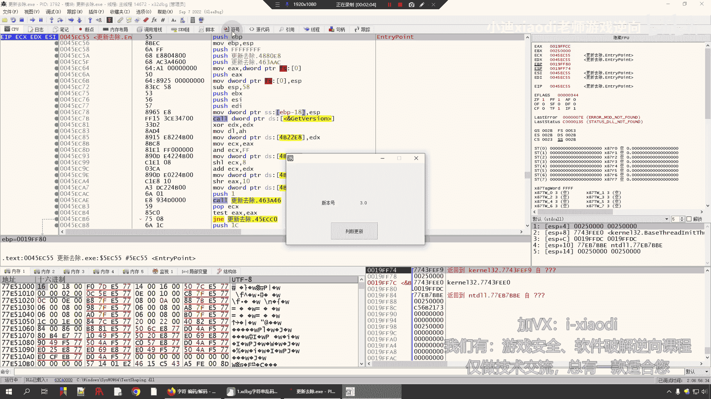

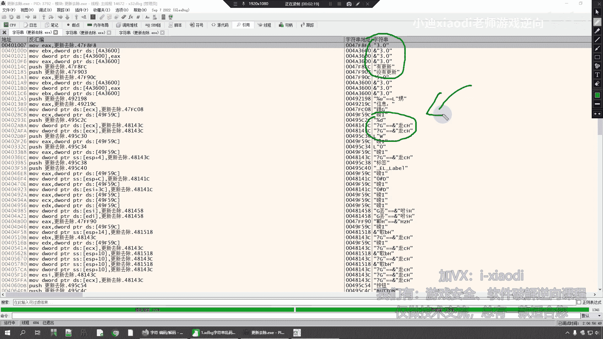

明白了字符串的本质后，我们再来看看字符串编码到底是什么。字符串编码就像语言一样，比如英语、汉语，都是一种用来表达信息的规则。为了更形象地理解，我们可以用“HELLO”这个单词来举例。

如果使用中文拼音的规则去解析“HELLO”这几个字母，你根本不知道它是什么意思。比如用拼音去读，可能会读出类似“呵猴”这样奇怪的发音，别人听到后完全不懂你在说什么。但是，如果使用英语的解析规则，你立刻就能明白这是“hello”，翻译成中文就是“你好”的意思。

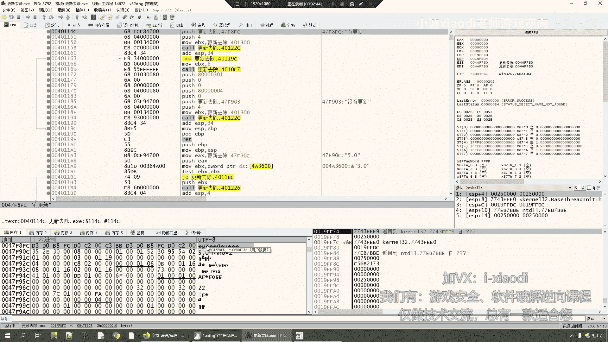

所以，字符串编码实际上就是**你用一种什么样的规则去解析文本**。这个规则就是编码。换句话说，编码就是解析文本的格式，或者说是解析原始数据的方法。不同的编码方式，会对同样的 0 和 1 数据产生不同的解析结果。在常见的日常开发中，UTF-8 和 GBK 是最常用的两种编码格式。

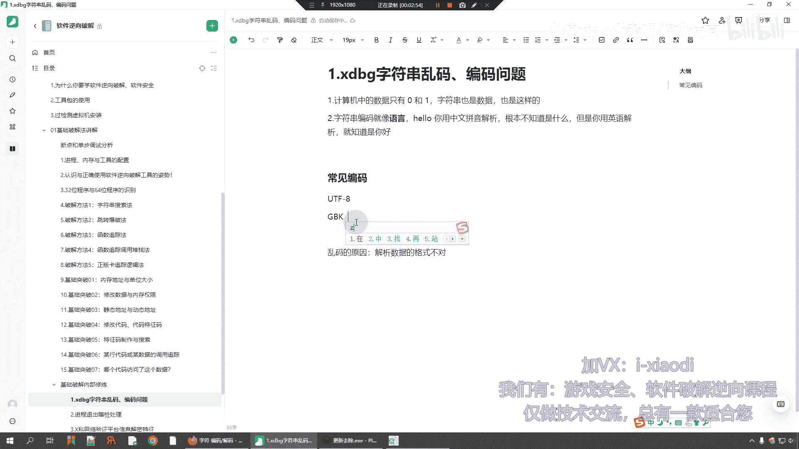

## 三、实例分析：x64dbg 中的乱码

上面我们介绍了编码的基本概念，这一节我们来看看一个真实的程序示例。假设我们有一个程序，运行起来之后，通常在 x64dbg 中我们会点击“符号”标签，切换到程序的主模块，然后搜索当前模块中的字符串。操作之后，我们会看到一些字符串。在某些情况下，可能一部分字符串显示正常，另一部分却出现了乱码。这是什么原因造成的呢？

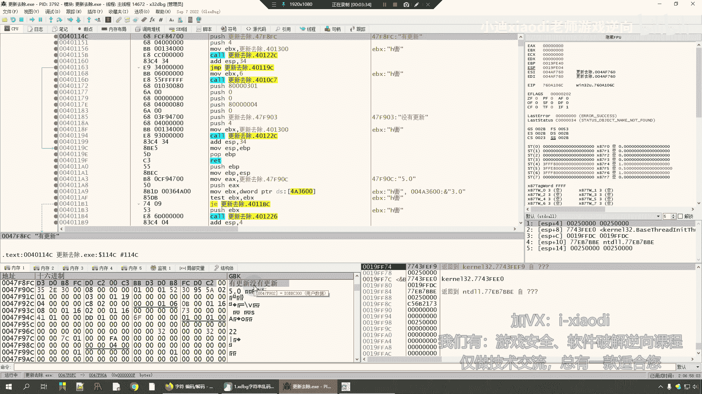

带着这个疑问，我们来一起探寻字符串编码的本质。比如我们在 x64dbg 中切换到中文相关的字符串，可以看到一个类似“有更新没更新”的文本，这个字符串有一个自己的地址。我们跳转到这个地址去看一下底层的字节数据。此时你会看到地址处的数据是类似这样的十六进制序列：

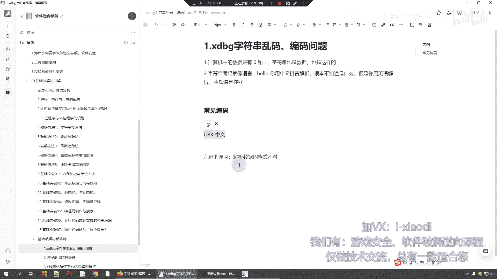

```text
D3 D0 B8 FC CD 0C 20 0C 3C ... C2
```

x64dbg 默认使用 UTF-8 格式来显示这些数据，而当它尝试用 UTF-8 去解析这一串字节时，显示结果就是乱码。那么问题来了，为什么会乱码呢？因为解析数据的格式不对。中文通常使用 GBK 编码来存放，如果使用 UTF-8 来解析 GBK 编码的数据，自然就会得到一堆看不懂的乱码。所以，我们可以尝试更改编码的显示方式，让它用 GBK 来解析。

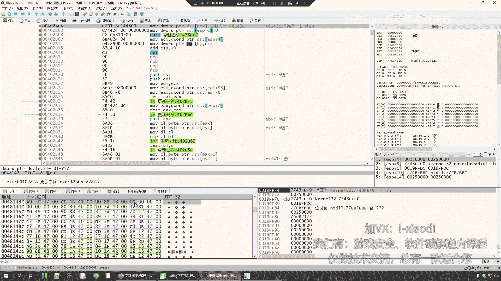

## 四、解决方案一：在 x64dbg 中切换代码页

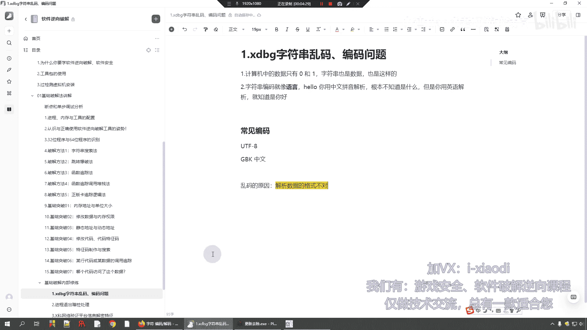

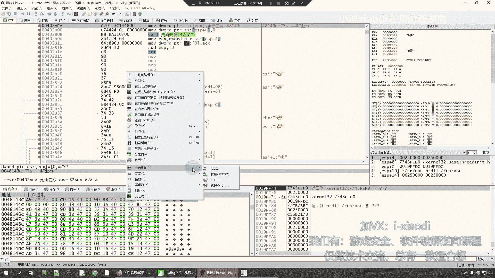

了解了乱码原因后，我们来看看如何在 x64dbg 中切换编码显示方法。具体操作是在 x64dbg 的十六进制数据区域，点击鼠标右键，然后选择“十六进制”，接着点击“代码页”，在弹出的窗口中找到“GBK”，选中后点击确定。操作完成后，你会惊奇地发现左侧显示的字节数据并没有任何变化，数据还是原来的那一串 D3 D0 B8 FC……，只不过我们解析这些数据的方式和方法变了，变成了 GBK 编码。

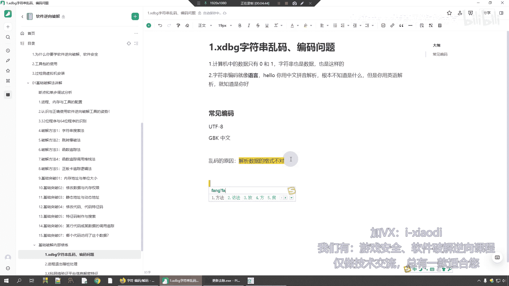

每一种解析格式都有自己固定的算法，它们会对这些字节数据进行不同的组织和处理。对于 GBK 编码来说，它会将这一串数据解析并显示成“有更新、没有更新”这样的中文文本。这样一来，数据就不再是乱码了，显示完全正常。从这个例子我们可以得出一个结论：**乱码的根本原因就是解析数据的格式不对**。

## 五、解决方案二：使用在线解码工具验证

如果我们在 x64dbg 中遇到了乱码，除了直接切换代码页，还有没有其他方法呢？有同学可能会问，只靠 x64dbg 中的切换够不够权威？如果觉得不够，我们还可以使用另一种方法，那就是把原始字节数据拷贝出来，然后放到在线的解码工具中进行验证。

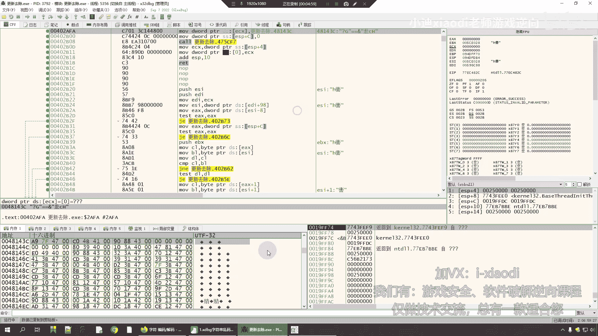

具体操作是这样的：在 x64dbg 中找到那一行乱码数据，鼠标右键点击，选择“复制”，然后选择“二进制编辑”，再点击“复制”，这样就可以把这一串原始字节数据完整地拷贝下来。拷贝完成之后，我们打开一个网站，这个网站叫做“锤子在线工具”，大家可以在搜索引擎中搜索“锤子在线工具”找到它。工具页面上可以输入十六进制数据，然后点击解码，解码完成后就会输出对应的关键信息。如果我们把刚才从 x64dbg 中复制的数据粘贴到工具里，同样可以得到解码结果。工具会显示当前使用的字符编码，比如 UTF-8。我们也可以把编码切换成 UTF-16 试试，结果不行；再换成 GBK，结果也不行。

那么，如果切换了多种编码方式之后，这些数据仍然无法解析成任何有意义的字符串，那就说明这一串数据可能根本就不是一个字符串，它只是一个普普通通的字节数据。在逆向分析中，我们不要认为所有显示在字符串列表里的内容都一定是字符串。有时候，x64dbg 显示的乱码其实并不是真正意义上的字符串，它可能只是一段简简单单的数据，只不过 x64dbg 错误地将它以字符串的形式显示了出来而已。

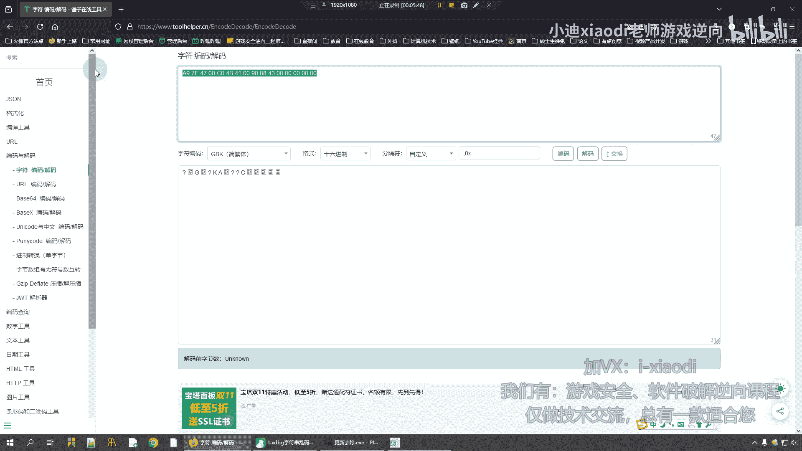

## 六、设计原则：能多不能少

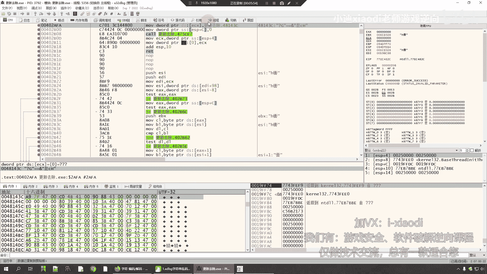

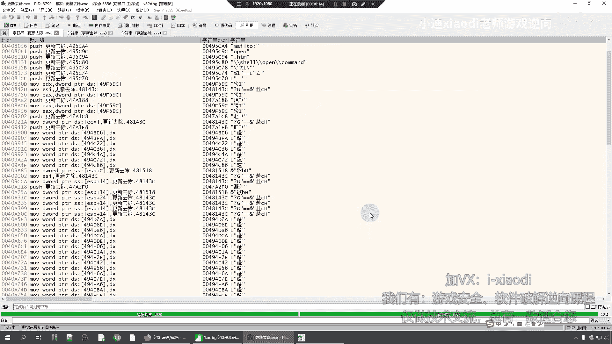

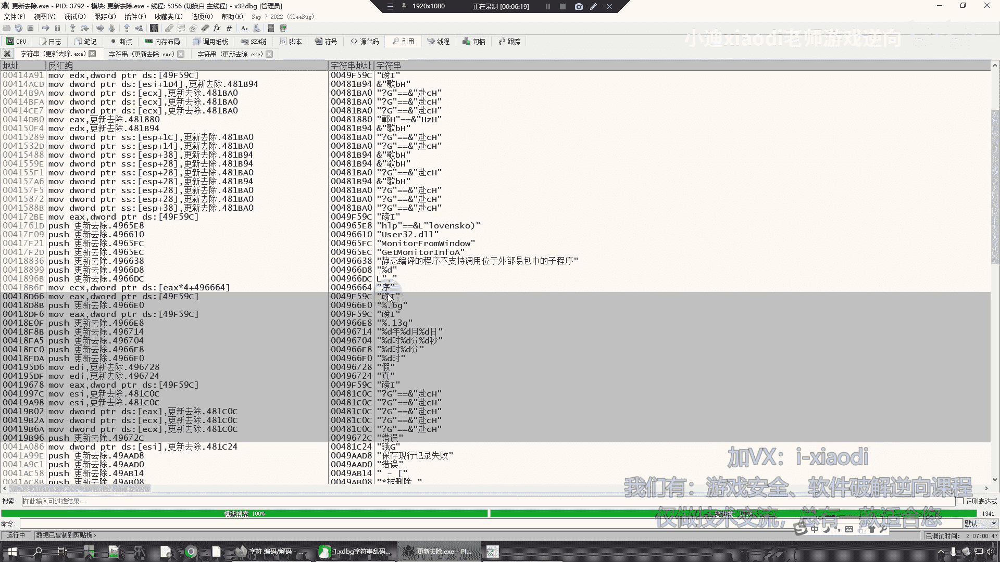

为什么 x64dbg 会把不是字符串的数据也显示在字符串列表里呢？这里有一个设计原则，叫做“能多不能少”。我们做事情通常也遵循这样一个原则：你可以给得多一点，但不要给少了，因为多多益善。x64dbg 为了尽量不遗漏任何可能的字符串，它会把所有看起来可能是字符串的字节数据都尽量列出来，避免因为漏掉而让分析者错过关键信息。这样做的代价就是列表中会出现一些其实并不是字符串的数据。但是，多了我们可以自己筛选，可以手动删减；如果少了，那就会非常麻烦，可能会漏掉重要线索。

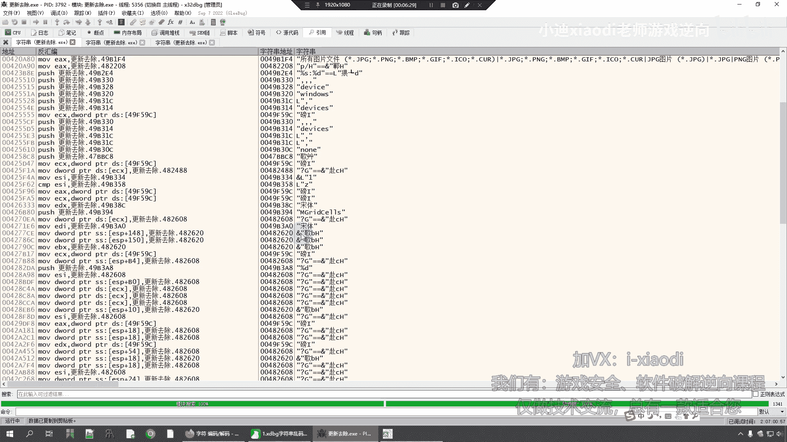

## 总结

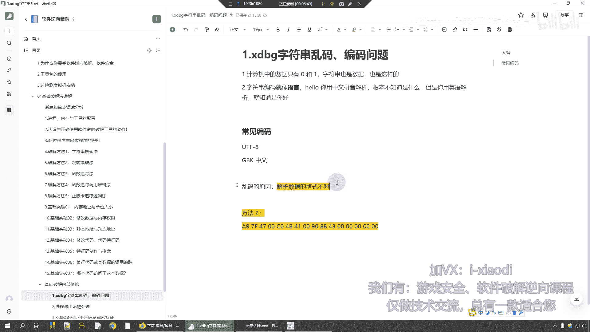

本节课中，我们一起学习了 x64dbg 中字符串乱码以及编码的相关问题。我们首先明白了乱码的本质是编码错误，知道了计算机中所有数据都是 0 和 1，字符串的本质也是如此。接着，我们学习了字符串编码就像语言一样，是一种解析文本的规则，常见的编码包括 UTF-8 和 GBK。在实操部分，我们演示了如何在 x64dbg 中通过修改代码页来正确显示 GBK 编码的中文，也介绍了使用“锤子在线工具”来验证和解析字节数据的方法。我们还总结出：如果尝试了多种编码都无法解析出有意义的内容，那么这些数据往往不是字符串，而只是普通数据。最后，我们理解了 x64dbg 字符串列表“能多不能少”的设计原则。掌握这些知识之后，以后再在逆向过程中碰到乱码，心里就不会再有那么多困惑了。本节内容偏重纯理论知识，但它是后续实战分析的重要基础。希望同学们能够彻底掌握编码和乱码的原理，我们下期再见。
