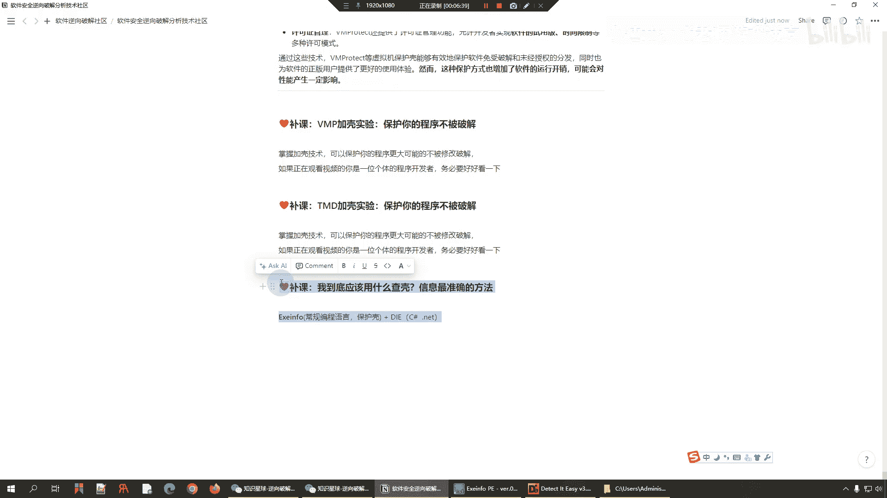

# 小白软件破解反汇编逆向安全工程师2024：公开课：查壳工具选择与信息识别方法 🔍

## 📖 课程概述

在本节课中，我们将学习软件逆向分析中的一个基础但关键的环节——如何准确识别程序是否加壳、加的是什么壳。课程核心围绕两款主流查壳工具（ESin 和 DIE）的对比实验展开，并讲解如何通过分析程序区段特征来判断壳的类型。通过学习本节内容，你将掌握最实用的查壳方法和独立分析思路，不再依赖单一工具的判断结果。

## 🎯 背景说明：为什么需要查壳？

在软件安全分析中，壳（Shell）是一种对程序进行加密或压缩的保护机制。壳的存在会干扰分析者对程序的静态分析和动态调试，因此在进行逆向工程前，准确识别壳的类型至关重要。

在实际学习过程中，初学者往往急于投入实战，可能会尝试使用 PE 类工具检测壳信息。然而，这种工具在准确性上存在明显不足，尤其是面对复杂保护壳时，其检测结果常常不完整或完全失效。

若你希望跳过基础部分直接掌握实战技能，本节课程是推荐的起点。本节介绍的两款工具将在后续的逆向分析过程中持续发挥作用。

## 🛠️ 查壳工具介绍与对比

### 工具一：ESin

ESin 是一款功能强大的查壳工具，能够识别常规的编程语言类型，并对程序中的保护壳进行判断。其判断逻辑可以简化为：

```text
IF 程序包含已知壳特征 THEN 输出壳名称
ELSE 输出"未检测到壳"
```


ESin 的优势在于其内置的壳特征数据库覆盖面广，能够识别市面上大多数主流保护壳。对于使用常见编程语言（如 C、C++、Delphi 等）编写的程序，ESin 都能快速给出明确的语言类型和壳信息。

### 工具二：DIE

DIE 是一款专注于检测 .NET 程序（特别是 C# 编写的程序）的查壳工具。对于 .NET 程序的开发者而言，DIE 是必备的辅助工具之一。

DIE 的检测能力集中在以下方面：

- 识别程序是否使用了混淆器（Obfuscator）
- 检测代码加密壳的类型
- 分析 .NET 程序集的元数据特征

对于非 .NET 程序，DIE 的检测能力相对有限，这一点将在下文实验中验证。


## 🧪 实验：VMP 与 TMD 壳检测对比


为了验证两款工具的检测能力，我们准备了两款加壳程序作为测试样本。这两款壳分别是：


- VMP 壳（VMProtect）：业界公认的顶尖保护壳之一
- TMD 壳（Themida）：同样属于顶级保护壳

实验环境为虚拟机中的 Windows 系统，测试程序位于桌面上的“虚拟保护实验”文件夹中。

### 第一轮测试：TMD 壳


首先使用 ESin 检测 TMD 加壳程序。将程序文件拖拽至 ESin 界面，检测结果立即显示该程序已被 Themida 保护。ESin 准确识别出了壳的具体名称。

随后使用 DIE 检测同一文件。将程序拖入 DIE 界面后，检测结果显示为空——DIE 未能识别出任何壳信息。

本局结果：ESin 胜出。

### 第二轮测试：VMP 壳

使用 ESin 检测 VMP 加壳程序。检测结果显示“99% packed/protected”，即程序已被保护，但 ESin 无法确定具体的壳类型。这表示 ESin 识别出程序存在保护机制，但未能匹配到具体的壳名称。

接下来使用 DIE 检测同一 VMP 文件，结果显示完全为空，未能检测到任何保护特征。

本局结果：ESin 再次胜出，但两款工具均未能精确识别 VMP 壳的具体版本。

## 📊 实验结果汇总

通过两轮对比实验，可以得出以下结论：

| 工具 | TMD 壳检测 | VMP 壳检测 |
|------|-----------|-----------|
| ESin | ✅ 准确识别 | ⚠️ 仅识别出已保护 |
| DIE | ❌ 未识别 | ❌ 未识别 |


综合来看，ESin 在常规查壳任务中表现明显优于 DIE，因此日常查壳推荐优先使用 ESin，其判断结果可表示为：


```text
查壳结果 = ESin(程序文件) → 壳类型 / 受保护状态
```


DIE 仅适用于 .NET 程序的补充检测，其适用范围可描述为：

```text
DIE(程序文件) → 适用于 .NET 程序 → 混淆器 / 加壳器类型
```

## 🔬 特征观察：手动分析 VMP 壳

当工具无法精确识别壳类型时，不必担心。我们可以通过观察程序区段特征来积累经验，从而手动判断壳的类型。

在 ESin 的“区段”视图中，可以观察到加壳程序的区段分布情况。一个正常程序通常包含以下区段：

- 文本段（代码段）
- 只读数据段
- 数据段
- 资源段

VMP 加壳程序的一个典型特征表现为：

```text
区段特征 = [4个正常段] + [3个异常段]
其中异常段 = 2个含数据段 + 若干Zero段
```

具体观察结果如下：

- 前四个区段（文本段、只读数据段、数据段、资源段）正常存在
- 剩余三个区段中，有两个包含数据
- 另外几个区段的 Size 显示为零，即数据为空

这种“正常区段 + 异常区段”的组合模式，是 VMP 新版本的一个显著特征。反复观察此类程序后，你将对各种壳的特征模式形成直观记忆。

## 📚 手动分析思路：观察与积累


查壳工具的原理是基于本地数据库匹配已知的特征签名。ESin 的数据库结构如下：

```text
壳特征数据库 = {特征签名1 → 壳名称1, 特征签名2 → 壳名称2, ...}
```


工具本质上是将程序中的字节特征与本地数据库进行比对，因此其识别能力受限于数据库的更新程度。当遇到未知壳时，工具自然无法给出准确结果。

这就是为什么手动分析能力如此重要。通过肉眼观察程序区段，你可以总结出肉眼可见的规律。例如，VMP 加壳程序的段名特征清晰可见，尽管存在几个名称乱码的区段，但其余区段名称均保持正常。

这种分析思路的核心价值在于：不依赖工具的局限性，通过自主观察与经验积累来判断程序特性。在实际学习中，记录和分析未知壳的特征，比单纯依靠工具更加可靠。

## ✅ 总结

本节课中，我们学习了查壳工具的选择与使用，内容包括以下要点：

- ESin 适合检测常规壳类型，推荐作为首选查壳工具
- DIE 仅适用于 .NET 程序检测，使用范围有限
- ESin 在 TMD 壳检测上优于 DIE，结果准确可靠
- 面对无法识别的壳类型，可通过区段特征进行手动分析
- 工具依赖本地数据库进行判断，手动观察与总结同样重要
- VMP 新版本的特征为“正常区段 + 异常区段”的组合模式
- 加壳程序的识别能力需要长期积累，多实践即可掌握



课后请自行实验，将本节方法应用于实际程序样本的壳检测中。通过多次实践，你将逐步建立起自己的查壳经验库，从而在逆向分析中更加从容应对各种加壳程序。
