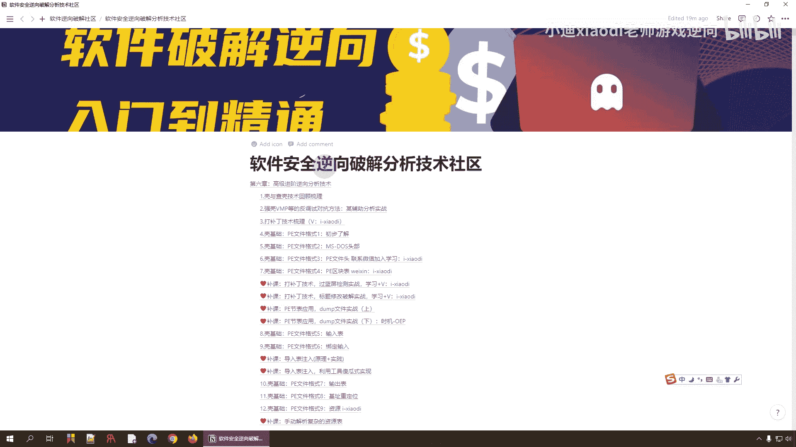
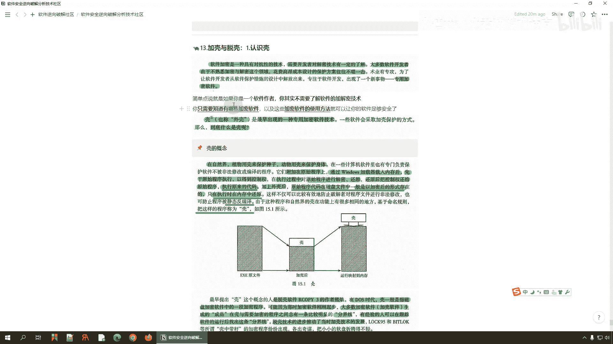

# 🔒 加壳与脱壳：1：认识壳

本节课中，我们将一起认识“壳”这一核心技术。壳是保护软件的重要手段，也是逆向工程中必须掌握的基础知识。通过本节课的学习，你将理解壳的概念、作用、历史发展，以及它在现实中的表现。

## 📌 什么是壳

首先，我们从“软件加密”说起。软件加密是一种具有对抗性的技术，需要开发者对解密技术有一定的了解。换句话说，如果你不了解解密手段，你设计的保护方案就很容易被人破解。

现实情况是，大多数软件开发者并不熟悉加密与解密这个领域。比如说你是一个写软件的，你可能只专注于功能实现，对于加解密技术并不了解。即使你花费高昂的成本设计了保护方案，也可能被别人一破就破解掉了，这样一来，投入就白费了。

在这种情况下，有一个成语叫“术业有专攻”，于是就出现了一个新事物——专用加密软件。简单点说，如果你是一个软件作者，你其实不需要了解软件的加解密技术，你只需要知道有哪些现成的加密软件，以及这些加密软件的使用方法就可以了。



只要你掌握这些加密软件的基本使用方式，就可以让你的软件足够安全。那么这个“壳”，也叫“外壳”，就是最早出现的一种专用加密软件技术。这个东西就是壳，这是最早出现的技术。

## 🌰 自然界中的壳与程序中的壳

那什么是壳呢？我们先看一下自然界的概念。在自然界里边，植物用壳来保护种子，动物用壳来保护身体。比如说乌龟的龟壳，对吧？乌龟的龟壳是附加在乌龟身体之上的，它保护着内部柔软的肉体，防止外部攻击。

Windows 上的程序保护壳也是类似的原理。它同样是附加在原始程序之上的。这个壳通过 Windows 加载器载入内存后，这是 Windows 操作系统使用的一种技术。加载到内存之后，壳会先于原始程序执行，以获得控制权。

壳在外边就像一个保护罩一样，保护着内部的程序。它先于原始程序执行，所以它是最先被攻击的那一方。就像防弹衣一样，子弹打过来，最先接触的是防弹衣，而不是身体。

在程序执行过程中，壳会对原始程序进行解密还原。还原之后，它会把控制权还给原始程序，让原始程序继续执行原来的代码。毕竟这个程序还是一个程序，程序终究要运行，运行的肯定是程序自己本身的代码，不能一直跑壳的代码，对不对？

## 🛡️ 加壳后的程序是什么样的

加上外壳后，原始程序的代码在磁盘文件中一般是以加密后的形式存在的。换句话说，假如我有一个程序，我给它加壳了，它放在磁盘上，它是穿着防弹衣的。从外部看，你看到的只是壳，而不是里边的真身。

当运行起来之后，这个防弹衣会把里边的“肉体”展开，也就是把原始代码解密还原。如果黑客要攻击这个程序，他直接攻击到的是下边的原始代码吗？不，他首先必须攻击壳层，因为壳在最外面挡着呢。

所以说，壳就相当于一层防弹衣。由于这种程序和自然界中的壳在功能上有很多相同的地方——都是保护和隐藏内部的东西——所以基于命名的规则，人们把这种程序也叫做“壳”。这个名字非常形象，也很容易理解。

## 📜 壳的发展历史

壳的发展其实也具备一定的历史。最早提出壳这个概念的人，是脱壳软件 Copy3 的作者雄念。在 DOS 时代，壳一般指磁盘加密软件中的一段加密程序。

那个时候，加密软件刚刚起步。大多数加密软件和程序之间有一条比较明显的分界线。如果是一个有经验的黑客，他就可以找到这条分界线，从而把软件破掉。这就像一道防线，只要找到薄弱点，就能撕开缺口。

所以说，脱壳技术的进步就推动了当时加壳技术的发展。这就像战争推动了武器的发展一样——有矛就有盾，有盾就有更强的矛。

下面还有一段历史，本书中给大家三分钟的时间自行阅读。同学们可以暂停视频，仔细阅读一下标注为高亮的部分。阅读完之后，我们来做重点的归纳总结。

## 🔑 现代壳的发展趋势与观察

以下是关于壳的重要结论，请大家注意：

1. 随着时代的发展，当代 Windows 操作系统中最先开始流行的是**压缩壳**，然后是**加密壳**，最后是**虚拟机保护壳**。这个演进过程也是我们接下来讲课的内容。从简单到复杂，从压缩体积到对抗分析，壳的技术在不断进化。
2. 很多正常的软件加了壳会被杀毒软件报毒。这个东西属于误报，因为杀毒软件偷懒了，它直接就把这些壳当作木马病毒来处理了。比如说你写了一个软件，你明明没有那些恶意的代码，但是加了壳之后就被判为木马了。这个东西不是你的问题，是杀毒软件的问题。当然，壳也有它自己的原因——因为很多恶意软件也会加壳，杀毒软件为了安全，干脆把凡是加壳的都标记为可疑。
3. 越来越多的大型商务软件很少用壳了，它们更加依赖密码学算法以及设置**暗装**。

## 💣 什么是暗装

那什么是暗装呢？暗装通常称为**逻辑炸弹**，或者说**逻辑锁**。它是软件内部故意植入的一段代码。这段代码在特定条件下触发，执行某些特殊操作。

这些操作可能包括限制软件功能、显示警告信息、修改数据等等。暗装的目的就是为了防止软件被未经授权的方式使用或破解。

我们可以把暗装的逻辑看作一个条件触发机制，用伪代码描述如下：

```python
if 触发条件（如检测到破解特征）:
    执行限制操作（例如：CPU 占用飙升、弹出警告、篡改数据）
```

举一个实际的例子：比如说你破解了一个程序，破解之后看起来可以正常使用了，但是你的程序资源占用会特别高。比如说你的 CPU 占用只有 10%？不，加装了暗装的破解程序可能达到 60% 甚至更高。这个时候你可能就碰到了暗装。

那这个时候，你就必须去找到这些暗装代码，把这些暗装去掉，才能够正常地使用软件，才算是一个完美的破解。暗装就像是软件作者埋下的地雷，你不小心踩到，就会触发非常难受的效果。

## 📝 总结

本节课中，我们一起学习了壳的基本概念。壳是最早出现的专用加密软件技术，它附加在原始程序之上，先于原始程序执行，起到保护作用。我们还了解了壳的发展历史：从 DOS 时代的磁盘加密程序，到现代 Windows 时代的压缩壳、加密壳、虚拟机保护壳。

此外，我们还讨论了加壳可能导致的杀毒软件误报问题，以及大型商业软件更倾向于使用暗装来防止破解。如果你是一个软件作者，你可以通过本节课以及接下来的内容，学会如何更好地保护自己的软件。如果你是想学逆向工程、想破解相关技术的同学，那么接下来的课程一定要认真听讲。



希望在本节课之后，大家都能够领悟到壳这样一种技术。我们会在接下来的日子里继续探讨加壳与脱壳的更多内容。我们下集再见。
