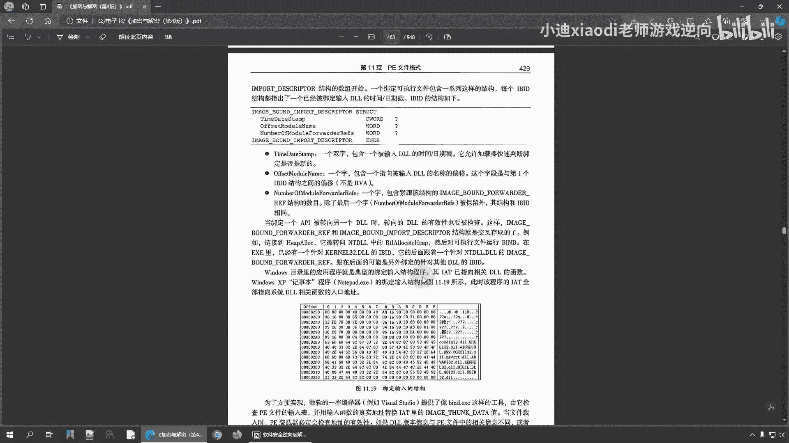
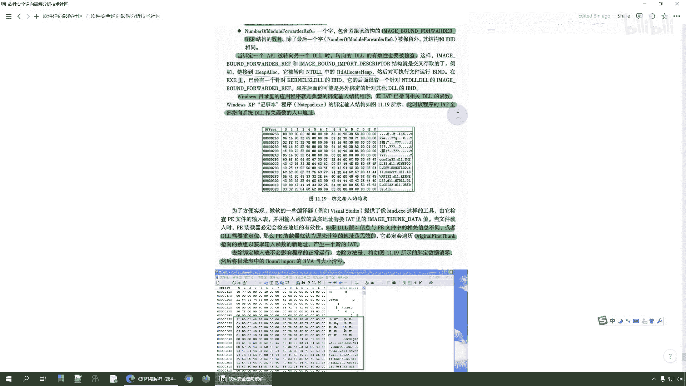

📘 壳基础：第九讲：PE文件格式6：绑定输入

大家好，我是小迪老师。学习软件安全和逆向破解，找小迪老师就对了。在本节课中，我们将要学习壳基础第九讲：PE文件格式6——绑定输入。这节课参考的教材是《加密与解密》，这本书一直是第六章非常关键的参考资料。如果大家自己跟着教材去实践，可能会发现对不上号，原因很简单：绑定输入现在已经被视为过时技术了。所以这节课的内容以科普为主，我们会弄明白绑定输入到底是什么、它为什么会被淘汰，同时还会顺带认识一下ASLR这个现代系统安全机制。

在正式开讲之前，顺便说一句课程优惠信息：目前基础版199元、高级版249元，欢迎大家前来学习。好了，下面我们进入正题。

## 什么是绑定输入？




首先，绑定输入在英文中叫做 Bound Import，它是PE文件格式中的一种优化技术。它的设计目标是在编译阶段，也就是程序生成的时候，就静态确定导入库的地址，从而加速应用程序的启动。众所周知，程序运行时需要依赖很多动态链接库（DLL）。这些动态链接库是在程序运行的时候才进行链接的，那么问题来了：有没有更快的方式呢？当然有。如果程序还在本地磁盘上的时候，就已经把那些库的地址确定下来，那么运行起来就不需要重新计算了。

绑定输入表里存放的正是可执行文件或DLL所依赖的其他DLL的预计算地址信息。它把要调用的动态链接库地址提前算好，保存在本地文件里。程序加载时可以直接使用这些现成地址，省去动态查找的过程。可以这样理解：传统方式就像每次回家都要临时找锁匠开门，而绑定输入则是提前把钥匙配好，回家直接开。

为了从数据结构上理解它，我们可以看下面这个C语言结构体，它描述了绑定输入表中的一个描述符：

```c
typedef struct _IMAGE_BOUND_IMPORT_DESCRIPTOR {
    DWORD TimeDateStamp;              // 时间戳，用来判断DLL是否被更新过
    WORD  OffsetModuleName;           // 模块名字符串相对于描述符的偏移
    WORD  NumberOfModuleForwarderRefs; // 后续转发器描述符的个数
} IMAGE_BOUND_IMPORT_DESCRIPTOR;
```

这个结构体记录的是程序生成时某个DLL的状态快照。理想情况下，加载器只需要检查文件中的地址是否仍然有效，然后直接使用即可。用伪代码表示就是：

```text
// 传统动态链接：程序运行时查找地址
地址 = GetProcAddress(dll, function)

// 绑定输入：程序生成时预计算地址
地址 = 文件中的预存值
```

这个思路的核心可以归纳为：把“加载时解析地址”变成“文件里预存地址”。可惜，这种“提前算好”的做法，后来被现代操作系统的安全机制彻底打破了。

## ASLR：让预计算地址失效的“随机化”

上一节我们了解了绑定输入的原理，接下来要看看它为什么会被抛弃。这里必须提到一个术语：ASLR，全称是 Address Space Layout Randomization，中文叫“地址空间布局随机化”。新手以后一定会经常见到它，所以现在先建立一个印象。ASLR是一种安全特性，它通过随机化进程各个组件的地址空间，来阻止一些攻击手段，比如缓冲区溢出攻击。简单说，程序每次加载到内存时，DLL、堆栈、堆等区域的位置都不一样。

ASLR的随机化特性意味着：预先计算好的固定地址，在程序真正加载时很可能已经不再有效。因为地址是随机分配的，你提前在文件里存一个固定地址，其实是一堆无关数据。而且这些预计算的数据还存在程序文件里白白占用空间。本来想优化速度，结果反而成了累赘。更麻烦的是，如果加载器强制使用这些旧地址，还可能引发兼容性问题。因此，绑定输入表的优势就变得毫无意义了。

用公式来表示现代系统的地址生成规则，就是：`实际地址 = 随机化基址 + 相对偏移`。由于随机化基址每次都可能变化，所以绑定输入表里保存的绝对地址，几乎等于一个“随机数”。

## 为什么绑定输入已经过时？

刚刚我们看到了ASLR带来的影响，现在来梳理一下绑定输入的兴衰过程。随着操作系统和应用程序加载机制的发展，尤其是ASLR的引入，绑定输入表的优势越来越不明显。在Windows XP系统上，我们还能看到绑定输入表的身影；但在Windows 10上已经找不到了，更不用说现在的Windows 11了。所以从本质上说，这是一种过时的技术。

尽管现在的PE文件格式仍然在数据目录表中为绑定输入预留了位置，但在现代软件开发实践中，已经不再推荐使用这项技术。因此，当下程序的数据目录表第12项，基本上都是空的。

接下来我们做一个实际操作来验证一下。比如用PE查看工具打开任意一个程序，这里以“代码注入器”为例。展开数据目录表，找到第12个成员，你会看到 `Bound Import`（绑定输入）这一项。通常情况下，它的 `VirtualAddress` 和 `Size` 都是0。这说明什么呢？说明当前软件没有使用绑定输入。

用伪代码判断一个程序是否启用了绑定输入，其实非常简单：

```python
if data_directory[12].VirtualAddress == 0 and data_directory[12].Size == 0:
    print("这个程序没有使用绑定输入")
else:
    print("这个程序使用了绑定输入（极罕见）")
```

所以，如果你去看教材里关于绑定输入的章节，跟着操作却发现对不上，那是很正常的。原因就是这项技术已经被时代淘汰了。我们只需要大致了解它曾经是一种优化手段，并且理解它为什么失效，就够了。

## 总结



本节课我们一起学习了PE文件格式中的绑定输入（Bound Import）。我们从它的定义、数据结构和设计初衷入手，理解了它原本是为了加速程序启动而存在的优化技术。然后，我们认识了ASLR这个关键的安全机制，明白了正是因为地址空间布局随机化，让预计算地址变得毫无意义，最终导致绑定输入被弃用。简单来说，绑定输入是一个过时的PE文件结构。在Windows XP上偶尔能见到，在Win10/Win11上基本见不到。今后在数据目录表第12项看到全零，不要觉得奇怪，这就是现代程序的主流状态。好了，本节课就到这里。希望大家记住绑定输入和ASLR这两个概念，至少以后再看到它们时不会一头雾水。

