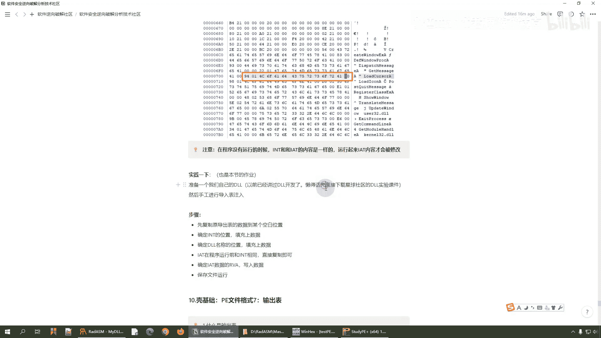

# 小白软件破解反汇编逆向安全工程师2024最新：第六章第五节：导入表注入（原理+实践）🚀

大家好，我是小李老师。学习软件安全逆向破解分析技术，就找小李老师。现在加入社区是最优惠的。如果你是在哔哩哔哩上看到的，可以点击评论区置顶链接直接购买加入。如果你想加入更高级、更优惠的，可以联系我的微信。


今天是我们第六章高级逆向分析技术的第五次补课，主题是导入表注入的原理与实践。在本节课中，我们首先要弄清楚什么是导入表注入，然后复习 PE 文件里导入表的数据结构，最后亲自动手修改一个 PE 文件，完成一次真正的导入表注入。整个过程会使用 WinHex 和 Stud_PE 这两个工具，内容不复杂，但需要耐心。

## 1. 什么是导入表注入？🤔

导入表注入的英文是 **Import Table Injection**，它是一种常见的恶意软件攻击技术。这种技术主要用于将恶意代码以 DLL 载体的形式注入到合法进程中，从而绕过安全防护机制和检测。

这个技术乍听起来比较高大上，好像很晦涩难懂，不过说实话，它其实很简单。比如实验程序 `tsP.exe`，我们运行它之后，你知不知道这个程序加载了几个 DLL 呢？你其实是知道的。因为我们前段时间讲过导入表，你可以用 `Stud_PE` 去看。操作方法很简单：把 `tsP.exe` 拖到 `Stud_PE` 里，点击“导入”，你就会看到有 2 个 DLL。2 个 DLL 说明什么？说明有 2 个 DLL 被加载了。

那么导入表注入要做的事情是什么呢？比如说，我们这里有一个 `myDLL1.dll`，我们要让 `tsP.exe` 这个程序去主动加载它，也就是说，让它任意性加载你想要加载的东西。这个 `myDLL1.dll` 是我们自己写的一个程序，它的功能非常简单：在 `myFunction` 函数里调用 `MessageBox` 弹出一个信息框，并且在 DLL 被加载的时候去调用这个函数，最后再把函数导出。整个功能就是让我们的程序去加载这个东西，很神奇吧？它通过什么手段实现呢？就是通过导入表注入这样一个技术。

## 2. 导入表结构复习 📚

在进行实践之前，我们先简单复习一下导入表的相关知识。首先，我们需要确定导入表的 **RVA**。导入表 RVA 位于数据目录的第二个成员，也就是在 PE 可选头的数据目录表中。在当前这个例子里，导入表 RVA 是 `0x2040`。如果我们用工具计算实际的文件偏移，它在 `0x640` 那个位置。所以导入表数据就在 `0x640` 处。

那么，有没有一个专门的成员去说明导入表有几项呢？并没有。如果导入表数据最后一项全都是零，就说明到这里是导入表的结尾。我们来数一下一共有几项。对于 `tsP.exe` 这个程序来说，一共有两项，因为 20 个字节为一项，所以这边一共有两项。

现在我们要做的是在导入表后面再加一项，但我们会发现此时文件中的地址空间明显是不够的。比如说，我们要在后面加一项，你就要把 `0x8E21` 等等后面的数据填充为 0。可是红色区域本来是有数据的，如果填充为 0，就会影响原来的内容。所以我们必须移动整个导入表的位置，找一个拥有足够空间的地方，然后再去修改填充数据。这就是我们的整体思路。

接下来，我们再把导入表数据回顾一下。橙色有数据的位置分别是 INT、DLL 名称 和 IAT，这个表对应下面的数据。我们先查看 INT：INT 的 RVA 是 `0x208C`，转换成文件偏移就是 `0x68C`。在 `0x68C` 这个位置，看到 `0x2102`，这就是 INT 的 RVA。`0x2102` 再转换成文件偏移是 `0x702`，然后我们去 `0x702` 看一下，看到没有？这不就是函数名称吗？INT 前边两个字节是序号，后边就是函数的名称。

然后我们再查看 DLL 名称。DLL 名称是这一项：`0x2174`，转换成文件偏移就是 `0x774`。在 `0x774` 这个位置，就是 DLL 名称。

最后我们再查看 IAT。IAT 的 RVA 是 `0x2010`，转换成文件偏移就是 `0x610`。在 `0x610` 处一眼看过去是 `0x2102`，这个 `0x2102` 转换成文件偏移是 `0x702`，看到的还是这个 INT。所以这里我们要注意：在程序没有运行的时候，INT 和 IAT 的内容是一样的；程序运行起来之后，IAT 的内容才会被修改。因为有了这样的性质，整个修改流程就比较简单了。

## 3. 手动实践：导入表注入 🛠️

下面我们开始手动操作。手动操作使用的工具还是 **WinHex**。首先把 `tsP.exe` 拖到 WinHex 中。拖进来之后，我们先找数据目录的第二个成员。在 WinHex 里，从 `0x18`、`0x28`、`0x38`、`0x48`、`0x58`、`0x68`、`0x78` 这些位置可以找到数据目录表。数据目录表的第二个成员就在这里，看到没有？值是 `0x2040`。`0x2040` 转换成文件偏移是 `0x640`，我们转到 `0x640` 看看。

在 `0x640` 这里，我们可以看到：一个、两个、三个、四个、五个，一共 20 个字节，这是第一个导入表描述符的信息；第二个再来一个、两个、三个、四个、五个，后面是零，说明一共有两项。我们先把这个数据复制一下。由于后面的空间不够，因为 `0x8E21` 等等位置有数据，所以需要先复制。我们直接按 `Ctrl+C`，点击确定，然后在下面找一个位置，比如说 `0x900`。在 `0x900` 处鼠标右键，点击“编辑”，点击“剪贴板数据”，然后点击“写入”。注意不要点击“粘贴”，因为粘贴会增大文件大小。点击“写入”并确定，这样我们就把导入表数据写进去了。

写进去之后，我们在后边去添加我们自己的数据。新的导入表描述符是 20 个字节，对吧？为了让我看得见，我把这块区域全部填充成 `0xCC`。这样只需要修改这一块内容就可以了，后面的零不用管。

新描述符的第一个字段是 INT。我们先找一个地方去存放函数的名称。我们的函数名称是 `myFunction`，我就手打上去。注意前两个字节是什么？是序号。后边才是函数的名称。所以我们在这里写上 `00 00`，然后写上 `myFunction`，这样就构造好了函数名称结构。

接下来再写一个 DLL 名称。DLL 名称是什么呢？是 `myDLL1.dll`。我们在另一个空白位置把它写上去。

然后我们需要计算这些位置的 RVA，因为你在导入表描述符里填写的内容是 RVA，不是文件偏移。当前函数名位置的文件偏移是 `0x8D0`，我们计算一下：`0x8D0` 转换成 RVA 是 `0x30D0`。所以指向函数名的指针应该填 `0x30D0`。当前 DLL 名称位置的文件偏移是 `0x8E0`，计算得到 RVA 是 `0x30E0`，所以 Name 字段填 `0x30E0`。当前用来存放 INT 数组（也就是一个指向函数名的 RVA 数组）的位置是 `0x8F0`，计算得到 RVA 是 `0x30F0`。因此，新描述符的 INT 字段填 `0x30F0`。由于程序没有运行之前 INT 和 IAT 是一样的，所以 IAT 字段也填 `0x30F0`。其他字段（TimeDateStamp、ForwarderChain）都填 0。

用结构化的方式表示，我们新填的导入表描述符大致是这样的：

```c
IMAGE_IMPORT_DESCRIPTOR {
    OriginalFirstThunk = 0x30F0,  // INT，指向 INT 数组
    TimeDateStamp      = 0,
    ForwarderChain     = 0,
    Name               = 0x30E0,  // 指向 DLL 名称 "myDLL1.dll"
    FirstThunk         = 0x30F0   // IAT，程序运行前与 INT 相同
};
```

填好之后，导入表的开头已经移到了 `0x900`。我们要对 `0x900` 重新计算 RVA，结果是 `0x3100`。所以需要在数据目录的第二个成员里，把原来的 `0x2040` 修改为 `0x3100`。修改完成后，就可以保存文件了：点击确定，关掉 WinHex，然后选择保存。

## 4. 验证效果 ✅

保存之后，我们来见证奇迹的时刻：运行这个程序。看到没有？程序弹出了一个 `123` 的对话框。我们的 DLL 功能就是弹出一个 `123`，这正好验证了导入表注入成功了。

同样的道理，我们可以再用 `Stud_PE` 看一下：把修改后的文件拖进去，点击“导入”，看看是不是多了一个东西？没错，多了一个我们自己的 DLL，也就是 `myDLL1.dll`。这就是导入表注入的完整过程。

## 总结 📝

本节课中，我们一起学习了导入表注入的原理与实践。首先，我们知道了导入表注入是一种将恶意代码以 DLL 形式注入到合法进程中的技术，然后复习了 PE 导入表中 INT、IAT、DLL 名称等关键字段，最后通过 WinHex 手动修改了 PE 文件的导入表，新增了一个导入表项，成功让 `tsP.exe` 加载了我们的 `myDLL1.dll`。整个过程听起来很复杂，实际上只要理解了导入表的结构，操作起来并不难。



给大家留一个作业：自己回去实践一下导入表注入。以前我们讲过 DLL 开发，如果你比较懒，可以直接去星球社区下载课件。我们下期再见。
