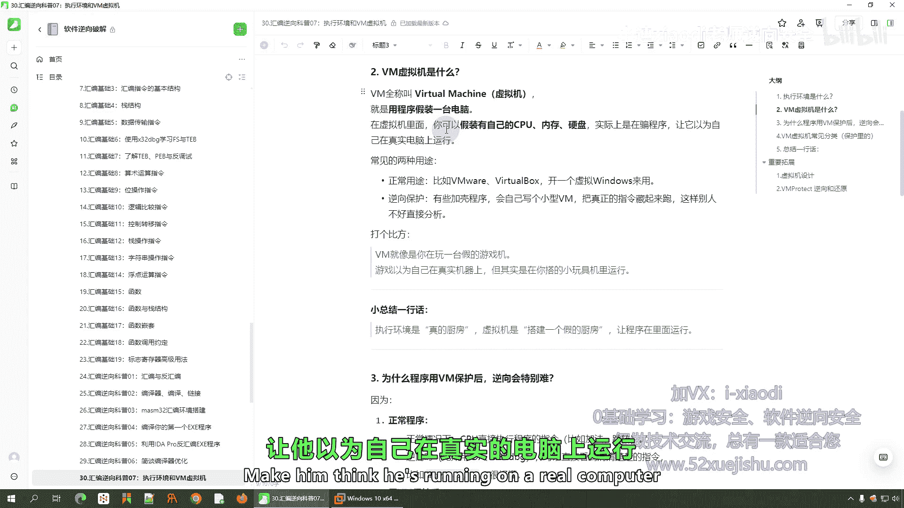
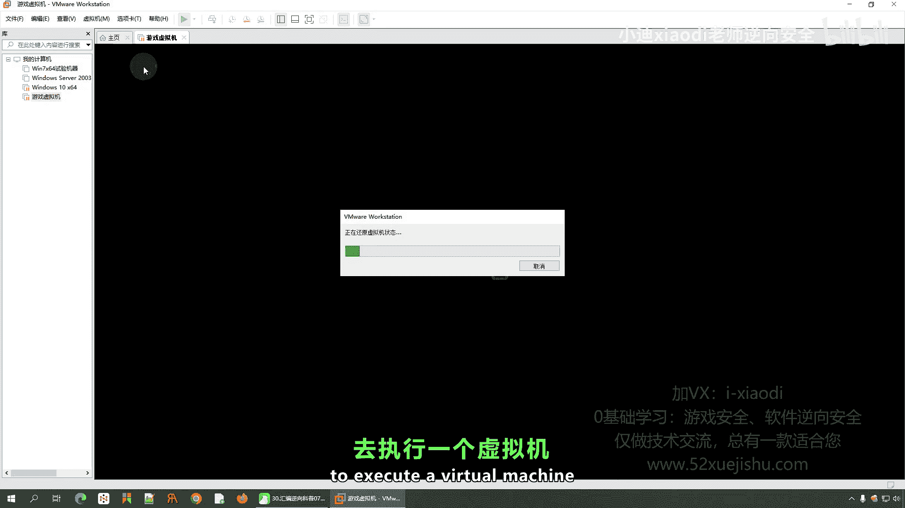
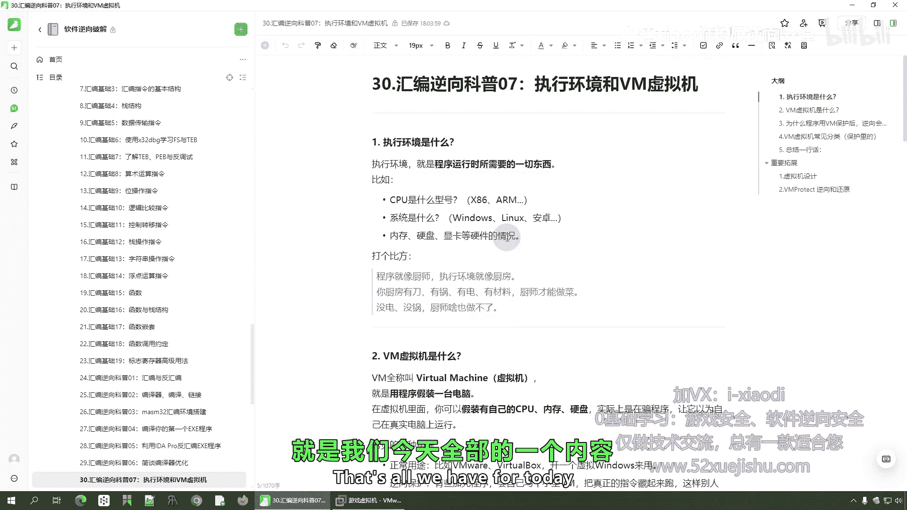

# 🛡️ 小白软件破解反汇编逆向安全工程师：第30节：汇编逆向科普07：执行环境和VM虚拟机

本节课中，我们将要学习两个核心知识点：第一个是执行环境是什么，第二个是VM虚拟机是什么。我们会先了解程序运行所依赖的硬件和系统条件，然后看看虚拟机是如何用程序去假装一台电脑的。接着，我们还会探讨VM技术在软件保护领域的应用，以及为什么程序一旦被VM保护之后，逆向分析就会变得特别困难。今天的内容只需要做一个简单的了解就可以了，不需要大家去深入研究。如果大家想要深入研究的话，我会在课程末尾给大家介绍一些重要的拓展资料，帮助大家进一步学习。

## 🖥️ 什么是执行环境

首先来看第一个知识点：执行环境是什么。执行环境就是程序运行时所需要的一些东西，这个概念非常好理解。比如说我们现在使用的这个笔记软件，它要运行的话，需要依赖什么呢？首先依赖CPU，对吧？还要依赖什么型号的CPU。然后依赖什么呢？依赖操作系统。

比如说现在就是一个Windows操作系统，对吧？再比如说内存是DDR几代的，硬盘是多大的容量呢？包括显卡的型号等等等等。这些都是硬件方面的情况。这些条件是缺一不可的，程序少了其中任何一样，都有可能出现运行不了或者运行不流畅的情况。这些条件合在一起，就构成了程序运行时所需要的一些必备的环境。这个就是执行环境。

以下就是执行环境的主要组成部分：

- **CPU**：程序的指令最终都要交给CPU来执行，CPU的型号和指令集决定了程序能跑多快。
- **操作系统**：程序运行在操作系统之上，不同的系统提供的运行接口是不一样的。
- **内存**：程序运行时进程会被加载进内存里，内存的容量和代数直接影响程序能否流畅运行。
- **硬盘**：程序的静态文件存放在硬盘上，硬盘的读写速度决定了程序的启动和加载速度。
- **显卡**：对于游戏和图形类软件来说，显卡的性能是必不可少的。

## 📦 VM虚拟机是什么

了解了执行环境之后，接下来我们来看看第二个知识点：VM虚拟机是什么。VM的全称是Virtual Machine，翻译过来就是虚拟机。虚拟机就是用程序去假装一台电脑，在虚拟机里边，你可以假装拥有自己的CPU、内存和硬盘。实际上它是在骗程序，让它以为自己在真实的电脑上运行。



也就是说，虚拟机在物理上并不真实存在，但它给程序呈现出来的样子和一台真实的电脑完全一样。程序在虚拟机里运行时，根本察觉不到自己其实是在另一个程序的控制之下。这种以假乱真的效果，就是虚拟机的核心原理。

### 🎬 VMware虚拟机的实际操作演示

比如说常见的VMware，它就是一个虚拟机软件。比如现在我就打开了VMware这个软件。这个软件本身是一个普通的应用程序，但是它可以创造出一台虚拟的机器出来，非常的神奇。

我们来看一下实际操作。比如现在我点击"继续运行此虚拟机"，这样的话就可以在这个软件里边去执行一个虚拟机了。现在这个虚拟机就已经开机了。大家会发现，是在一个软件里边模拟出了一个操作系统的完整环境出来，就好像创造了一个新的世界、新的大陆一样。

如果说大家觉得看不清楚，我可以全屏操作一下，让大家看一下这到底是不是一个完整的操作系统。大家可以看到，它的的确确就是一个非常完整的操作系统。大家可以仔细观察一下。在这个虚拟机里边，可以运行游戏，也可以运行相关的一些软件，都是可以的。此时这个软件里边运行的操作系统，它跟我们自身的操作系统是隔绝开的，互相之间不会干扰。此时这个隔绝开的操作系统环境，就简称为VM，全称叫做Virtual Machine（虚拟机）。

这个场景，就像你在玩一台假的游戏机一样。游戏以为自己在真实的机器上运行，但其实是在你的小玩具机里边运行。虚拟机给人的感觉就是如此，里面的程序全都以为自己跑在真实硬件上，实际上只是跑在一个软件模拟出来的世界里。

## 🔐 VM技术在软件保护中的应用

刚才我们看到的VMware的用途，属于正常用途。比如说VMware就是模拟一台操作系统出来供我们使用。但是这种技术不仅可以用来模拟操作系统，还可以用来保护程序。

比如说有些加壳程序，它会自己写一个小型的VM，把真正的指令藏起来跑，别人就不好直接分析了。也就是说，这个软件它会自己创造一个小型的虚拟环境，真正的指令就在这个虚拟环境里边跑。这样的话，分析起来就是比较困难的。逆向工程师拿到手之后，看到的不是正常的CPU指令，而是这个私有虚拟机才能解释的字节码，自然就一头雾水了。

## 🧩 为什么VM保护让逆向分析变得特别困难

紧接着第三个问题就来了：为什么程序被VM保护之后，逆向分析会变得特别困难呢？



原因非常简单，就是以前的这些代码，它都会给你隐藏掉，换成一堆假的指令。这个怎么去理解呢？其实非常简单。比如说以前有一条汇编代码是：

```asm
mov eax, 5
```

这条指令的意思就是把数值5移动到eax寄存器中，本来是一眼就能看懂的。那么被VM保护之后，它直接给你替换成下面这一串东西：

```asm
5A 3B 7C
```

你是不是全都看不懂了？也就是说，你看到的全都是假的指令。真的指令必须通过虚拟机解释器这样一个东西，一条一条地翻译，才能还原成原本的程序执行逻辑。

所以你要逆向被VM保护的程序的话，就要先研究清楚假的指令它是怎么翻译的，这个是比较麻烦的。整个VM保护的过程可以用下面这个式子来概括：

```text
真实指令 --虚拟化--> 假指令 + 虚拟机解释器
```

逆向工程师必须弄清楚假指令和解释器之间的对应关系，才能把原来的逻辑还原出来，这相当于要先学会一门全新的、没有文档的机器语言，难度自然就上去了。

## 🗂️ VM虚拟机的常见分类

第四个知识点是VM虚拟机的常见分类。VM虚拟机按照不同的实现方式和使用场景，可以分成好几种类型。比如说从实现方式上看，有的虚拟机是纯软件模拟的，有的虚拟机是借助硬件辅助加速的，还有的是为了专门保护程序而自定义制作的小型虚拟机。这些分类大家在日常接触中简单了解一下就可以了。

那么，VM保护给逆向工程师带来的痛苦，用一句话来总结就是：

> 程序用了VM保护，就像加了一个翻译器，还加了外星文加密。逆向工程师想看懂，必须先破译外星文，非常痛苦。

就是这个道理。

## 📖 深入学习资料推荐

如果大家想要学习了解虚拟机设计相关的一些知识的话，可以参考《加密与解密》这本书的第20章，这本书里有非常明确的讲解。如果大家想要了解mprotect逆向和还原相关的一些知识的话，可以去看这本书的第21章，也有非常明确的讲解。

以下是两个推荐的阅读方向：

- **虚拟机设计**：参考《加密与解密》第20章，学习虚拟机是如何实现的。
- **mprotect逆向与还原**：参考《加密与解密》第21章，学习如何应对这类保护的逆向分析。



## ✅ 本节课总结

本节课中，我们一起学习了执行环境的概念，知道了程序运行离不开CPU、操作系统、内存、硬盘、显卡等必备条件。然后我们了解了VM虚拟机的定义，看到了VMware虚拟机在软件中模拟出完整操作系统的实际演示。我们还探讨了VM技术在软件保护中的应用，分析了为什么VM保护会让逆向分析变得异常困难，本质原因就是真实指令被换成了假的指令，必须通过虚拟机解释器才能还原。最后我们还简单了解了VM虚拟机的常见分类，并且知道了《加密与解密》这本书的第20章和第21章分别是学习虚拟机设计和mprotect逆向还原的参考资料。这个就是今天全部的内容，我们下节课再见。

