# VMP强壳动态补丁破解实战：01：课程概述与目标 🎯

在本节课中我们将要学习一次围绕VMP强壳动态补丁的实战梳理。原文来自直播回放，内容包含挂起进程查看内存、使用CE搜索字符串、通过特征定位版本号、判断半成品数据、验证自写内存搜索器、分析动态地址、使用`WriteProcessMemory`临时修改内存、配置搜索替换补丁、选择`GetVersion`时机、处理CRC检测、理解指针与基地址，以及零基础学习提醒和直播互动。直播中穿插了背景音乐、歌词、玩笑和闲聊，这些内容在教程中作为现场说明保留，不改变技术主线。本课程仅用于技术交流，适合在授权环境中理解逆向分析思路。

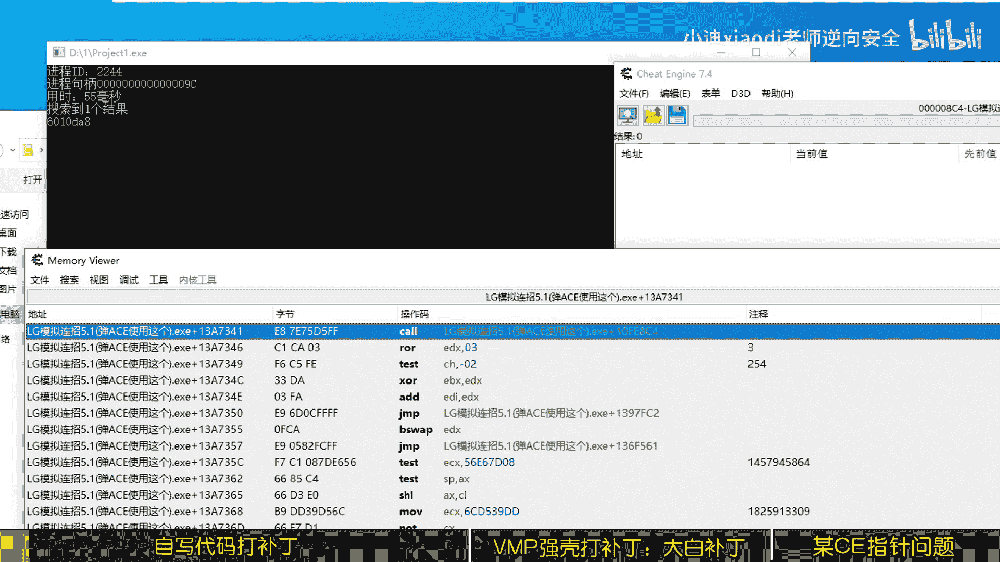

> 原直播主题：小白软件破解反汇编逆向安全工程师2025最新：5.29日直播回放，VMP强壳打补丁技术实战梳理：某VMP壳动态补丁破解--BV1P27wzrEpk

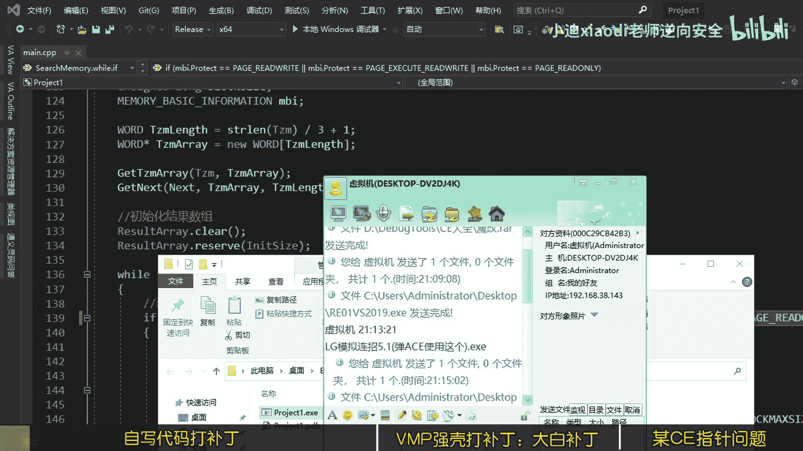

先说明课程目标，帮助初学者建立整体地图。下面列出本节要覆盖的目标和主线。

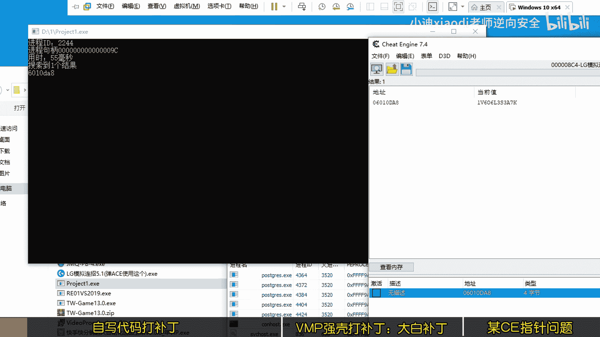

- 理解挂起进程与查看内存的目的。
- 掌握CE搜索字符串、记录地址、搜索版本号的基本流程。
- 理解特征定位与版本号`5.1`的查找差异。
- 判断“半成品”程序、异常返回数据`-81033`和参数反向问题。
- 验证自写内存搜索器，确认地址正确后修改内存。
- 理解动态地址、静态地址和修改时机。
- 使用C++思路编写动态补丁，避免直接用OD改错位置。
- 使用`WriteProcessMemory`演示临时补丁。
- 配置搜索替换补丁工具，理解`CreateWindowEXW`与`GetVersion`时机差异。
- 理解VMP强壳打补丁的关键步骤和CRC检测影响。
- 理解指针题、间接赋值、基地址和偏移。
- 保留直播中的互动提醒、工具获取、信息检索和学习建议。

上一段完成了课程总览，本节的目标是把技术路线和现场内容都纳入教程。下一节进入进程挂起和CE内存搜索，先解决“如何看内存、如何搜目标”的问题。

# VMP强壳动态补丁破解实战：02：挂起进程与CE内存搜索 🧰

上一节我们介绍了课程目标和整体路线，本节中我们来看看最基础的操作：挂起进程、查看内存、使用CE搜索字符串。直播中先选择挂起进程，原因是需要观察内存；程序运行起来后，直接整体暂停运行，再随便打开CE工具进行调试。这个思路被确认是正确的，随后搜索出了目标内容。自写程序本身没有问题，接下来要看一共能搜出多少个结果，并使用CE搜索字符串。操作中勾选一个目标，记录地址示例`6010DA8`，但版本号没有直接找到，因此需要自己定位特征，再通过特征定位版本号`5.1`。直播中提到同类问题由同一人教学，但有人能找到，有人找不到，说明特征定位存在差异。


核心搜索概念可以用下面的代码描述。


```text
操作流程：运行程序 -> 挂起/暂停 -> 打开CE -> 搜索字符串/特征 -> 记录地址
地址示例：0x6010DA8
版本号定位示例：5.1
异常返回示例：-81033
```

在搜索过程中还出现了“半成品”判断。直播中提到到期时间返回`-81033`，感觉返回数据不太对，需要确认这个程序能不能用，以及对方发来的是否只是半成品。进一步判断发现内容没有删干净，可能删掉了两个位置，需要更细心；也可能是某个参数反了。程序带有壳，原文提到“有VIP的壳”，实际应理解为带VMP类强壳，处理思路是直接改掉相关位置，不存在“有救没救”的复杂判断。下面列出本节的操作要点。

- 挂起进程的主要目的是查看内存。
- 程序运行后可以直接整体暂停运行。
- 打开CE工具后调试并搜索目标内容。
- 搜索字符串后勾选一个目标。
- 记录地址示例`6010DA8`。
- 没有直接找到版本号时，需要自己定位特征。
- 通过特征定位版本号`5.1`。
- 同类教学中有人能找到版本号，有人找不到，差异在特征定位。
- 返回数据`-81033`提示结果可能不对。
- 需要判断样本是否为半成品。
- 内容没有删干净时，检查是否少删或多删位置。
- 检查是否有参数反向。
- 样本带强壳时，处理思路仍然是定位并修改关键位置。

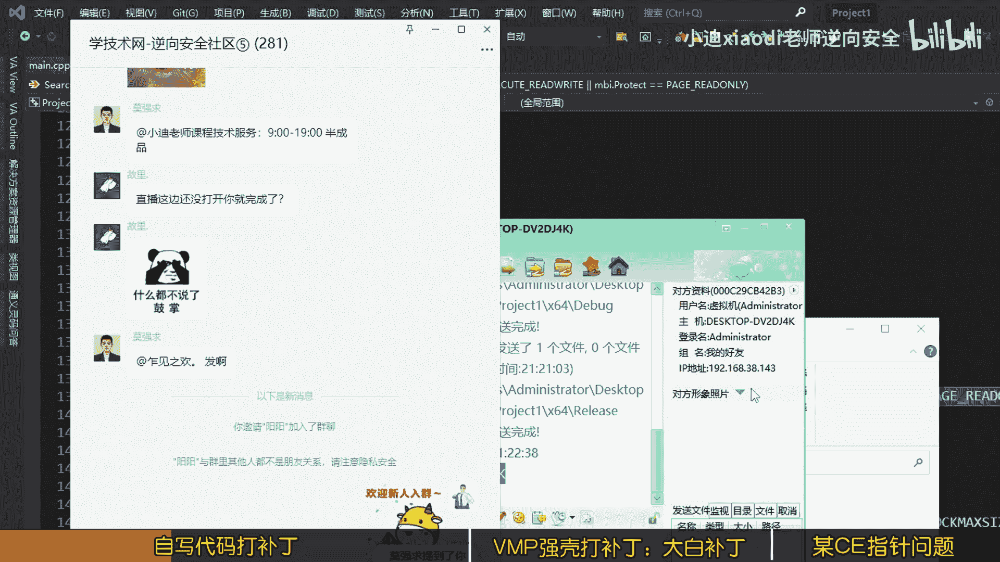

上一节完成了挂起和搜索的基础流程，本节确认了地址、特征和半成品判断。下一节我们验证自写内存搜索器，并讨论修改内存的时机。

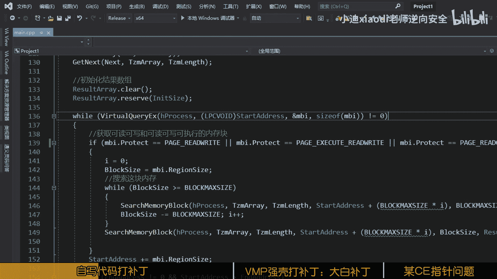

# VMP强壳动态补丁破解实战：03：验证内存搜索器与修改时机 ⏱️

上一节我们找到了地址并判断了数据异常，本节中我们来看看如何验证自写内存搜索器，以及什么时候修改内存。直播中已经验证自写内存搜索器可以使用，搜索出来的地址能够对上，找到地址后修改内存即可，没有额外复杂操作。使用CE修改也可以，关键是理解某云类程序的验证时机。原文说明不需要等程序完全运行、窗口加载完成后再修改，运行一段时间后仍然可以修改；例如把`61`改成`223`，想怎么改就怎么改，只要改成自己的目标值即可。该程序不是加载时验证，而是在点击登录按钮时验证，因此修改时机要围绕登录动作判断。

动态地址与修改时机可以用下面的公式和代码描述。


```text
动态地址 = 模块基址 + 偏移
验证时机 = 点击登录按钮时
CE临时修改示例：0x61 -> 223
```

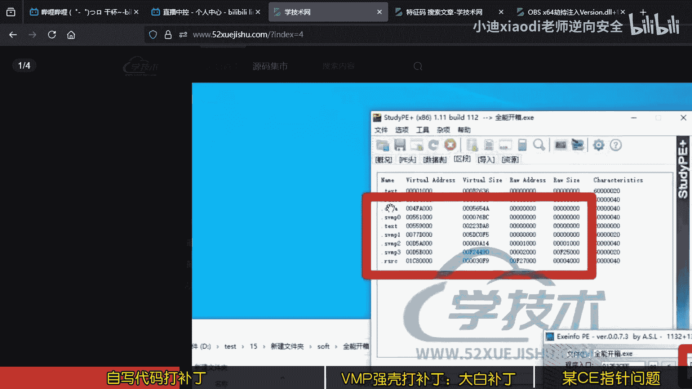


理解这个时机后，就不需要纠结程序窗口是否已经加载完成。只要目标地址正确，运行后修改也能生效。下面列出本节的关键结论。


- 自写内存搜索器已经验证可用。
- 搜索出的地址能够对应目标。
- 找到地址后直接修改内存。
- CE可以完成临时修改。
- 某云类程序不需要等待窗口加载完成再改。
- 程序运行一段时间后仍然可以修改。
- 示例中把`61`改成`223`。
- 修改目标是把自己的标识改成期望值。
- 程序不是加载时验证。
- 程序在点击登录按钮时验证。
- 修改时机应围绕登录按钮点击动作判断。


上一节确认了搜索器和修改时机，本节说明了“改哪里”和“什么时候改”的基础逻辑。下一节我们进入自写动态补丁和地址判断，重点分析为什么直接改错位置会失败。

# VMP强壳动态补丁破解实战：04：自己写动态补丁与地址判断 🧩

上一节我们讨论了修改时机，本节中我们来看看为什么要自己写动态补丁，以及如何判断地址是否正确。直播中建议自己写一个补丁，原因可能是程序存在检测，使用C++写补丁更可控。操作中出现“没效果”的反馈，需要明确是哪方面没有效果，例如软件标识是否改上、`2C4`相关数据是否对应、加密校验相关数据是否对应。直播中查看了`410A3F`和`410A54`，发现对应位置没有数据，因此怀疑改的是错误地址。关键判断是：该位置可能是动态地址，不是静态地址，应该修改动态地址对应的位置。除非某云类程序做了特殊修改，否则不能简单认为所有样本完全一样。

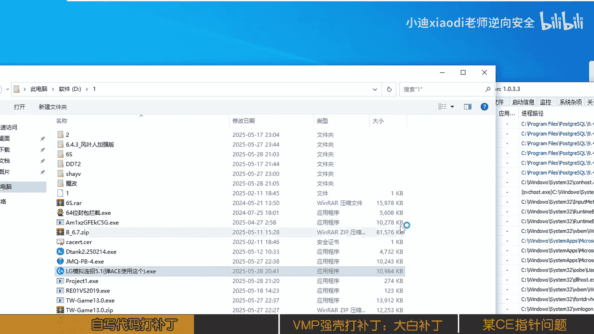

动态地址和特征匹配可以用下面的代码描述。

```cpp
// 概念示意：先搜索特征，再写补丁
uint8_t oldBytes[] = {0x2C, 0x04};  // 原文提到的2C4相关标识
// 动态地址不能写死，需要运行时搜索
uintptr_t target = searchFeature(moduleBase, oldBytes, sizeof(oldBytes));
```

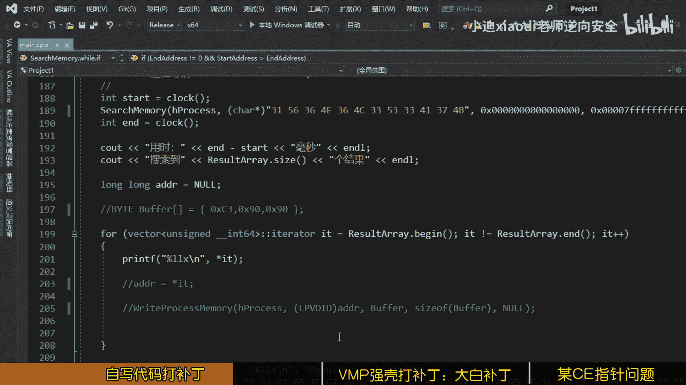

直播中还提到多个样本：某某云样本、加了SP的样本、MFC程序、一言相关样本，以及代码被虚拟化的样本。处理思路仍然是山寨式替换和关键位置修改，代码虚拟化后也照样尝试定位并处理。核心结论是：问题往往不在样本本身，而在补丁位置和补丁写法。下面列出本节的判断要点。

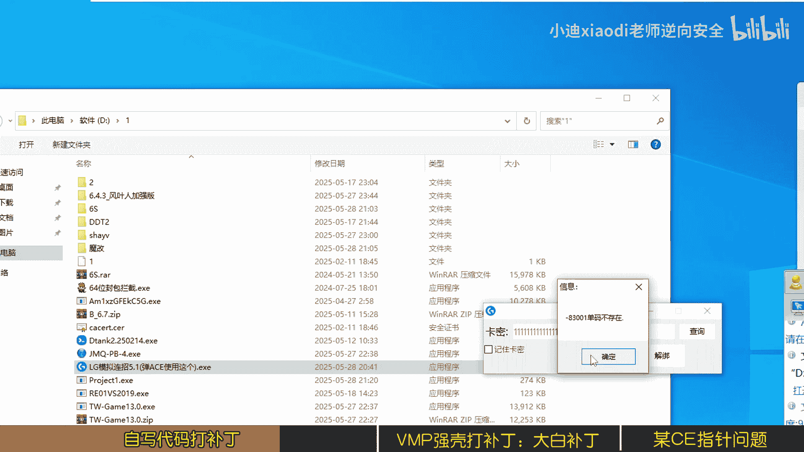

- 可以自己写动态补丁。
- 原文建议使用C++写补丁，口述中写作“CR加”。
- 出现“没效果”时，需要确认具体是哪方面没有效果。
- 检查软件标识是否修改成功。
- 检查`2C4`相关数据是否对应。
- 检查加密校验相关数据是否对应。
- 查看`410A3F`和`410A54`时未发现数据。
- 怀疑修改位置不正确。
- 判断地址可能是动态地址。
- 动态程序应修改运行时定位到的动态地址。
- 不要默认某云类程序的所有样本完全一致。
- 原文提到某某云、加了SP、MFC、一言、代码虚拟化等样本。
- 代码虚拟化后仍然沿用搜索、定位、修改的思路。
- 问题可能与样本无关，重点是补丁位置和写法。
- 正确流程是先搜索，再修改。
- 不建议直接用OD修改，因为位置容易不对。

上一节我们定位了失败原因，本节说明了动态地址和特征搜索的重要性。下一节通过`WriteProcessMemory`演示一个临时补丁，把“搜索后修改”的流程走通。

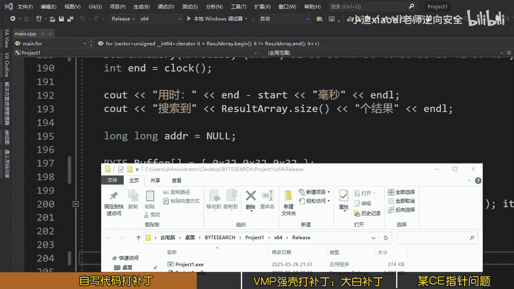

# VMP强壳动态补丁破解实战：05：WriteProcessMemory临时补丁演示 🧪

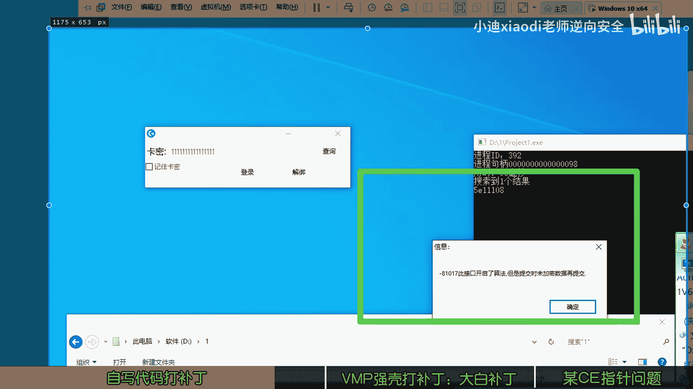

上一节我们强调了动态地址和先搜索后修改，本节中我们来看看一个临时补丁演示。直播中先关闭部分窗口，恢复进程，程序因时间较久退出，随后重新暂停、刷新，并做临时修改示例。示例中修改一个字节即可，第一个字节原值为`31`，将其改成`32`。使用`WriteProcessMemory`写入三个字节，构造`323232`作为补丁数据，然后运行验证。直播中先输入点卡密码，长度16位，填写`12345678`，目标为`2816`，出现“代码不存在”的提示。随后执行写入进程内存操作，修改成功后再次输入并测试，发现提交不上去，说明补丁已经打上，程序行为被改变。

`WriteProcessMemory`的核心代码可以用下面的形式描述。

```c
// 概念示意：先搜索或确认地址，再写入补丁字节
BYTE buffer[3] = {0x32, 0x32, 0x32};
BOOL ok = WriteProcessMemory(hProcess, (LPVOID)addr, buffer, 3, &written);
// 原文示例：第一个字节0x31改成0x32
```

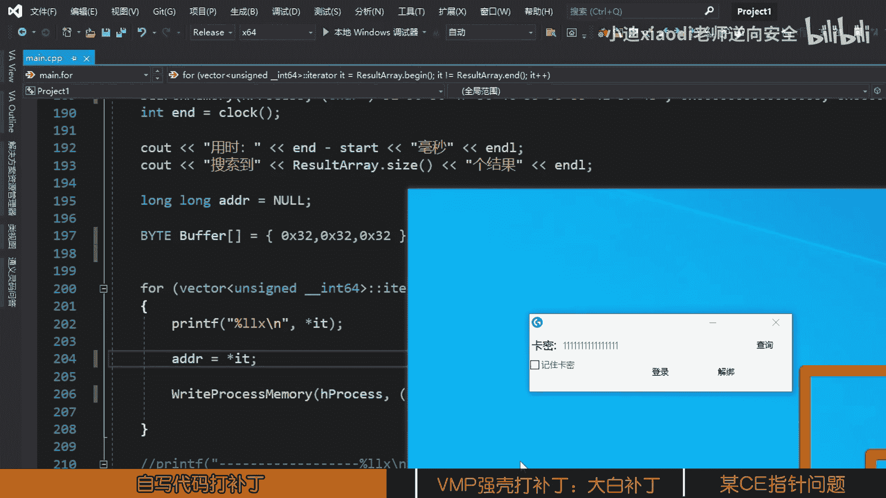

这个演示说明补丁本身可以成功，失败通常来自补丁位置不对或补丁没有真正写入。直播中明确说，这不是换样本的问题，也不是校验导致的问题，而是自己的补丁没有打成功；演示中随便一打就打上了，补丁完成后提交不上去，说明修改生效。使用OD修改的位置不对，因为目标是动态地址，必须先搜索再修改。下面列出本节的验证要点。


- 临时修改前关闭相关窗口并恢复进程。
- 程序退出后可以重新暂停和刷新。
- 示例只修改一个字节。
- 第一个字节原值为`31`。
- 将`31`改成`32`。
- 写入三个字节`323232`。
- 使用`WriteProcessMemory`写入进程内存。
- 输入点卡密码长度16位。
- 示例输入`12345678`。
- 目标代码示例为`2816`。
- 出现“代码不存在”提示。
- 修改成功后程序提交不上去。
- 说明补丁已经打上。
- 失败原因不是换样本。
- 失败原因不是目标校验。
- 失败原因是补丁没有打成功或位置不对。
- 不要直接用OD改，动态地址容易改错。
- 正确方法是先搜索，再修改。


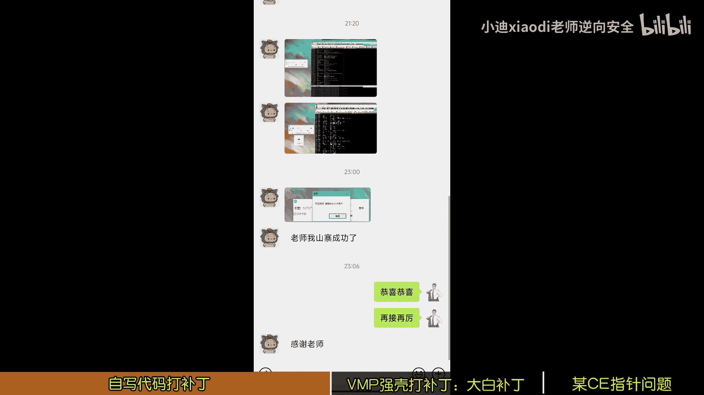

上一节我们通过写入三个字节验证了临时补丁思路，本节说明补丁位置和动态搜索是关键。下一节进入补丁工具配置，讨论解码判定、`CreateWindowEXW`和`GetVersion`的时机差异。

# VMP强壳动态补丁破解实战：06：补丁工具配置与GetVersion时机 🛠️

上一节我们完成了临时写入演示，本节中我们来看看如何用补丁工具配置搜索替换补丁。直播中先把程序运行起来，拖到工具中，选择搜索替换补丁，点击添加补丁，先不修改其他内容。第一次创建补丁时出现“补丁创建失败”，因此需要增加配置。第一步需要做解码判定，然后选择API。最初选择`CreateWindowEXW`，保存工程并创建补丁，执行到目录后运行，结果不可以。直播判断存在CRC检测，或者修改时机不对；`CreateWindowEXW`这个时机不行。随后改用`GetVersion`，保存工程后再次测试，发现可以登录，补丁打上了。这个过程说明补丁数据正确时，时机选择仍然非常关键。

补丁配置的核心参数可以用下面的代码描述。


```text
工具：搜索替换补丁
流程：拖入程序 -> 添加补丁 -> 解码判定 -> 选择模块/API -> 填写原始数据与补丁数据 -> 保存 -> 创建补丁 -> 执行到目录 -> 运行验证
失败示例：API = CreateWindowEXW，结果不可以，存在CRC检测或时机不对
成功示例：API = GetVersion，结果可以登录，补丁打上
补丁字节示例：323232
```


在工具操作中，补丁创建失败后需要补充判定条件，选择模块和API，填写原始数据、特征数据、补丁数据。`CreateWindowEXW`失败不代表补丁数据错误，而是修改时机不对。`GetVersion`成功后，程序可以正常登录，说明补丁已经写入。下面列出本节的操作要点。

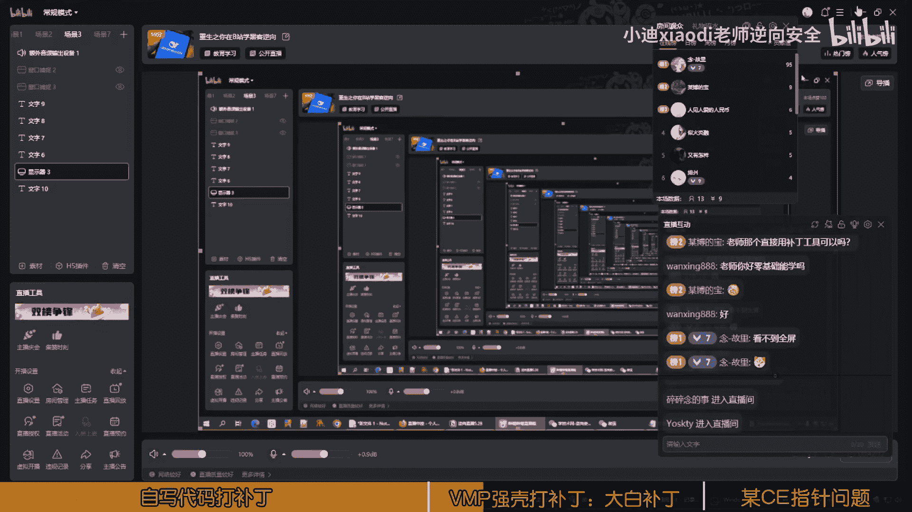

- 程序运行后拖入补丁工具。
- 选择搜索替换补丁。
- 点击添加补丁。
- 初始配置不修改其他内容。
- 直接创建补丁可能失败。
- 第一步需要做解码判定。
- 需要选择模块和API。
- 先尝试`CreateWindowEXW`。
- 保存工程并创建补丁。
- 将补丁执行到目录后运行。
- `CreateWindowEXW`时机下运行不可以。
- 判断可能存在CRC检测。
- 判断可能修改时机不对。
- 改用`GetVersion`后保存工程。
- `GetVersion`时机下可以登录。
- 补丁成功打上。
- 补丁数据示例为三个`32`。
- 创建补丁后执行到目录并运行验证。

上一节我们看到了补丁工具的配置和时机选择，本节确认`GetVersion`是一个有效时机。下一节把VMP强壳打补丁的关键步骤单独梳理，形成可复用的配置清单。

# VMP强壳动态补丁破解实战：07：VMP强壳打补丁关键步骤 🔐

上一节我们通过`GetVersion`成功打上补丁，本节中我们来看看对抗VMP加壳时的关键配置。直播中强调，搜索替换补丁拖过来后点击添加补丁，解码判定选择模块`kernel32`，API选择`GetVersion`。一般来说选择`GetVersion`就可以完成打补丁，然后复制配置，把特征、原始数据和补丁数据放到对应位置，点击添加，点击保存，再创建补丁。整个过程可以一气呵成。直播中补丁成功后说明目标没有额外加入检测，VMP强壳打补丁这个案例也就通过了。

VMP强壳补丁的关键配置可以用下面的代码描述。

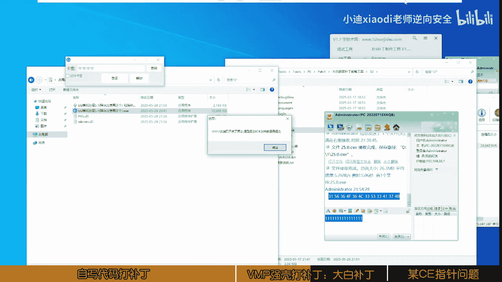


```text
模块：kernel32
API：GetVersion
原始数据：填写搜索到的原始字节/特征
补丁数据：填写要替换的字节，例如323232
操作：添加补丁 -> 解码判定 -> 选择模块/API -> 填写原始数据与补丁数据 -> 添加 -> 保存 -> 创建补丁 -> 运行验证
```


这里的重点不是堆叠复杂操作，而是把搜索、判定、模块选择、API选择、原始数据、补丁数据这几个步骤配合好。补丁失败时先检查字节和地址，再检查时机；补丁成功时说明关键路径已经打通。下面列出本节的关键步骤。

- 使用搜索替换补丁功能。
- 将目标程序拖入工具。
- 点击添加补丁。
- 执行解码判定。
- 选择模块`kernel32`。
- 选择API`GetVersion`。
- 一般情况下`GetVersion`即可。
- 填写原始数据和补丁数据。
- 将特征放到对应位置。
- 点击添加。
- 点击保存。
- 创建补丁。
- 执行到目录并运行验证。
- 补丁成功后说明目标未额外加入检测。
- VMP强壳打补丁案例通过。

上一节我们完成了VMP强壳补丁的关键配置，本节把流程压缩成可复用清单。下一节转向指针题和基地址查找，理解“地址中存放地址”的间接赋值。

# VMP强壳动态补丁破解实战：08：指针题与基地址查找 📌


上一节我们完成了VMP强壳补丁的主要流程，本节中我们来看看一个指针题。题目描述为：有两个按钮，一个会改变数值，不但能改变数值，还会改变数值在内存中的存储位置；这个过程涉及赋值和间接赋值操作。基本思路是取地址，把数值放在一个地址中，再取出该地址中的值，放到另一个地址中。理解汇编会有帮助，但初学者可以先按步骤操作。题目要求输入地址、查找改写，再修改数值和代码。关键步骤是找指针、找基地址、确认偏移。直播中通过查找改写，看到`EDS`的数据给到`EDX`，`EDS`对应地址`91898918`，偏移为`0`，十进制显示`758`。扫描完成后至少得到一个结果，添加地址时勾选指针，填入刚刚扫描到的内容，点击确定即可把地址添加到地址列表。随后修改指针数值为`5000`，并修改指针地址的数值为`5000`，再锁定，下一步按钮变为可点击状态，说明操作正确。

指针和间接赋值可以用下面的公式与代码描述。

```text
指针地址 = 0x91898918
偏移 = 0
十进制目标值 = 758
目标修改值 = 5000
间接赋值：value = *(DWORD*)address; *(DWORD*)newAddress = value;
```

直播中还提到，该题目的中文说明像英文硬翻译，读起来不顺，机翻导致表达不自然，人翻会更友好。看中文说明容易头大，但按“查找改写、取地址、填指针、改值、锁定”的步骤操作即可。下面列出本节的指针题要点。

- 题目包含两个按钮。
- 一个按钮改变数值。
- 该按钮还会改变数值在内存中的存储位置。
- 过程涉及赋值操作。
- 过程涉及间接赋值。
- 先取数值所在地址。
- 再取出地址中的值。
- 将值写到目标地址。
- 理解汇编会有帮助。
- 操作入口是输入地址、查找改写。
- 查找改写后可以看到数据流。
- 原文中`EDS`数据给到`EDX`。
- `EDS`对应地址`91898918`。
- 偏移量为`0`。
- 十进制显示为`758`。
- 扫描完成后至少得到一个结果。
- 添加地址时勾选指针。
- 填入刚刚扫描到的内容。
- 点击确定添加到地址列表。
- 修改指针数值为`5000`。
- 修改指针地址的数值为`5000`。
- 锁定后按钮变为可点击状态。
- 中文说明存在机翻痕迹，表达不顺。
- 按步骤操作即可完成基地址和指针查找。

上一节我们梳理了指针题和基地址查找，本节的重点是理解“地址中存放地址”的关系。下一节整理直播互动、工具获取、信息检索和学习提醒，保留原文中的现场交流含义。

# VMP强壳动态补丁破解实战：09：直播互动、工具获取与学习提醒 📣

上一节我们完成了指针题的技术梳理，本节中我们把直播中的互动、提醒和杂项集中整理。直播过程中穿插了背景音乐和歌词，例如“当我唱起往日的歌”等内容，这些属于现场氛围，不进入技术结论。直播中还出现全屏显示提醒，只有一个人提醒看不到全屏，直播者提醒以后遇到极端情况要及时提醒；为了降低电脑卡顿修改了分辨率，画面变模糊后又切换到高清或超清。工具包丢失后，直播者表示会通过微信发送，并分享到群中，还询问观众在哪个群、在几群，要求扣“1”确认。直播中还提到第五关、第六版、绿色资源网下载CE，以及提高信息检索能力。学习方面，直播者说明零基础可以学习，有读博士的学员也在学习，学习效果不错；课程仅做技术交流。最后提到再播7分钟、嗓子需要休息、版本号不是最新、片段内容等收尾信息。

下面列出本节保留的互动与提醒内容。

- 直播中穿插背景音乐和歌词。
- 歌词内容不进入技术结论。
- 出现看不到全屏的提醒。
- 只有一个人提醒全屏问题。
- 提醒以后遇到极端情况及时提醒。
- 修改分辨率是为了降低电脑卡顿。
- 画面模糊后切换到高清或超清。
- 工具包丢失后通过微信发送。
- 工具包分享到群中。
- 询问观众所在群并让观众扣“1”确认。
- 提到第五关和第六版内容。
- 提到通过绿色资源网下载CE。
- 强调提高信息检索能力。
- 零基础可以学习。
- 有读博士的学员也在学习。
- 学习效果不错。
- 课程仅做技术交流。
- 最后再播7分钟。
- 嗓子需要休息。
- 提到版本号不是最新。
- 提到片段内容。
- 提到“出去喝酒”“没时间搞了”“半成品”“没弄完”等现场闲聊。
- 这些闲聊属于直播现场说明，不改变技术步骤。

上一节我们把技术主线之外的直播内容集中保留，本节的作用是让教程贴近原始直播语境。下一节对整篇课程做总结，把挂起搜索、动态地址、写入补丁、工具配置、VMP强壳和指针题串起来。

# VMP强壳动态补丁破解实战：10：课程总结 ✅

上一节我们整理了直播互动和学习提醒，本节中我们对整篇教程做总结。本节课中我们一起学习了从挂起进程、CE搜索字符串、特征定位版本号，到判断半成品和异常返回数据，再到验证自写内存搜索器、分析动态地址、使用`WriteProcessMemory`写入临时补丁、配置搜索替换补丁、选择`GetVersion`时机、处理VMP强壳和CRC检测，以及理解指针和基地址的完整流程。核心结论是：先搜索再修改，动态地址不能写死，补丁失败先检查位置和时机，工具配置要重视解码判定、模块选择和API选择。

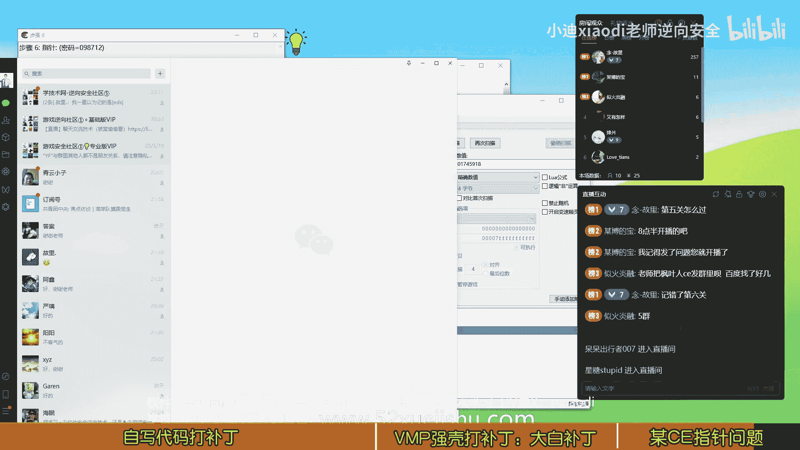

下面总结本课程的核心结论。

- 挂起进程用于查看内存，运行后可以整体暂停。
- CE可搜索字符串和特征，地址示例为`6010DA8`。
- 版本号可通过特征定位，示例版本号为`5.1`。
- 返回数据`-81033`提示结果可能异常。
- 半成品和参数反向需要通过对比和细心检查排除。
- 自写内存搜索器需要验证地址是否正确。
- 动态地址公式为“模块基址 + 偏移”。
- 修改时机可能位于点击登录按钮时。
- 动态补丁应先搜索特征，再写入补丁。
- `WriteProcessMemory`可用于临时写入补丁字节。
- 示例中把`31`改成`32`，写入`323232`。
- `CreateWindowEXW`时机失败时，可尝试`GetVersion`。
- `GetVersion`配合`kernel32`模块可成功打补丁。
- VMP强壳补丁需要解码判定、模块选择、原始数据和补丁数据配合。
- 补丁成功说明关键路径已经打通。
- 指针题涉及间接赋值和基地址查找。
- 地址`91898918`、偏移`0`、目标值`5000`是演示数据。
- 零基础可以按步骤学习，课程仅做技术交流。

本节课中我们一起学习了VMP强壳动态补丁破解的实战梳理，从基础内存搜索到补丁工具配置，再到动态地址和指针理解。希望读者能够掌握“先定位、再验证、后修改”的思路，并在授权环境中理解这些技术概念。
