# 🛠️ 小白软件破解反汇编逆向安全工程师2025最新：第三十二讲：使用 x64dbg 进行逆向破解实战

## 📖 本节概述

今天是第三十二讲，主题是使用 x64dbg 进行逆向破解实战。本节课中，我们将学习逆向分析的两个主要方向：静态分析和动态分析。我们会把 IDA Pro 和 x64dbg 放在一起看，理解它们之间的区别和共同点。然后使用 x64dbg 实际打开一个程序，从搜索字符串、定位关键跳转、修改代码、修改数据、查看日志、设置断点，一直到打补丁保存文件，完整体验一遍软件破解的过程。这个过程不复杂，但需要动手操作。

## 🧭 逆向分析的两个方向

先不要着急，我们先讲一个基础概念：逆向分析。逆向分析不是只有一种方式，它分为两个方向。这两个方向看起来都是在分析程序，但它们的操作方式完全不同。


```text
静态分析 = 不运行目标程序，直接分析程序文件
动态分析 = 运行目标程序，观察每一行代码执行时的数据变化
```

### 🧱 静态分析

静态分析，从字面上理解，就是“静止的、静态的”分析方式。具体来说，静态分析不需要运行程序。拿到一个程序文件之后，不需要让 CPU 去执行它，直接对文件本身进行分析就可以了。比如说使用 IDA Pro 分析程序的时候，我们不需要先运行实验程序。直接把实验程序拖到 IDA Pro 中，然后就可以开始分析反汇编代码、字符串、导入表等内容。这个过程没有让程序跑起来，所以称为静态分析。

### ⚡ 动态分析

动态分析正好和静态分析相反。动态分析需要先运行程序。程序运行起来之后，我们可以观察每一行代码执行过程中，寄存器、内存、栈等数据发生了什么变化。Cheat Engine 和 x64dbg 都是非常典型的动态分析工具。动态分析的优势在于，它能看到程序运行时的真实状态，而不是只看到文件里写死的静态内容。


## 📂 用 x64dbg 打开目标程序

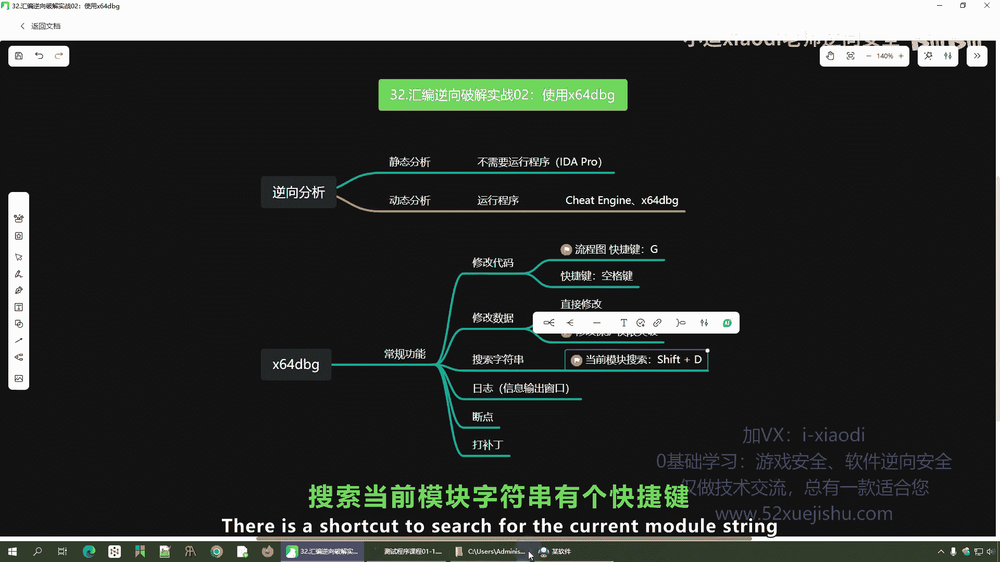

理解了静态分析和动态分析的区别之后，我们来看 x64dbg 是如何打开一个程序的。打开程序的方式并不只有一种。常见打开方式有以下两种：

- **直接拖入**：把目标程序直接拖进 x64dbg 窗口。拖进来之后，点击运行按钮，程序就可以正常启动。程序运行起来之后，就可以开始分析了。这种方式最简单，适合没有反调试的程序。
- **附加进程**：先让程序自己运行起来，然后在 x64dbg 中点击“文件 -> 附加”，选择程序对应的进程。附加成功后，x64dbg 就和目标进程建立了联系。接着点击“符号”窗口，切换到程序的主模块，就可以进行分析了。

这两种方法中，我们更倾向于第二种，也就是附加方式。原因很简单，附加方式可以绕过很多程序的反调试检测。如果程序检测到自己被调试，可能会退出或者隐藏关键逻辑，而附加方式可以在一定程度上避免这种问题。

## 🔎 定位关键字符串和关键跳转

程序打开之后，下一步是找到登录相关的代码。通常做法是先在程序里点击登录按钮，观察提示信息。在示例程序中，点击登录后显示的是“登录失败”。这是非常常见的破解入口。

看到登录失败提示后，我们需要找到这个字符串在代码中的引用位置。操作步骤可以这样梳理：

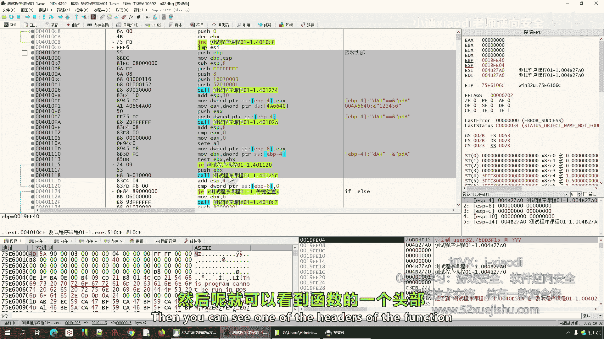

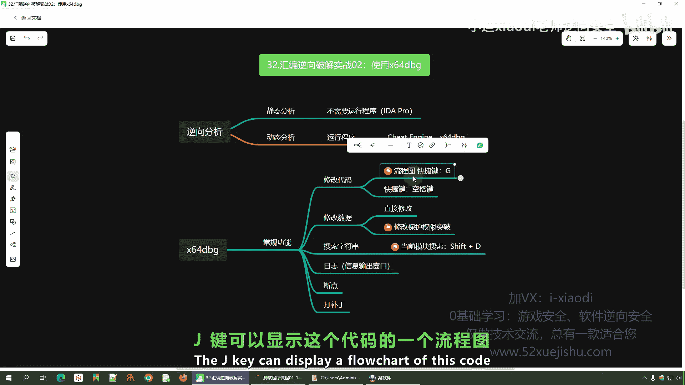

- 切换到程序主模块，确保当前分析的是目标程序的代码，而不是系统模块。
- 搜索当前模块的字符串。x64dbg 提供了“搜索当前模块字符串”功能，快捷键是 Shift+D。
- 按下 Shift+D 后，x64dbg 会搜索当前模块中的字符串列表。
- 搜索完成后，双击“登录成功”或者“登录失败”都可以。这里双击“登录成功”更符合目标。
- 跳转过去之后，向上翻一翻，找到函数头部。

函数头部通常是这段登录逻辑的起点。到了函数头部之后，就可以开始分析程序的跳转结构了。

## 📊 切换流程图视图

在函数头部位置，我们可以做一个操作：按下快捷键 G 键，显示当前代码的流程图。按下 G 键之后，反汇编代码会以流程图的形式显示出来。这种流程图视图有一个明显的好处，就是可以看到程序跳转的逻辑。哪个分支是登录成功，哪个分支是登录失败，条件成立时往哪里走，条件不成立时又往哪里走，都会比较直观。

假如我们要破解这个软件，应该往哪个方向跳呢？答案非常明显，应该跳到登录成功的位置。所以结论很直接：我们应该把这个关键跳转变成无条件跳转，让程序直接走进登录成功分支。这样就能实现破解。

流程图虽然方便，但有时候我们想回到普通的线性反汇编文本。这时只需要再按一次 G 键，就会回到线性的反汇编排列视图。流程图和线性文本只是同一个代码的两种展示方式，可以随时切换。

## ✏️ 修改跳转指令

回到线性视图之后，就可以修改代码了。修改代码非常容易，按空格键就能弹出修改代码的窗口。例如，我们要让某个条件跳转不再影响程序走向。最简单的方法就是让这个跳转逻辑失效，也就是把原来的跳转指令改成 NOP。

```text
JE  登录成功地址      ; 原来的条件跳转
NOP                   ; 改成空操作，什么都不做
```

按空格键把指令改成 NOP，然后点击确定。因为要修改成 NOP，x64dbg 还提供了一个非常方便的操作：对着这行代码鼠标右键，选择“二进制 -> 用 NOP 填充”。如果修改的指令是 NOP，直接选择 NOP 填充就行了。如果修改的不是 NOP，而是其他指令，比如把 JE 改成 JNE，就需要按空格键手动修改，再点击确定。不管是哪种方式，修改完成后，关键跳转就会按我们想要的方式工作。

## 💾 修改字符串数据

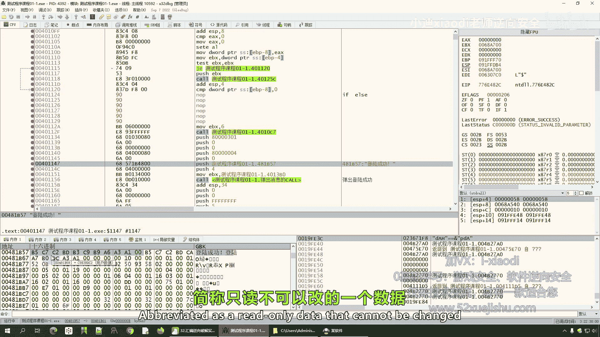

代码可以修改，数据也可以修改。下面我们来尝试把“登录成功”改成“登录成果”。首先找到这个字符串存放的位置，它的地址是 0x481B57。在 x64dbg 的内存窗口中转到这个地址。转过来之后，内存窗口显示的是 ASCII 字符。要让这里正确显示中文，需要切换编码。点击内存窗口中的“GBK”，如果找不到 GBK，就在“代码页”里面找到 GBK，点击确定。这样“登录成功”四个字就正常显示出来了。

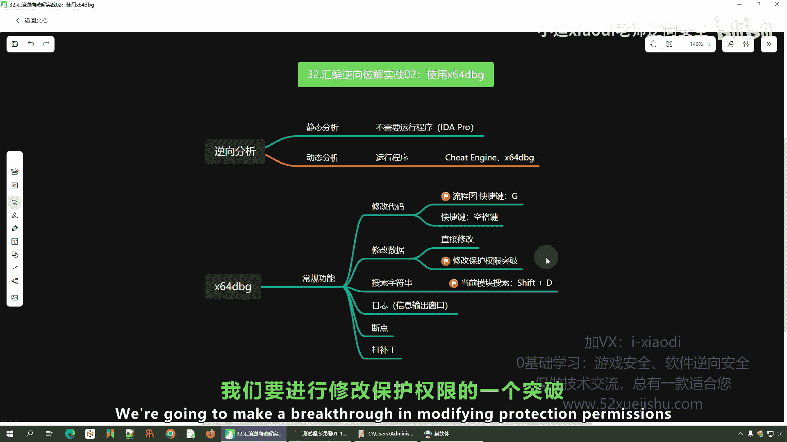

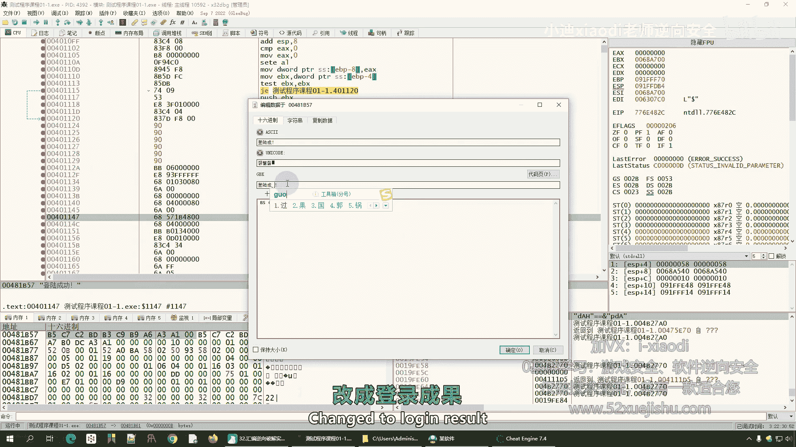

接下来直接进行二进制编辑。把“登录成功”修改为“登录成果”，点击确定。但这个时候会发现没有修改成功。这说明什么？说明这块内存不允许我们直接修改。它是一块只读数据，只允许读，不允许改。面对只读数据，我们需要先突破内存保护权限。

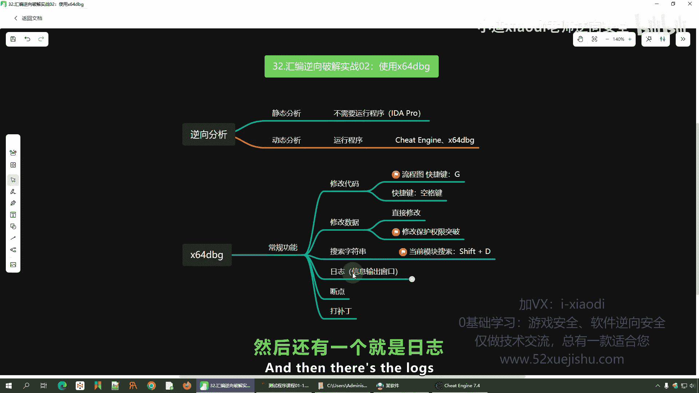

具体操作之前视频已经讲过，这里重复一下：使用 Cheat Engine，找到目标程序的进程，在 Cheat Engine 中点击“查看内存”，跳转到 0x481B57 这个地址。跳过去之后，可以看到这里果然是只读数据。鼠标右键，把页面保护改成“可写”，也就是改成读/写权限。修改之后，再回到二进制编辑，把“登录成功”改成“登录成果”，点击确定。这一次修改就成功了。

## 📋 日志窗口

接下来看一下日志窗口，也就是信息输出窗口。这个窗口在调试中非常有用。当我们在 x64dbg 中做一些操作时，x64dbg 会自动给我们做记录。点击“日志”标签就可以看到这些记录。以下是日志窗口会出现的几种常见提示：

- 加载程序时，会提示“进程已启动”或者“已附加到进程”。
- 搜索字符串时，会提示搜索到了多少个字符串。
- 下断点时，会提示断点已设置在某个地址。

这个日志窗口和 IDA 的信息输出窗口差不多。后期调试时，它能给我们提供很好的记录性帮助，让我们知道刚才做过哪些操作。

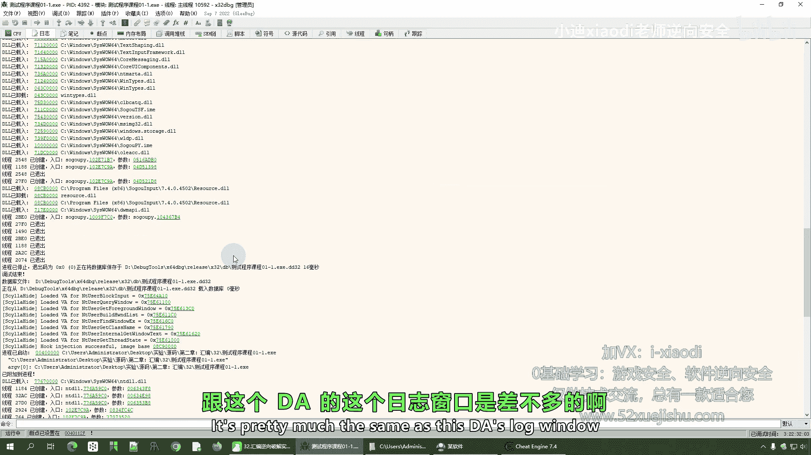

## 🧩 断点的作用

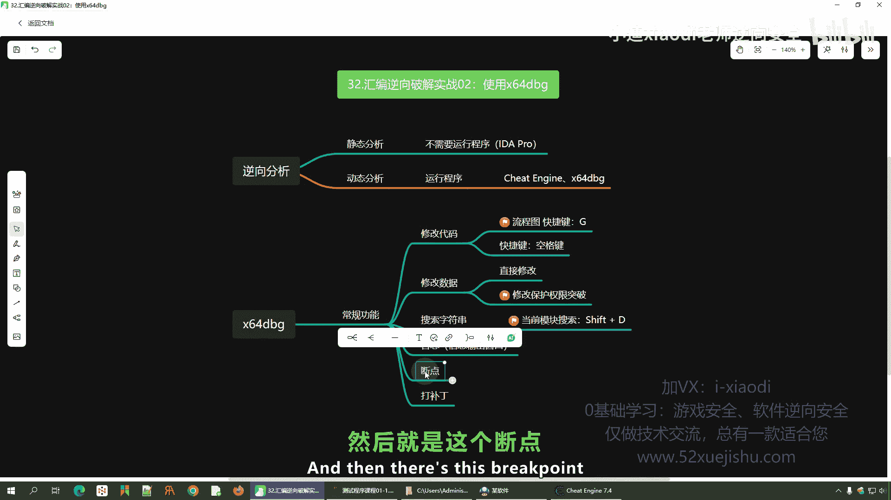

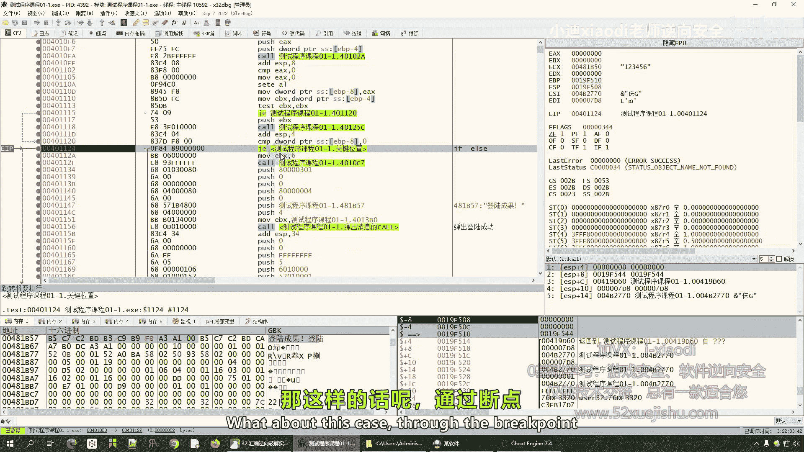

断点也是动态分析中非常重要的功能。所谓断点，就是中断下来的点。在目标代码行按 F2 键，就可以设置一个断点。设置成功后，日志窗口会提示断点已设置。当程序代码执行到这一行时，它会从上一行一行往下执行，执行到断点这一行时就中断下来。

中断下来有一个好处：可以观察当前代码运行状态下的相关数据。例如，我们要看 EBP-8 的值。在寄存器窗口点击 EBP，鼠标右键选择“在栈中转到”，然后双击 EBP-8。这样就能看到 EBP-8 当前的值是 0。再看另一个参与比较的数据，也是 0。0 和 0 相等，所以相等则跳转的 JZ/JE 指令就会跳转。通过断点，我们可以观察到更多程序运行的细节。断点因此也成为动态分析中非常有代表性的功能，很多时候我们甚至是很依赖断点的。

## 🩹 打补丁并保存文件

最后一个操作是打补丁。打补丁也非常简单。比如要把 JE 改成 NOP，可以用二进制编辑，用 NOP 填充，点击确定。修改完成之后，在 x64dbg 中点击“修补文件”，把修改后的内容保存到可执行文件里。示例演示中，给它改成了一个新名字，比如 1-2，然后点击保存，再点击“是”确认覆盖。这些步骤完成后，运行程序测试一下。点击登录，程序显示“登录成功”。这说明补丁已经生效，破解成功。

## ⚠️ 注意事项：不要在断点上修改代码

最后还有一点要特别注意：千万不要在断点上修改代码。比如我们在某一行设置一个断点，然后直接在这个位置修改代码，这样会出问题。修改之后会发现代码变成了乱码。原因很简单，断点本身会改变内存中的字节，如果再同时修改代码，状态就会变得混乱。所以修改代码之前，一定要先把断点取消掉，然后再进行修改。

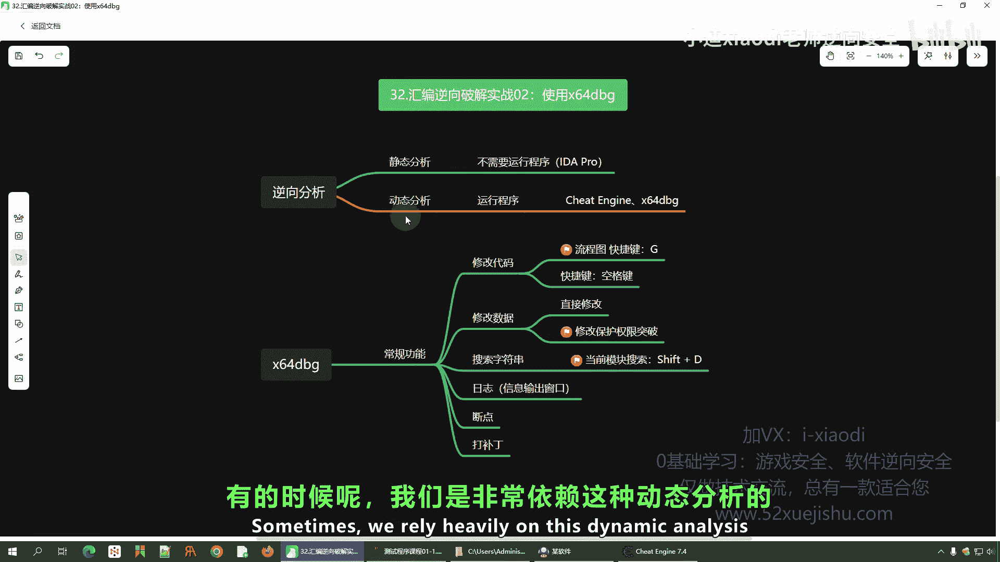

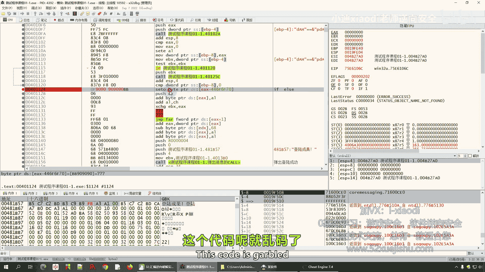

## 🏁 总结

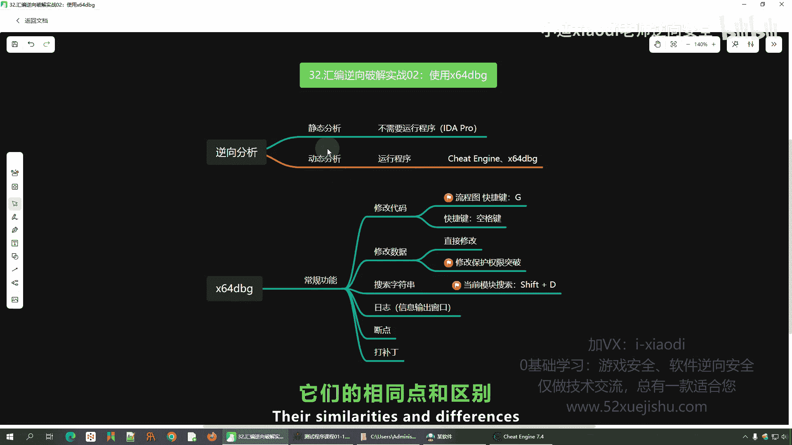

到这里，今天的内容就全部结束了。本节课中，我们一起学习了 x64dbg 和 IDA 之间的区别与共性，也初步体验了静态分析和动态分析。静态分析不需要运行程序，直接分析程序文件；动态分析需要运行程序，观察运行时数据变化。在实战部分，我们用 x64dbg 打开了目标程序，搜索当前模块字符串，定位到登录成功/失败逻辑，切换流程图，修改跳转指令，修改字符串数据，查看日志窗口，使用断点观察数据，最后通过打补丁保存了修改后的文件。相信大家现在对 x64dbg 的使用方式有了一个直观的感受。我们下节课再见。
