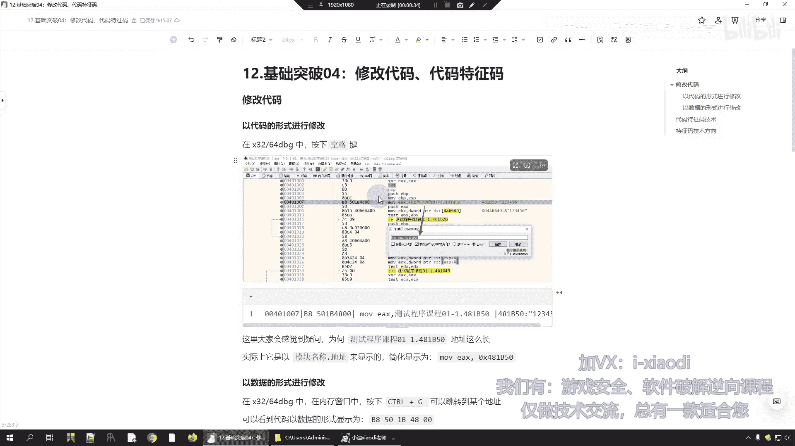
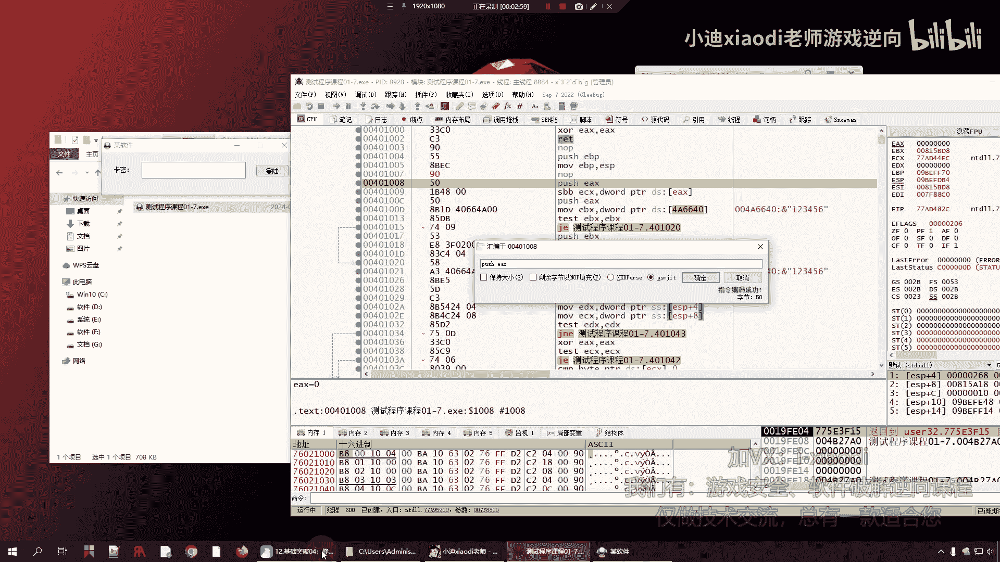
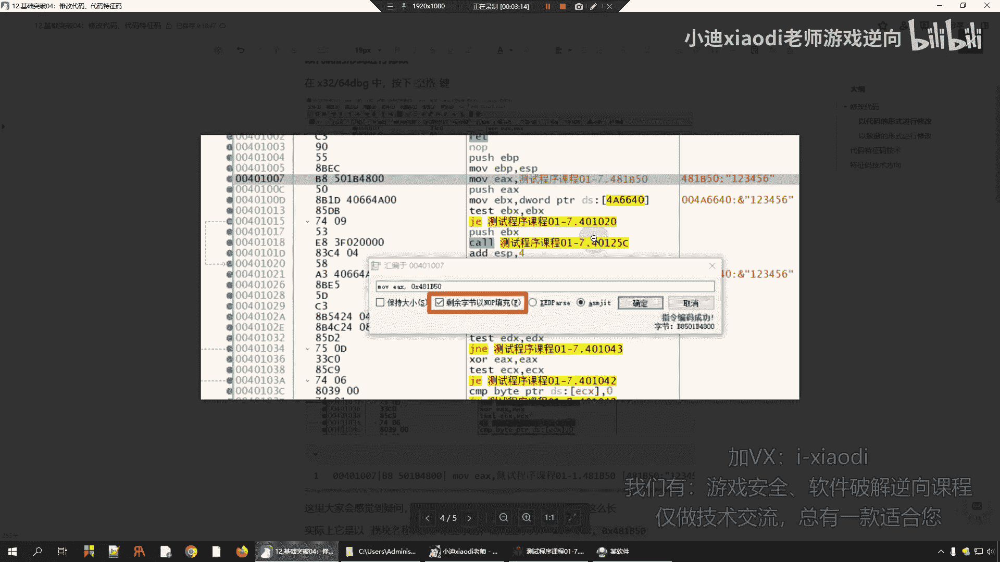
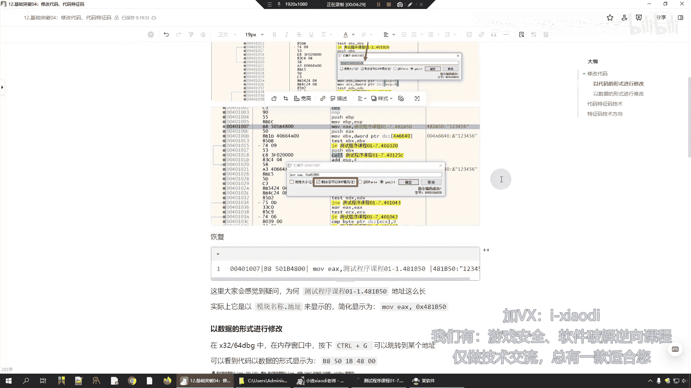
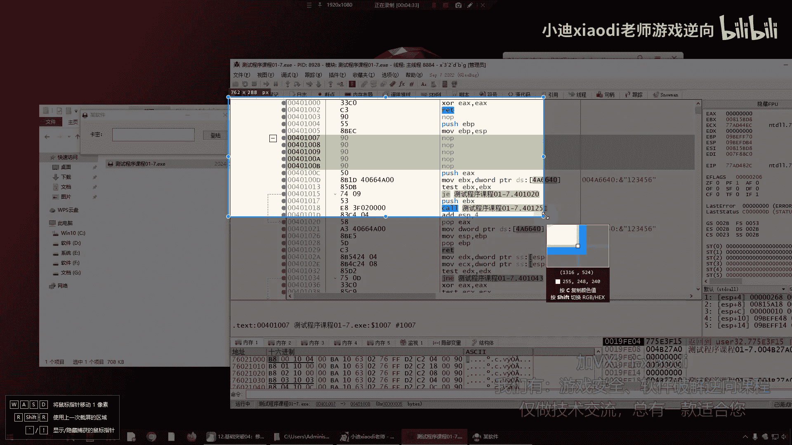
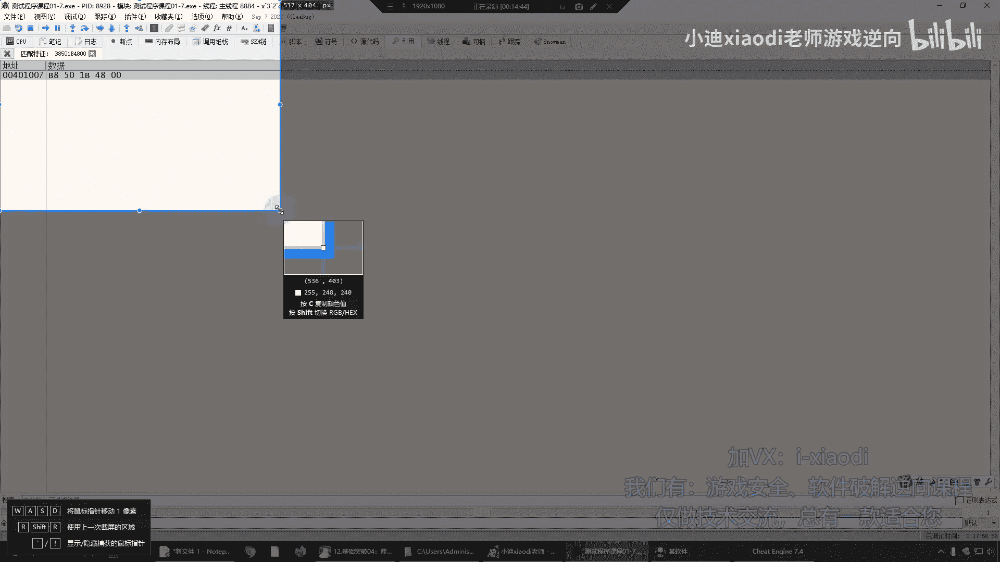
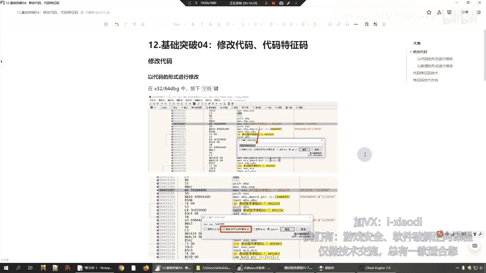

# 🧰 小白软件破解反汇编逆向安全工程师2025最新：01：课程概述



在本节课中我们将要学习修改代码的两种方法，一种是以代码形式修改，另一种是以数据形式修改。随后会学习与代码相关的代码特征码技术，把这个技术的原理和本质讲清楚。最后会梳理特征码技术可以应用在哪些方向上。整篇教程会尽量用直白的大白话说明，让初学者也能跟着理解每一步在做什么。


## 🧭 小白软件破解反汇编逆向安全工程师2025最新：02：修改代码的两条路线

上一节概述了本课程的主要内容，本节先看修改代码的整体路线。原文指出，修改代码的方法有两种：一种以代码形式进行修改，一种以数据形式进行修改。后面还会讲一个与代码相关的技术，叫作特征码技术，并把它的原理本质说明白。以下是两种修改路线的基本区分。

- 以代码形式修改：在DBG里找到目标代码，选中后按空格键，直接修改汇编指令。


- 以数据形式修改：在内存窗口或相关工具里直接修改机器码和数据，必要时先调整内存保护属性。


之所以要分成两条路线，是因为工具里看到的反汇编只是给人看的显示形式，底层仍然是机器码和数据。理解这一点之后，后面的操作就不会只停留在表面。


## ⌨️ 小白软件破解反汇编逆向安全工程师2025最新：03：以代码形式修改代码的基本操作

上一节介绍了修改代码的两条路线，本节先看以代码形式修改代码的操作。原文说明，在DBG里找到要修改的代码，选中它，按下空格键，就可以进行修改。空格键就是键盘上最长的那个键。按下后会弹出一个窗口，窗口会显示要修改的地址，例如00401007，这个地址就是接下来要改的位置。

实际操作时，可以先运行程序，再点击文件、点击附加；也可以直接把程序拖进DBG。原文比较推荐附加这种方式。进入DBG后点击符号，双击程序的主模块，就可以切换到主模块的领空。然后选中要修改的那行代码，按空格键，就会进入修改弹窗。以下是原文强调的代码修改要点。

- 选中目标代码行。



- 按空格键打开汇编修改弹窗。

- 确认弹窗里显示的地址，例如00401007。



- 勾选“剩余字节以NOP填充”。

- 输入新的指令并点击确定。

这里要特别说明NOP填充。NOP就是空指令，机器码里常显示为90。原文提醒记住这个勾选习惯，一般建议勾上。下一节会看如果不勾选会发生什么，以及修改后如何恢复。


## 🧯 小白软件破解反汇编逆向安全工程师2025最新：04：NOP填充、代码乱套与恢复选区



上一节提到修改代码时要勾选“剩余字节以NOP填充”，本节说明这个选项为什么重要。原文用例子说明，某行代码有5个字节，两个十六进制数算一个字节。如果不勾选填充，只输入一个NOP，点击确定后可能只把第一个位置改成90，后面还残留50 1B 48 00这类字节。这样反汇编显示就会乱套，可能多出SBB等原本没有的指令。多出来的指令并不是程序原来的内容，程序原有执行逻辑会被破坏，甚至可能导致程序崩溃。



勾选“剩余字节以NOP填充”后，剩余字节会用NOP填满。这样5个字节的整行代码会被完整覆盖，程序就不容易因为残留字节而出错。修改后如果想知道自己改了哪里，可以观察颜色，红色表示该位置被修改。选中修改位置，鼠标右键，选择“恢复选区”，就可以恢复。恢复后会看到原来只修改了B8等位置，后面没有改。以下是恢复与填充的操作顺序。

- 观察红色标记，定位被修改的位置。

- 鼠标右键选择“恢复选区”。

- 重新按空格键打开修改窗口。

- 勾选“剩余字节以NOP填充”。

- 点击确定后检查整行是否被完整覆盖。

这样处理的原因是，修改代码不只是改眼前一个字节，还要保证整行指令的长度和执行逻辑完整。下一节看模块名称点地址的显示方式，以及如何查看内存中的数据。


## 🧩 小白软件破解反汇编逆向安全工程师2025最新：05：模块名称点地址与数据查看

上一节处理了NOP填充和恢复选区，本节看地址显示和内存数据。原文在DBG里看到类似“测试程序.01-7.481B50”的显示，而另一个地方显示“4481B50”，两者看起来不一样。原文说明，这是“模块名称.地址”的显示方式，用来表示该地址属于哪个模块。模块就是点击符号后左侧列出的内容。如果显示“搜狗.IM”“搜狗.PY”之类，就说明它是搜狗程序模块下的地址；但搜狗模块地址不会是这个481B50，因为搜狗模块从1000000开始。每个模块后面的地址都从该模块的基址开始。显示关系可以概括为下面的形式。

```text
模块名.偏移地址 = 模块基址 + 模块内偏移
```

接着查看481B50的数据。在内存窗口中右键选择“转到481B50”，会看到31 32 33 34 35 36，这实际上就是ASCII编码的123456。原文说ASCII编码后面会讲。此时可以尝试把123456改成其他数据。若在DBG里用二进制编辑改成32 32 32 32 32 32，点击确定后发现改不了，说明该内存有保护。可以用CE找到该地址，例如481C60，按Ctrl+G跳转，查看属性为只读，再通过“使分页可写”“读写执行”“可执行写时拷贝”等选项调整属性，然后就可以修改。修改后可以打补丁，让代码指向修改后的数据。以下是本段涉及的操作。

- 在内存窗口右键转到目标地址。

- 用二进制编辑查看或修改数据。

- 若改不了，用CE查看并调整内存保护属性。

- 修改后可用补丁方式让代码指向新数据。

这些操作说明，修改代码不只有直接改指令一种方式，还可以通过改数据、改指针、打补丁来实现。下一节从“数据”的角度理解修改代码。


## 🧠 小白软件破解反汇编逆向安全工程师2025最新：06：以数据形式修改代码

上一节我们看到内存保护和数据修改，本节从数据角度理解代码。原文强调，计算机内部实际上不分代码和数据，全部都是0和1。所谓代码和数据，只是根据内存属性和使用方式进行区分。反汇编窗口和十六进制窗口都是工具为了方便人类观察而生成的显示形式。计算机只认识0和1，不认识这些反汇编文字。程序本质就是0和1的数据，其中某些数据带有可执行属性。常见内存属性包括read、write、executable。原文提到在“内存布局”中可以看到read、read execute等属性，可执行代码对应executable，只读对应read。核心关系可以写成下面的形式。

```text
程序本质 = 0/1数据
代码 = 带有可执行属性的数据
数据 = 按不同内存属性参与读写的0/1数据
```

因此可以在内存窗口跳转到401007，会看到B8 50 1B 48 00，也可以在这里直接修改机器码。原文把这里修改留作作业，想怎么改就怎么改。若遇到保护属性，可以用CE把内存分页设为可写，再读写执行。CE专题后面会讲。下一节进入代码特征码技术。


## 🧬 小白软件破解反汇编逆向安全工程师2025最新：07：代码特征码技术原理

上一节说明程序本质是0和1的数据，本节看代码特征码技术。原文通过对比说明，代码窗口左侧的B8 50 1B 48 00，与右侧那行代码是等同关系。也就是说，内存中的机器码B8 50 1B 48 00可以当作那行代码的特征。原文把这行代码表述为“目ES、481B50”一类指令。核心关系可以写成下面的形式。

```text
B8 50 1B 48 00  ⇔  对应的一行代码（原文表述为“目ES、481B50”）
```

由此可以推算，只要在内存中能搜索到一次B8 50 1B 48 00，就说明程序里存在这样一行代码；搜索到几次，就说明有几条这样的代码。因此可以把B8 50 1B 48 00称为该行代码的特征码。直接搜代码不太好搜，所以更好的办法是在内存布局里搜索与代码一模一样、只是表现形式不同的机器码。下一节做搜索测试。


## 🧪 小白软件破解反汇编逆向安全工程师2025最新：08：特征码搜索测试

上一节说明了特征码的原理，本节进行搜索测试。先恢复刚才的修改。然后选中目标代码，鼠标右键选择二进制，复制二进制内容；也可以在二进制编辑里复制。复制出来的内容就是特征码。接着点击“内存布局”，选择第一行位置，鼠标右键选择“搜索匹配特征”，按Ctrl+V粘贴特征码，勾选“整块”，点击确定。原文示例搜索到一条结果，说明B8 50 1B 48 00可以定位到一条代码。搜索时勾选整块，结果会更加全面。以下是特征码搜索测试步骤。

- 恢复选区，避免受前面修改影响。

- 选中代码行，复制二进制内容作为特征码。

- 打开内存布局，定位到起始行。

- 右键选择“搜索匹配特征”。

- 粘贴特征码并勾选“整块”。

- 点击确定查看结果数量。

通过结果数量可以判断程序中存在多少条同类代码。下一节看特征码技术的应用方向。


## 🚀 小白软件破解反汇编逆向安全工程师2025最新：09：特征码技术的应用方向



上一节完成了特征码搜索测试，本节梳理应用方向。原文最后说明，特征码技术可以用于游戏外挂辅助、软件逆向破解和动态地址定位。下面先列出方向。

- 游戏外挂辅助方向。

- 软件逆向破解方向。

- 动态地址定位方向。

游戏外挂辅助方向：游戏更新后，外挂有时仍然可用，可能是因为外挂用了特征码技术。游戏更新常常变更某个地址或数据，例如4A664000这类数据会变，但代码本身如8B1D85DB、7409、50等一般不会变。原文还提到类似tax、EB、SEB、S这类代码一般也不会变，只有数据会变。于是可以把不变代码当作特征码，搜索到后取出后面变动的数据，例如4A6600、4A6640这类数据，得到游戏最新地址。这个思路可以概括为“以不变应万变”。

软件逆向破解方向：与上面类似。软件更新后，也可以通过特征码定位关键代码或数据，从而无视软件更新继续破解。原文说后面有案例再讲。

动态地址定位方向：程序中某些数据是动态的，没有静态地址或基址，可以用特征码技术定位其特征，再搜索得到目标。该技术常用于安卓模拟器的数据定位，或程序中某些没有静态地址的数据。原文提到例如标题、测试程序、课程、某软件这类内容可能会动，可用特征码定位。原文也说明这里讲得不够全面，后面会通过具体案例和安卓模拟器内部视频进一步讲解。以下是应用方向对应的关键点。

- 游戏外挂：代码不变、数据变，搜索不变代码，取出变动数据。

- 软件破解：用特征码无视更新定位关键位置。

- 动态定位：用于没有静态地址的数据，常见于安卓模拟器场景。

这些方向说明，特征码技术的关键是抓住不随更新变化的部分，再用它定位变化的部分。最后进行总结。


## ✅ 小白软件破解反汇编逆向安全工程师2025最新：10：本节课总结



本节课中我们一起学习了修改代码的两种方法：以代码形式在DBG中选中代码并按空格修改，以及以数据形式在内存窗口直接修改机器码。我们还学习了NOP填充和恢复选区，理解了模块名称点地址的显示形式，知道了程序本质是0和1的数据，代码只是带可执行属性的数据。随后学习了代码特征码技术：机器码B8 50 1B 48 00与对应代码等同，可作为特征码搜索定位；并通过内存布局的“搜索匹配特征”进行测试。最后梳理了特征码技术在游戏外挂辅助、软件逆向破解和动态地址定位中的应用。原文提醒内容较多，建议自己按步骤操作一遍。后续课程会结合具体案例继续讲解CE专题和安卓模拟器数据定位。

