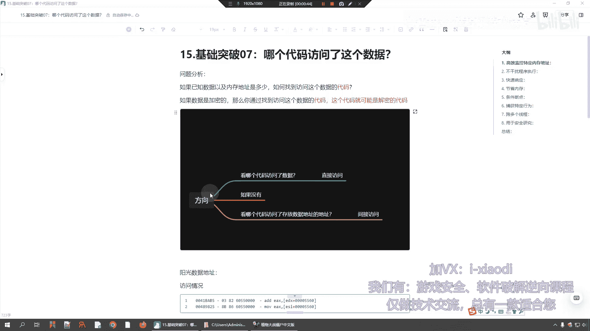
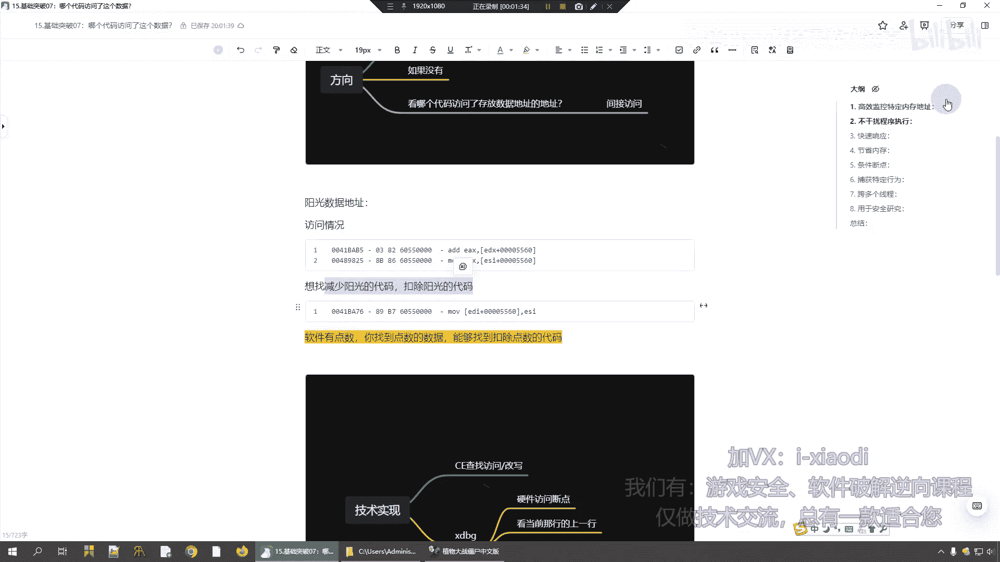
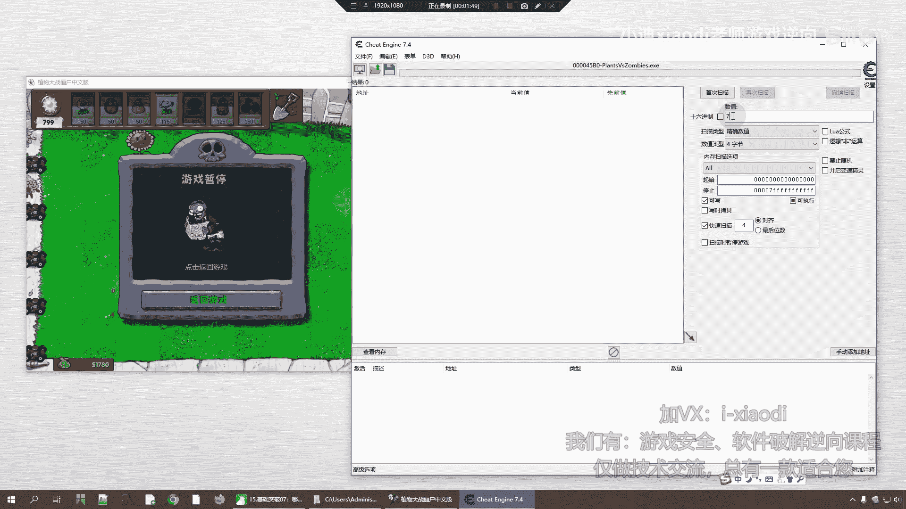
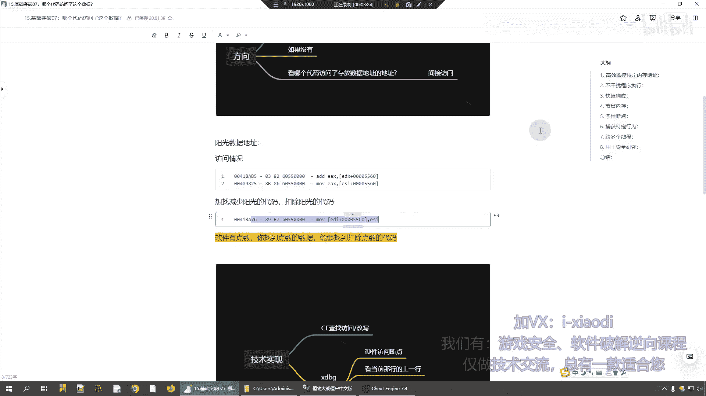
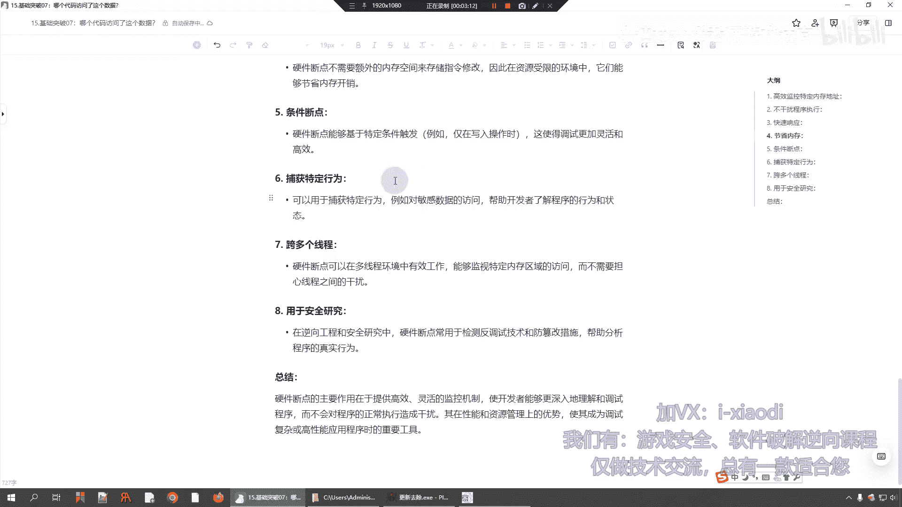

# 🧭 小白软件破解反汇编逆向安全工程师2025：第十五讲：定位关键代码实现软件破解无限点数的原理

## 📌 课程概述

大家好，我是小金老师。在本节课中，我们将要学习一个非常关键的问题：当我们已经知道某个数据，也已经知道这个数据所在的内存地址时，如何找到访问这个数据的代码。这个问题看起来简单，但它背后涉及直接访问、间接访问，以及用CE和DBG定位关键代码的多种方法。学会这套思路后，初学者就能理解软件扣除点数、游戏扣除资源这类逻辑是如何被定位和分析的。

上一节我们介绍了数据和内存地址的基础概念，本节中我们来看看如何从地址继续往下走，找到真正操作这个地址的代码。整个过程会结合游戏阳光数值和版本号校验两个例子来讲，尽量用大白话说明白。

## 🧩 一、为什么要定位访问数据的代码



先说明一个常见疑问：找到访问数据的代码有什么用。这里举一个加密数据的例子。假设有一个数据是加密的，你搜索出来的结果也一定是加密后的结果。此时你想解密，就需要找到访问这个加密数据的代码，因为这段代码很可能就是实现解密流程和逻辑的代码，也可能是解密代码所在的位置。这就是定位访问代码的一个重要应用场景，理解这个技术的应用非常重要。

从整体思路看，我们可以把过程概括为下面这个公式：

```text
已知数据 -> 已知内存地址 -> 查找访问或改写该地址的代码 -> 分析关键逻辑
```

这个技术的实现有两个方向，一个是直接访问，一个是间接访问。上一节我们介绍了基础定位思路，本节中我们先从直接访问开始看。直接访问的意思是，我们已经拿到了数据所在的内存地址，然后直接对这个地址查找访问或查找改写，从而找到相关代码。



## 🎮 二、直接访问：用CE定位阳光数据与扣除代码



上一节我们说明了为什么要找访问代码，本节中我们来看看直接访问的具体操作。这里拿一个游戏做例子。当前游戏中的阳光数值是999，我们想定位到这个数值，第一步就是先定位到999这个数据。定位到以后，再去找到改写这个阳光数据的代码。

有同学会问，找这个代码有什么用。举例来说，现在种一个植物会花掉一份阳光，种一个东西就扣一次钱；当拥有某个物品时，阳光还可能增加；再种一个又会减少阳光。这个扣除过程，和软件扣除点数是类似的。如果我们能找到减少阳光或扣除阳光的代码，并把它干掉，就不会再扣除阳光。软件有点数时也是同样的道理：找到扣除点数的代码并处理掉，就不会扣点。这个思路简单直接。

以下是使用CE定位阳光数据并找到扣除代码的基本步骤。

1. 打开工具包，找到Cheat Engine并运行。
2. 运行后点击进程选择按钮，找到游戏进程并打开。
3. 搜索当前拥有的数值，例如先搜索799，再让数值变动到84。
4. 搜索84，发现只有唯一一个结果。
5. 双击这个结果，让它进入下方列表。
6. 双击描述并修改，把它标记为阳光。

完成这些步骤后，阳光数据的地址就确定了，当前值是84。也可以直接在这里把值改成666，验证这个地址是否对应阳光。现在真正的问题是找到谁扣除了这个数值。定位到数据只是第一步，接下来要找到扣除逻辑对应的代码。

以下是定位扣除代码时可以观察到的关键信息。

```text
阳光数据地址 = 0x1B586490
阳光当前值 = 84
扣除代码地址 = 0x41BA76
```

定位到扣除代码后，可以先看效果。刚才观察到的是增加逻辑和扣除逻辑，显示并返回反汇编窗口后，就能看到对应代码，其中扣除代码已经记录下来，地址是`0x41BA76`。接着可以右键选择使用空指令替换，控制零填充就是`NOP`，也就是什么都不做。之前我们已经讲过这个操作。执行后再去扣除阳光，会发现不再扣除了，这就是我们要实现的功能。后面的课程可以暂时不看，但建议坚持看完本节。



以下是还原代码和验证效果的操作。

1. 选中被修改的指令。
2. 鼠标右键选择用原代码还原。
3. 再次观察增加和扣除的区别。

还原后再观察区别，可以看到查找访问和查找改写都能提供线索。接下来我们专门比较这两种方式。

## 🔎 三、查找访问与查找改写的区别

上一节我们通过改写代码实现了不扣阳光，本节中我们来看看“查找访问”和“查找改写”的区别。先找查找改写，会发现一开始什么数据都没有。当我们增加阳光时，会出现一条记录，其中出现`add`，英文里就是增加、加法的意思。它非常单纯地执行了加法，记录里还会出现多次`add`，说明加了好几次。再执行扣除时，它也非常单纯地扣除了数值，再来一次仍然非常单纯地扣除。一个是增加，一个是扣除，一共两条记录，逻辑非常简单，没有特别复杂的东西，可以用单纯的小女孩来打比方，说明逻辑不复杂。

以下是查找访问和查找改写的核心区别。

```text
查找访问 = 读取 + 写入
查找改写 = 写入
```

再来观察查找访问。鼠标右键选择查找访问后，一上来就有数据，此时还没有手动操作。执行增加时会出现好几条记录，执行扣除时也会出现记录，点击停止就可以让它不再记录次数。此时`0x430A11`能看到，`0x41BA76`也能看到，这说明访问包含读取和改写，而写入只是单纯改写。这个工具非常方便，通过清晰的列表界面就能把这些信息全部拿到。

上一节我们比较了CE中的访问和改写，本节中我们换一个工具，看看DBG如何通过硬件断点定位关键代码。这个工具叫DBG，也叫xDBG。

## 🛠️ 四、用DBG硬件断点定位关键代码

先看DBG的操作方式。假设阳光地址是`0x1B586490`，先复制这个地址，点击文件附加，双击附加到游戏进程，然后在内存窗口按`Ctrl+G`跳转过去。当前值是32，32就是50，这里重开了一下游戏。接着鼠标右键选择断点，再选择硬件访问或硬件写入。如果想找改写，就下硬件写入断点；如果想找访问，就下硬件访问断点。当前目标是找改写，所以直接下硬件写入断点。

以下是DBG定位关键代码的基本流程。

1. 复制目标数据地址。
2. 使用文件附加功能附加到目标进程。
3. 在内存窗口跳转到目标地址。
4. 右键设置硬件访问或硬件写入断点。
5. 触发数值变化，观察断点位置和上一行指令。
6. 定位完成后右键删除断点并运行程序。

这里需要特别提醒一个判断工具选择的原则。

> 访问非常频繁时，CE更适合；访问不频繁时，DBG更适合。特别频繁时如果下访问断点，程序可能卡死。

为什么这样选择？因为刚才也能看到，硬件写入和硬件访问记录的数据很多，访问次数太多。DBG断下来后没有CE那种可视化列表，程序会直接中断，游戏也会中断。所以CE适合访问非常频繁的情况，DBG适合访问不频繁的情况。

继续看DBG的实际观察。下硬件写入断点后点击返回，增加阳光时断点是否断下来？断下来了。下这种硬件断点时，要看断下来这一行的上一行，上一行才是关键。当前可以看到`add dword`这类增加指令，再查看`ECX`寄存器，确认它对应的就是增加逻辑。再次运行，目标是找扣除，观察上一行，看到`ESI`相关这一行，就是扣除逻辑。因此DBG使用硬件访问断点或硬件写入断点也可以实现定位。删除断点时，点击断点，鼠标右键删除，然后运行即可。记住一定要看访问是否频繁：频繁用CE，不频繁用DBG。

刚才的情况是我们能够拿到数据地址，然后对这个内存地址直接查找访问或改写，从而找到访问代码。这是直接访问。上一节我们完成了直接访问的示例，本节中我们来看看另一种情况：间接访问。

## 🧠 五、间接访问：地址嵌套与硬件访问断点

间接访问适用于另一种场景。来到这个程序，这个程序会检测版本号，当前最新版本号不知道，但它会跟3.0做校验。打开DBG，点击文件，点击附加，双击切换到程序主模块，然后搜索字符串。可以看到老版本是3.0，新版本可以猜是5.0。接下来要找到相关的访问代码，可以切换到内存窗口，右键下硬件访问字节断点，尝试后发现断不下来。重启再试也断不下来，说明直接对字符串位置下断点没有用。

以下是间接访问的定位思路。

1. 先搜索字符串，找到3.0所在位置。
2. 观察字符串引用，区分普通字符串和带与、或、取地址符号的地址。
3. 找到存放字符串地址的指针位置。
4. 对指针位置下硬件访问断点。
5. 触发校验逻辑，观察断下来的访问代码。

这时需要观察当前模块的字符串，再做一遍。会发现3.0有很多处，其中一种是普通字符串，另一种前面带有与、或或取地址符号。这个符号的作用是地址嵌套。例如`0x4A3600`里面放着`0x47F8F8`，而`0x47F8F8`里面才是字符串3.0。这个关系可以用下面的公式表示。

```text
[0x4A3600] = 0x47F8F8
[0x47F8F8] = "3.0"
真实字符串地址 = [[0x4A3600]]
```

因此可以在`0x4A3600`上下一硬件访问断点。尝试后断下来了，这样就能找到访问的地方。这是一种间接访问，能看到几个访问位置。再点一下，仍然能看到对应位置。有人把这种符号说成井号或其它说法，这里要明确不是井号，而是与、或、取地址这类表示间接关系的符号。这个知识点的本质是地址嵌套：地址里面放的是字符串的地址，也就是地址里面放地址。

上一节我们完成了间接访问的原理说明，本节中我们对整节课做总结。

## ✅ 六、课程总结

本节课中我们一起学习了：当我们知道数据时，如何找到访问这个数据的代码。方法上分为直接访问和间接访问。直接访问是对已知数据地址查找访问或查找改写；间接访问是先找到存放真实地址的指针，再对指针下硬件访问断点。技术实现上主要有两种方式，一种是通过CE查找访问和改写，另一种是通过DBG设置硬件访问断点或硬件写入断点。

以下是本节课需要记住的核心结论。

```text
访问频繁 -> CE查找访问/改写
访问不频繁 -> DBG硬件访问/硬件写入断点
间接访问 -> 对指针地址下断点，而不是直接对字符串地址下断点
```



DBG硬件断点的作用和功能，可以自行查阅笔记，暂停视频了解即可。到这里，本节课的内容就整理完了，我们下期再见。
