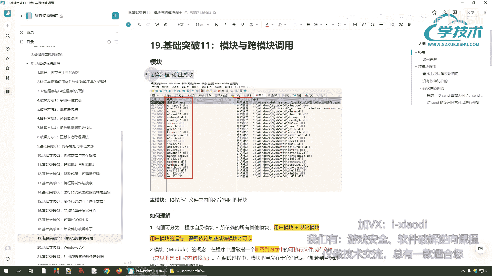
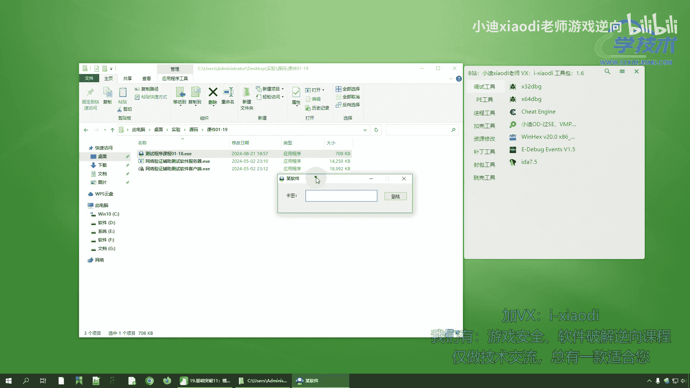
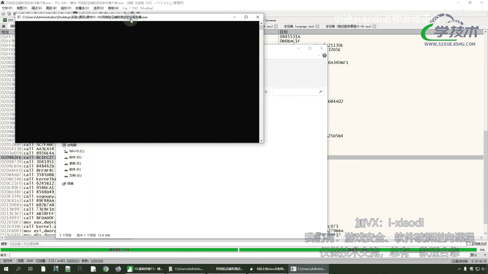
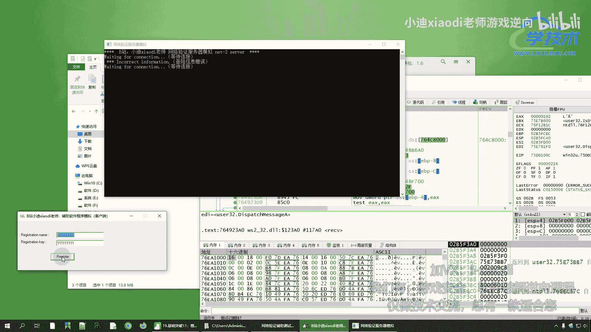
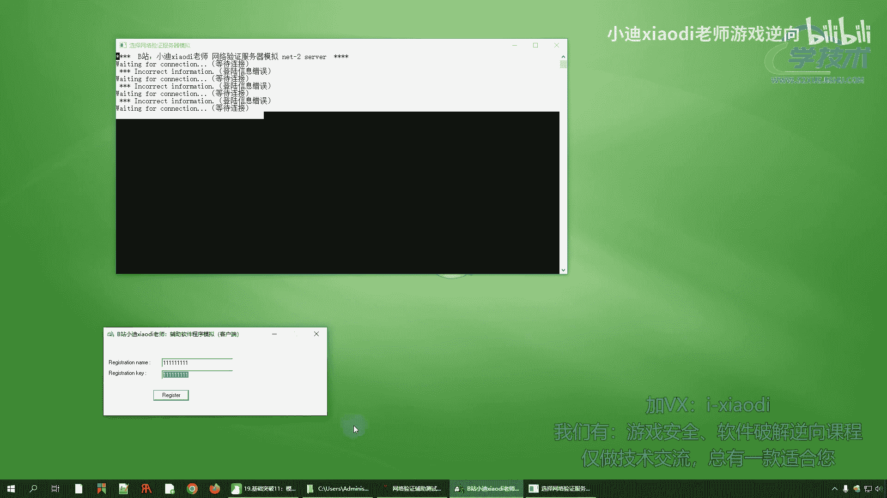
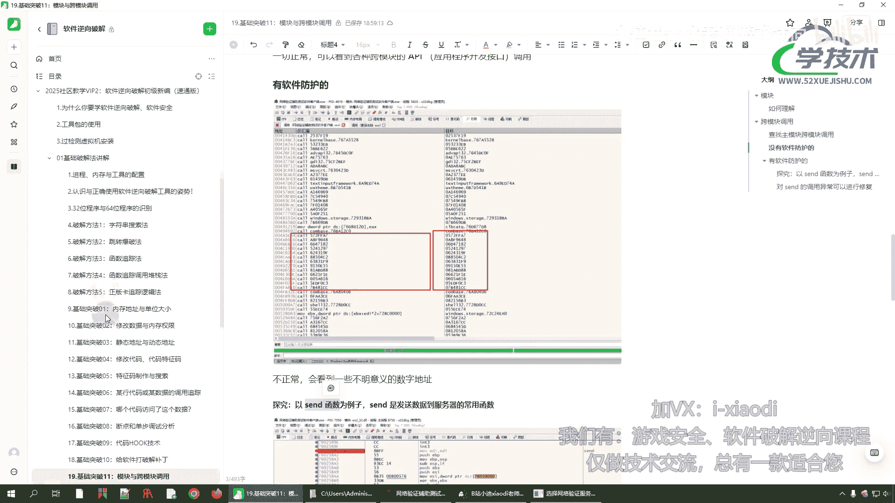
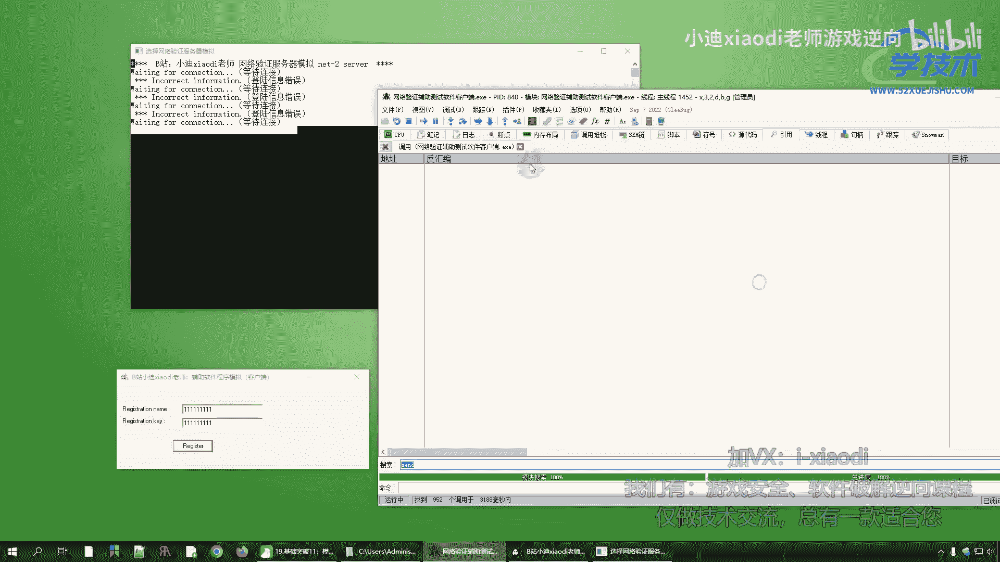
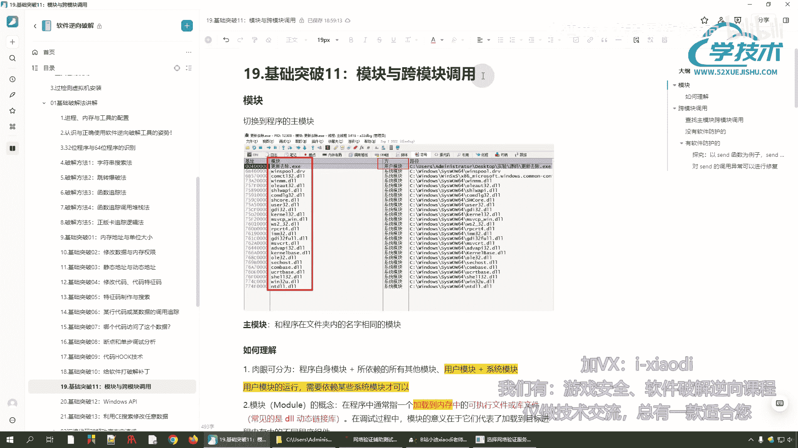

## 小白软件破解反汇编逆向安全工程师2025最新：01：课程概述与学习目标 🌟

在本节课中，我们将要学习模块与跨模块利用。这个内容本身不算复杂，听一听，稍作了解，可能会得到一些新的见解。课程会围绕模块概念、程序主模块切换、用户模块与系统模块、跨模块调用、软件防护抹除模块调用代码后的现象，以及如何修复被抹除的调用代码展开。这些内容是游戏安全、软件安全、网络安全和CTF比赛中的基础内容，对后续逆向分析很有帮助。



先给出一个核心理解：



```text
模块 = 加载到内存中的可执行文件或库文件
```

上一节是课程概述，本节我们先从最基础的程序主模块切换开始看。

## 小白软件破解反汇编逆向安全工程师2025最新：02：切换程序主模块 🧭

上一节概述了课程目标，本节中我们来看看如何切换到程序的主模块。模块这个概念之前经常提到，因为逆向分析中经常提到一个操作，叫作切换到程序的主模块。切换到程序的主模块是逆向分析程序必备的操作，而且是最开始一定要做的步骤。

先运行程序，然后打开程序，点击文件附加，双击目标进程。切换方法如下：

```text
点击“符号” -> 双击主模块
```

点击符号后双击主模块，就可以切换到程序的主模块。只有切换到这个模块之后，才能正常搜索当前模块的字符串。当前分析的正是这个程序，所以要切换到这个模块里搜索相关字符串。如果分析的是其他程序，例如搜狗拼音，搜索当前模块字符串时，结果都是跟搜狗拼音相关的。因此第一步一定要切换到程序的主模块。

主模块的判定方式如下：

```text
主模块 = 与程序文件名、文件夹中程序名一致的模块
```

点击符号查看搜狗相关模块，就能知道那是搜狗模块；与程序名一致的模块，才是当前程序的主模块。

上一节介绍了主模块切换，本节我们继续理解用户模块与系统模块的区别。

## 小白软件破解反汇编逆向安全工程师2025最新：03：用户模块与系统模块 🧩

上一节介绍了如何切换到程序主模块，本节中我们来看看模块在肉眼观察下如何区分。模块可以分为用户模块和系统模块。用户模块实际上就是自己的程序模块；系统模块就是Windows操作系统里的模块。

拖动查看模块路径，可以看到系统模块的路径通常在C盘Windows目录下，例如：

```text
C:\Windows\System32
C:\Windows\SysWOW64
```

如果发现多了一个用户模块，查看它属于谁，例如它属于搜狗拼音，这个模块可以忽略，也可以无视它。当前这个模块是程序自己的模块，程序运行时会依赖这些模块，而且这些依赖模块基本都在系统路径下。

程序和系统的关系可以这样理解：

```text
程序运行在系统上
用户模块运行依赖系统模块
程序模块依赖系统模块，属于依赖关系
```

例如下面可以看到user32.dll。通过搜索可以了解到，user32.dll是Windows图形用户界面的主要支持，一些重要的图形用户界面函数由它导出。程序如果想要正常把界面显示出来，例如让窗口显示出来被人看到，就需要加载这个模块。每个模块都有它的用途。

上一节区分了用户模块和系统模块，本节我们进一步整理模块概念与常见模块类型。

## 小白软件破解反汇编逆向安全工程师2025最新：04：模块概念与常见类型 📦

上一节介绍了用户模块与系统模块的区别，本节中我们来看看模块概念本身。模块在程序中通常指一个加载到内存中的可执行文件或库文件。它们都是文件，不是无中生有，而是真实存在于系统上的文件，并且会加载到内存中。每个模块都会拥有自己的地址空间，并提供某些特定功能。

可以这样记：

```text
模块 = 系统上的真实文件 + 已加载到内存 + 拥有自己的地址空间 + 提供特定功能
```

点击符号可以看到，每个模块的机制不一样，各自拥有自己的空间，不能混淆。搜索字符串时也能体现这一点：在当前程序模块里搜索，搜到的是自己程序的内容；切换到搜狗模块里搜索，搜到的全部是搜狗搜索相关内容。

常见模块类型如下，以下是几种需要认识的模块文件类型：

- 可执行文件，例如 `.exe` 文件。
- 动态链接库，例如 `.dll` 文件。
- 输入法文件，例如 `.ime` 文件。

点击符号查看模块时，如果看到的是exe或dll，就属于常见程序模块；如果看到ime，就是输入法文件。

上一节介绍了模块概念与类型，本节我们进入跨模块调用的基础操作。

## 小白软件破解反汇编逆向安全工程师2025最新：05：跨模块调用基础 🔍

上一节介绍了模块概念与常见类型，本节中我们来看看跨模块调用。跨模块调用是DBG提供的一个功能。操作时点击CPU，先切换到程序的主模块，然后鼠标右键搜索当前模块的跨模块调用。它实际上会把程序调用的一些Windows API列出来，并写出这个API在哪个DLL里面。

例如MessageBox，之前经常说下MessageBoxA断点，它实际上就在user32.dll里面，是user32.dll中的一个函数。可以这样理解：

```text
跨模块调用 = 当前模块调用的Windows API + API所属的DLL
```

跨模块调用可以说明程序用到了哪些系统功能。以下是它能提供参考的常见功能示例：

- 程序是否用到了复制文件。
- 程序是否用到了删除文件。
- 程序是否连接服务器。
- 程序是否创建窗口。



这些信息都会显示在跨模块调用中，因此它存在一定参考价值。没有软件防护的程序，跨模块调用显示正常，就是一个正常程序的样子。

上一节介绍了正常情况下的跨模块调用，本节我们看看有软件防护时会出现什么问题。

## 小白软件破解反汇编逆向安全工程师2025最新：06：软件防护抹除跨模块调用记录 🛡️

上一节介绍了跨模块调用的正常表现，本节中我们来看看有软件防护时的异常表现。有软件防护的程序，在查看跨模块调用时会出现一些问题。找一个带防护的程序，拖入调试器并运行，点击符号，切换到程序主模块，然后鼠标右键搜索当前模块的跨模块调用，会发现很多无意义的数字。这就是有防护的软件造成的情况。这种防护技术以后可以在内部视频中讲解。

这个示例程序是一个网络验证软件。先运行服务器，然后输入账号和密码，点击注册，它会向服务器发送信息，服务器会收到信息。实际使用时，服务器软件运行在别人的服务器或别人的电脑上，所以看不到；这里只是做模拟，一个在本地，一个假设在遥远的服务器。点击注册后，对方服务器会收到信息。它发送数据包实际上通过send函数完成。send函数以后会讲，现在只需要了解它是一个Windows API。

前面说过，如果程序用了send函数，就可以在当前模块的跨模块调用里找到它。但是搜索send时发现没有，按正常道理应该有。为什么没有，因为程序加了防护，把这个东西抹除了。





> 提示：软件防护可能抹除跨模块调用记录，让调试器看不到真实的API调用，从而给分析带来困扰。

这里可以简单拓展一下：

```text
正常情况：跨模块调用中可以看到 send
被防护后：send调用记录被抹除，搜索结果中看不到 send
```

现在只是简单拓展，后续内部修炼内容里会有更多相关技术，包括VIP内容、壳相关技术等，会慢慢加入。学习需要循序渐进，VIP1是踏踏实实学基础，VIP2是拔高性内容。

上一节看到了防护抹除调用记录的现象，本节我们定位send调用并观察断点。

## 小白软件破解反汇编逆向安全工程师2025最新：07：定位send调用并观察断点 🔬

上一节介绍了软件防护会抹除跨模块调用记录，本节中我们来看看如何定位send调用。既然知道程序调用了send，不妨跳转到send去下一个断点。下send断点后，send断点这里仍然是正常情况。在send这里打一个断点，点击注册会断下来，这没有问题，因为程序正常走这边的代码。



接下来的观察流程如下：



```text
在 send 下断点 -> 点击注册 -> 程序断下 -> Ctrl+F9 执行到函数末尾 -> F8 出框
```

执行到函数末尾并出框后，会发现实际是从A8164D出来的。调用的是send，为什么会从这个位置出来。双击或回车进去，会发现这里实际上是软件防护做了一些手脚。正常情况下，我们调用的是send函数，应该直接往这里调用，直接走这边的代码。但是防护程序多了一步，把东西抹除，抹成了另外一个样子。

再次演示时，打一个断点，点击注册断下来，按F2、Ctrl+F9、F8观察，仍然是从A8164D出来。这个位置本应就是call send。因为我们是从send函数里出来的，所以这个位置应该是调用send的位置。

可以用下面的对照理解：

```text
正常调用点：call send
被防护后：先进入中间代码，再绕回调用流程
观察到的返回位置：A8164D
send函数地址示例：76495810
```

上一节定位并观察了send调用，本节我们看看如何修复被抹除的调用代码。

## 小白软件破解反汇编逆向安全工程师2025最新：08：修复被抹除的模块调用代码 🛠️

上一节观察了send断点和返回位置，本节中我们来看看如何修复。修复思路很直接：直接call send。也可以先查看call send，它会自动调用76495810，而76495810就是send函数的地址。因此直接call这个地址，把原来的东西一改，就完成修复。

修复方式可以表示为：

```text
修复前：防护代码绕开或抹除了原始调用
修复后：把调用点改为 call send
或：把调用点改为 call 76495810
```

防护程序多走一步可以做什么，它可以检测是否存在非法下断，也可以加入一些检测。只要程序走它的流程，它就可以做各种检测和手脚。修复时直接把地址填到调用位置即可。这就是一个软件防护示例：如果它对函数调用做了手脚，可以这样还原。

以下是修复流程的简化总结：

```text
1. 在 send 下断点
2. 点击注册触发调用
3. Ctrl+F9 到函数末尾，F8 出框
4. 观察返回位置 A8164D
5. 进入返回位置附近的调用代码
6. 将调用改为 call send 或 call 76495810
```

如果这部分听懂了，说明理解得不错；如果没有听懂，也没有关系，因为这里只是比较浅的内容。笔记会整理后发给大家。

上一节完成了调用修复，本节我们对整节课做总结。

## 小白软件破解反汇编逆向安全工程师2025最新：09：课程总结 ✅

本节课中我们一起学习了模块与跨模块利用的基础内容。我们了解了模块概念，知道模块是加载到内存中的可执行文件或库文件；学习了如何切换到程序主模块；区分了用户模块与系统模块；认识了常见模块类型，包括exe、dll和ime；掌握了跨模块调用的查看方式；观察了软件防护抹除模块调用记录后出现的异常；并通过send断点定位调用位置，理解了如何把被抹除的调用代码修复为call send或call 76495810。

最后用一句话概括本课核心：

```text
模块要切主模块看，跨模块调用看API，防护会抹记录，修复要还原 call send
```



今天的内容就是简单了解模块、跨模块调用，以及有软件防护时会带来哪些困扰。笔记会整理后发给大家，下期再见。

