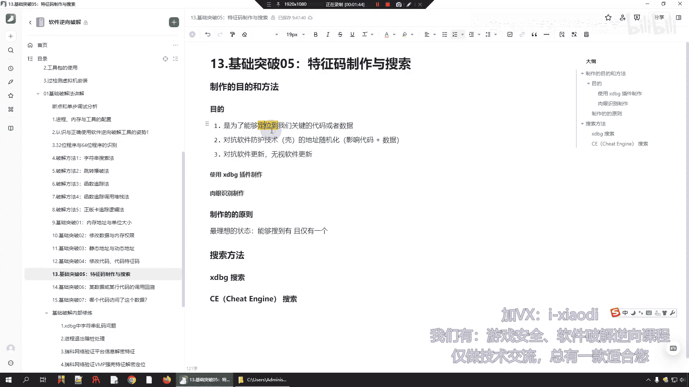
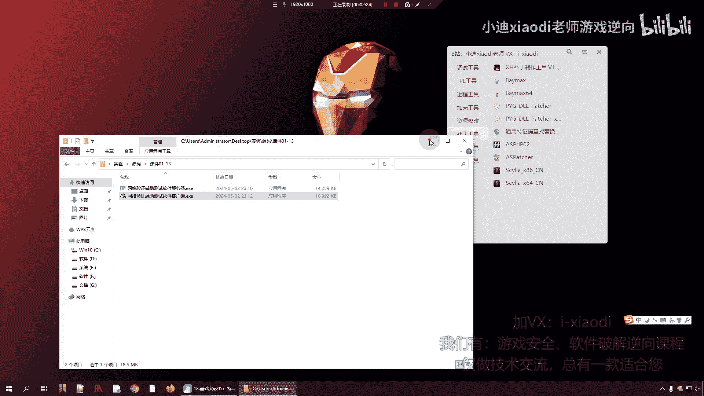
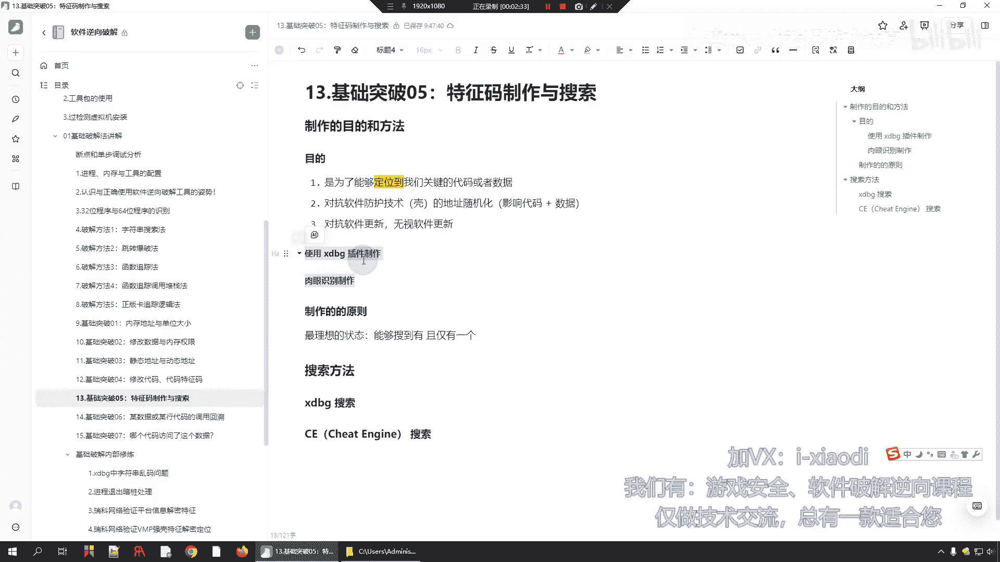
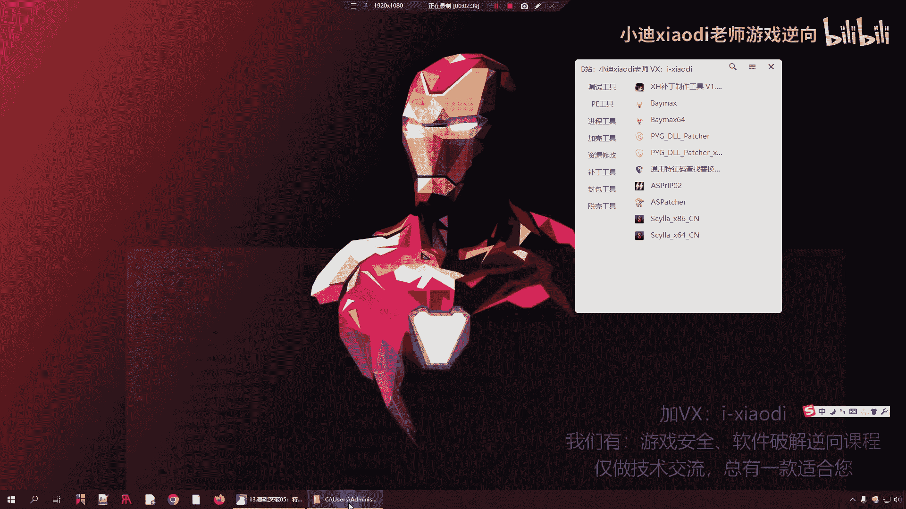
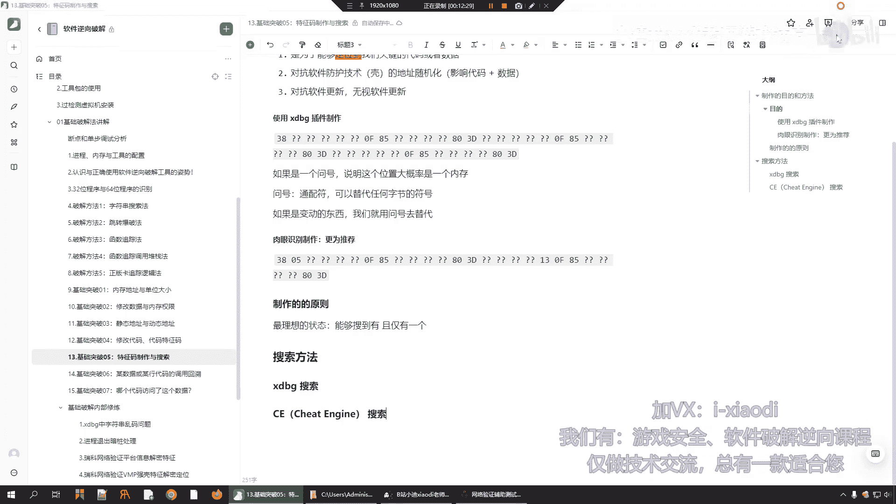
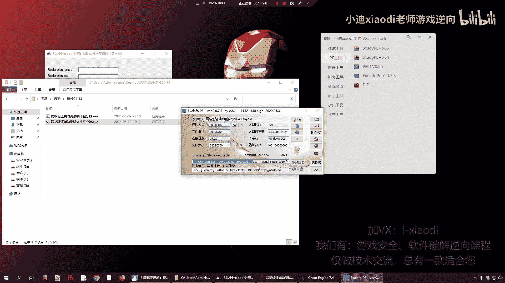
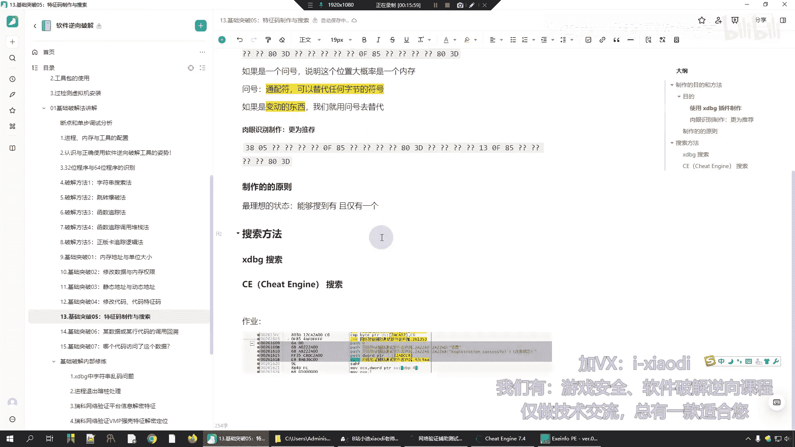

# 🧩 小白软件破解反汇编逆向安全工程师2025最新：01：特征码制作与定位技术概述

​

在本节课中我们将要学习特征码制作与定位技术。上一节课程中我们介绍了如何修改代码，并由此引申出代码特征码的概念；本节课程中我们来看看特征码的细节，也就是特征码如何制作、如何搜索、如何验证，以及制作时需要注意哪些原则。特征码技术是逆向分析、软件破解、游戏安全、软件安全、网络安全和 CTF 比赛中非常基础也非常常用的技术，很多工具都基于特征码搜索来完成定位，因此它是一个绕不过去、必须掌握的内容。

​

# 🎯 小白软件破解反汇编逆向安全工程师2025最新：02：特征码的作用与学习目的

​

上一节我们说明了特征码的概念，本节中我们来看看制作特征码的目的。制作特征码的目的有三个，下面这些内容分别说明这三个目的，以及它们在逆向分析中的实际意义。

​



- 第一个目的是定位关键代码或关键数据。例如我们逆向分析并破解一个软件时，本次能够定位到关键代码或关键数据的位置，下一次是否还能快速定位到，就是特征码技术要解决的问题。

- 第二个目的是帮助下一次快速定位。软件没有更新时可以用特征码定位；软件更新后，特征码技术可以对抗软件更新，也就是无视软件更新，仍然能够一下子定位到关键位置，不需要重新分析整个软件。

- 第三个目的是对抗软件防护和地址随机化。软件作者后来给软件加了防护技术，这类防护技术一般来说就是壳。壳会导致代码或数据地址随机化。代码或数据放在程序内存中，内存地址像身份证号一样标识代码和数据，但这个“身份证号”会随机化，每次不一样，从而影响代码和数据的定位。特征码技术可以对抗地址随机化，因为定位的是特征码，不是固定地址，所以地址怎么随机都不影响定位。



​

特征码技术可以无视软件更新，也可以无视软件防护。很多工具在使用时都基于特征码搜索，我们需要在工具中填入特征数据才能完成搜索，因此特征码是必须学习的内容。今后在实际分析中一定会用到特征码。



​

# 🛠️ 小白软件破解反汇编逆向安全工程师2025最新：03：特征码的两种制作方法与DBG插件制作流程



​

上一节我们介绍了特征码的作用，本节中我们来看看特征码如何制作。制作方法有两个，下面这些内容是两种制作方法的总体说明。

​

- 第一种方法是用 DBG 自带的插件制作特征码。

- 第二种方法是肉眼识别制作特征码。

​

接下来我们打开程序并运行客户端程序。点击调试工具，找到 DBG 并运行起来，然后点击文件，点击附加，双击目标程序。接着点击符号，这样可以切换到程序的主模块。切换到主模块后，可以进行搜索，搜索当前模块的字符串。此时可以看到一些关键信息，这是分析一个软件的正常流程。例如可以看到“注册成功”等信息。这里的跳转非常多，我们的目标是让这些跳转都跳到下面，或者不让它们跳，大家可以自行尝试。如果能够破解成功，可以在群里发送信息。

​

现在需要定位一片代码的位置。第一种方法是用 DBG 插件制作特征码。操作时先选中目标位置，然后点击插件，找到 `space army knife`，再找到 `signature`，这里有一个 `create signature`，也就是创建特征码的意思。点击 `create`，点一下后可以看到生成结果。这个结果中的格式并不是我们常用的格式，我们一般使用 PEID 格式。将生成结果复制下来并粘贴过来，可以看到其中有很多问号。

​

下面这些内容说明问号出现的位置和含义。观察问号出现的位置，例如 `38 05` 中的 `05`、`DEC9 2A00` 等位置。可以看到问号基本出现在内存地址形式的位置。如果某个位置是内存地址，插件就会把这个内存地址变成问号。再看 `0F85 0F85`，`0F85` 后面似乎不是地址，而是跳转到一个地址，后面这个东西也可能和地址有关。继续看 `CMP`，再看 `2AC` 和 `DA`，以及 `803D 803D`。`DAC92A00` 刚好也是这个地址的字节码。后面的 `13` 也被变成了问号。因此可以通过插件大致了解到，如果某个位置是问号，那么它大概率是一个地址形式，或者说大概率是地址的表征形式。

​

为什么地址会变成问号，需要先了解问号是什么。问号叫做通配，问号叫做通配符。通配符可以替代任何字节，是一个通用的符号。可以用公式表示如下。

​

```text
? = 任意字节
```

​

也就是说，地址位置的字节不管是什么内容，都可以用问号替代。如果某个位置是变动的地址，就用问号替代；如果是变动的内容，也用问号替代。这就是插件给我们的操作逻辑。

​

# 👁️ 小白软件破解反汇编逆向安全工程师2025最新：04：肉眼识别制作特征码的方法

​

上一节我们使用 DBG 插件生成了特征码，本节中我们来看看肉眼识别制作特征码的方法。肉眼制作和插件制作差不多，核心逻辑是：如果某个位置是地址并且会变动，就把它变成问号。

​

下面这些内容是肉眼制作时的具体观察和记录过程。看 `38 05` 和 `2AC9DE00`，`AL` 这个内容不一定变，因此 `38` 可以把 `05` 带上，没有问题。记录 `38 05`。继续往后看，这里是 `0F85`，也就是 `JNE`。后面这个内容如果不确定，可以先使用插件判断。`0F85` 大概率不会变，因为它是一个跳转，是一个固定的跳转格式；会变的只是后面的地址，后面这个地址是通过地址计算出来的，因此把后面这个地址换成问号。接着是 `803D`，这里又是一个地址，`803D` 实际上不会变。问号个数需要记清楚：`38 05` 后面是四个问号；`0F85` 后面也是四个问号；`803D` 后面也是四个问号，后面带一个 `13`。

​

下面这些内容继续说明问号替换范围和后续记录。`13` 不是地址，一般来说 `13` 不会变。我们一般只把地址或者跳转后面的几个地址相关内容替换掉，其他内容一般不变，因此 `13` 可以保留。肉眼识别制作基于原理，和插件制作并不完全一样。插件可以使用，但不能完全替代人，因此更推荐肉眼制作。继续往后做，`0F85` 又来一个，`0F85` 后面是一个地址相关的内容，因此换成四个问号。继续看到 `803D`，记录到 `803D` 即可。这样我们就再次制作出了一个特征码。可以用代码形式表示类似结果如下。

​

```text
38 05 ?? ?? ?? ??
0F 85 ?? ?? ?? ??
80 3D ?? ?? ?? ??
13
```

​

# 🔍 小白软件破解反汇编逆向安全工程师2025最新：05：使用DBG搜索并验证特征码

​

上一节我们制作了特征码，本节中我们来看看如何搜索和验证制作结果。制作好特征码之后要遵循一个原则：能够搜到有且仅有一个。为什么呢？因为如果搜出来 100 个结果，这 100 个结果中到底哪个是关键代码，就不好区分。最好让特征码只搜到一个结果，这样就能确定这个结果就是目标。就像警察抓犯罪嫌疑人一样，确定这个人就是犯人，然后去抓他，不要抓错人。这个原则可以用公式表示如下。

​

```text
匹配结果数量 == 1
```

​

下面这些内容介绍使用 DBG 搜索特征码的步骤。先试一下插件制作的特征码。在 DBG 中点击内存布局，然后点击搜索匹配特征，直接按 `Ctrl+V` 粘贴特征码，点击确定。可以看到搜索结果，而且工具还把问号通配符显示出来了。双击搜索结果，可以看到程序来到对应位置。再演示一遍：先点击符号，切换到对应界面，再点击内存布局，搜索匹配特征，粘贴后点击确定，得到 `261549`，双击后跳转到 `261549`，说明验证成功，这个特征码指向了代码位置。

​

下面这些内容介绍验证我们自己制作的特征码。使用我们自己制作的特征码，它比较短，也可以尝试是否能用。点击符号切换到对应界面，为了验证点击内存布局，搜索匹配特征，点击确定，也可以搜索到一个结果。因此两种特征码都可以使用。插件制作更省事一些，但插件不能保证百分百正确；人在制作时可控性更高，因此更推荐肉眼识别制作特征码。



​

# 🧰 小白软件破解反汇编逆向安全工程师2025最新：06：使用CE搜索并验证特征码

​

上一节我们使用 DBG 搜索并验证了特征码，本节中我们来看看使用 CE 搜索特征码的方法。打开 Cheat Engine，点击选择程序，找到目标程序，点击打开。然后切换到字节数组，把当前选项取消勾选，再勾选可写，基本设置就完成了。勾选方块，然后粘贴特征码进行搜索。

​

下面这些内容说明 CE 搜索的结果和意义。粘贴到搜索框后点击首次扫描，发现只有一个结果。CE 不仅能够搜到一个结果，还能显示模块名、模块地址和模块偏移，这是这个工具的好处。这也说明这个程序有可能是动态地址，有可能是启用了随机地址 ASLR。再进行新的扫描，也能搜索到一个结果。搜索结果数量是一，说明特征码非常好，不会错怪任何一个“犯人”，只抓一个目标。

​

# 📌 小白软件破解反汇编逆向安全工程师2025最新：07：制作原则、作业与总结

​



上一节我们使用 CE 验证了特征码，本节中我们总结特征码制作原则并布置作业。特征码技术非常有用，它能够无视软件更新，也能够无视软件防护。以当前程序为例，使用 `starP` 和 `ESEin` 简单查看，程序运行有点慢，稍等一下。将程序拖过来后可以看到 `99% packed protected`，说明这是一个有保护、有软件防护的软件。有软件防护的软件也可以对抗，使用的就是特征码技术。后续还会讲解瑞克网络验证平台如何解密相关数据，以及加了强壳时如何处理，这些内容会发布在内部视频中。

​

下面这些内容是特征码制作方法的总结和通配符规则。制作方法分为两种。问号是通配符，通配符可以替代任何字节。什么时候使用问号替代？如果某个内容是变动的内容，就用问号替代。什么会变动？代码地址会变，因此地址性质的内容都要替换成问号。像 `43` 这种数不是地址，只是一个简单的数，一般不会变，因此不需要替换。

​

下面这些内容是作业安排。举一个例子作为作业：定位几个目标位置，思考哪里会变、哪里不会变。地址是会变的，把地址替换成问号。大家回去自己尝试，作业就是定位目标位置并自己写一个特征码。制作原则是能够搜到且有且仅有一个，不要错过任何一个目标。

​



本节课中我们一起学习了特征码的制作目的、两种制作方法、DBG 插件制作流程、肉眼识别制作方法、DBG 搜索验证方法、CE 搜索验证方法、通配符规则、制作原则以及作业安排。本节课内容较多，回去后需要好好消化，做好笔记，认真理解。课程到此结束。
