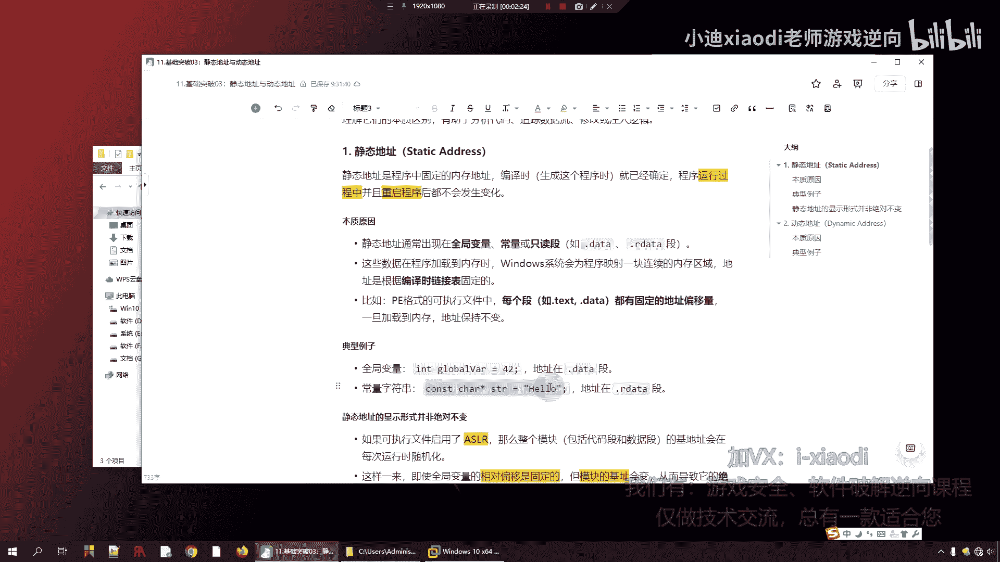
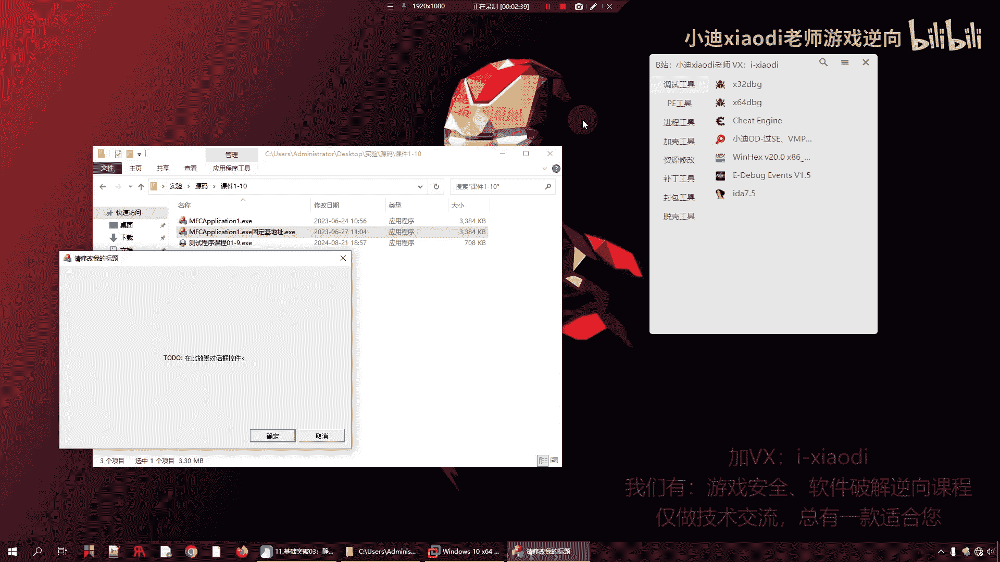
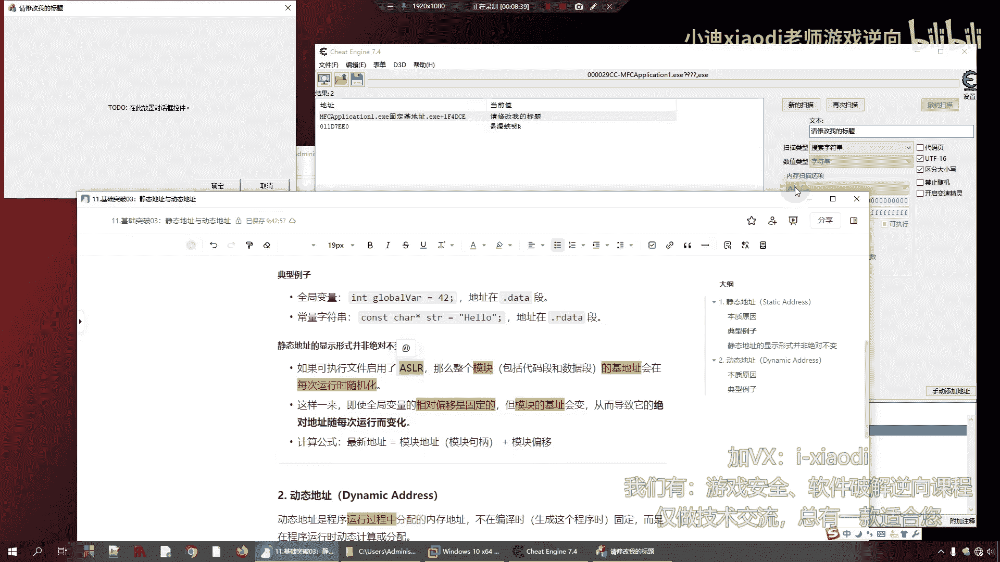
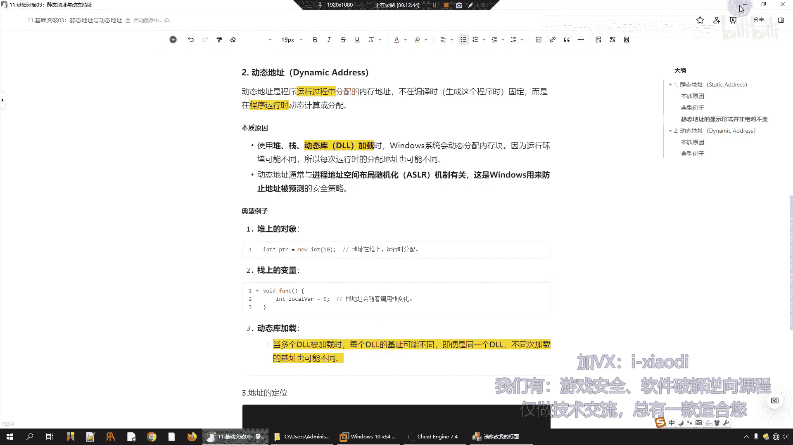
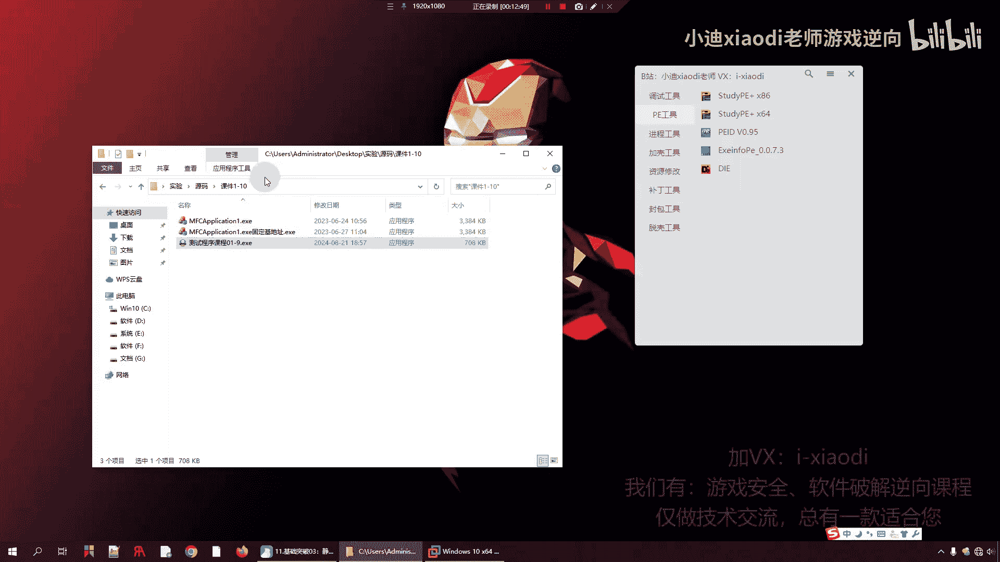
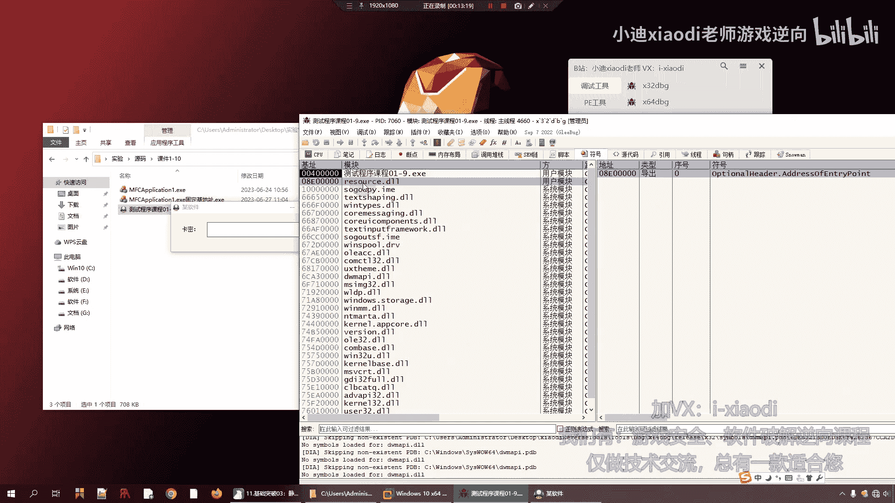
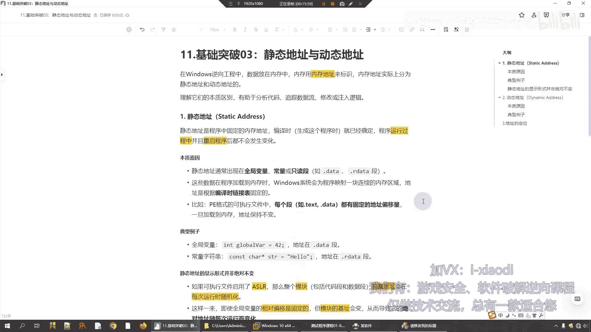

## 🧭 小白软件破解反汇编逆向安全工程师2025最新：01：课程概述与学习目标

在本节课中我们将要学习静态地址和动态地址。本节先说明内存地址的基本概念，再通过实验观察静态地址与动态地址的差别，最后介绍定位地址的常见思路。学习这一节时，先把概念和实验现象对应起来，后面分析程序会更顺。

在Windows逆向工程中，数据放在内存中，这一点是基础共识。屏幕显示的内容实际放在显存里，数据不会放在键盘里，所以数据在内存中。内存是非常连续的空间，用内存地址来标识每一个内存数据。这种标识方法类似每个人都有自己的身份证号，说明它是独一无二的东西。针对Windows系统来说，这个标号有可能变化。由此引出本节内容：内存地址分为静态地址和动态地址。理解它们的本质区别，有助于分析代码、追踪数据流、修改或注入逻辑。

## 🧠 小白软件破解反汇编逆向安全工程师2025最新：02：内存与地址基础

上一节说明了课程目标，本节来看看内存与地址的基础关系。内存中的数据需要用地址定位，地址像身份证号，但在Windows中可能变化。这个变化不是随口说的，它和程序编译方式、模块加载方式、系统安全机制都有关系。

静态地址和动态地址的差别，直接影响后续破解、修改和调试时能不能稳定找到目标数据。初学阶段先记住一句话：地址是定位数据的标号，标号可能固定，也可能在每次运行时变化。下面先介绍静态地址。

## 🧱 小白软件破解反汇编逆向安全工程师2025最新：03：静态地址的概念

静态地址是程序中固定的内存地址。从名字可以想到它的含义：程序生成时，或者在编译时，这个地址就已经确定，程序运行过程中不会变化，重启程序后也不会发生变化。初学阶段简单了解即可，不必一开始就深究底层细节。





静态地址通常出现在全局变量、常量或只读段中。定义全局变量或常量字符串时，这类数据的地址一般不会变，它们的地址就是静态地址。可以用下面的公式概括静态地址的特征。

```text
静态地址：程序编译时已经确定的内存地址
重启程序后：地址保持不变
常见来源：全局变量、常量、只读段
```

理解静态地址后，本节通过工具实验观察它的现象。静态地址在重启程序、换电脑后是否保持不变，是实验要验证的重点。下面进入实验操作。

## 🔬 小白软件破解反汇编逆向安全工程师2025最新：04：静态地址实验与现象

上一节介绍了静态地址的定义，本节用Cheat Engine观察静态地址。实验目标是搜索字符串“请修改我的标题”，记录地址，再重启程序和换虚拟机验证地址是否变化。以下是实验操作步骤。

1. 打开工具包中的Cheat Engine并运行。
2. 点击小电脑图标，选择进程，打开“固定基地址”程序。
3. 数值类型选择字符串，处理可写选项，勾选UTF-16。
4. 搜索“请修改我的标题”，首次扫描没有结果，勾选UTF-16后进行新的扫描和首次扫描。
5. 搜索结果中出现地址5F4DCE，记住这个地址。
6. 关闭程序并重新运行，点击打开时保留当前地址列表，观察5F4DCE仍然存放标题。
7. 换到虚拟机，运行同一程序，在Cheat Engine中手动添加地址5F4DCE，选择字符串和Unicode，观察5F4DCE仍然存放标题。

实验现象说明，这个字符串在重启程序后和换电脑后都没有变化，它属于静态地址。逆向分析或逆向破解时，修改程序后地址仍可能不变，这有助于破解完成后发给别人测试。

需要拓展一点：静态地址显示的形式并非绝对不变。搜索数据时可以看到5F4DCE以“模块名.exe+偏移”的形式出现。前面是模块地址，也可以叫模块基址、模块基值、模块机制或模块基址，后面是模块偏移。模块地址加模块偏移始终等于5F4DCE，但模块基址有变化的可能性。下面说明模块基址与ASLR的关系。

## 🧩 小白软件破解反汇编逆向安全工程师2025最新：05：模块基址与模块偏移

上一节看到了“模块名.exe+偏移”的显示形式，本节拆解模块基址和模块偏移。静态地址不是只看一个绝对数字，还要看它由哪两部分组成。可以用下面的公式表示。

```text
实际地址 = 模块基址 + 模块偏移
5F4DCE = 模块基址 + 模块偏移
```

复制“.exe”并手动添加地址，可以得到模块基址。模块基址可能变化，原因是可执行文件启用了ASLR。ASLR启用后，整个模块的基地址会在每次运行时随机化。也就是说，模块偏移可以固定，模块基址却可能变化，最终绝对地址会随每次运行变化。

> 提示：ASLR是进程地址空间布局随机化，是Windows用来防止地址被预测的一种安全策略，属于软件安全机制，用于防止黑客攻击。

查看ASLR可以用PE工具Stud_PE。以下是查看和切换ASLR的操作与现象。

1. 运行固定基地址程序和动态基地址程序。
2. 用Stud_PE打开程序，观察动态基址和固定基址的区别。
3. 显示动态基址表示开启ASLR，显示固定基址表示没有开启ASLR。
4. 工具中可以点击切换ASLR，左下角会显示“使用动态基址ASLR成功”。
5. 不推荐直接修改ASLR，修改可能造成程序异常，最好保持原状。

观察动态程序时，运行后搜索“请修改我的标题”，原来固定基址下的地址会失效。重新搜索会得到D14DCE，模块基址变成B20000，之前是0040000，现在变成B20000。换一个操作系统后，原地址同样失效，重新搜索得到7A4DCE，模块基址为5B000，与之前的B20000不同。这样能直观看到：静态地址不一定绝对不变，开启ASLR后可能变化。



## 🛡️ 小白软件破解反汇编逆向安全工程师2025最新：06：ASLR与静态地址的变化

上一节通过工具观察了ASLR，本节把ASLR对静态地址的影响说清楚。ASLR是进程地址空间布局随机化，Windows用它防止地址被预测。微软为程序安全设计这种机制，目的是防止攻击。

即使全局变量的相对偏移固定，模块基值也会变化。模块偏移不变，模块基址受ASLR影响，导致绝对地址每次运行变化。可以用下面的公式计算最新地址。

```text
最新地址 = 模块地址（模块基址 / 模块基值） + 模块偏移
```

因此，静态地址要分两种情况看：没有开启ASLR时，可以直接看绝对地址；开启ASLR时，要用模块基址加模块偏移计算。理解这一点后，下面进入动态地址。


## 🌀 小白软件破解反汇编逆向安全工程师2025最新：07：动态地址的概念

上一节说明了ASLR导致静态地址变化，本节介绍动态地址。动态地址是程序运行过程中分配的内存地址。类比开启游戏后才会有各种装备，现实生活中没有这些装备，玩游戏时才有。动态地址不在程序编译时固定，程序运行起来才会产生。

动态地址的本质来源可以简单了解。使用堆栈、动态库加载时都会产生动态现象。学过C语言或C++会了解堆和栈，栈上变量的生命周期很短，仅存在于栈这一块。动态库加载也需要了解：多个DLL被加载时，每个DLL的基地址可能不同；即便是同一个DLL，不同加载时的基地址也可能不同。以下是动态地址的常见来源。

- 堆分配产生的数据地址。
- 栈上变量产生的数据地址。
- 动态库加载产生的模块基址。

下面用实验观察动态库基址变化。以下是动态库基址实验步骤。

1. 打开调试工具，找到实验程序。
2. 将程序拖入工具并运行。
3. 点击符号，观察resource.dll的基址为8E00000。
4. 关闭程序并重启，再次运行。
5. 点击符号，观察resource.dll的基址变为8E70000。

实验说明，DLL每次加载的基址可能不同。动态地址的定位比静态地址更依赖运行状态。下面介绍定位方法。

## 🎯 小白软件破解反汇编逆向安全工程师2025最新：08：静态地址与动态地址的定位方法



上一节介绍了动态地址的来源，本节说明如何定位地址。修改数据前必须先找到地址，地址定位非常重要。静态地址和动态地址的定位思路不同。



对于静态地址，可以直接计算。没有开启ASLR时，肉眼看地址即可，看到什么就是什么，直接修改即可。开启ASLR时，使用模块地址加模块偏移计算最新地址。可以用下面的公式表示。

```text
未开启ASLR：直接使用看到的绝对地址
开启ASLR：最新地址 = 模块基址 + 模块偏移
```



对于动态地址，它在程序运行过程中分配，不能只靠固定数字。以下是动态地址常见的两类定位思路。

- CE自动化找指针技术：可能找到一个表达式，最终指向动态地址。它不是绝对有效，后续课程会讲。
- 特征码定位技术：把稳定数据作为内存特征搜索，例如“请修改我的标题”这几个字永远不变，可以转成内存字节形式作为特征，搜索后查看结果第几个并修改。后续课程会讲。

特征码定位可以用下面的形式理解。

```text
目标地址 = 指针表达式
特征字节 = “请修改我的标题”的内存字节形式
```

静态地址定位重在计算，动态地址定位重在找稳定线索。两条路线会在后续课程继续展开。

## ✅ 小白软件破解反汇编逆向安全工程师2025最新：09：课程总结

本节回顾整体内容。以下是本节课需要记住的要点。

- 内存数据用地址标识，地址像身份证号，但Windows中的地址可能变化。
- 静态地址在编译时确定，重启程序后通常不变，常见于全局变量、常量、只读段。
- 静态地址的显示形式是模块基址加模块偏移。
- ASLR会让模块基址随机化，导致绝对地址每次运行变化。
- 动态地址在程序运行中分配，常见来源包括堆、栈和动态库加载。
- 静态地址可直接看或计算，动态地址可用指针表达式或特征码定位。



本节课中我们一起学习了静态地址和动态地址的概念、实验现象、ASLR的影响以及地址定位思路。掌握这些基础后，后续分析代码、追踪数据流、修改或注入逻辑会更有方向。
