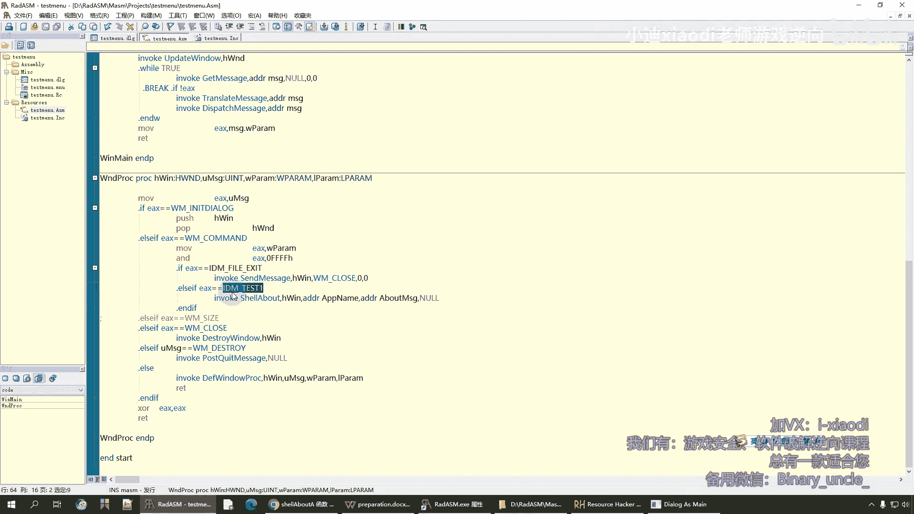

# 🧭 小白软件破解反汇编逆向工程师2023最新入门到精通：第24课：Windows API 讲解——创建窗口程序与菜单资源的用法及逆向修改

在本节课中我们将要学习 Windows API 中创建窗口程序时菜单资源的基本用法。内容会从“菜单长什么样”开始，逐步讲到带菜单窗口模板的生成、菜单消息在 `WM_COMMAND` 中的过滤方式、测试菜单项的添加，以及用 Resource Hacker 修改菜单资源。本节对应小迪老师第24课，重点是把菜单资源的创建、使用和逆向修改串成一条完整的学习路线。

## 📚 小白软件破解反汇编逆向工程师2023最新入门到精通：第24课-01：认识菜单是什么

上一节我们完成了课程概述，本节中我们来看看菜单在开发工具和窗口程序中的基本样子。菜单可以理解成窗口顶部的一排功能入口，用户把鼠标放上去以后，会出现下拉选项，点击选项就能触发对应功能。打开开发工具后，最上面一栏通常有“文件”“编辑”“视图”等文字，这一栏就是菜单。

以下是开发工具中常见的菜单栏示例：

- 文件
- 编辑
- 视图

当鼠标放到这些文字上时，会出现对应的菜单选项，这个区域就是菜单。我们自己写窗口程序时，也可以创建类似的菜单。运行原文示例程序后，可以看到 `Help About`、`File Exit`、`测试一`、`测试2` 等菜单项，这些内容都可以自己添加和修改。它和开发工具顶部的菜单基本一样，只不过示例里还添加了一些快捷键标记，例如 `A`、`O`、`WT`、`M`，本节先不展开快捷键，先了解菜单资源如何创建和使用。


菜单本身属于资源的一部分，但它不是在对话框资源里直接添加的，而是有专门的菜单编辑器。理解这一点很关键，因为后面做逆向修改时，经常会遇到“对话框资源”和“菜单资源”分开存放的情况。下一节我们来看看如何创建一个带菜单的窗口程序模板。

## 🧩 小白软件破解反汇编逆向工程师2023最新入门到精通：第24课-02：创建带菜单的窗口程序模板

上一节我们说明了菜单在开发工具中的位置，本节中我们来看看菜单资源在窗口程序里如何创建。原文示例通过新建工程的方式生成一个窗口程序模板，这个模板自带菜单资源，适合用来观察菜单的生成和消息过滤过程。

以下是创建带菜单窗口模板的操作步骤：

1. 点击“文件”，选择“新建工程”。
2. 选择 `Win32 APP` 工程类型。
3. 给工程取一个名字，例如 `manual test menu` 或 `test menu`。
4. 点击“下一步”。
5. 在窗口类型中选择类似 `Dialog as main` 的窗口程序模板。
6. 继续点击“下一步”，然后点击“完成”。

工程创建完成后，可以在资源视图里看到一个 `Dialog` 资源，同时开发工具会自动生成一个菜单编辑器。这个菜单编辑器里已经有一套默认菜单，相当于窗口程序模板自带的菜单。这个模板的特殊之处在于它是一个带菜单的窗口模板，默认只有两个功能：`Help About` 和 `File Exit`，结构很简单，适合初学者观察。

以下是该默认模板中的两个菜单功能：

- `Help About`：弹出关于对话框。
- `File Exit`：退出程序。

菜单功能的实现肯定在窗口过程函数里，因为窗口过程负责处理窗口消息。程序判断用户点击了哪个菜单项，然后执行对应功能。下一节我们来看看菜单点击消息到底在哪里过滤。

## 🔍 小白软件破解反汇编逆向工程师2023最新入门到精通：第24课-03：在 WM_COMMAND 中过滤菜单消息

上一节我们生成了带菜单的窗口模板，本节中我们来看看菜单点击消息如何被窗口过程接收和处理。菜单被点击后，程序通常会在 `WM_COMMAND` 消息里进行过滤，通过判断菜单 ID 来决定执行哪个功能。可以把这个过程理解成一条固定链路。

以下是菜单点击到功能执行的核心链路：

```text
点击菜单项 → 产生 WM_COMMAND 消息 → 在窗口过程中判断 wParam 中的菜单 ID → 执行对应功能
```

原文示例中，代码会判断 `IDM_FILE_EXIT`，如果匹配，就发送退出消息。这里用到的 API 是 `SendMessage`，它可以向指定窗口发送消息。窗口句柄使用当前窗口自己的句柄，发送的消息是 `WM_CLOSE`，也就是关闭窗口。因此点击 `File Exit` 后，程序就会关闭。

以下是对应逻辑的简化代码：

```c
case WM_COMMAND:
    if (LOWORD(wParam) == IDM_FILE_EXIT) {
        SendMessage(hWnd, WM_CLOSE, 0, 0);
    }
    break;
```

除了退出功能，原文还判断了 `IDM_HELP_ABOUT`。点击 `Help About` 时，程序会调用类似 `ShellAbout` 的关于对话框函数，把窗口句柄等参数传进去，弹出一个系统关于对话框。这个关于对话框可以自定义标题，原文示例中出现了 `Win10` 这样的标题，也可以填写版权信息。图标句柄一般填空或 `NULL`，表示使用默认处理。下一节我们来看看这些菜单 ID 和宏定义在哪里查看。

## 🧾 小白软件破解反汇编逆向工程师2023最新入门到精通：第24课-04：查看关于对话框、菜单 ID 与宏定义

上一节我们介绍了 `WM_COMMAND` 中的菜单消息过滤，本节中我们来看看过滤时使用的菜单 ID 和宏定义。原文口播中提到 `File Exit` 为 `1001`，`IDM_HELP_ABOUT` 为 `10101`，后面在菜单编辑器里又看到 `File Exit` 菜单项显示为 `10001`，`Help About` 显示为 `10101`。这里需要以资源编辑器实际显示的 ID 为准，口播中的数字可能存在口误或不同模板差异。

> 提示：菜单 ID 的数字在不同工程模板中可能不同，学习和破解时应以资源编辑器、`resource.h` 或反编译工具中实际显示的值为准。

菜单资源的定义可以在资源视图中查看。双击资源位置可以打开 `Menu` 资源，再双击一次可以打开菜单编辑器。菜单编辑器里可以编辑菜单项名称、ID 和层级关系。原文示例中，`File Exit` 是一个菜单项，`Help About` 也是一个菜单项，它们各自有对应的 ID。菜单项前面带有 `&` 符号的通常是主菜单标题，下边缩进的内容是子菜单选项。`Help` 是主菜单标题，下边是它的子菜单选项。

以下是在资源编辑器中观察菜单资源的要点：

- 双击资源视图中的菜单资源，可以打开 `Menu` 编辑器。
- 菜单项可以修改名称和 ID。
- 带 `&` 符号的通常是主菜单标题。
- 主菜单下边缩进的项目是子菜单选项。
- 可以继续插入自己的菜单项。

理解宏定义和菜单 ID 的对应关系后，就可以在代码里用 ID 判断用户点击了哪个菜单项。下一节我们动手添加测试菜单项，并把菜单 ID 与代码逻辑关联起来。

## ➕ 小白软件破解反汇编逆向工程师2023最新入门到精通：第24课-05：添加测试菜单项并关联代码

上一节我们查看了菜单 ID 和宏定义，本节中我们来看看如何自己添加菜单项。原文示例先插入一个名为“测试”的主菜单，为了防止混乱，还给菜单做了模拟标记。点击确定后运行程序，可以看到多了一个“测试”菜单，但“测试”里面还没有子菜单项，因此还需要继续往里面添加内容。

以下是添加“测试”主菜单和“测试一”子菜单的操作思路：

1. 在菜单编辑器中点击“插入”，添加一个菜单项。
2. 将名称改为“测试”。
3. 点击确定并运行程序，观察是否多出“测试”菜单。
4. 再次点击“插入”，添加“测试一”。
5. 如果“测试一”跑到了“测试”的后边，说明层级不对。
6. 点击菜单位置并向右移动，让“测试一”前面出现两个点，表示它成为子菜单。
7. 点击确定后重新运行，确认“测试一”进入“测试”菜单内部。

添加子菜单时，缩进层级非常重要。原文中“测试一”一开始跑到了“测试”的后边，原因是层级关系没有设置正确。通过向右移动，让“测试一”前面出现两个点，就表示它已经成为“测试”的子菜单。为了让代码能够过滤“测试一”，还需要给它起一个菜单 ID，例如 `IDM_TEST1`，原文口播中对应数字为 `10003`，并定义宏。原文中宏定义出现类似 `EQU` 的写法，实际开发中通常在 `resource.h` 中写成 `#define` 形式。

以下是测试菜单 ID 的示例定义：

```c
#define IDM_TEST1 10003
#define IDM_TEST2 10004
```

定义好宏以后，把原来的 `IDM_HELP_ABOUT` 判断替换成 `IDM_TEST1`，这样点击“测试一”时就会调用关于对话框，方便验证菜单 ID 已经和代码逻辑对应上。继续添加“测试2”时，可以插入菜单项，把名称改为“测试2”，向下移动再向右移动，形成“下、下、右”的层级关系。然后给它定义 `IDM_TEST2`，原文口播中对应数字为 `10004`，运行后点击“测试”“测试一”“测试2”，可以观察每个菜单项是否正常响应。下一节我们使用 Resource Hacker 修改已有程序的菜单资源。

## 🧰 小白软件破解反汇编逆向工程师2023最新入门到精通：第24课-06：用 Resource Hacker 修改菜单资源

上一节我们通过代码添加并关联了测试菜单项，本节中我们来看看如何用反编译或资源修改工具修改已有程序的菜单。原文示例把自己的程序 `textmenu` 拖入 Resource Hacker，然后在左侧资源树中查看 `Dialog` 和 `Menu`。`Dialog` 对应程序界面，`Menu` 对应菜单资源，修改菜单时重点看 `Menu`。

以下是使用 Resource Hacker 修改菜单资源的基本步骤：

1. 将目标程序拖入 Resource Hacker。
2. 在左侧资源树中找到 `Menu` 节点。
3. 展开菜单资源，观察现有菜单项。
4. 勾选 `Design` 模式，使菜单项可以编辑。
5. 右键点击菜单资源，选择 `Insert`。
6. 在 `Caption` 中输入新菜单名称，例如“破解一”。
7. 点击 `OK`，确认菜单树中多出“破解一”。
8. 也可以在“测试”菜单中加入新项，在 `Help` 菜单中加入“我的help”。
9. 修改完成后点击编译按钮。
10. 点击保存，覆盖或另存修改后的程序。
11. 运行程序，检查是否出现新增菜单项。

原文中 Resource Hacker 的菜单资源旁边有一个加号，这个加号表示可以添加资源项。添加菜单项前需要先勾选 `Design`，否则不方便直接编辑。双击加号可能无法操作，可以使用鼠标右键点击 `Insert`，然后在 `Caption` 中填写菜单名称。添加“破解一”后，菜单里会多出对应项目；“测试”菜单里也可以继续添加；`Help` 菜单里可以加入“我的help”。修改完成后编译程序并保存，运行后就能看到新增的菜单项。

原文还提到，有些程序的菜单会显示为灰色，这种灰色菜单在当前简单模板里体现不出来。后续课程会继续讲解菜单的构成，只有理解菜单资源如何组织，才能进一步分析灰色菜单为什么不可用，以及如何通过逆向修改去掉灰色限制。下一节我们对本节内容做总结。

## ✅ 小白软件破解反汇编逆向工程师2023最新入门到精通：第24课-07：本节总结

上一节我们完成了 Resource Hacker 修改菜单资源的实验，本节中我们对第24课的内容做总结。本节课围绕菜单资源展开，从菜单在开发工具中的外观讲起，说明了菜单属于资源的一部分，并且有专门的菜单编辑器。随后通过窗口程序模板观察默认的 `Help About` 和 `File Exit`，理解了菜单点击消息在 `WM_COMMAND` 中过滤的流程。

以下是本节课需要掌握的核心内容：

- 菜单是窗口顶部的功能入口，鼠标放上去会出现下拉选项。
- 菜单属于资源，但不是在对话框资源里直接添加，而是使用菜单编辑器。
- 带菜单的窗口模板默认可以包含 `Help About` 和 `File Exit` 等功能。
- 菜单点击后在 `WM_COMMAND` 中判断菜单 ID。
- `SendMessage` 可以向窗口发送消息，例如发送 `WM_CLOSE` 关闭窗口。
- 菜单 ID 与宏定义需要对应，才能让代码正确响应菜单点击。
- 可以通过插入菜单项、调整缩进层级来添加主菜单和子菜单。
- Resource Hacker 可以修改已有程序的菜单资源，需要勾选 `Design` 后插入菜单项。
- 灰色菜单的逆向分析会在后续课程继续展开。



本节课中我们一起学习了菜单资源的基本概念、带菜单窗口模板的创建、`WM_COMMAND` 消息过滤、菜单 ID 与宏定义的对应、测试菜单项的添加，以及用 Resource Hacker 修改菜单资源的完整流程。掌握这些内容后，初学者就能看懂一个窗口程序里的菜单是如何生成、如何响应点击、又如何被逆向工具修改的。

