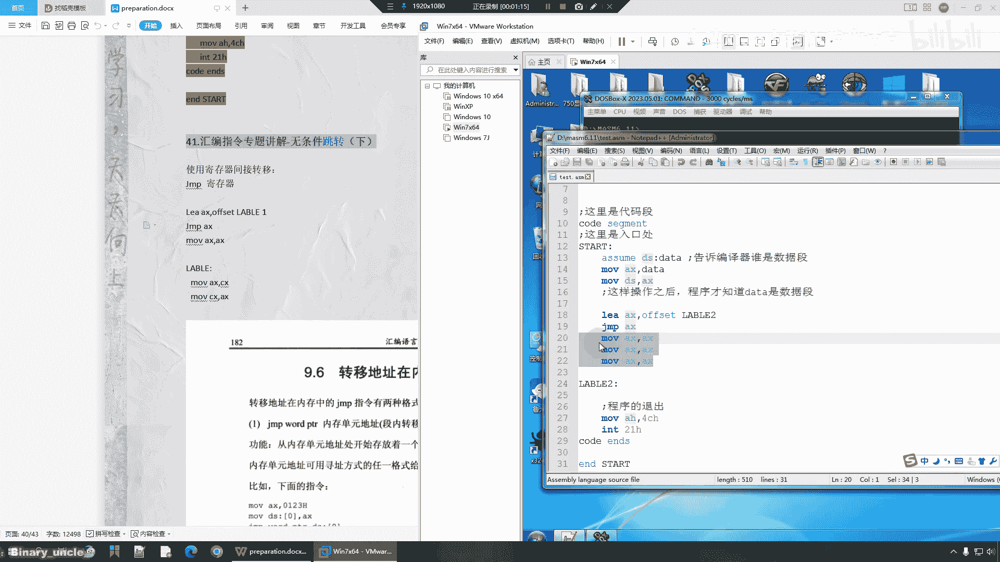
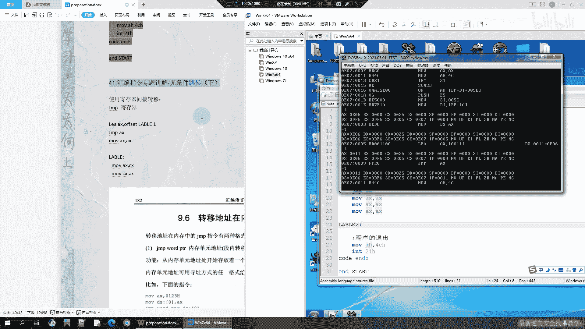
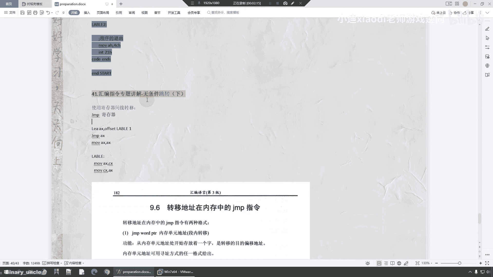

# 小白软件破解反汇编逆向工程师2023最新：4.41：汇编指令专题讲解-无条件跳转（下）🔀


在本节课中，我们将要学习无条件跳转指令的下半部分——使用寄存器进行间接转移。这是整个汇编跳转专题中非常关键的一个环节，因为之前我们接触到的跳转方式都比较“死板”，而今天要讲的这种间接转移方式，会让程序的跳转变得更加灵活，也更贴近实际逆向工程中经常遇到的代码模式。很多初学者在刚刚接触汇编的时候，往往会觉得跳转指令就那么几种，没什么好研究的，但事实上，当你真正开始分析别人的程序时，经常能看到类似 `jmp ax` 这样的写法，如果你不理解它背后的原理，很容易就被绕晕了。所以，这节课的内容虽然看起来简单，但它的重要性绝对不容忽视。

上一节中，我们讲解了无条件跳转的基础用法，也就是直接跳转到一个固定的标号位置。那种方式非常好理解，就像你在地上钉了一根钉子，程序执行到跳转指令时，就直接跳到那个钉子的位置继续运行。但是现在情况变了，跳转的目标不再是一个固定的标号，而是可以通过寄存器来动态改变。也就是说，程序可以直接跳转到一个寄存器里存放的地址上去。在汇编代码中，这个动作通常写成 `jmp ax` 或者 `jmp bx` 这样的形式。这里的寄存器不是随便用的，它必须提前被赋上一个合法的地址值，然后跳转指令才会带着程序飞到那个地址去执行。

那么，这个寄存器的值是从哪里来的呢？通常有两种来源：一种是从某个地方取出一个段内的偏移地址，另一种是直接给它一个明确的地址，然后跳转到那个地址上去。不管你使用哪种方式，最终的效果都是一样的——程序会跳到寄存器所指向的那个位置继续执行。这里就需要特别提醒你一个非常重要的注意点：当你做逆向分析的时候，或者在看别人写的代码的时候，甚至是在自己动手写代码的时候，都要时刻关注这个寄存器的来源。具体来说，就是你要搞清楚，跳转指令里那个寄存器（比如 `ax`）的值到底是从哪里来的，是某条 `lea` 指令取出来的，还是某条 `mov` 指令赋进去的，或者是经过一系列运算之后算出来的。只有弄清了寄存器的来源，你才能真正读懂这段跳转的逻辑。当然，这些通用寄存器都是可以用的，`ax`、`bx`、`cx`、`dx` 等等都可以拿来当跳转目标，没有特别的限制。

接下来，我们来看一个具体的例子，通过实例来理解这个间接转移到底是怎么工作的。这个例子在逻辑上非常简单，但它把寄存器间接转移的核心过程完整地展示了出来。

以下是这个示例程序的执行逻辑步骤：


- 先使用 `lea` 指令取出一个标签的地址。这里取的是 `label2` 这个标签的地址，而这个标签对应的是程序的退出部分。
- 取出来的地址被保存到 `ax` 寄存器中。
- 然后执行 `jmp ax`，也就是直接跳转到 `ax` 所保存的那个地址上去。
- 跳转之后，`label2` 之前下面的那些代码就不会再执行了，因为程序已经直接飞到了退出部分。


你看，整个过程非常清晰：先用 `lea` 把目标地址“装”进寄存器，然后再用 `jmp` 这个寄存器进行跳转。这就像是先把目的地输入到导航仪里，然后按下“开始导航”按钮，程序就乖乖地跟着导航走了。我们把这几个动作用代码表示出来，就是这样的：




```asm
lea ax, label2   ; 取出 label2 的偏移地址，保存到 ax
jmp ax            ; 跳转到 ax 指向的地址（也就是 label2）
```


当程序执行完 `jmp ax` 之后，`ax` 里存放的是 `label2` 的地址，所以下一条要执行的指令就是 `label2` 处的那条指令。在这个例子里，`label2` 就是程序的退出代码，所以执行完跳转之后，程序就准备退出了。至于跳转指令后面还有没有其他代码，已经无所谓了，因为程序根本不会去执行它们。这就是寄存器间接转移的基本逻辑，也是它和直接跳转最大的区别：直接跳转的目标是写死在指令里的，而间接转移的目标是运行时才确定的。

好，我们把这段程序实际运行一下，看看效果。程序运行的过程中没有出现任何错误，说明这个跳转是正常的。然后我们打开调试器，单步执行，把目光放到那个关键的位置上，也就是执行 `lea` 指令的那一行。你注意看，这里使用的是 `lea` 而不是 `mov`，这是非常有意思的一个细节。`lea` 的全称是“加载有效地址”，它做的事情是把一个内存地址计算出来，然后存到目标寄存器里，而不是去读取那个地址里的内容。当程序执行到这条 `lea` 指令，即 `lea ax, 0x11` 的时候，它就把 `0x11` 这个地址值直接取出来了，注意，是地址值本身，不是地址里的数据。因此，在执行完这一行语句之后，`ax` 寄存器就变成了 `0x11`。

我们来单步执行一下，看看是不是这样。你看，当步过这条 `lea` 指令之后，`ax` 的值果然变成了 `0x11`。然后程序继续执行，下一步就是 `jmp ax`，它直接跳转到 `0x11` 这个地址。而 `0x11` 这个地址对应的指令是什么呢？我们在调试器里可以看到，这个位置就是 `mov ah, 4ch`，接下来紧跟着的就是 `int 21h`。所以，当执行完 `jmp ax` 之后，程序直接就跳到了 `mov ah, 4ch` 这一行。我们按一下单步，程序就真的跳到了那里，完全符合我们的预期。

通过这个例子可以看到，使用寄存器的间接转移并不复杂，本质上就是“先取地址，再跳转”的套路。很多新手可能会觉得 `lea` 和 `mov` 容易混淆，这里我们用一个简单的对比来加深理解：




```asm
mov ax, label2   ; 这里是把 label2 地址处的数据（内容）赋给 ax
lea ax, label2   ; 这里是把 label2 这个地址值本身赋给 ax
```


在寄存器间接转移的场景下，我们使用的是 `lea` 而不是 `mov`，因为我们需要的是地址，而不是地址里的内容。如果把这两者搞混了，程序就会跳到完全错误的地方去，这在逆向分析的时候是一个非常容易踩的坑。所以，一定要把 `lea` 的用途记清楚：它负责计算并加载有效地址，而不是加载数据。

关于寄存器间接转移的内容，在教材的第182页有详细的说明，大家如果有兴趣的话，可以自己翻开来看看。这个知识点在汇编里面属于比较常见，而且也比较简单的部分，但是简单不代表不重要。恰恰是因为常见，所以你在阅读别人的代码时经常会遇到它，如果你能一眼就看懂这种跳转模式，那么你对整个程序的控制流就会有一个更清晰的认识。以后在逆向分析中，如果看到 `jmp` 后面跟的是寄存器，而不是一个直接的内存地址或标号，那么你就应该立刻意识到，这是一个动态跳转，它的目标地址是在程序运行过程中计算出来的，需要你仔细追踪寄存器的来源。



到这里，本节课的主要内容就讲得差不多了。我们一起学习了无条件跳转中的寄存器间接转移方式，知道了它和直接跳转的区别，也通过一个实际的例子看到了 `lea` 取地址、`jmp` 跳转的完整过程。简单来说，就是先把目标地址放进寄存器，然后再用 `jmp` 去跳转。同时，我们还强调了注意寄存器来源的重要性，以及 `lea` 和 `mov` 的区别。希望大家在课后再自己动手调试一遍这个例子，把每一步的变化都看清楚，这样你对寄存器间接转移的理解就会更加牢固了。好了，本节课就讲到这里，我们下节课再见。
