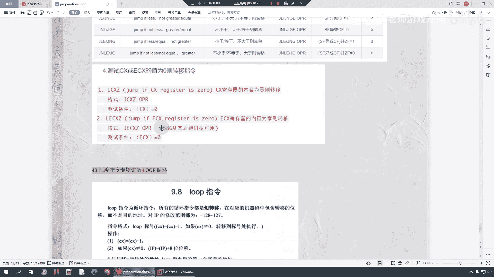

# 🧭 小白软件破解反汇编逆向工程师2023最新：4.42：汇编指令专题讲解-条件跳转

在本节课中我们将要学习汇编里的条件跳转指令。条件跳转有很多种，我们不会把每一个都讲得非常复杂，而是抓住平时分析程序时最常见、最核心的知识点来讲。学习重点是认识英文单词和指令之间的对应关系，理解标志位是什么意思，然后通过一个循环查找字符串中某个字符的小程序，把条件跳转真正用起来。下面我们从最常见的英文缩写开始。

## 🧩 一、先认识条件跳转的英文单词和指令关系

上一段我们说了要抓住英文单词和指令的对应关系，本节中我们来看看这些常见缩写到底代表什么。条件跳转看起来字母很多，拆开以后很多就是英文单词的缩写，理解单词含义，指令就不难记。

下面是常见条件跳转英文含义的对照：

- `JZ` 里的 `Z` 是 `Zero`，表示零；`JE` 里的 `E` 是 `Equal`，表示相等。因此 `JZ` 或 `JE` 表示相等就跳转，也就是结果为零就跳转。相等就是结果为零，这一点要记住。
- `JNZ` 是 `Not Zero`，表示非零；`JNE` 是 `Not Equal`，表示不相等。因此 `JNZ` 或 `JNE` 表示不相等就跳转，也就是结果不是零就跳转。
- 这些指令执行时会看 `ZF` 标志位，因为它们在判断结果是不是零。`Zero` 对应 `Z`，所以 `ZF` 和 `Z` 是连在一起的。
- `S` 是 `Sign`，表示符号、标记。计算机里的符号就是正负号，没有别的符号。如果是负数就转移，`Sign` 对应 `S`，也就是看 `SF`。
- `NS` 是 `Not Sign`，表示不是负数时转移。看到 `S` 就要想到它和正负号有关。
- `O` 是 `Overflow`，表示溢出。溢出就跳转，`Overflow` 的 `O` 对应 `OF` 标志位。
- `P` 是 `Parity`，表示奇偶。奇偶位为一时转移，奇偶位为零时转移，对应 `PF`。
- `B` 是 `Below`，表示低于。`A` 是 `Above`，表示高于。
- `NA` 是 `Not Above`，表示不高于。不高于这个数，就是小于等于这个数。
- `C` 是 `Carry`，表示进位，对应 `CF`。

这些英文单词和标志位的关系可以用下面的代码表示：

```text
Z = Zero      -> ZF
S = Sign      -> SF
O = Overflow  -> OF
P = Parity    -> PF
C = Carry     -> CF
```

条件跳转的核心判断可以写成下面的形式：

```text
JZ / JE  : 若 ZF = 1，则跳转
JNZ / JNE: 若 ZF = 0，则跳转
```

这些英文单词和标志位不是靠死记硬背，而是看到字母就知道大概方向。下面我们再把这些条件跳转放到实际分析场景里辨认。

## 🔍 二、日常分析中常见条件跳转的辨认

上一节我们认识了英文单词和标志位，本节中我们来看看平时分析代码时经常遇到的条件跳转是什么样子。原文提到 `GNP`，这里按常见指令理解为 `JMP`，它是强制性的无条件跳转，直接跳到标号所在的内存地址。

下面是几个常见跳转的辨认例子：

- `JE` 表示相等就跳转。看谁相等，要看上面的运算，因为条件跳转上面必定有一个运算或比较。它实际上是在判断运算结果是不是零，结果为零就跳转。
- `JB` 里的 `B` 是 `Below`，表示低于、小于。它看左边的值是不是小于右边的值，例如左边小于右边就跳转。
- `JNE` 表示不相等就跳转。如果两个操作数不相等，就跳到目标位置。原文例子里箭头是往上走的，要注意跳转方向。
- `JL` 里的 `L` 是 `Less`，表示小于。它也是看左边是不是小于右边。原文例子里右边已经是零，左边还小于右边，实际上是在看这个数是不是负数。
- `JBE` 表示低于或等于时跳转，也就是小于或等于时跳转。
- `JAE` 表示高于或等于时跳转，也就是大于或等于时跳转。

这些条件跳转的常见比较关系可以用下面的代码概括：

```text
JB  : 左 < 右（无符号低于）
JBE : 左 <= 右（无符号低于或等于）
JA  : 左 > 右（无符号高于）
JAE : 左 >= 右（无符号高于或等于）
JL  : 左 < 右（有符号小于）
JNE : 左 != 右
JE  : 左 == 右
```

原文提到这几张图会放到星球里，原图也放到星球里。以后看到不认识的跳转，可以自己查。查的前提是知道常见英文单词，例如 `A` 是 `Above`，`N` 是 `Not`，`C` 是 `Carry`，`B` 是 `Below`，`L` 是 `Less`。大致知道含义，再结合上下文查，就不需要硬背。

> 提示：条件跳转不是靠背字母表，而是靠英文单词、标志位和上面的比较运算一起理解。

认识了这些常见跳转以后，我们进入实践环节，写一个小程序来观察条件跳转如何控制流程。


## 🧪 三、实践：循环比较字符串中的某个字符


上一节我们辨认了常见跳转，本节中我们动手写一个程序，循环比较字符串中的某个字符。这个程序的目标是在名字 `XIAODI` 里查找字符 `A`，通过比较结果决定继续查找还是跳出循环。

首先规定一个数据段，数据段里有两个变量。一个变量是 `text`，表示文本，原文里这个文本是名字 `XIAODI`。另一个变量是字符串长度，可以用 `J_LEN` 或 `lens` 这样的变量表示。

字符串长度的计算方式是地址相减，可以用下面的公式表示：

```text
字符串长度 = 字符串结尾地址 - 字符串起始地址
```

得到长度以后，再把它赋值给长度变量。程序的基本思路是取出 `text` 的地址，然后循环和字符 `A` 比较。下面是程序思路的伪代码：

```text
取出 text 的地址
循环比较当前字符和 A
if 当前字符 != A:
    地址自增，继续比较
if 地址 < 字符串长度:
    继续查找
if 当前字符 == A:
    跳到找到分支
```

具体过程是，先把 `text` 的地址取出来，然后进入循环。循环里把当前地址对应的字符和 `A` 比较。如果不相等，就继续执行比较。原文里有一个标签，口述为 `3PbPTRSI`，可以理解为当前比较位置的标签。比较以后使用 `JNE`，不相等就继续找。

不相等时跳到继续查找的位置。跳到这个位置以后先做一件事，让 `SI` 自加一，因为地址要一个接一个往后找。地址不断往后加，才能遍历字符串。自增可以用下面的代码表示：

```text
INC SI
```

自增以后，再比较 `SI` 这个地址是不是小于字符串长度。也就是说，当前地址不能超过字符串长度。这里使用 `JL` 做比较，如果左边小于右边，就继续执行查找。左边小于右边，就跳到查找位置继续找。

如果找到了字符 `A`，就跳到 `label2` 这个位置。原文调试时先执行到 `C` 的位置，然后单步观察。单步执行时会发现，因为字符不相等，程序直接跳转到后面的位置。继续执行比较长度，此时 `SI` 是 1，小于长度，所以继续走。然后 `JL` 跳到 `09` 的位置，回到循环位置继续比较。

再次比较时，数据是 `6969` 和 `61`，不相等，所以继续执行条件跳转。然后再次跳转，再次自增。长度仍然在区间内，于是再跳回去。这个时候数据变成 `61`，`61` 和 `61` 相等。相等以后执行 `T`，这时条件跳转不再往下跳，而是直接跳转到 `mov ah,4ch` 的位置。原文还提到先要走到 `17`，还要走一个 `JMP`，然后跳回来。这个流程就是条件跳转的一个实际应用。

这个实践过程说明，编写代码或者看反汇编代码时，条件跳转的判断并不神秘，很多就是对应字母含义。相等对应 `JE`，不相等对应 `JNE`，小于对应 `JL`。同时要注意，条件跳转上面通常都要带计算或比较，没有比较就无法形成条件判断。

## 📌 四、本节总结




本节课中我们一起学习了条件跳转的核心知识。我们先认识了 `JZ`、`JE`、`JNZ`、`JNE`、`JS`、`JNS`、`JO`、`JP`、`JB`、`JA`、`JNA`、`JC` 等常见跳转和英文单词的关系，理解了 `ZF`、`SF`、`OF`、`PF`、`CF` 等标志位的作用。然后我们辨认了日常分析中常见的 `JE`、`JB`、`JNE`、`JL`、`JBE`、`JAE` 等跳转形式。最后我们通过循环比较字符串中字符 `A` 的程序，观察了条件跳转如何控制循环、如何自增地址、如何比较长度、如何在找到字符后跳出。下节课我们将讲 `loop` 循环。

