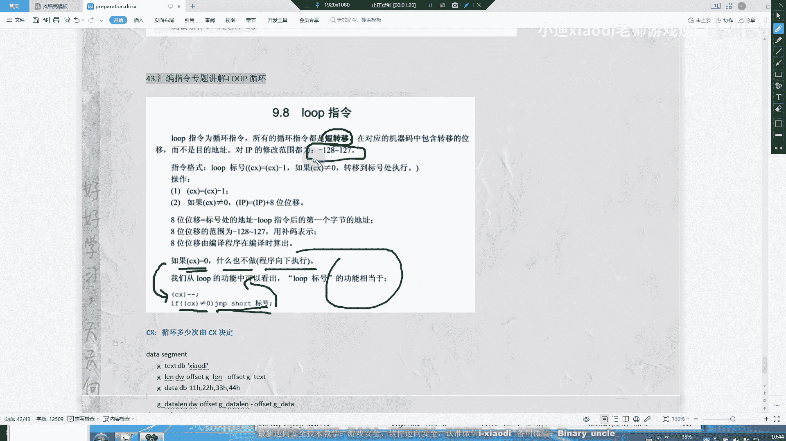
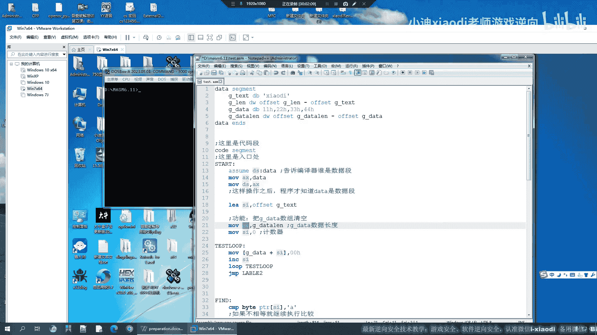
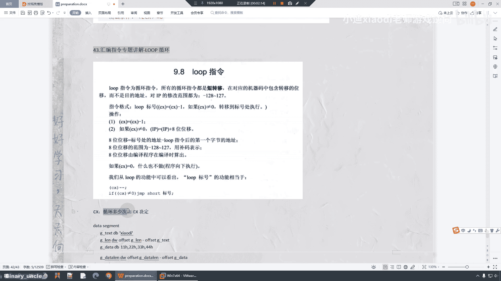
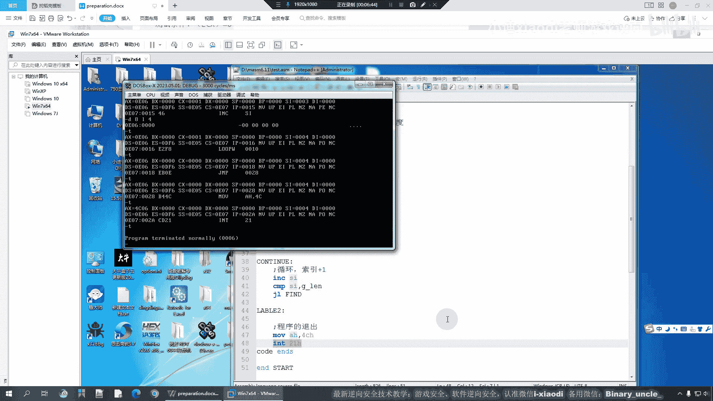
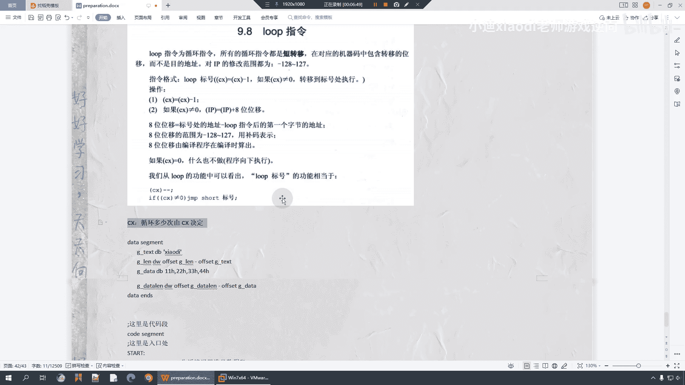
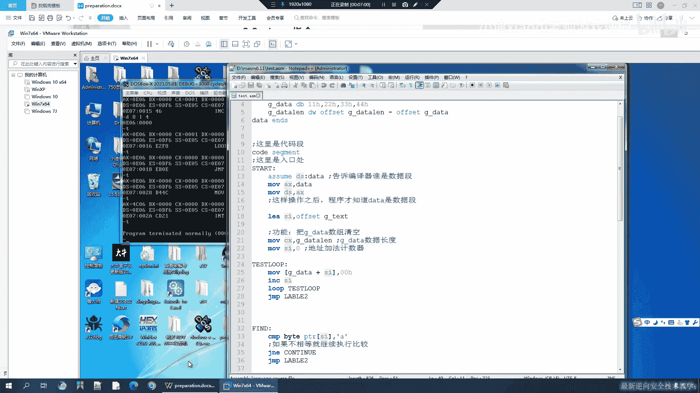

# 🧩 小白软件破解反汇编逆向工程师2023最新：4.43：汇编指令专题讲解-LOOP循环


本课是第 4.43 课，在本节课中我们将学习汇编指令中的 LOOP 循环。LOOP 循环属于条件转移指令的一种，但它的条件比较特殊，也比较专一，只检查 CX 寄存器。因此，看到 LOOP 指令时，只要修改 CX 寄存器的值，就能控制程序在这一块区域的执行流程；如果 CX 等于 0，程序就什么都不做，继续向下执行。下面先给出整体结论，再进入代码和调试观察，帮助初学者把 LOOP 循环的来龙去脉弄清楚。


## 🧩 小白软件破解反汇编逆向工程师2023最新：4.43.1：LOOP循环的核心概念


上一节我们给出了课程概述，本节来看看 LOOP 循环到底在做什么。LOOP 指令的本质可以理解成两步：先把 CX 的值自减 1，再判断自减后的 CX 是否等于 0。例如原来 CX 是 2，自减 1 后变成 1，然后判断 CX 是不是 0。因为 CX 不等于 0，所以继续循环。只要 CX 大于 0，LOOP 就会跳转到上面的循环体入口。可以用下面的伪代码表示：


```asm
; LOOP 的核心行为
CX = CX - 1
if CX != 0:
    jump 循环体入口
else:
    继续向下执行
```




从这段伪代码可以看到，LOOP 循环的判断条件非常专一，只看 CX 寄存器。原文中有些地方口误说成 CS 寄存器，实际控制 LOOP 循环次数的是 CX 寄存器。理解了这一点，后面写程序时就不会把循环次数给错。如果 CX 给成 0，程序就什么都不做，直接继续向下执行；如果 CX 不等于 0，程序才会循环，并且是大于 0 时循环，跳转到上面去。这个逻辑一开始可能比较抽象，等看到实际代码和调试过程，就会变得清楚。理解核心行为之后，接下来看看 LOOP 作为跳转指令的范围特点。


## 🧩 小白软件破解反汇编逆向工程师2023最新：4.43.2：LOOP是短转移指令


上一节我们理解了 LOOP 会先减 CX 再判断，本节来看看 LOOP 的跳转范围。LOOP 指令属于短转移指令。所谓短转移，就是跳转范围有限，范围很小，大约是 -127 到 +127 个字节。可以用下面的范围公式描述：


```text
LOOP 短转移范围：-127 <= 偏移量 <= +127 字节
```




因此，LOOP 指令的跳转范围基本上用肉眼就能看出来，不会特别大。也正因为范围不大，分析起来比较好分析。对于初学者来说，先记住“LOOP 是短转移，范围有限”这一点即可，后面在代码里看到它跳回上面的标签时，就能很快判断出循环体的大致边界。清楚了范围和条件之后，下面进入一个具体例子：用 LOOP 清空数组。




## 🧩 小白软件破解反汇编逆向工程师2023最新：4.43.3：用LOOP清空数组的程序思路


上一节我们介绍了 LOOP 的短转移特点，本节来看看一个具体例子：用 LOOP 清空 Jda 数组。这个程序的目标很直接，就是把数组里的每个字节都清成 0。首先在 data 数据段定义一个 Jda 数组，这个数组一共有 4 个字节，里面依次可以放 11、22、33、44 这样的字节数据。人眼可以看到它有 4 个字节，但程序本身并不知道数组有多少个元素，所以需要让程序自己算出数组长度。程序计算长度的方法是：用数组末尾地址减去数组起始地址，得到字节数组的长度。可以用下面的公式表示：


```asm
; 用人眼可见的数组结尾地址减起始地址
Jda_LEN = Jda_END - Jda

; 若 Jda 中依次是 11h、22h、33h、44h
; Jda_END - Jda = 4
```


因为 Jda 是字节数组，所以算出来的长度就是 4 个字节。接下来要把这个数组长度给到 CX，因为 LOOP 循环多少次由 CX 决定。清空数组时要看里面有几个元素：4 个元素就清空 4 次，3 个元素就清空 3 次，8 个元素就清空 8 次，100 个元素就清空 100 次。因此，LOOP 循环很核心的一点，就是先把 CX 给对；CX 给不对，程序就会出错。这个例子里把 CX 给成 4。循环次数确定后，下一步就是让数组地址跟着循环变化。


## 🧩 小白软件破解反汇编逆向工程师2023最新：4.43.4：地址计数与循环体结构


上一节确定了用 CX 控制循环次数，本节来看看数组地址怎样变化。程序里写的是类似 `mov Jda[SI], 0` 的形式，通过 SI 寄存器来访问数组元素。SI 刚开始是 0，0 就指向数组第一个字节；SI 是 1，就指向第二个字节；SI 是 2，就指向第三个字节；SI 是 3，就指向第四个字节。可以用下面的代码描述这种关系：


```asm
; SI 作为数组下标
; SI = 0 -> 指向 11h
; SI = 1 -> 指向 22h
; SI = 2 -> 指向 33h
; SI = 3 -> 指向 44h
```


因此，程序要不断让 SI 自加，使用的指令是 `INC SI`。在循环过程中，LOOP 会判断 CX 是否等于 0；如果不等于 0，CX 就先减 1，然后跳回循环体入口。循环体的组织方式是先定义一个标签作为循环体入口，然后循环体从上往下执行，执行完再通过 LOOP 跳回上面，这样就形成了一个循环体。CX 的赋值要放在循环体之外，地址加法器 SI 的初始化也要放在循环体之外，而 SI 的自加放在循环体里面。这样安排之后，循环次数和地址变化就不会乱。结构理清之后，下面用调试器实际走一遍。


## 🧩 小白软件破解反汇编逆向工程师2023最新：4.43.5：调试观察LOOP循环执行过程


上一节我们梳理了程序结构，本节用调试器实际走一遍。调试时可以先运行程序并跳转到目标位置，例如用 `g` 命令跳到地址 9 的位置，观察 CX 的值。此时 CX 等于 4，说明数组长度是 4 个字节，这一部分没有问题。接着用 `t` 单步执行，SI 被赋值为 0，然后继续单步执行到赋值语句，完成一次清空操作。完成后查看内存地址 8 附近的内容，可以看到 `Jda` 对应的数据被清成 00，也就是说第一个字节已经清空。


继续单步执行，SI 变成 1，然后 LOOP 判断 CX 是否不等于 0。此时 CX 不等于 0，并且大于 0，所以程序继续往回跳，又跳回循环体入口。再往下执行，又完成一次赋值，查看内存可以看到第二个字节也被清空。继续执行时，LOOP 再次判断 CX 是否不等于 0，此时 CX 是 3，仍然不等于 0，于是再次循环。循环回去后又清空一个字节，查看内存可以看到又有一个字节变成 0。再执行到 LOOP，判断 CX 不等于 0，程序继续循环，把第四个字节也清空。此时查看内存，四个字节都变成 0，而 CX 已经变成 1。随后 CX 再减 1 就变成 0，等于 0 时 LOOP 不再跳转。


当 CX 等于 0 后，LOOP 的判断不成立，程序不再往回跳，而是直接往下执行到 label2。label2 处执行的是结束程序的代码，类似 `mov ah, 4ch` 和 `int 21h`，程序正常结束，调试器会显示程序正常终止。通过这一轮调试，可以直观看到 LOOP 先减 CX、再判断 CX、再决定是否跳回循环体的完整过程。以下是本节的调试观察要点列表：


- CX 初始值为 4，表示循环 4 次，也对应数组的 4 个字节。


- SI 从 0 开始，每次循环通过 `INC SI` 指向下一个字节。


- 每执行一次循环体，就清空一个字节。


- LOOP 每次先让 CX 自减 1，再判断 CX 是否等于 0。


- CX 不等于 0 时跳回循环体入口，CX 等于 0 时继续向下执行。




- 最后执行 `mov ah, 4ch` 和 `int 21h`，程序正常结束。




## 🧩 小白软件破解反汇编逆向工程师2023最新：4.43.6：本课总结




本节课中我们一起学习了汇编指令中的 LOOP 循环。LOOP 属于条件转移指令的一种，判断条件专门看 CX 寄存器；它的核心行为是先把 CX 自减 1，再判断 CX 是否等于 0，不等于 0 就跳回循环体入口，等于 0 就继续向下执行。LOOP 还是短转移指令，跳转范围大约在 -127 到 +127 个字节之间，所以循环体范围通常比较小，分析起来也比较直观。通过清空 Jda 数组的例子，我们看到了数组长度怎样算、CX 怎样赋初值、SI 怎样作为地址计数器，以及循环体应该放在什么位置。最后通过调试单步执行，我们观察到每次循环清空一个字节，直到 CX 变成 0 后退出循环并正常结束程序。建议自己把这段代码写一遍，再发挥自己的思路改一改，这样对 LOOP 循环的理解会更牢固。本课到此结束，下期再见。

