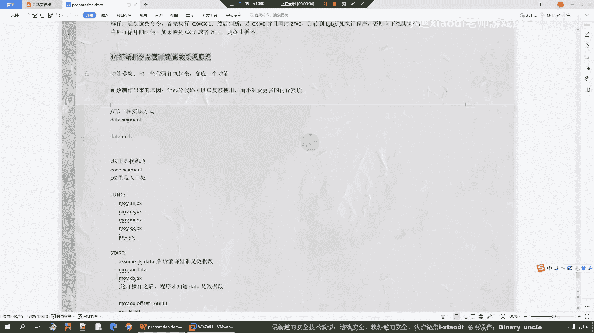
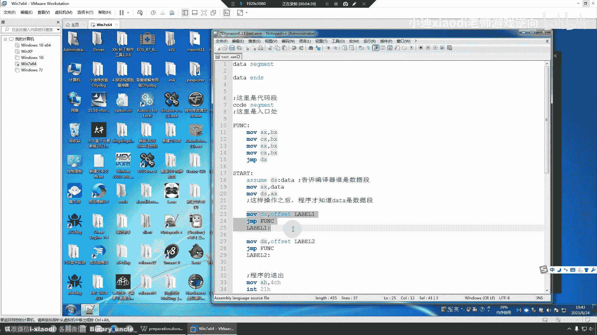
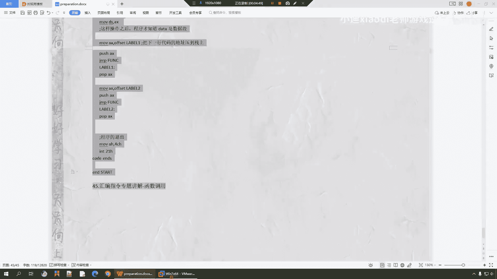
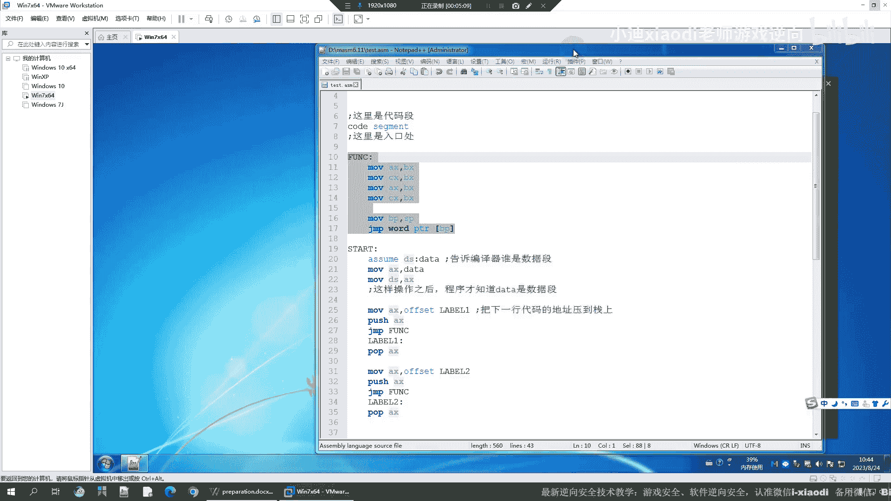
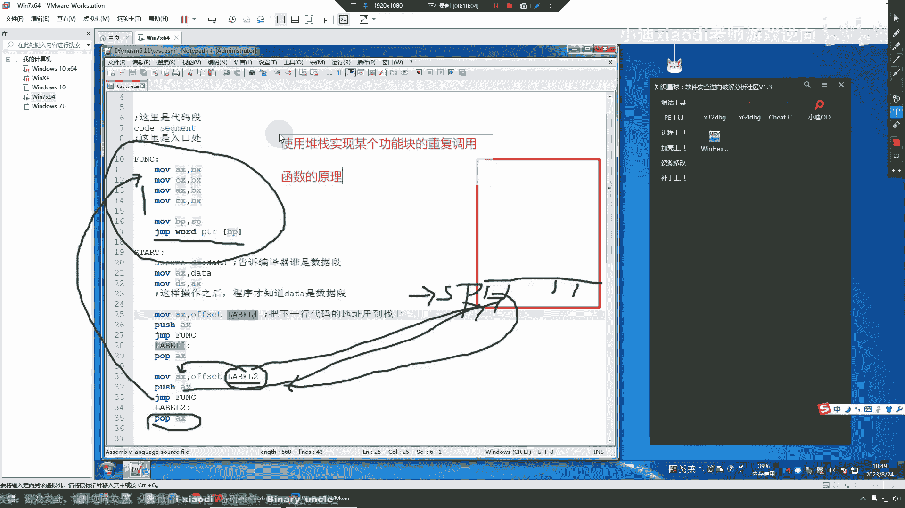
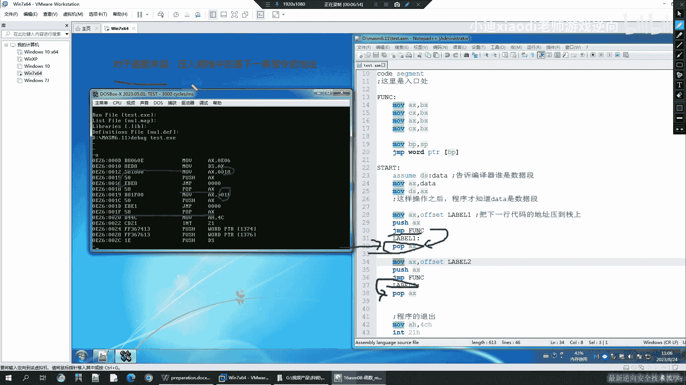
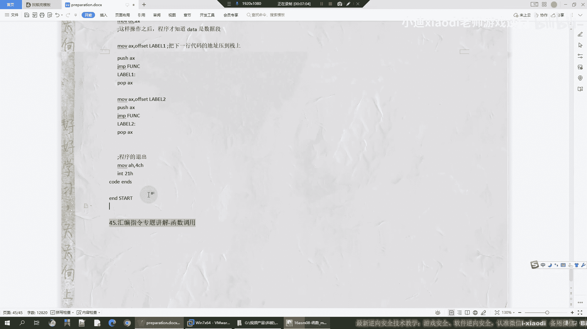

# 🧩 小白软件破解反汇编逆向工程师2023最新：4.44：汇编指令专题讲解-函数实现原理



在本节课中我们将要学习函数实现原理。课程内容来自小迪老师第44课，重点把一个看起来陌生的“函数”概念讲清楚。函数实际上就是功能模块，也就是把一些代码打包成一个功能，方便重复利用、重复使用。为了把这个概念讲透，本教程会先说明函数与功能模块的关系，再看重复调用功能代码带来的问题，然后分别介绍跳转标签实现方式和堆栈实现方式，最后观察栈空间内存数据变化，并总结堆栈平衡这个核心概念。理解这些内容，对后续学习汇编指令和逆向分析都很关键。

## 📦 小白软件破解反汇编逆向工程师2023最新：4.44.1：函数与功能模块

在概述中我们提到了函数这个概念，本节中我们来看看函数到底怎么理解。函数实际上就是功能模块。功能模块就是把一些代码打包起来，变成一个功能，方便重复利用，方便重复被使用。可以用一个简单公式表示：

\[
函数 = 功能模块 = 可重复使用的代码块
\]

为了直观理解，可以举一个程序例子。程序前边是一个数据段，数据段可以是空的；下边是代码段。在代码段某个位置写一些东西，例如写三行功能代码。这里用示意汇编代码表示：

```asm
; 数据段（示意）
data segment
data ends

; 代码段（示意）
code segment
start:
    mov ax, bx
    mov cx, ax
    ; 以上几行可理解为某某功能代码
code ends
end start
```

这三行代码可以理解为某某功能代码。调用一次的时候没有问题，就这样调用。调用两次的时候，其实也没有问题，再写一遍即可。调用三次的时候，好像也还好，再写一遍也能接受。但是如果一个程序要调用100次这种功能代码，这样写就有点重复了。它不仅重复，而且对内存空间也是一种浪费，因为它们在做同样的事情。日常生活中也有类似体会：当你重复做一件事的时候，会感觉特别枯燥，会造成精神消耗，也就是内耗。程序也是如此。计算机内存本来就不多，写了很多重复的东西，程序都会觉得烦。所以需要解决这个问题。本节理解了函数就是功能模块，下一节看看重复调用会带来什么问题，以及如何用跳转思路解决。

## 🔁 小白软件破解反汇编逆向工程师2023最新：4.44.2：重复调用的问题与跳转思路





上一节我们介绍了函数就是功能模块，本节中我们来看看重复调用的问题和跳转思路。解决重复代码的一种设想是学习跳转：定义一个标签，把功能代码放到标签处，然后用jmp function调用。下面是简单思路：



```asm
jmp function
...
function:
    ; 功能代码
```

调用一次好像没有问题。如果在多处调用，也可以写jmp function。但是这样有一个问题：如果直接跳过去，功能代码执行完后，程序会继续往下执行，可能又回到调用处，形成死循环。所以这样设计有问题。第一种解决方案可以先复制功能代码来学习思想，这里整理为跳转标签返回法。为便于理解，先给出核心想法，再用代码展示。以下是第一种方案的关键步骤列表。

- 定义function标签，把功能代码放在该标签下。
- 在功能代码末尾使用jmp dx，dx保存调用点下一条指令的地址。
- 调用前把offset label1放入dx，先jmp function。
- 功能代码执行完后jmp dx，跳回label1继续向下执行。
- 第二次调用时把offset label2放入dx，重复跳转并返回label2。

可以用下面的示意代码表示这种思路：

```asm
; 第一次调用
mov dx, offset label1
jmp function

label1:
; 返回后继续执行的位置
...
; 第二次调用
mov dx, offset label2
jmp function

label2:
; 返回后继续执行的位置
...
function:
    ; 某某功能代码
    jmp dx
```

执行过程是：先把要执行代码的下一行位置给DX，然后跳到function，功能代码执行完再jmp dx，DX指向label1，于是跳到label1并继续向下执行。第二次调用时，label2给到DX，DX又变了，DX现在指向label2，所以又从function跳回label2。这样实现功能模块重复使用，而且程序代码可以继续向下执行。这种方式不错，也比较有趣。本节看到了跳转标签返回法，下一节看看更常见的堆栈实现方式。

## 🥞 小白软件破解反汇编逆向工程师2023最新：4.44.3：用堆栈实现函数调用

上一节我们介绍了跳转标签返回法，本节中我们来看看第二种方式：用堆栈实现函数调用。之前学过一种数据结构叫堆栈，今天用堆栈解决重复调用问题。这个代码可能有点多。结构上边是数据段，下边是代码段，同样定义function标签。示意代码如下：

```asm
; 数据段（示意）
data segment
data ends

; 代码段（示意）
code segment
start:
    mov ax, offset label1
    push ax
    jmp function

label1:
    pop ax          ; 弹出，保持堆栈平衡
    ; 继续执行
    ...
    mov ax, offset label2
    push ax
    jmp function

label2:
    pop ax          ; 弹出，保持堆栈平衡
    ; 继续执行
    ...
function:
    mov bp, sp      ; SP不能直接随意写，用BP中转
    jmp word ptr [bp] ; 取出栈顶保存的返回地址并跳转
code ends
end start
```

执行流程是：把label1给AX，然后push AX，把label1地址压入栈，接着jmp function。进入函数后，把SP给BP，因为SP不能直接随意写，直接写SP会报错，所以需要用BP做一个中转。然后BP取出地址，再跳过去，跳到label1。下面用列表分步说明堆栈方式的关键动作。



- 把label1地址放入AX。
- 执行push AX，把label1压入栈。
- 执行jmp function进入功能代码。
- 在函数中执行mov bp, sp，用BP中转取得栈顶地址。
- 执行jmp [bp]跳回label1。
- 在label1处执行pop，弹出压入的数据，使堆栈平衡。
- 第二次调用把label2压入栈，重复上述过程并跳回label2。

这里可以画一个栈示意来理解。首先这部分是内存空间，也就是栈的内存空间。第一步，把label1给到AX，label1就是某个地址。然后push AX，就是往栈里压入一个label1。此时SP是栈顶，SP就指向了label1这个地址。然后执行jmp跳到function，依次往下执行。接着把SP给BP，BP就是SP，SP里存的就是label1，所以相当于jmp跳到label1的位置。跳到label1之后还不够，因为压入栈里的数据还要弹出来。有压入操作，就有弹出操作，push和pop是相对的。有压就有出，这个东西叫堆栈平衡。压入的是什么呢？压入的是下一条指令的地址。对于函数来说，压入到栈中的就是下一条要执行指令的地址。pop之后，堆栈就平衡了。第二次使用这个功能时，再重复一遍：label2给AX，push AX，jmp function，SP里存放label2，于是跳转到label2，然后再pop，保持堆栈平衡。本节理解了用堆栈保存返回地址和堆栈平衡，下一节实际观察栈空间内存数据变化。

## 🔍 小白软件破解反汇编逆向工程师2023最新：4.44.4：观察栈空间变化与堆栈平衡

上一节我们介绍了用堆栈实现函数调用，本节中我们来看看栈空间内存数据如何变化。函数的实现是通过堆栈形式构造的，所以了解堆栈空间的动态变化非常重要。在观察之前，要对代码进行简单修改，把栈段加上；如果不加栈段，就没有办法观察。保存代码并生成程序后开始调试。以下是观察栈空间变化的准备步骤。

- 在代码中加入栈段定义。
- 保存代码并生成可调试程序。
- 使用调试命令单步执行，查看AX、SP和栈内存。
- 用类似d ss:1f0的命令查看栈段数据。

先执行mov ax, offset label1，把label1给AX。单步后AX变成18，这是示例地址。此时SP是0x200，说明栈空间里本来就有数据，SP指向0x200。查看栈空间可以用：

```text
d ss:1f0
```

从1F0开始查看比较舒服。下面画一个栈示意。当前SP=0x200，栈空间里本来有数据。接下来将要push AX。AX是两个字节，所以SP要减小两个字节：

\[
SP_{新}=SP_{旧}-2=0x200-2=0x1FE
\]

单步执行push后，SP变成0x1FE，栈空间中0x1FE位置出现压入的数据0x0018。继续单步执行功能代码并跳转，然后执行pop。弹出后SP恢复为0x200，之前的数据也恢复。第一次调用观察完，再看第二次调用。第二次把label2给AX，AX变化；push AX后堆栈又变小，SP再次变成0x1FE，0x1FE位置压入label2相关地址；执行pop后SP恢复0x200。下面列出压入和弹出时栈地址的变化规律。

- 压入数据时，栈地址数字变小，SP减2（以两字节AX为例）。
- 弹出数据时，栈地址数字变大，SP加2。
- 压入和弹出一一对应，称为堆栈平衡。
- 堆栈不平衡时，程序会崩溃。





再观察压入内容：示例中压入的0x0018对应下一条指令位置；第二次压入的数据对应label2，也就是下一条指令地址。对于函数来说，压入到栈中的是下一条要执行指令的地址。这个结论很重要。本节观察了SP和栈内存变化，下一节进行总结。

## 🧾 小白软件破解反汇编逆向工程师2023最新：4.44.5：本节总结

本节对本课内容进行总结。本节课中我们一起学习了函数实现原理。函数就是功能模块，把代码打包方便重复使用。重复写功能代码会浪费内存，所以需要跳转或堆栈保存返回地址。第一种方式用标签和dx保存返回地址，功能代码后jmp dx返回。第二种方式用堆栈：push返回地址，进入function，通过BP取栈顶地址跳回，再用pop保持堆栈平衡。我们还观察了栈空间：push使SP减小，pop使SP增大，压入和弹出一一对应就是堆栈平衡，堆栈不平衡程序会崩溃。函数在汇编里有专门代码，下一集继续讲。今天内容较多，需要回去实践代码。
