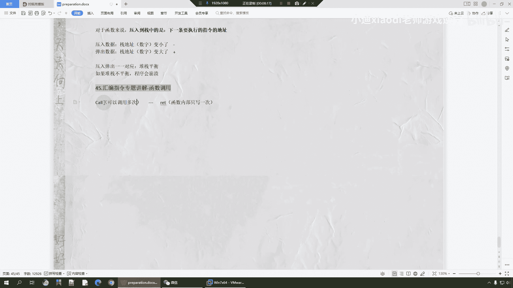

# 🧩 小白软件破解反汇编逆向工程师2023最新：45：汇编指令专题讲解-函数调用

在本节课中我们将要学习汇编指令专题中的函数调用。我们会先回顾上一节课设计函数架构、理解函数实现方式的内容，再说明原来手写多行代码实现函数调用为什么麻烦，接着介绍汇编中的 `call` 和 `ret` 指令，最后通过调试观察压栈、返回地址、栈平衡以及多次调用函数的完整过程。整节课的目标是让初学者用大白话理解函数调用到底在做什么，以及为什么一个函数只需要写一次 `ret`，而 `call` 可以调用很多次。

## 📌 一、回顾：函数调用原本怎么实现

上一节课我们设计了函数的基本架构，也了解了函数在汇编层面是怎么实现的。简单说，函数调用时会把下一条要执行指令的地址压入栈中，函数执行完之后再从栈里把返回地址取出来，然后跳转回这个地址继续执行。这个思路本身不复杂，但真正写起来会遇到一个很实际的问题，就是需要的代码行数比较多。

上一节的关键操作可以归纳成下面这些要点，以下是具体回顾：

- 函数调用时，把下一条要执行指令的地址压入栈。
- 函数执行完成后，从栈中取出返回地址。
- 根据取出的返回地址跳转回去，继续执行原来的程序。
- 这种实现需要实打实写多行代码，写起来比较麻烦。
- 压入数据时，栈地址变小；弹出数据时，栈地址变大。
- 压入和弹出一定要一一对应，保持平衡。
- 压入之前的栈数据和弹出之后的栈数据要对应相等，这种关系叫堆栈平衡。
- 如果堆栈不平衡，程序就会崩溃。

也就是说，上一节课已经说明了函数调用的基本原理，但问题在于代码写得太多了。原文中实际实现时用了七行左右的代码，这七行代码需要老老实实写出来，所以整体比较麻烦。既然问题来自代码太多，那么本节中我们来看看汇编语言有没有更简单的办法来解决这个问题。

## 🛠️ 二、用 call 指令简化函数调用

上一节我们介绍了手动压栈、取返回地址、跳转这一套流程，本节中我们来看看汇编里的专门指令。汇编语言中有一个专门用于函数调用的指令，叫 `call`。`call` 英文翻译过来就是打电话的意思，也可以理解为函数调用，给谁打电话就调用谁。调用哪个函数，就把那个函数名写在 `call` 后面，例如 `call function`。


为了把原来的多行代码替换掉，核心写法如下，下面是调用与返回的代码示例：

```asm
call function

; 函数内部只写一次返回指令
function:
    ; 函数体代码
    ret
```

原来需要写很多行，现在只写一行 `call function` 就可以完成调用，写法非常简单。函数调用时，`call` 实际上会把下一行要执行的代码地址压入栈中，因为函数执行完还要返回。返回时不再手写多行返回代码，而是把返回部分改成 `ret`。这样函数调用就完成了：`call` 负责把下一条指令地址压栈，`ret` 负责把地址弹出并返回。

同样的道理，下面再次调用函数时，同样写 `call function`。这里要注意，调用的时候写 `call`，而 `ret` 只在函数内部写一次。一个函数只有一个 `ret`，记住一个函数只有一个 `ret`。调用的时候可以随便调，调几次都无所谓。接下来我们把代码保存，然后编译生成，再去调试器里观察实际效果。


## 🔍 三、编译后观察入口与返回地址

上一节我们介绍了 `call` 和 `ret` 的基本写法，本节中我们来看看编译后程序在调试器里的样子。我们可以从 0 地址开始，用 `-u` 反汇编查看。反汇编窗口里能看到 AX、BX 等寄存器相关区域，也能看到 `function` 这一块代码，以及 `ret` 所在的位置。程序入口执行部分也能看到，例如 `call 000CA000`，意思就是调用 0 地址处的函数。

调试时可以按下面顺序观察，以下是几个关键观察点：

- 从 0 开始用 `-u` 反汇编查看代码。
- 能看到 AX、BX 等寄存器区域，也能看到 `function` 和 `ret`。
- 程序入口处有 `call 000CA000`，即调用 0 地址处的函数。
- `ret` 会自动返回到下一条要执行指令的位置。
- 第一次执行 `call` 时，下一条要执行的指令地址是 11，记住 11。
- 第二次执行 `call` 时，下一条要执行的指令地址是 14，记住一个 11、一个 14。

这里的关键是记住两个返回地址：第一次调用对应 11，第二次调用对应 14。后面观察栈里压入的数据时，这两个数字就是判断 `call` 是否把下一条指令地址压入栈的重要依据。接下来我们就让程序运行到 E 的位置，开始单步跟踪。

## 🧪 四、单步跟踪压栈、ret 与堆栈平衡

上一节我们看到了入口和返回地址，本节中我们通过单步执行来观察栈的变化。先让程序运行到 E 的位置，此时还没有执行 `call`，SP 指向的栈地址是 200。然后用 `-t` 单步执行，可以看到下一条要执行指令的地址已经被压入栈中。接着用 `d ss:1F0` 查看栈段，在 1FE 位置能看到 0011。这个 0011 就是第一次 `call` 的下一条地址 11，说明返回地址已经压栈成功；11 这个位置后面还要执行下一个 `call`。

整个单步过程可以按下面的节奏理解，以下是执行顺序和观察结果：

- 先让程序运行到 E 的位置，此时 SP 的栈地址是 200。
- 用 `-t` 单步后，下一条要执行指令的地址已经压入栈。
- 用 `d ss:1F0` 查看栈段，在 1FE 位置看到 0011。
- 0011 是第一次 `call` 的下一条地址 11，说明压栈成功；11 位置后面还要执行下一个 `call`。
- 第二次 `call` 时，下一条指令地址是 14。
- 用 `-t` 单步执行后，程序进入函数内部。
- 执行 `ret` 时，会把栈中的数据弹出，把返回地址取出来，栈恢复平衡，相当于自动执行了一次 pop。
- 再执行 `-t`，SP 恢复到 200；查看 1F0 栈段，栈已经恢复。
- 执行第二个 `call` 时，又把下一条地址压入栈，一开始看像是 14 或 16，最后确认是 14。
- 用 `d ss:1F0` 查看，看到 14，也就是 0014；这是第二个 `call` 调用时的下一条指令地址，实际上就是这行代码的地址。
- 用 `-u` 查看，14 就在那里，证明下一条要执行的指令地址被压入了。
- 再执行函数，然后执行 `ret`；此时地址是 1FE，随后栈恢复，堆栈平衡恢复到 200。

这里的核心概念可以用公式和代码表示。`call` 的本质是压入下一条指令地址，`ret` 的本质是弹出返回地址并跳转，堆栈平衡则要求调用前后的栈指针保持一致。下面是便于初学者记忆的公式描述：


\[
\text{call：} push(next\_addr),\quad \text{ret：} pop(EIP)
\]


\[
SP_{\text{调用返回后}} = SP_{\text{调用前}}
\]

也就是说，`ret` 会自动把栈里的数据弹出，取出返回地址，然后让栈恢复平衡。实际调试时可以看到 200 恢复到 200，1FE 位置的数据被处理掉，这就是堆栈平衡在起作用。将来写函数调用时，只要记住 `call` 和 `ret` 的配合，代码会比手动压栈、手动返回简单很多。

## 🧠 五、结论：call 可多次调用，ret 只写一次

上一节我们通过调试看到了压栈和恢复栈的全过程，本节中我们把今天的内容收束一下。以后调用函数时，写法就比较好写了：先写一个 `call`，然后在函数内部写一个 `ret`。这个 `ret` 在函数内部只写一次，函数内部只写一次，函数内部只写一次。重要的事情说三遍，一个函数只有一个 `ret`。而 `call` 可以调用多次，调几次都无所谓。


最后把今天容易记错的点列出来，以下是结论清单：

- 以后调用函数写 `call`。
- 函数内部写一次 `ret`。
- 一个函数只有一个 `ret`。
- `call` 可以调用多次，调几次都无所谓。
- 回去之后自己写一下函数调用练习。
- 这个内容实际上相当简单。

## ✅ 六、总结



本节课中我们一起学习了汇编指令专题中的函数调用。我们回顾了函数原本如何通过压栈保存返回地址、通过弹栈返回，也看到了手写多行代码比较麻烦的问题；随后介绍了用 `call function` 简化调用、用 `ret` 完成返回，并通过调试观察了第一次 `call` 压入 11、第二次 `call` 压入 14，以及 `ret` 弹出返回地址后栈从 1FE 恢复到 200 的过程。最后记住核心结论：`call` 可以多次调用，`ret` 在函数内部只写一次，堆栈平衡要保持 `SP` 调用前后一致。下期再见。

