# 🧩 小白软件破解反汇编逆向工程师2023最新：4.47：汇编指令专题讲解-函数局部变量

## 📌 概述

在本节课中我们将要学习函数局部变量。大家好，本课由小李老师讲解，是第47课，对应视频编号为 BV1ej411y7wA。上一阶段我们讲过变量，当时的做法是先定义一个数据段，再告诉编译器哪一段是数据段，然后程序就可以使用其中的变量。那种变量的作用范围是全局的，整个程序都可以使用。今天讲的局部变量与全局变量相对应，重点看两者的差异、局部变量如何在函数内部开辟内存、如何赋值寻址，以及函数结束后如何释放内存并保持栈平衡。

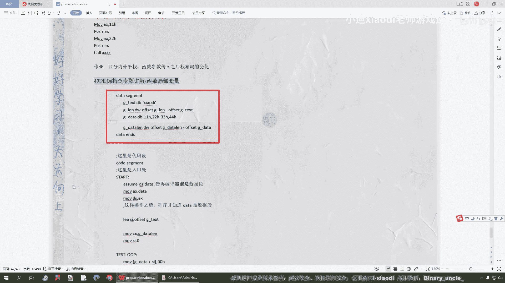

> 提示：局部变量只在函数内部有效，离开函数后就无法继续使用。

上一节我们介绍了全局变量的基本用法，本节我们来看看局部变量与全局变量的差异。理解全局和局部的区别，是后面分析函数栈帧和逆向代码的基础，所以需要把概念和栈操作对应起来。

## 🧭 一、局部变量与全局变量的差异

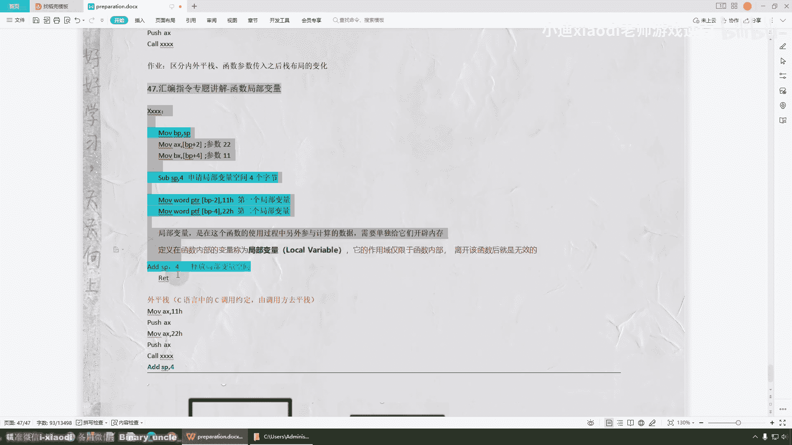

先看程序结构。这个程序跟上节课差不多，代码中的“叉叉叉叉”实际上代表 function。我们在调用这个 function 函数，程序中上面是函数本体，下面是函数的调用位置。调用时会通过 push 指令借助栈传入参数，参数传入会影响堆栈状态。push 会让栈顶向上移动，栈顶地址的值会减小。为了保证程序正常运行，也为了保证堆栈平衡，需要根据参数占用的字节数把栈指针调整回来。

例如，参数占两个字节，传入两个参数，总共占用 4 个字节，那么做栈平衡时就要使用下面的指令：

```asm
add sp, 4
```

上一节我们介绍了这种通过栈传参和栈平衡的流程，本节中我们来看看局部变量的定义。局部变量就是定义在函数内部的变量，只有写在函数内部的变量才可以称为局部变量。它的作用域仅限于函数内部，离开该函数后就无效。也就是说，程序跑出这个函数后，再想使用这个局部变量就找不到它，无法继续使用。这是局部变量的基本规范，也是分析函数内部变量时首先要记住的规则。

## 🧱 二、局部变量为什么要单独开辟内存

局部变量的使用方式与全局变量有一定差异。在函数内部，如果需要使用参数和局部变量进行计算，参数是从外部传进来的，而局部变量需要单独开辟内存。理解这一点很关键，因为局部变量不是凭空出现，它需要由栈来提供存储空间。原文强调需要单独给局部变量开辟内存，这正是函数内部栈操作的核心。

我们想一下，当前有新的 SP 指向栈顶，要开辟内存就需要通过栈来完成。参数是通过栈传入的，局部变量也通过栈来保存。假设需要一个两字节的局部变量，只需要让 SP 向上移动，也就是让 SP 减小 2。用公式表示就是 `SP = SP - 2`，对应下面的指令：

```asm
sub sp, 2
```

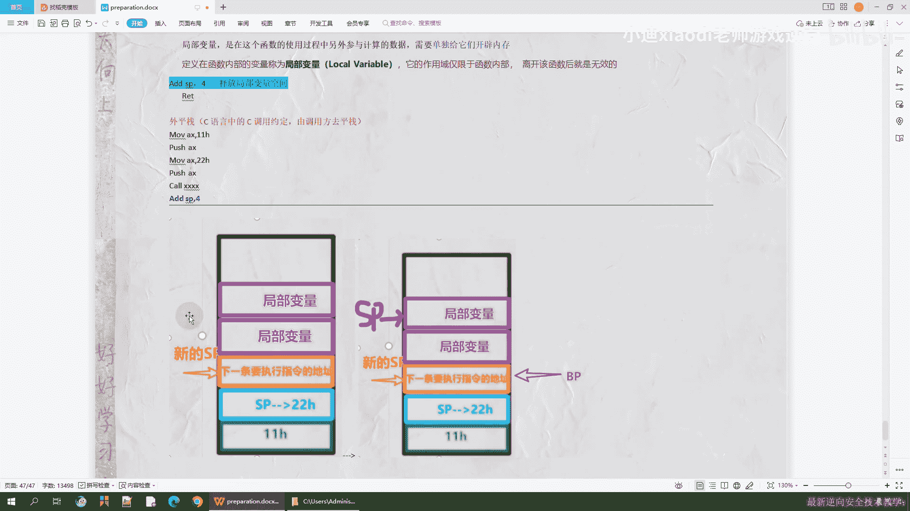

如果需要两个局部变量，那么 SP 向上移动后多出两个两字节，也就是多出 4 个字节。用公式表示就是 `SP = SP - 4`，对应下面的指令：

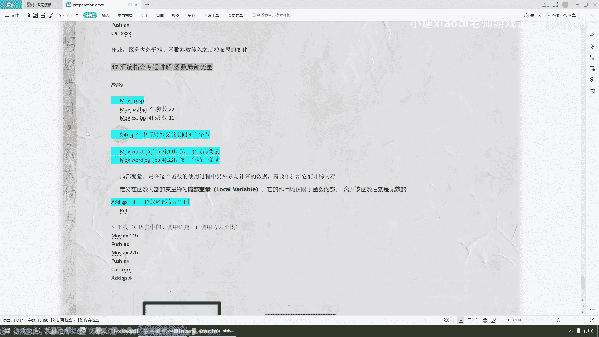

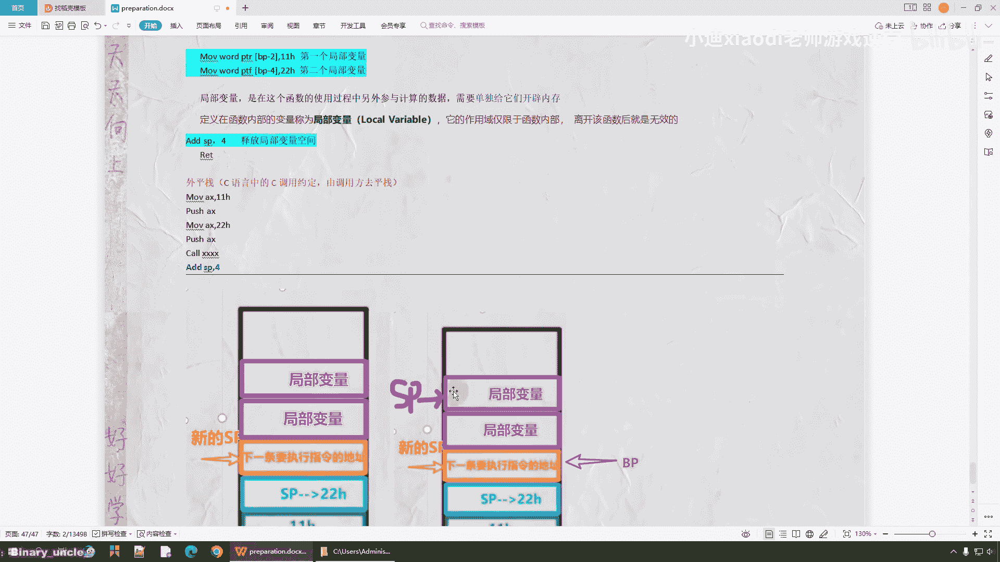

```asm
sub sp, 4
```

上一节我们说明了局部变量为什么需要单独开辟内存，本节中我们来看看如何在函数内部识别这种开辟动作。只要在函数内部看到 `sub sp, xxxx` 这样的指令，不管后面是多少，它通常都在给局部变量开辟内存。这个规律很实用，因为在反汇编代码里，函数开头出现 `sub sp, ...` 往往就是局部变量空间分配。现在我们已经申请了 4 个字节的局部变量空间，接下来就要看这些空间如何被使用。

## 🔍 三、局部变量的赋值与寻址

局部变量空间申请完成后，使用方式同样是通过栈把这个值传入进去。比如第一个局部变量要放入 11，可以通过 BP 去寻值。BP 指向某个基准位置，`BP - 2` 就是第一个局部变量，`BP - 4` 就是第二个局部变量。于是可以把 11 给到 `BP - 2`，把 22 给到 `BP - 4`。这个过程可以用下面的示意代码描述：

```asm
; 示意：把 11 赋给第一个局部变量
mov word ptr [bp-2], 11

; 示意：把 22 赋给第二个局部变量
mov word ptr [bp-4], 22
```

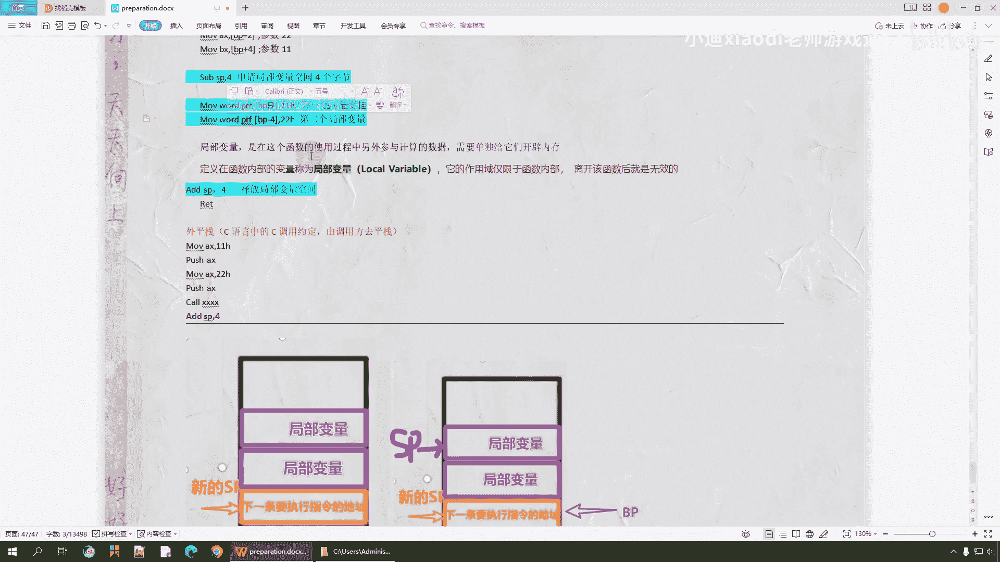

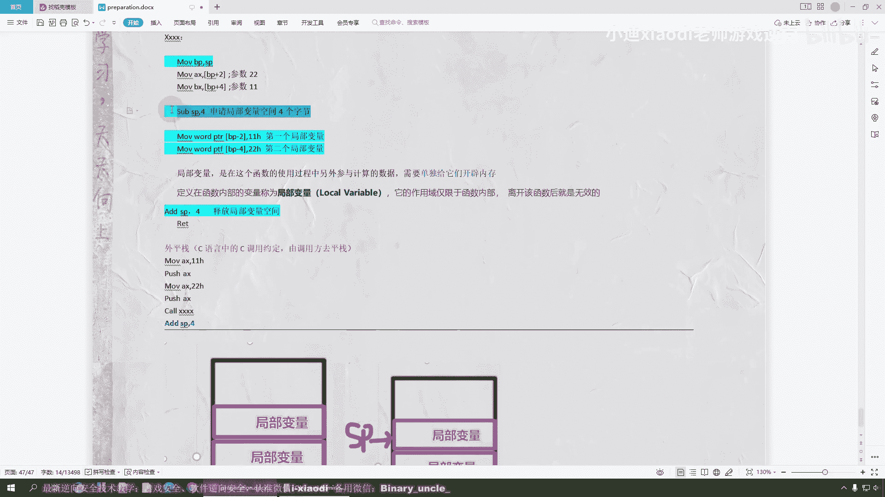

上一节我们介绍了局部变量空间的申请，本节中我们来看看局部变量使用完成后如何收尾。这里的寻址方式比较直接，核心就是围绕 BP 计算偏移。`BP - 2` 对应第一个局部变量，`BP - 4` 对应第二个局部变量，11 和 22 分别写入这两个位置。掌握这个偏移关系后，看到类似的 `[bp-2]`、`[bp-4]` 就能判断它在操作哪个局部变量。

## 🧹 四、局部变量空间的释放与栈平衡

最后还有一个关键问题。前面用 `sub sp, 4` 申请了 4 个字节的局部变量空间，此时 SP 已经移动到新的位置。这个位置之前没有那两个数据，局部变量使用完成后必须把这块内存释放掉。如果不释放，SP 的位置就歪了，函数返回时就回不到正确位置，程序也无法正常返回。这个问题在逆向分析中很常见，因此要特别注意函数开头分配空间和函数结尾释放空间的对应关系。

释放方式与申请方式相反。上面用 `sub sp, 4` 申请空间，下面就用 `add sp, 4` 把 SP 加回去。用公式表示就是 `SP = SP + 4`，对应指令如下：

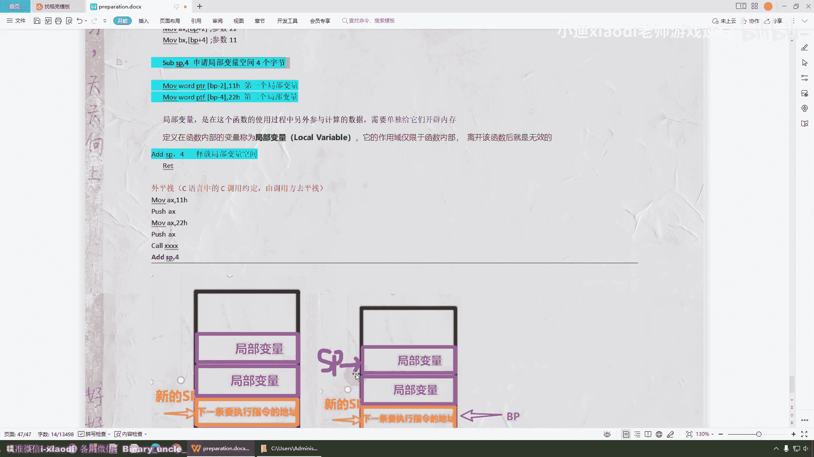

```asm
add sp, 4
```

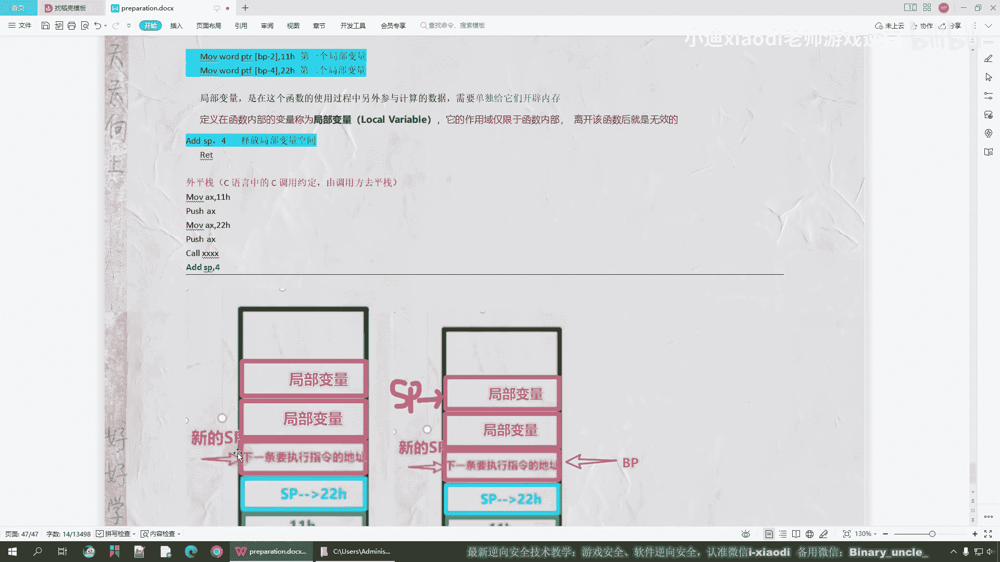

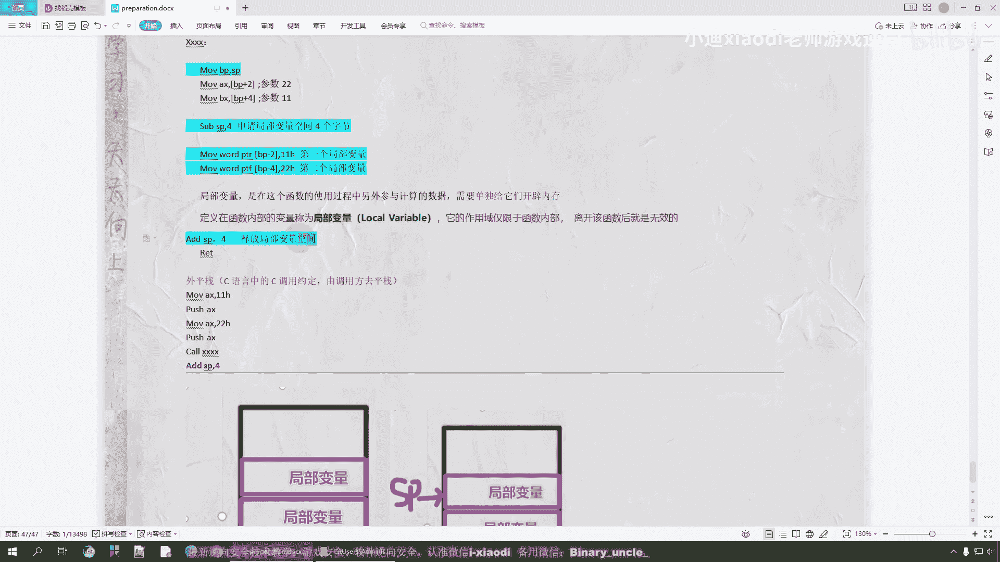

上一节我们介绍了局部变量如何赋值，本节中我们来看看函数结尾如何释放局部变量空间并恢复栈平衡。执行 `add sp, 4` 后，局部变量空间被释放，SP 又回到原来的位置。这样函数就可以返回到下一条要执行指令的地址。如果不做这一步，函数就返回不回去，程序就会跑飞。这个流程需要课后自己过一遍，把申请空间、使用变量、释放空间三个步骤连起来理解。

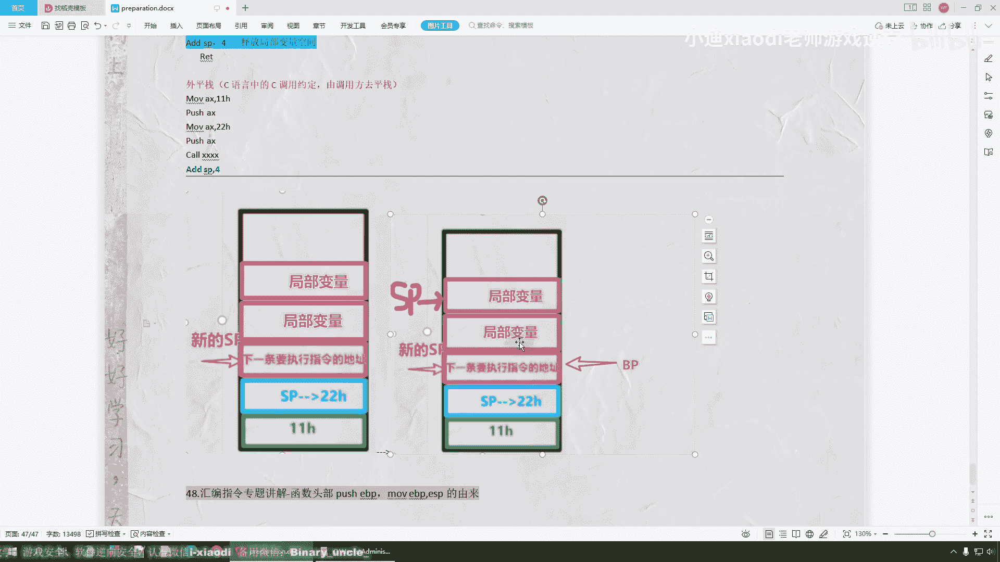

## ✅ 总结

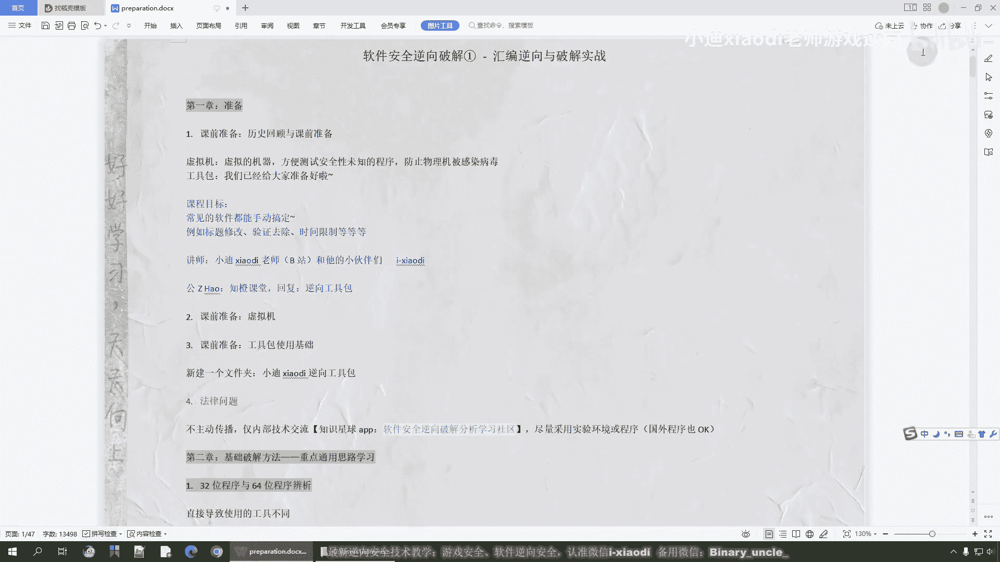

本节课中我们一起学习了函数局部变量。我们回顾了全局变量定义在数据段、整个程序都可以使用，而局部变量必须定义在函数内部，作用域仅限于函数内部，离开函数就无效。我们学习了函数调用时通过 push 传参以及栈平衡的基本思路，理解了局部变量需要单独通过栈开辟内存，看到 `sub sp, xxxx` 通常就是在给局部变量分配空间。我们还学习了用 `BP - 2`、`BP - 4` 这样的偏移去寻址局部变量，并把 11、22 分别赋给对应位置。最后我们学习了使用 `add sp, 4` 释放局部变量空间，使 SP 回到原来的位置，保证函数能正常返回，避免程序跑飞。课后可以自己把整个流程过一遍，如果有疑问，可以加课程中的微信交流，微信和星球信息在课程中提供。我们下期再见。
