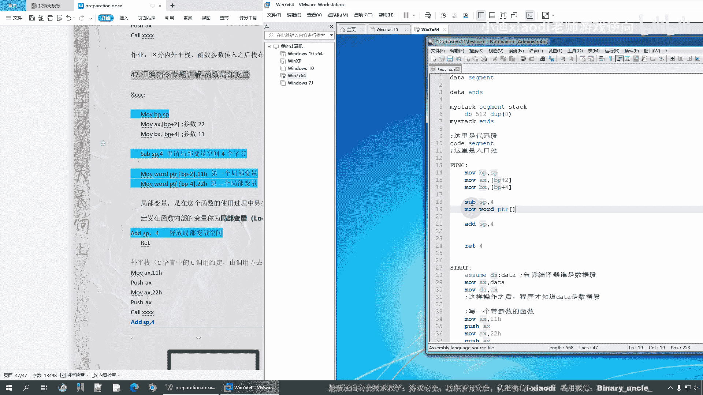
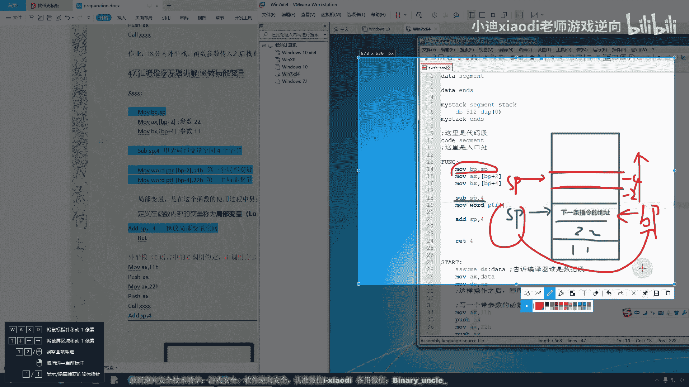
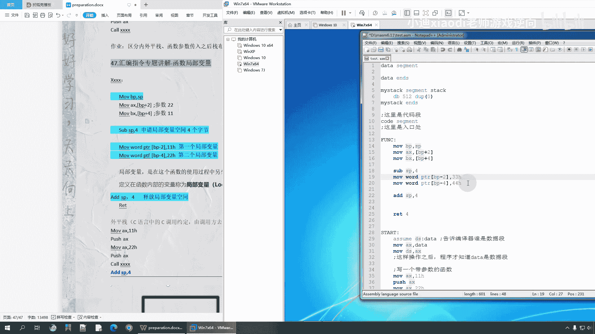
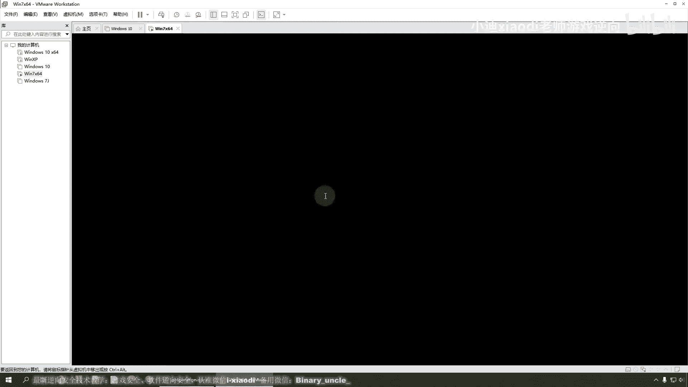
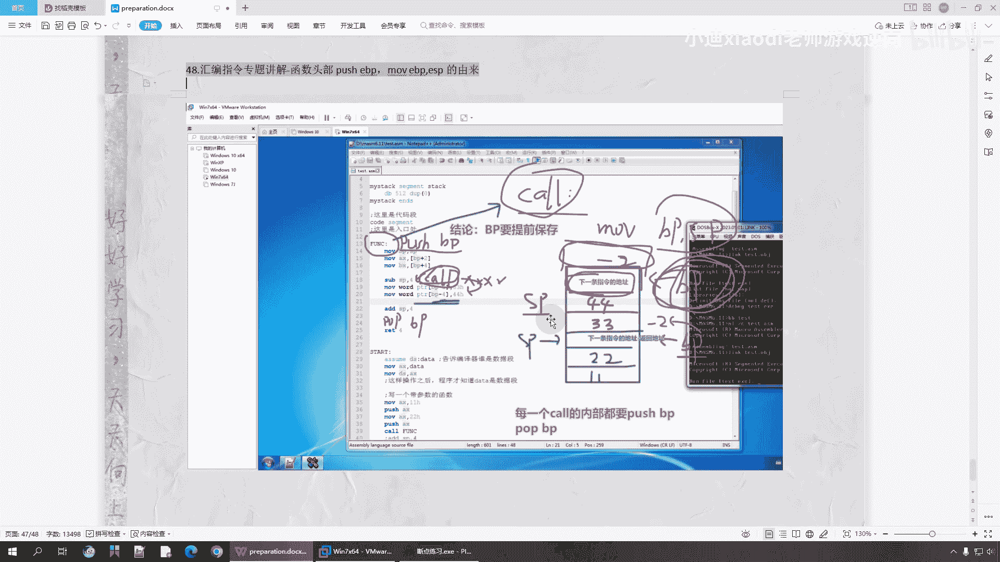

# 🧠 小白软件破解反汇编逆向工程师2023最新：4.48：汇编指令专题讲解——函数头部栈帧push ebp、mov ebp, esp的由来

## 🎯 小白软件破解反汇编逆向工程师2023最新：4.48.1：课程概述与问题引入

本课是第四十八课，我是小李老师。在本节课中我们将要学习函数头部`push ebp`、`mov ebp, esp`的由来，也就是常说的函数栈帧开头为什么这样写。上节课留下一个疑问：BP为什么出现在函数头部。原因是我们写函数时，第一行代码写了`mov bp, sp`，把SP的值给到BP；有人又会问，为什么要把SP给BP。这个疑问本节会解决，根本原因是语法不支持直接把SP写在寻址表达式里。为了把这个问题讲清楚，我们先手写一个带参数的函数，观察参数怎样通过栈传递，再观察编译器报错，最后引出保存BP的必要性。

上一节我们提出了BP位置的问题，本节中我们来看看直接使用SP寻址会遇到什么麻烦。

## 🧪 小白软件破解反汇编逆向工程师2023最新：4.48.2：直接使用SP寻址会报错

上一节我们提出了BP为什么在函数头部的问题，本节中我们来看看直接使用SP寻址会碰到什么麻烦。先手写一个带参数的函数，函数本身是空的，然后通过栈压入两个参数。下面按步骤写出这个带参数的函数，并观察每一步的含义。

- 先写`call function`，`function`是空函数，里面暂时没有内容。
- `mov ax, 11h`，把11H给到AX。
- `push ax`，通过栈的方式把参数压入栈。
- `mov ax, 22h`，把22H给到AX，作为第二个参数。
- `push ax`，再把第二个参数压入栈。

```asm
call function

function:
    mov ax, 11h
    push ax
    mov ax, 22h
    push ax
```

压栈完成后，栈布局如下。下面用文字把栈画出来，方便理解。

- 第一次压入的11在较高地址。
- 第二次压入的22在较低地址，靠近栈顶。
- `call function`会把下一条指令的地址压入栈，这个返回地址在22的更靠近栈顶的位置。
- 此时SP指向返回地址。

所以可以计算出参数位置。16位汇编中每个栈单元占2字节，公式如下：

$$
[SP+2]=22,\quad [SP+4]=11
$$

知道这个算法后，就可以使用压入的参数。下面用BP加偏移访问参数。

```asm
mov ax, [bp+2]   ; 访问后压入的参数22
mov bx, [bp+4]   ; 访问先压入的参数11
```

函数进去后要返回，返回时分为内平栈和外平栈。先看外平栈，用`add sp, 4`恢复栈。

```asm
add sp, 4
```

保存并编译后，第十四行、第十五行报错，提示错误。原因不能直接用SP寻址，必须用BP寻址。此时BP还没有赋值，所以要把SP给BP，因为BP可以用于寻址。

```asm
mov bp, sp
```

用BP后保存并生成程序，程序生成完毕，可以运行。



过渡：参数已经能访问，函数返回时栈怎样恢复，本节中我们来看看内平栈和外平栈。

## 🧱 小白软件破解反汇编逆向工程师2023最新：4.48.3：内平栈与外平栈

上一节我们看到了外平栈的写法，本节中我们来看看内平栈与外平栈的区别。函数返回时涉及栈平衡，分为内平栈和外平栈。先看外平栈，代码如下。

```asm
add sp, 4
```

压栈时SP会减小，恢复时就要把SP加回去，所以外平栈用`add sp, 4`。内平栈的立即数是4，把`add sp, 4`删掉并注释，用英文分号注释，然后写`ret 4`。



```asm
; add sp, 4
ret 4
```

用BBText生成程序，程序没有问题，说明内平栈和外平栈都可以。





过渡：参数和返回已经处理，本节中我们来看看局部变量怎样开辟和访问。

## 📦 小白软件破解反汇编逆向工程师2023最新：4.48.4：局部变量的开辟与访问

上一节我们处理了参数访问和栈平衡，本节中我们来看看局部变量怎样加到函数里。假如需要两个局部变量，就是四个字节。用`sub sp, 4`开辟四个字节的局部变量空间；为了保持栈平衡，再用`add sp, 4`，这样加减相互抵消。下面用代码把局部变量的值填进去。

```asm
sub sp, 4
mov word ptr [bp-2], 33h
mov word ptr [bp-4], 44h
add sp, 4
```

这里用了`word ptr`，表示按字访问。局部变量位置在BP下面。下面用文字画图说明栈布局。

- 先压入11，再压入22，然后call压入返回地址。
- 执行`sub sp, 4`后，SP向低地址移动，形成新的SP。
- BP仍然指向原来保存的旧SP位置。
- 局部变量1用`[BP-2]`访问，局部变量2用`[BP-4]`访问。
- 代码里给第一个局部变量33，给第二个局部变量44。

局部变量地址公式如下：

$$
局部变量1地址 = BP - 2,\quad 局部变量2地址 = BP - 4
$$

再次保存并生成程序，程序没有问题。

过渡：局部变量已经能访问，但如果函数里再调用另一个函数，BP会怎样，本节中我们来看看嵌套调用的问题。

## ⚠️ 小白软件破解反汇编逆向工程师2023最新：4.48.5：嵌套调用会修改BP，所以BP要提前保存

上一节我们让局部变量可以访问，本节中我们来看看函数里再调用另一个函数时BP被修改的问题。假设当前函数已经处于有局部变量的状态，新的SP在上方，BP在下方。现在在这个函数里再调用一个无参函数，比如`call xxx`。进入被调用函数后，因为要寻址，又会执行`mov bp, sp`，把SP给BP，此时BP跑到新位置，原来的BP被修改。如果从被调用函数返回后，再访问`[BP-2]`，这个BP已经不是原来的BP，减2会跑到上面去，找不到原来的局部变量。原因就是BP被修改了。因此得到一个重要结论：BP要提前保存。

> 结论：BP要提前保存。

什么时候保存？要在函数刚开始调用的时候保存。函数一开始就把BP用`push bp`压入栈保存；栈是临时存放数据的好方式，用完再释放。最后用`pop bp`还原。下面是一个函数头部保存BP的基本结构，每个call内部都可以这样写。

- 函数开头执行`push bp`，把旧的BP保存到栈里。
- 执行`mov bp, sp`，让BP指向当前栈帧。
- 函数体正常执行。
- 返回前执行`pop bp`，恢复旧的BP。
- 最后执行`ret`返回。

```asm
push bp
mov bp, sp
; 函数体
pop bp
ret
```

每个call内部都要`push bp`和`pop bp`，这样在被调用函数里再调用函数时，永远可以访问到正确的局部变量。空函数也建议写；不写也能正常返回，因为空函数不需要找数据。通过SP寻找数据，把SP给BP，让BP去寻找数据；空函数没有数据需要找，所以不写也可以。写上`push bp`和`mov bp, sp`后，返回时BP正确。

过渡：回到主题，函数头部`push ebp`、`mov ebp, esp`的由来，就是因为要正确找到数据，所以一定要保存BP。16位用BP，32位用EBP。上一节我们解决了嵌套调用问题，本节中我们来看看32位程序里的实际样子。

## 🔍 小白软件破解反汇编逆向工程师2023最新：4.48.6：32位程序中的函数头部

上一节我们得到保存BP的结论，本节中我们来看看32位程序里函数头部的实际样子。拿一个程序断点练习，进入内部看到代码。

```asm
push ebp
mov ebp, esp
sub esp, 0x48
```

`0x48`是十六进制48，不是十进制48；它表示开辟0x48字节给局部变量使用。下面再看另一个程序的不同点，列表如下。

- 第一个程序有`push ebp`、`mov ebp, esp`、`sub esp, 0x48`，因此有局部变量空间。
- 第二个程序进入后只有`push ebp`、`mov ebp, esp`，没有看到`sub esp`。
- 没有`sub esp`就说明没有局部变量。

32位汇编已经发展到EBP，16位是BP，32位是EBP。最后回到主题：函数头部`push ebp`、`mov ebp, esp`的由来，就是为了正确寻找数据，所以一定要保存BP。

过渡：本节我们观察了32位程序，下一节我们对整节课做总结并布置作业。

## ✅ 小白软件破解反汇编逆向工程师2023最新：4.48.7：总结与作业



上一节我们观察了32位程序里的真实函数头部，本节中我们对整节课做总结并布置作业。在本节课中我们一起学习了函数头部`push ebp`、`mov ebp, esp`的由来。核心原因是不能直接用SP寻址，需要把SP给BP，用BP稳定地访问参数和局部变量；参数通过栈传递，返回地址由call压入；局部变量通过`sub sp`开辟，用`BP-偏移`访问；函数返回分内平栈和外平栈；嵌套调用会修改BP，所以函数开头要`push bp`保存，结尾`pop bp`恢复；16位用BP，32位用EBP。作业是回去把代码写一写，把栈表画一画；加上BP后，把新的栈表再画一画。有不懂的地方可以来找我。下节课会给大家做一个公式，用来对照答案，先不要提前看答案。下期再见。

