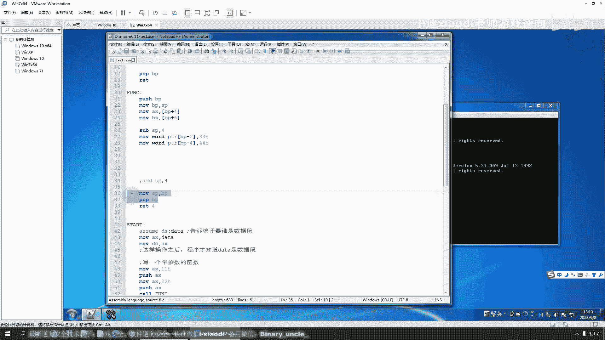

🔧 小白软件破解反汇编逆向工程师2023最新：4.49：汇编指令专题讲解-更好的恢复局部变量栈空间的方式

在本节课中，我们将要学习一个非常实用的汇编技巧：如何更好地恢复局部变量所占用的栈空间。相信通过本节课的学习，你能够掌握一种比多次手动计算减法指令更加简洁高效的方法，并且理解为什么这种方法在实际的逆向工程分析中如此常见。

在开始今天的新内容之前，我们需要先回顾一下上节课所讲的基础知识。大家应该还记得，如果函数要想访问到正确的数据，有一个非常重要的前提条件：那就是必须提前保存BP寄存器。如果这个前提条件得不到满足，那么函数在访问参数和局部变量的时候就会发生严重的错误，程序甚至可能直接崩溃。所以，这个步骤绝对是不能省略的。

那么，提前保存BP的方式具体是怎么操作的呢？答案非常简单，就是把BP的值压入到栈中。对应的汇编指令就是`push bp`。执行了这条指令之后，栈空间的结构就会发生变化，原来的栈顶位置会向上移动，新的栈顶变成了存放BP值的位置。因此，我们就需要重新画一张图来表示当前栈的布局。上节课给大家布置了一个作业，不知道大家有没有认真完成。如果没有完成的话，也没有关系，今天我们就结合这个新的图，来把整个流程彻底理清楚。

首先，我们假设这个函数需要两个参数。为了方便描述，我们把这两个参数称为参数1和参数2。当我们调用这个函数的时候，也就是执行`call`指令的时候，CPU会先把下一条指令的地址压入栈中，这个地址就是函数的返回地址。与此同时，程序的执行流程就开始进入被调用函数的内部了，栈的布局也发生了相应的变化。

进入函数内部之后，我们要做的第一件事，就是先把BP这个寄存器的值保存起来。所以，我们会执行`push bp`这条指令，把BP的值压入栈中。紧接着，我们需要把SP的值赋给BP，因为SP这个寄存器不能直接用于内存寻址，也就是说，我们不能直接用SP来访问栈中的数据。这样做的目的，是为了让BP指向当前栈帧的一个固定位置，从而可以通过BP加偏移量的方式来访问参数和局部变量。执行完`mov bp, sp`之后，SP和BP就指向了同一个位置，也就是栈顶。

接下来，如果在函数内部碰到了局部变量，我们就需要申请局部变量的空间。通常的做法是执行`sub sp, 立即数`这个指令，让SP减去一个数值。SP一旦减小，新的SP就跑到了更低的地址位置，也就是往栈的上方移动了。这样一来，整个栈空间的布局就确定下来了，大概就是之前所描述的那张图的样子。这个时候，有一个地方和以前相比发生了变化，而且是必须要注意的变化。什么变化呢？就是在访问函数参数的时候，偏移量要改了。以前的时候，也就是没有保存BP和移动BP之前，BP加2就可以访问到参数2了，BP加4就可以访问到参数1了。但是现在情况不一样了，为什么不一样呢？因为BP现在已经移动到了一个新的位置，也就是指向了保存好的旧BP值的位置。在当前这个布局下，BP加2指向的是返回地址，BP加4指向的才是参数2，而BP加6指向的才是参数1。所以，在这个位置，我们要进行一个修改，访问参数的时候，必须使用新的偏移量。这是一个非常容易出错的地方，大家一定要牢记。

好了，回顾完了BP保存和访问参数的相关细节，接下来我们就来说一说今天的主要内容，主题就是更好的恢复局部变量栈空间的方式。

在我们编写汇编程序的时候，经常会在函数内部定义局部变量。这时候你可能会发现一个问题：每次声明一个局部变量，就要执行一次`sub sp, xxx`指令来调整栈顶位置。这里的`xxx`是一个数值。比方说，我们第一次需要一个局部变量，那我们就写一条`sub sp, 73`。假如说我们后来又发现还需要一些新的局部变量，那怎么办？那我们就只能再写一条类似的减法指令。假如说我们需要的局部变量很多，比如需要4个，那我们可以分别给它们分配空间，比如一条是`sub sp, 73`，另一条是`sub sp, 165`。你还可以继续加，一条两条的加，加起来之后，在最后统一调整SP的位置。你可以想象一下，如果我们需要100个这样的局部变量，你是不是就要计算100次？你得把73加165加896加751加234等等这些数字全部加起来，我就是随便举了一些例子。假如说你真的需要很多局部变量，那么你计算的这个工作量就显得非常庞大了，还容易出错，一旦哪一步加错了，整个栈空间分配就乱了，程序运行起来就会出问题。那么，有没有更简单的方式来解决这个问题呢？确实有的，这就是我们今天要讲的这个知识点的核心所在。

我们回头再来看一下整个栈空间的布局。你会发现，局部变量空间是在SP的上方，也就是在栈的高地址方向。而我们的BP呢，它处在一个固定的位置，在整个函数运行期间，BP永远都不会动。从这个角度看，BP就像是一个基准点，或者叫基址。那么，怎么才能快速释放掉所有的局部变量空间呢？你可能会想，直接把BP的值赋给SP不就可以了吗？没错，这个思路是完全正确的。如果你直接执行`mov sp, bp`，那么SP就会从栈顶位置一下子回到BP的位置。这样一来，上面所有的局部变量，不管有多少，它们的空间就全部被舍弃了，也就是一次性释放干净了。

所以说，我们有更好的一个方法。什么方法呢？非常简单，一条指令就搞定了。这条指令就是`mov sp, bp`，也就是把BP的值传送给SP。执行了这条指令之后，直接就把上面全部的这个局部变量空间全部给它释放掉了。这样做的好处非常多，不需要像之前那样，写好多条`sub sp, xxx`，也不需要进行繁琐的加法计算，完全省去了计算的步骤。整个过程干净利落，非常优雅。

但是，这里有一个顺序的问题，大家一定要特别注意。如果你在函数开头执行过`push bp`来保存旧BP的值，那么在函数结束的时候，肯定要执行`pop bp`来恢复原来的BP值。那么问题来了，执行`mov sp, bp`这条指令的时候，要写在`pop bp`的上面还是下面呢？答案肯定是上面。这是为什么呢？理由也很简单。因为如果你先执行了`pop bp`，那么BP寄存器中就会变成之前保存在栈里的旧值了，而原来的BP值已经被覆盖掉了。这样一来，你后面再执行`mov sp, bp`的时候，就把SP错误地设置成了旧BP的位置，这就完全乱套了。所以说，`mov sp, bp`这条指令，一定要写在`pop bp`指令的上方。这样，我们先利用BP当前的值来恢复栈顶位置，然后再把旧BP值从栈中弹出来，顺序就完全正确了。

来，我们把整个流程串在一起，写一段简单的程序来验证一下。我们可以用调试工具来观察。在命令行中执行调试程序，运行相关的命令，就可以看到程序运行的结果，没有任何的问题。这证明了我们写的方式是正确的，之前担心的访问参数偏移量的问题也都不复存在了。

好，那这个就是咱们今天的内容。通过这节课的学习，希望大家能够明白，在恢复局部变量栈空间的时候，使用`mov sp, bp`这种方式是最高效、最不容易出错的做法。在实际的逆向分析中，如果你看到了这样的指令模式，就可以很轻松地判断出这里是函数结束的收尾阶段了。比起那种一条条`sub sp, xxx`的方式，这种方式显然更加上档次，也更值得我们去深入理解。

本节课中，我们一起学习了更好的恢复局部变量栈空间的方式。我们首先回顾了保存BP的重要性和当前的栈布局，明白了为什么访问参数的偏移量会发生变化。然后，我们分析了多次使用`sub sp, xxx`来声明局部变量的繁琐之处。接着，我们重点介绍了`mov sp, bp`这种方法，它能让我们一次性释放掉所有的局部变量空间，非常高效。最后，我们还强调了指令的书写顺序，也就是`mov sp, bp`必须写在`pop bp`的前面。希望大家能够把今天的内容消化吸收，在今后的学习或者逆向工程实践中，能够灵活运用这些知识。
