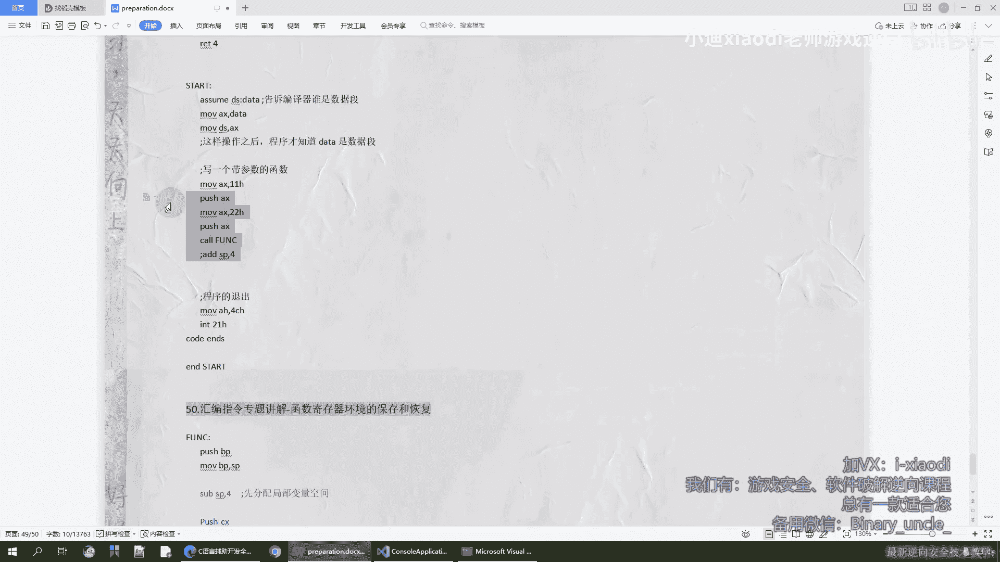
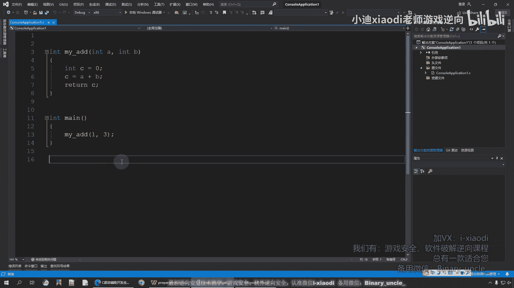
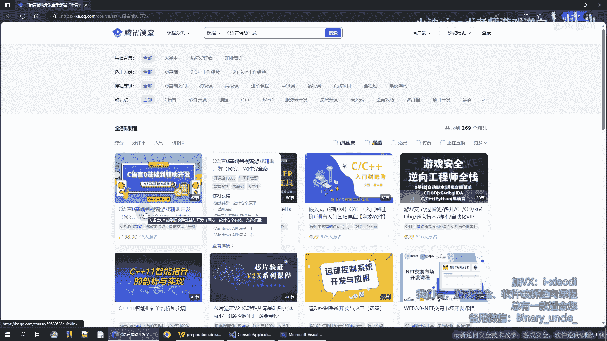
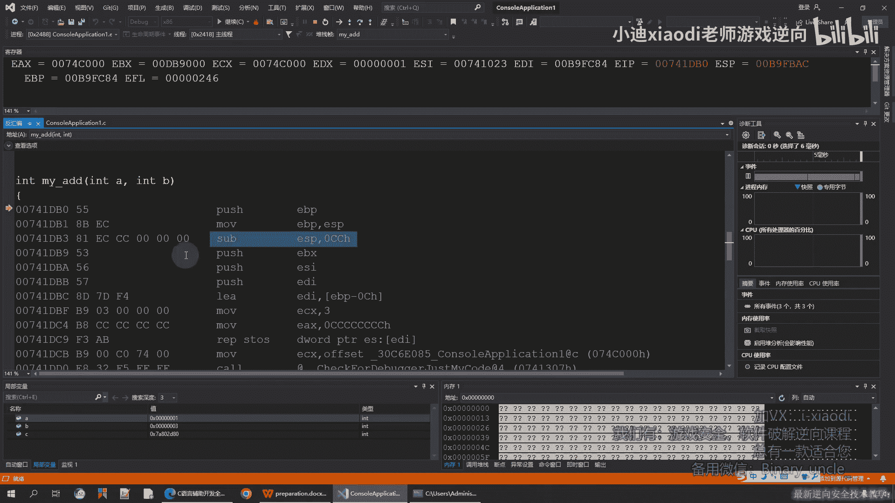
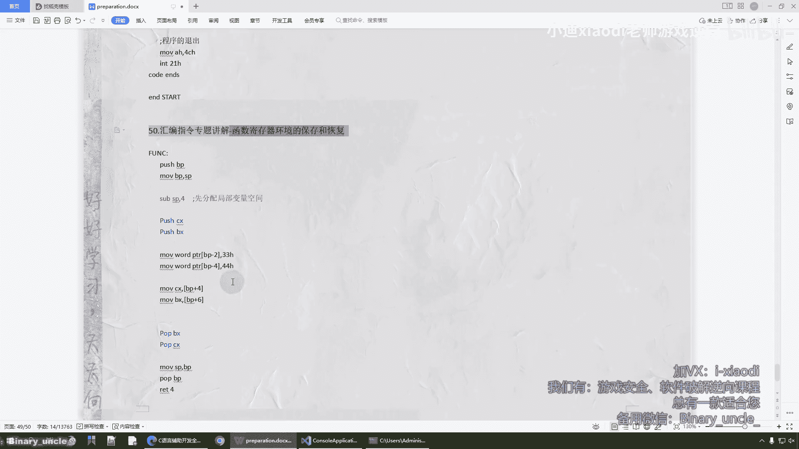
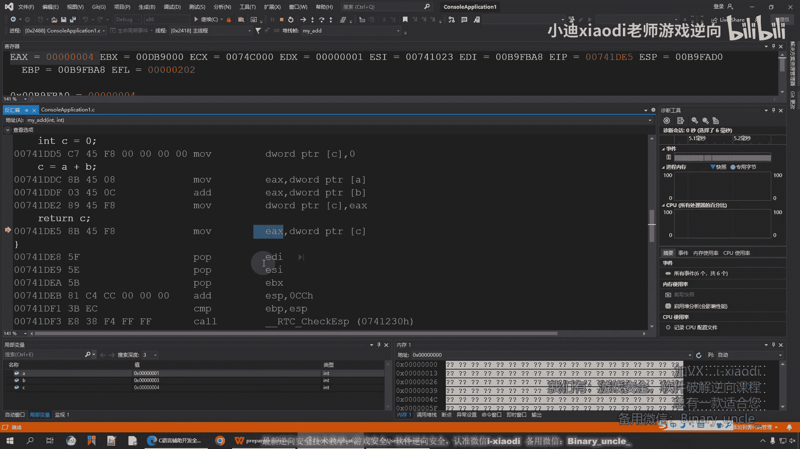
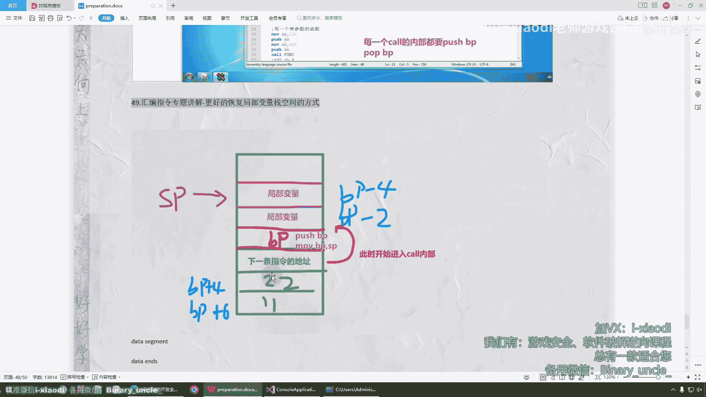

## 📘 小白软件破解反汇编逆向工程师2023最新：第0节：课程概述


本课程由小迪老师讲解，今天是第50课，主题是汇编指令专题讲解中的函数寄存器环境的保存和恢复。上节课讲解了局部变量栈空间的保存和恢复，本节中我们来看看寄存器环境是如何保存和恢复的。为了便于初学者理解，可以把寄存器环境保护理解成一套固定动作：先把寄存器里的数据压入栈，函数执行完后再从栈里恢复回来。下面的公式概括了本节的核心思路。

```text
寄存器环境保护的基本形式：
push 寄存器
函数体执行
pop 寄存器
```

在整体结构上，本节会先回顾局部变量栈空间的处理方式，再说明寄存器为什么需要保存和恢复，然后通过push与pop示例、函数栈空间顺序、返回值寄存器等内容展开。这样安排可以让初学者从已经学过的栈知识自然过渡到寄存器环境知识，并且能够把“为什么做”和“怎么做”联系起来。


## 🧱 小白软件破解反汇编逆向工程师2023最新：第1节：从局部变量栈空间到寄存器保存


上节课讲到局部变量占空间的保存和恢复。局部变量的保存和恢复做法很简单：直接执行一个push，把要保存的数据压入栈中，最后再执行一个pop把数据恢复出来。寄存器如果希望保存，手段与栈一样，本质上也是把寄存器中的数据压入栈中，用完之后再通过pop恢复。下面用代码形式把这一基本动作展示出来。



```text
保存数据：push 数据
恢复数据：pop 数据
```

从局部变量栈空间过渡到寄存器环境，可以发现两者的核心思想一致，都是利用栈这种后进先出的结构临时保存数据。理解了这个共同点后，下一节需要进一步回答一个问题：函数内部为什么要专门保存和恢复寄存器环境。


## ❓ 小白软件破解反汇编逆向工程师2023最新：第2节：为什么需要保存和恢复寄存器


以function函数为例，函数内部用到了BX和CX。若在调用函数之前，函数外部的AX和CX等寄存器比较有用，而函数内部又修改了这些寄存器，那么函数执行完之后，CX、AX或其他寄存器就可能发生变化。寄存器变化后，原本的计算结果可能不正确，严重时还可能造成整个程序崩溃。因此，编写函数时如果用到了一些寄存器，为了防止外部函数再次调用时寄存器数据发生错误，就需要进行保存和恢复。也就是说，寄存器在函数执行前是什么值，函数执行完后还应恢复成什么值，而不是用了一次就改变。可以用一个生活中的比喻来理解这个要求：借给同学一本书，同学看完后应当完好归还，不能少三四张或五六张，物归原主时尽量一点模样都不变。程序中的寄存器保存也是同样的讲究，因此需要把寄存器环境恢复好。下面的引用块概括了这个比喻的含义。

> 借出去的书要完好归还原主，函数用过的寄存器也要恢复成原来的值。



理解了必要性之后，下一节我们来看实际保存和恢复寄存器时使用的push与pop动作。




## 🧰 小白软件破解反汇编逆向工程师2023最新：第3节：push与pop保存恢复示例


保存寄存器时使用push，恢复寄存器时使用pop。例如函数中用到CX和BX，可以先push CX、再push BX，函数执行完后按相反顺序pop BX、pop CX。这样做的原因是栈具有后进先出的特点，先压入的数据后弹出，后压入的数据先弹出。以下是保存和恢复寄存器的基本动作列表，便于初学者按步骤理解。

- 保存寄存器：执行`push CX`和`push BX`，把寄存器数据压入栈中。
- 恢复寄存器：执行`pop BX`和`pop CX`，把栈中数据按相反顺序弹回寄存器。



掌握push与pop的基本用法后，还需要注意函数内部栈空间安排存在先后顺序。下一节结合C语言程序和调试观察，说明为什么先开辟局部变量栈空间，再保存寄存器环境。




## 🔍 小白软件破解反汇编逆向工程师2023最新：第4节：先开辟局部变量栈空间，再保存寄存器


在保存寄存器之前，函数内部栈空间的处理顺序是：先开辟局部变量栈空间，再保存寄存器环境。为了看清这个顺序，可以观察微软编译器正常编写程序后的汇编结果。如果对C语言不太熟悉，可以在腾讯课堂搜索C语言辅助开发课程，该课程优惠后是98元，需要时可以加老师微信。使用F10单步执行并进入函数内部，可以看到局部变量C等于0，这个变量就是局部变量。往上翻看汇编代码，首先出现函数头，然后先开辟局部变量栈空间，再保存寄存器环境，这就是眼见为实的观察结果。也就是说，函数开头先把局部变量需要的栈空间开出来，再去保存寄存器环境；函数结束时先恢复寄存器环境，再把局部变量栈空间丢掉，把不用的内容释放掉。下面的代码形式概括了这个顺序。

```text
函数头
开辟局部变量栈空间
push 保存寄存器环境
函数体执行
pop 恢复寄存器环境
释放局部变量栈空间
```

理解栈空间顺序后，下一节需要关注一个特殊寄存器：函数返回值所使用的AX系列寄存器。


## 🎯 小白软件破解反汇编逆向工程师2023最新：第5节：函数返回值通过AX传递，不能用pop AX


还有一个重要知识点：函数的返回值是通过AX进行传递和返回的，因此不能用pop AX把返回值弹掉。回到示例代码，这是一个加法函数，A加B，A给了一个1，B给了一个3，1加3等于4。观察寄存器窗口并连续按F10单步执行，会发现EAX会变成4。这说明在汇编或程序中，函数返回值永远通过AX系列寄存器进行传递和返回。下面的公式展示了不同位宽下返回值寄存器的对应关系。

```text
16位程序返回值寄存器：AX
32位程序返回值寄存器：EAX
64位程序返回值寄存器：RAX
```

为什么不能用pop AX或类似pusha、popa的整体恢复方式处理返回值？之前讲过pusha会保存所有寄存器，popa会恢复所有寄存器。当执行popa恢复时，AX也会被恢复，原本算出来的1加3等于4就会被弹掉，等于费了很大劲算出AX等于4，又把结果丢掉，这样的处理不合适。函数需要返回值时，要的就是AX中的结果，所以在函数内部永远不需要保存AX，因为AX永远充当返回值。无论程序怎么写，返回值都通过AX系列寄存器返回，16位对应AX，32位对应EAX，64位对应RAX，记住这一点即可。理解返回值寄存器后，下一节对今天的重要知识点做顺序归纳，并布置一个画栈空间的作业。


## 📌 小白软件破解反汇编逆向工程师2023最新：第6节：知识点归纳与作业


今天比较重要的知识点需要按顺序归纳。以下是本节归纳出的关键知识点列表，初学者可以按条目记忆。



- 顺序很重要：先开辟局部变量栈空间，保存寄存器环境在后。
- AX永远充当返回值寄存器，16位程序是AX，32位程序是EAX，64位程序是RAX。
- 函数内部使用寄存器后，要通过push和pop把寄存器环境恢复好。

归纳知识点后，本节还留有一个作业：既然已经保存了寄存器环境，就把栈空间画出来。提示是参考上节课的栈空间画法，现在栈中增加了局部变量KBBKP所占空间，还增加了push保存的CX和BX等寄存器内容，可以把这些内容往上挪一挪，把寄存器画在局部变量栈空间上方。画栈空间主要是提升熟练度，做出来或做不出来都可以找老师私聊，查看正确答案。完成这个练习后，下一节补充说明C语言基础学习渠道。


## 📝 小白软件破解反汇编逆向工程师2023最新：第7节：补充说明


如果对C语言不太熟悉，可以在腾讯课堂搜索C语言辅助开发课程，该课程优惠后是98元，需要时可以加老师微信。这部分内容属于学习渠道补充，方便基础薄弱的同学补齐C语言知识，再回到汇编指令和函数寄存器环境的学习中。补充说明结束后，下面对本节课做整体总结。




## ✅ 小白软件破解反汇编逆向工程师2023最新：第8节：课程总结


本节课中我们一起学习了函数寄存器环境的保存和恢复。具体内容包括：局部变量栈空间通过push压栈保存、通过pop恢复；寄存器环境同样通过push和pop保存恢复；函数内部使用BX、CX等寄存器时，需要防止外部调用环境被破坏；函数栈空间顺序是先开辟局部变量栈空间，再保存寄存器环境，函数结束时先恢复寄存器环境，再释放局部变量栈空间；函数返回值永远通过AX系列寄存器传递，16位是AX，32位是EAX，64位是RAX，因此不能用pop AX把返回值丢掉。最后还布置了画栈空间的作业，用于提升熟练度。本节内容到此结束，下期再见。

