# 🧵 小白软件破解反汇编逆向工程师2023最新：58：远线程调用函数功能


## 🧭 小白软件破解反汇编逆向工程师2023最新：58.1：课程概述


本课由小李老师讲解，是系列课程的第58课，主题是远线程调用函数功能。在本节课中我们将要学习：如何不在自己的程序里执行函数，而是通过远线程的方式，在别人的程序里创建线程并调用目标函数。之前课程讲过，在自己程序里可以创建一条线程去执行相应函数；如果目标是调用别人程序中的函数，就需要换一种思路。可行的技术方案就是“远线程调用函数功能”，它的思路比较直接：在别人的程序里创建一条线程，并让这条线程执行目标函数。为了把这个思路讲清楚，本课会先介绍两个关键API，再分析演示程序里的按钮Call，接着用代码注入器做演示，最后逐个说明`CreateRemoteThread`的参数以及带参数调用的扩展思路。


## 🧩 小白软件破解反汇编逆向工程师2023最新：58.2：核心思路与关键API


上一节说明了本课要解决的问题，本节我们来看看远线程调用函数的整体思路和关键API。远线程调用函数的核心可以概括为两步：第一步打开目标进程，拿到进程句柄和相应权限；第二步在目标进程里创建远程线程，让线程从指定函数地址开始执行。为了便于记忆，可以把核心过程理解成下面这个公式。


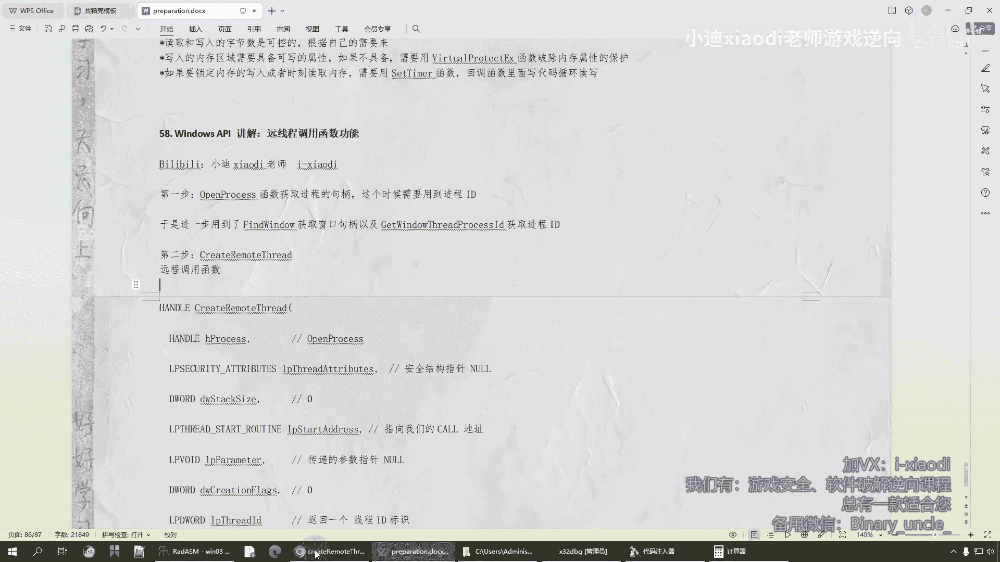

```text
远程调用结果 = OpenProcess 获取目标进程句柄
             + CreateRemoteThread 在目标进程创建线程
             + 指定目标函数地址作为线程起始地址
```


下面是远线程调用函数时最常用的两个步骤，按顺序理解即可。


1. 使用`OpenProcess`获取目标进程句柄，并取得相关权限。

2. 使用`CreateRemoteThread`在目标进程的虚拟地址空间中创建线程，并指定要执行的函数地址。


`CreateRemoteThread`的用法可以通过官方文档查看，它的作用是创建在另一个进程的虚拟地址空间中运行的线程。这个函数的参数看起来多，但拆开以后并不复杂。理解完整体流程后，下一节我们通过一个演示程序来分析目标按钮Call，看看怎样找到要远程调用的函数地址。


## 🔍 小白软件破解反汇编逆向工程师2023最新：58.3：分析目标按钮的Call


上一节介绍了核心API，本节我们来看看如何从演示程序里找到要调用的函数。先构想一个演示程序，它的功能可以理解为“请远程激活调用我”。如果由程序自己执行，操作就是点击按钮，然后程序执行相应功能；点击按钮时，实际执行的是按钮对应的Call。接下来要做的，就是把这个按钮Call分析出来，并找到它调用的函数。可以用x32dbg分析这个程序。由于程序比较简单，可以直接附加，然后点击符号跳转到目标位置。在跳转位置可以看到“开启打怪”字样，这个字样基本可以确定就在按钮Call里面。这个分析过程可以用下面的流程表示。


```text
点击按钮
→ 执行按钮Call
→ 调用目标函数
→ 弹出“开启打怪”信息框
```


如果基础较好，向上查看就可以看到函数头；如果基础一般，可以鼠标右键选择“分析模块”，让工具把函数分析出来。分析后会看到完整的函数头和函数尾，也就是有头有尾的函数结构，工具还会自动给这个函数起一个符号名，例如`sub_401013`，说明它是一段函数。这个函数会弹出信息框，也就是“开启打怪”对应的函数。找到函数地址以后，下一节我们使用工具包里的代码注入器，尝试远程调用这个函数。


## 🛠️ 小白软件破解反汇编逆向工程师2023最新：58.4：使用代码注入器远程调用


上一节找到了目标函数，本节我们来看看怎样用代码注入器完成一次远程调用。工具包里有代码注入器，可以直接用来演示远线程调用函数。使用代码注入器时，可以按下面的步骤操作。


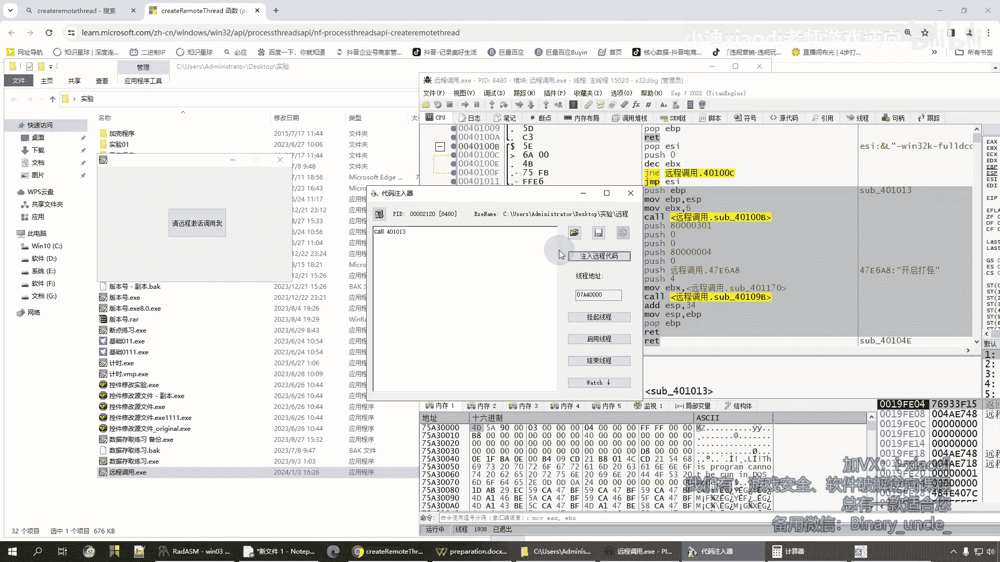

1. 点击小电脑图标。

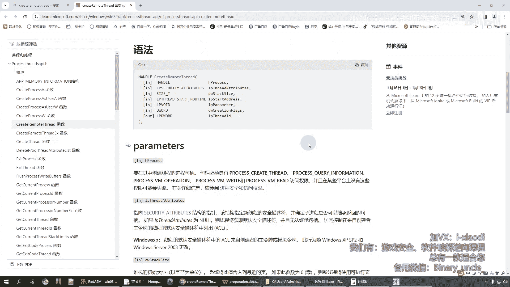

2. 找到目标程序的进程并双击。

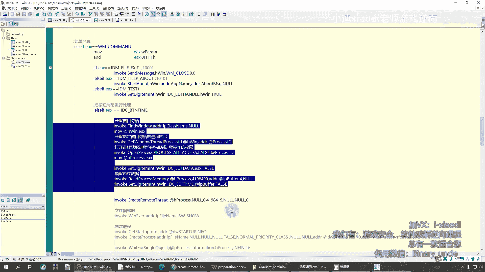

3. 在地址位置直接写`0x401013`，因为它是函数头部地址。

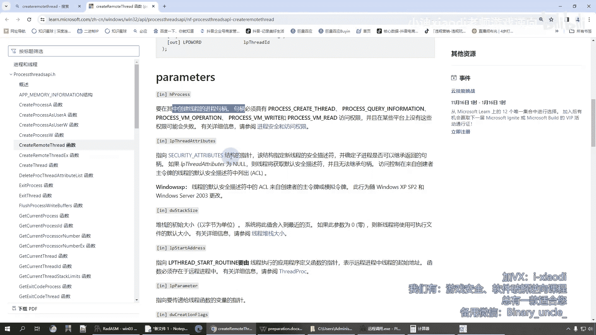

4. 点击“注入远程代码”。


点击注入后，可以看到“开启打怪”信息框弹出来。再次点击，信息框再次弹出，说明远程调用成功。界面上还能看到“注入远程代码”“挂起线程”“启用线程”等与线程有关的操作，这说明工具底层就是通过远线程技术实现的。这个工具的实现原理，同样可以通过`CreateRemoteThread`这个函数实现，整体并不复杂。关闭工具后，可以自己写出一个类似代码注入器的程序。理解工具演示后，下一节我们逐个查看`CreateRemoteThread`的参数应该怎样填写。


## 🧮 小白软件破解反汇编逆向工程师2023最新：58.5：CreateRemoteThread参数逐个说明


上一节完成了工具演示，本节我们来看看`CreateRemoteThread`每个参数的含义和填写方式。`CreateRemoteThread`的参数可以按下面的顺序逐个理解，先记住每个位置的作用，再对照代码示例填写即可。


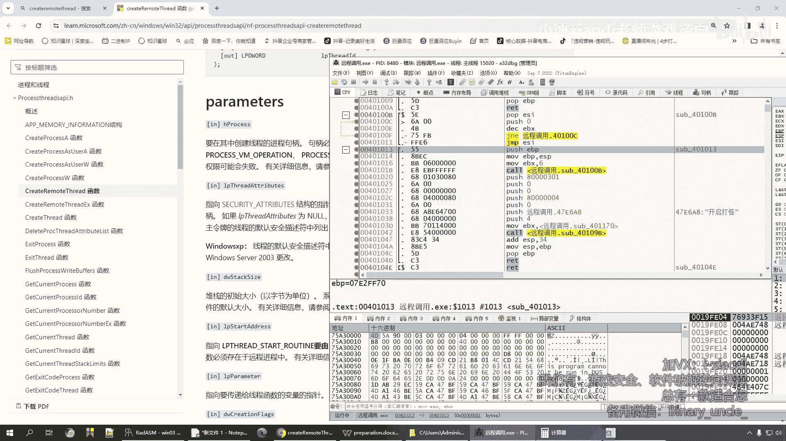

1. 第一个参数是进程句柄，直接传`HANDLE hProcess`。这个句柄在前面用`OpenProcess`获取，相关方法前面课程已经讲过。

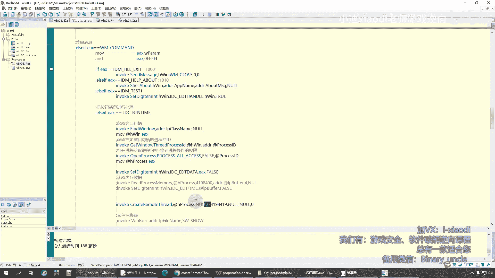

2. 第二个参数是结构体指针，填`NULL`，表示使用默认安全标识符。

3. 第三个参数是栈的初始大小，填`0`，让系统使用默认值。

4. 第四个参数是函数指针，表示远程进程中线程的起始地址，也就是要执行的函数。这里填写`0x401013`；换算成十进制是`4198419`，这个数值就是函数地址。

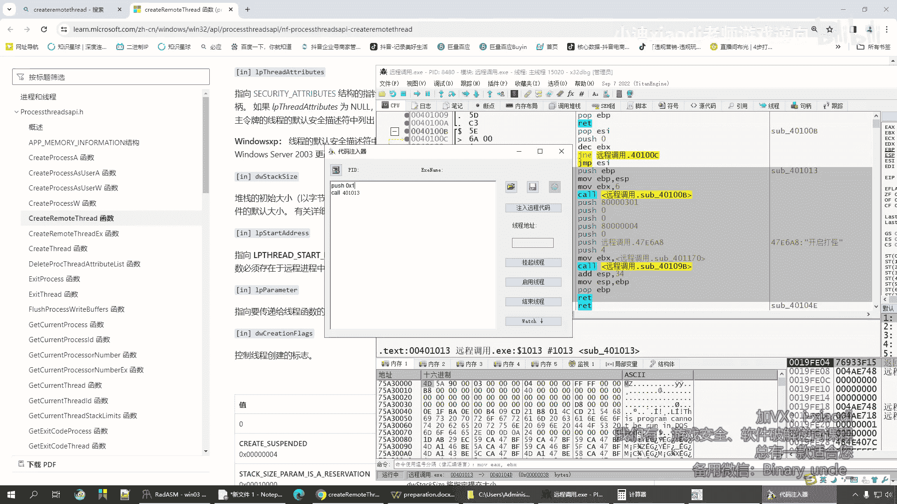

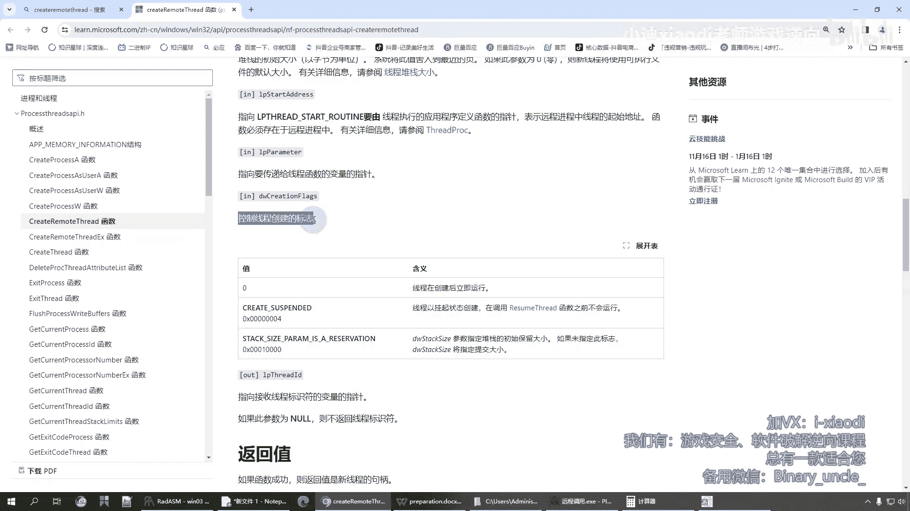

5. 后面三个参数与变量指针有关。刚才分析发现该函数没有参数，直接调用`0x401013`没有崩溃，调用时也没有写`push`，所以该函数不需要参数，相应位置填`NULL`或`0`。

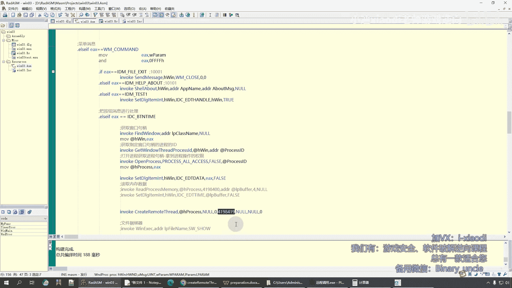

6. 控制线程创建方式的参数填`0`，表示线程创建后立即运行。

7. 最后一个参数用于接收线程标识符。这里不需要接收线程标识符，填`NULL`即可。这些填`NULL`的位置效果一样。


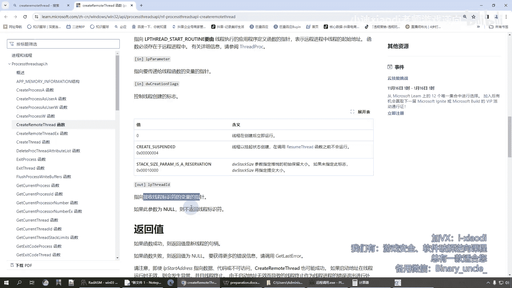

参数填写完成后，可以写成下面的代码形式。


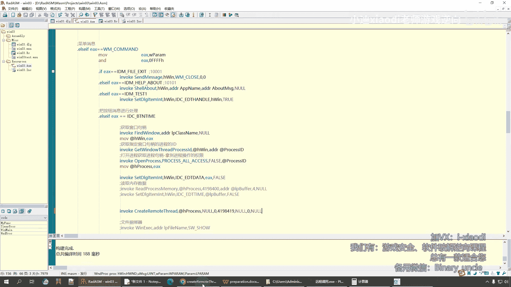

```c
HANDLE hThread = CreateRemoteThread(
    hProcess,                              // 目标进程句柄
    NULL,                                  // 默认安全标识符
    0,                                     // 默认栈大小
    (LPTHREAD_START_ROUTINE)0x401013,      // 目标函数地址
    NULL,                                  // 无参数
    0,                                     // 创建后立即运行
    NULL                                   // 不接收线程标识符
);
```


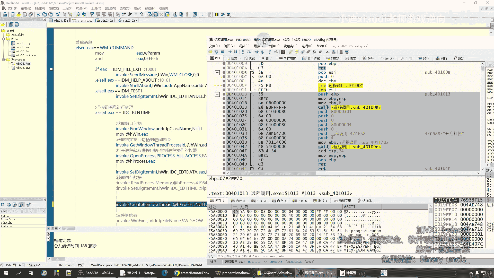

把程序完整地摆在工程里，构建并运行，然后点击按钮，可以看到“开启打怪”信息框弹出；再次点击，信息框再次弹出。这样就在别人的程序里调用了别人的函数，每个参数的含义也能对应起来。理解参数填写后，下一节我们看看怎样完善程序，并讨论带参数调用的思路。


## 🧱 小白软件破解反汇编逆向工程师2023最新：58.6：完善与带参数调用


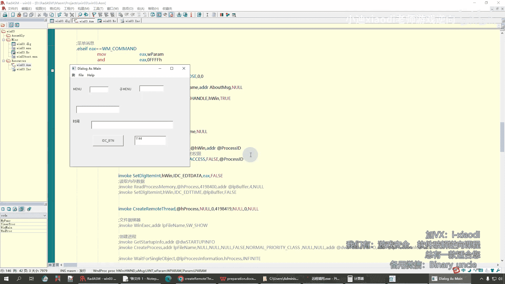

上一节完成了无参数远程调用，本节我们来看看程序完善方式和带参数调用的处理思路。如果想让程序更加完善，可以围绕下面几个动作处理线程和句柄。


1. 使用`WaitForSingleObject`等待远程线程返回。

2. 使用`CloseHandle`关闭线程句柄。

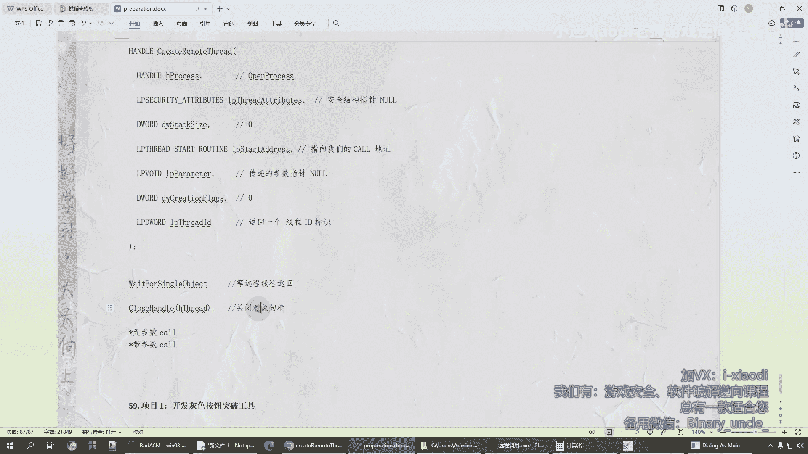

3. 记录`CreateRemoteThread`成功返回的新线程句柄，并在合适位置保存。

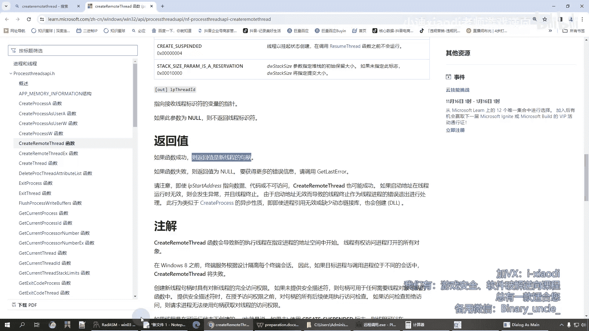

4. 在函数调用完成后关闭进程句柄。


调用函数成功后，`CreateRemoteThread`会返回新线程的句柄，这个句柄可以保存下来，后续用于等待和关闭。除了无参数Call，还存在带参数Call。无参数Call可以直接调用；带参数Call需要把参数放到结构体里，或者直接写到某一块内存里。内存可以通过`VirtualAllocEx`分配，然后通过`WriteProcessMemory`把参数数据写进去。如果只有一个参数，可以直接写入；如果有多个参数，可以通过结构体存放。下面是一个带参数调用的思路示例。


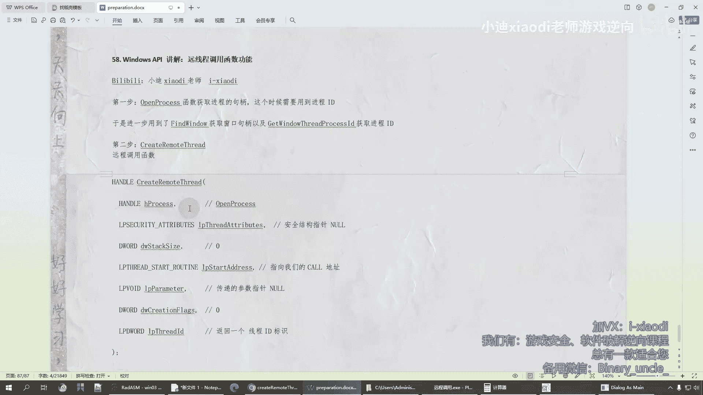

```c
LPVOID pRemote = VirtualAllocEx(
    hProcess,
    NULL,
    sizeof(参数结构体),
    MEM_COMMIT | MEM_RESERVE,
    PAGE_READWRITE
);

WriteProcessMemory(
    hProcess,
    pRemote,
    &参数结构体,
    sizeof(参数结构体),
    NULL
);
```


> 注意：带参数调用时，参数结构体和参数地址要按目标函数的调用约定准备；多个参数建议统一放入结构体，再把结构体地址传给远程线程。


结构体相关内容前面课程已经讲过，可以直接写入结构体地址。带参数调用可以作为作业练习：先分析目标函数需要哪些参数，再准备结构体和远程内存，最后把参数地址传给`CreateRemoteThread`。理解这些扩展思路后，本节内容就形成了完整闭环，下一节我们做本课总结。


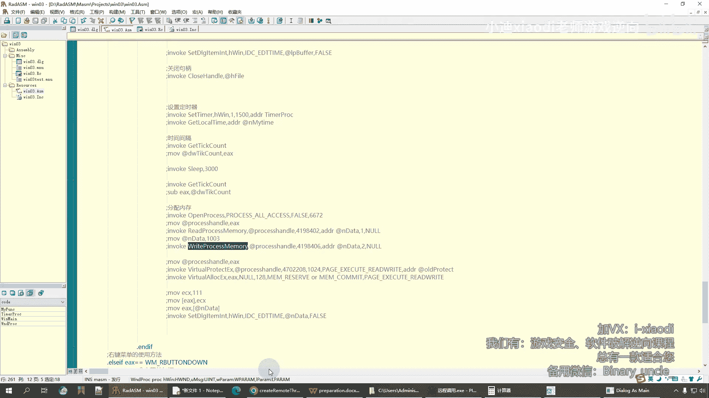

## 📝 小白软件破解反汇编逆向工程师2023最新：58.7：本课总结


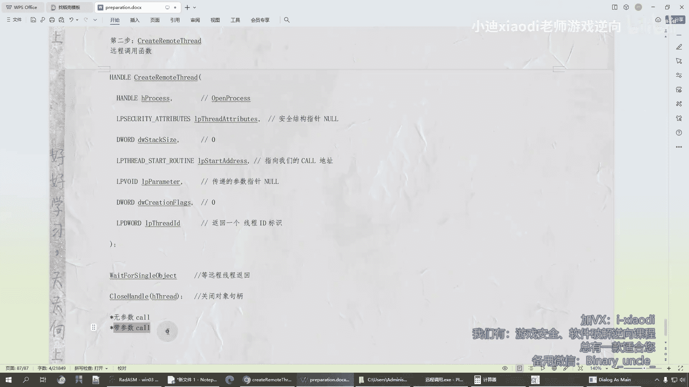

本节课中我们一起学习了远线程调用函数功能。本课先说明了在自己程序里创建线程执行函数与在别人程序里调用函数的区别，接着介绍了`OpenProcess`和`CreateRemoteThread`两个关键API，然后通过x32dbg分析演示程序的按钮Call，找到`sub_401013`这个目标函数。之后使用代码注入器完成远程调用演示，并逐个说明了`CreateRemoteThread`的进程句柄、安全标识符、栈大小、函数地址、参数指针、创建方式和线程标识符等参数。最后讨论了使用`WaitForSingleObject`和`CloseHandle`完善程序，以及通过`VirtualAllocEx`和`WriteProcessMemory`准备带参数调用的思路。本课到此结束，下期再见。
