  
# 🔧 小白软件破解反汇编逆向工程师2023最新：项目2：开发灰色菜单突破工具  

大家好，我是小李老师。今天是我们的第六十课，项目2的内容是开发灰色菜单突破工具。上节课我们讲了灰色按钮的突破，按钮的操作相对简单，直接使用现成工具就能实现。但菜单的情况就不一样了——很多通用工具没办法直接拖动到菜单上，比如我电脑上的 splight 工具，拖到菜单上根本不起作用。既然现成工具不行，那我们就自己写一个程序来实现突破。写起来其实也不复杂，只需要获取到目标菜单项的信息，然后调用一个 API 函数就能让它变为可用状态。  

在本节课中，我们将一步步分析灰色菜单的禁用原理，并编写一个小工具，通过 Windows API 强行启用那些灰掉的菜单项。最终你会看到，原本无法点击的菜单项经过我们的处理就变得可以点击了。  

## 🧩 背景与问题  

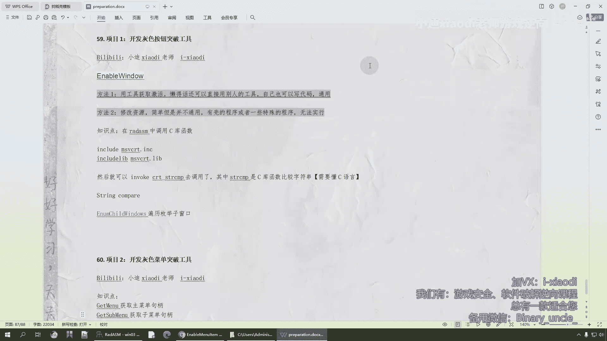

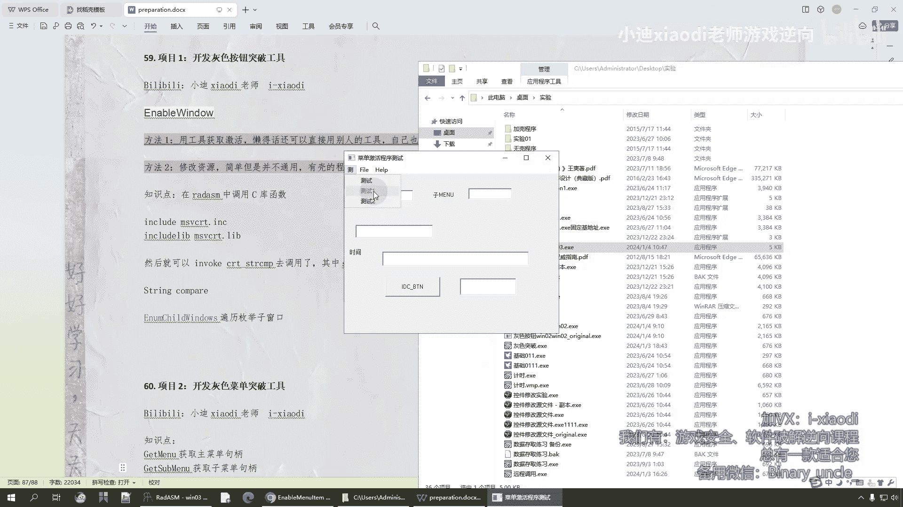

我们打开一个测试程序，窗口标题是“菜单激活程序测试”。在这个程序里，有一个“测”菜单项，点开后里面的“测试一”是灰色的，也就是处于禁用状态。灰色状态意味着这个菜单项当前不可点击，这在很多软件中常见，用于在特定条件下隐藏或禁止功能。  

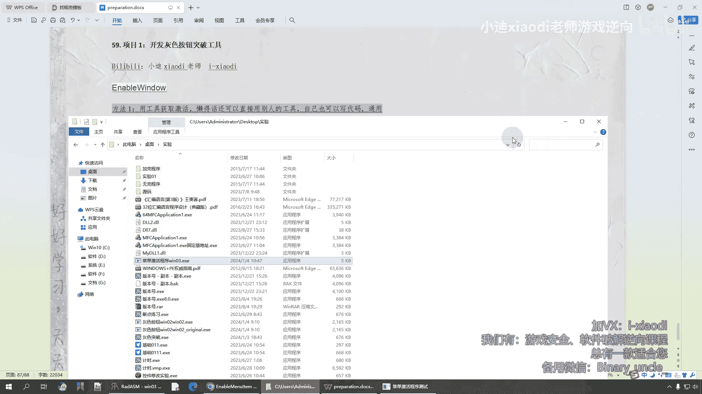

过去的工具之所以失效，是因为它们大多针对按钮设计，无法操作菜单的句柄。我们的思路是直接调用 Windows 提供的菜单相关 API，绕过界面限制，主动启用灰色菜单项。  

## 💡 解决思路  

整个突破过程可以分为五步，每一步都对应一个 Windows API 调用。以下是用伪代码表示的调用链，它也是我们后面编写程序的骨架：  

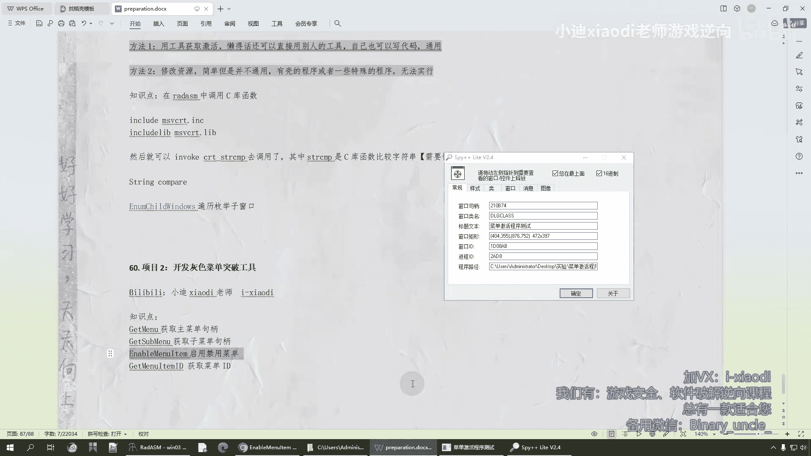

```text  
hWnd     = FindWindow(NULL, "菜单激活程序测试")  
hMenu    = GetMenu(hWnd)  
hSubMenu = GetSubMenu(hMenu, 0)  
menuID   = GetMenuItemID(hSubMenu, 1)  
EnableMenuItem(hSubMenu, menuID, MF_ENABLED)  
```  

简单解释一下：我们先找到目标窗口，然后通过窗口取出它对应的菜单栏，再定位到包含灰色菜单项的那个下拉子菜单，接着查到这个菜单项的唯一 ID，最后用启用命令把它激活。  

## 🛠️ 代码实现  

下面我们将上面的思路转换成具体的 C++ 代码。开发环境使用 Win32 API，不需要额外依赖第三方库。  

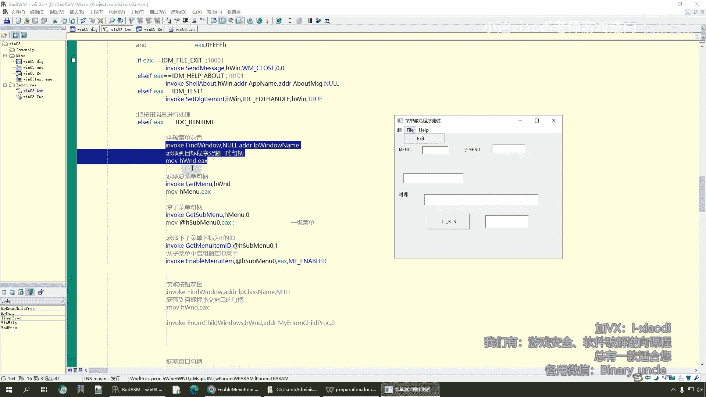

### 1️⃣ 获取主窗口句柄  

第一步，我们通过窗口标题找到目标窗口的句柄。Windows 中所有窗口都有一个句柄，相当于它的身份证，后续所有操作都要基于这个句柄展开。这里我们使用 `FindWindow` 函数，第一个参数传窗口类名，因为我们不知道具体类名，所以传 `NULL`；第二个参数传窗口标题“菜单激活程序测试”。  

以下是获取主窗口句柄的代码：  

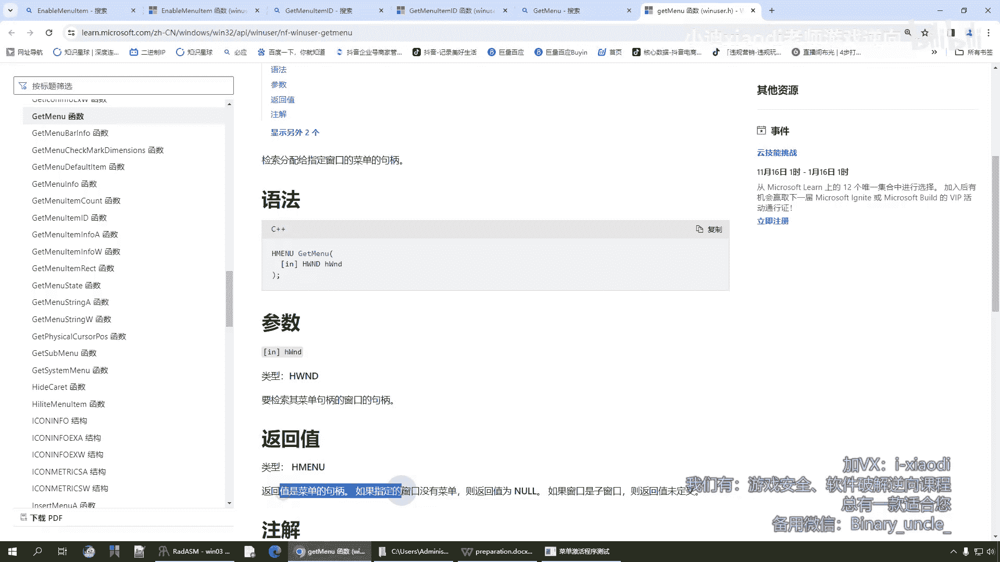

```cpp  
HWND hWnd = FindWindow(NULL, "菜单激活程序测试");  
if (hWnd == NULL) {  
    // 窗口不存在时的错误处理  
    return;  
}  
```  

### 2️⃣ 获取菜单句柄  

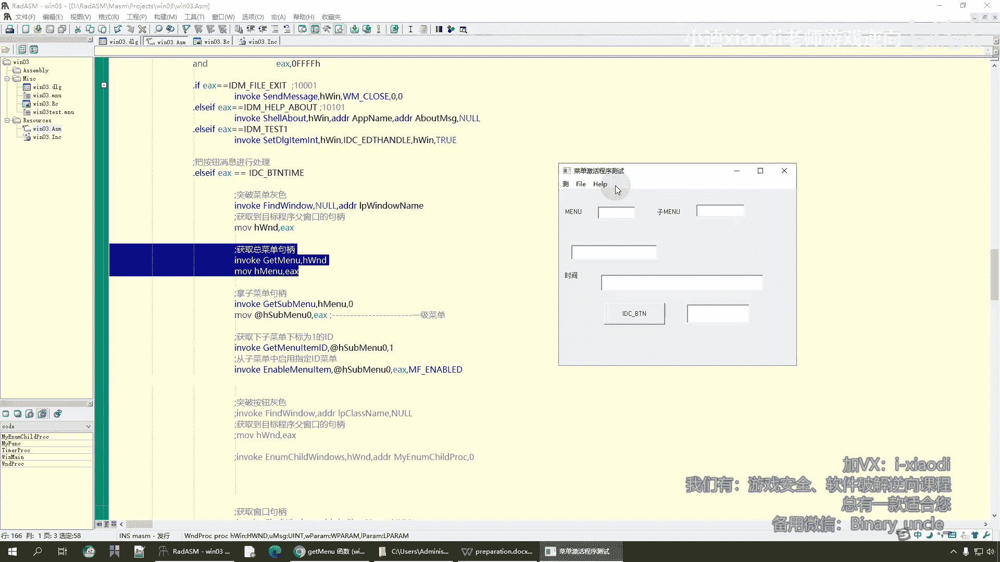

拿到主窗口句柄后，我们就可以获取整个菜单栏的句柄了。菜单句柄类似于窗口句柄，用来标识菜单资源。这里调用 `GetMenu` 函数，它只接收一个参数，就是窗口句柄，返回值是菜单句柄。  

```cpp  
HMENU hMenu = GetMenu(hWnd);  
if (hMenu == NULL) {  
    // 没有菜单或出错  
    return;  
}  
```  

### 3️⃣ 获取子菜单句柄  

菜单栏中通常有多个顶层菜单项，比如“文件”、“编辑”、“帮助”等等。我们要操作的“测试一”位于某个下拉菜单中，所以需要先拿到这个下拉菜单的句柄。使用 `GetSubMenu` 函数，第一个参数传刚才获取的菜单句柄，第二个参数是顶层菜单的位置索引，从 0 开始计数。  

在我们的测试程序中，“测”菜单位于第一个位置，所以索引是 0。下图展示了菜单栏的位置关系：  

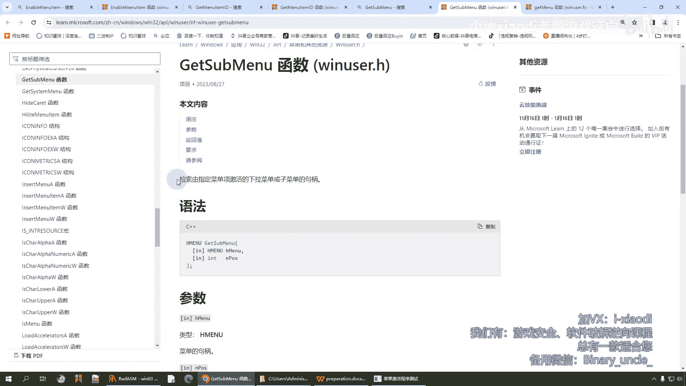

```text  
索引:   0      1      2  
菜单:  测    帮助    退出  
```  

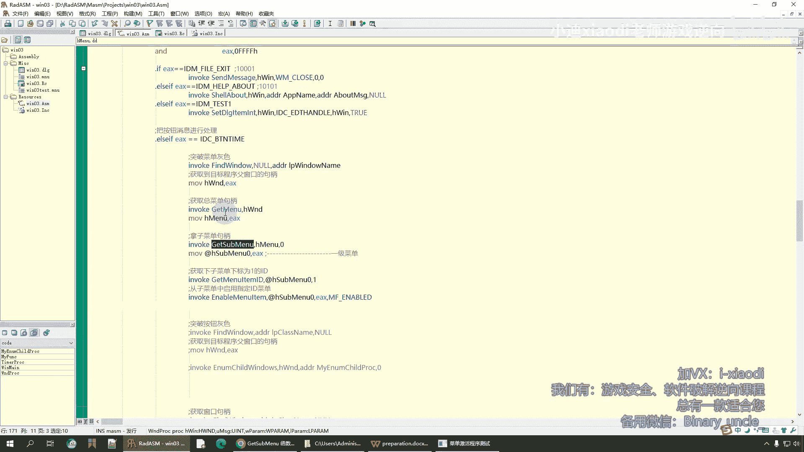

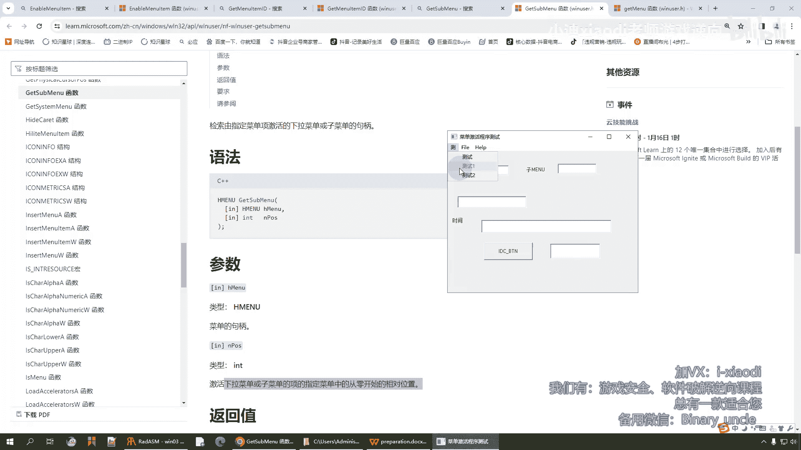

因此我们这样获取“测”的下拉菜单句柄：  

```cpp  
HMENU hSubMenu = GetSubMenu(hMenu, 0);  
```  

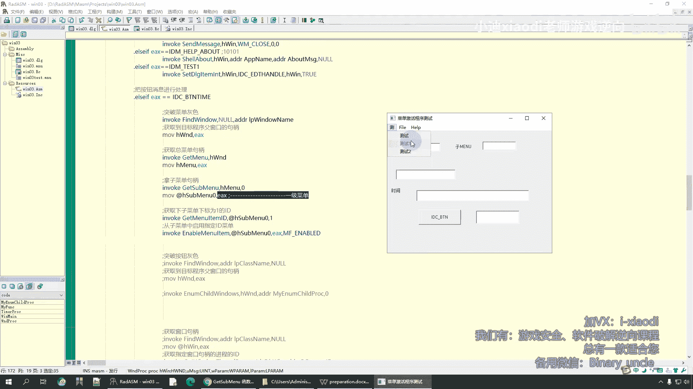

### 4️⃣ 获取菜单项 ID  

下拉菜单里可能有很多项，每一项都有一个唯一的数值 ID。Windows 通过这个 ID 来识别和操作菜单项。我们使用 `GetMenuItemID` 函数，第一个参数是子菜单句柄（也就是刚才的 `hSubMenu`），第二个参数是该菜单项在子菜单中的位置。  

注意，位置从 0 开始。在我们的测试程序里，“测试一”恰好位于子菜单的第二个位置，也就是索引 1。有人可能会疑惑为什么不是 0——这取决于程序作者的实际布局，我们可以通过调试工具实际确认。下面这行代码就能拿到“测试一”的 ID：  

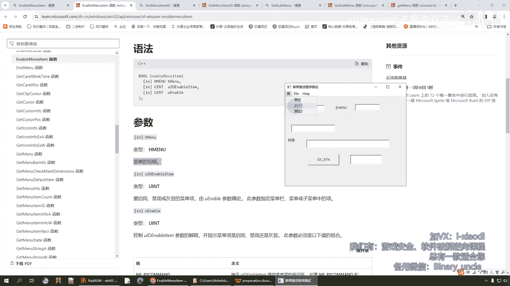

```cpp  
UINT menuID = GetMenuItemID(hSubMenu, 1);  
```  

### 5️⃣ 启用菜单项  

最后一步，调用 `EnableMenuItem` 函数，把灰色菜单项激活。该函数有三个参数：第一个是子菜单句柄，第二个是菜单项 ID，第三个是操作标志。我们使用 `MF_ENABLED`，表示启用该菜单项，让它变得可以点击。  

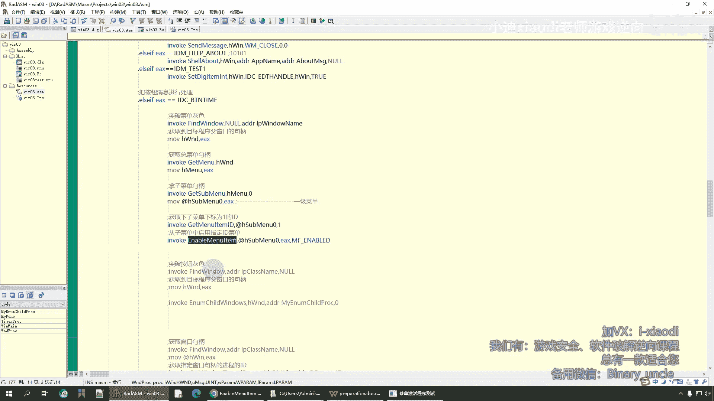

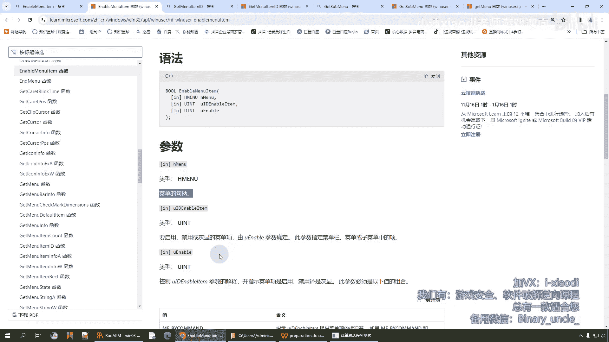

```cpp  
EnableMenuItem(hSubMenu, menuID, MF_ENABLED);  
```  

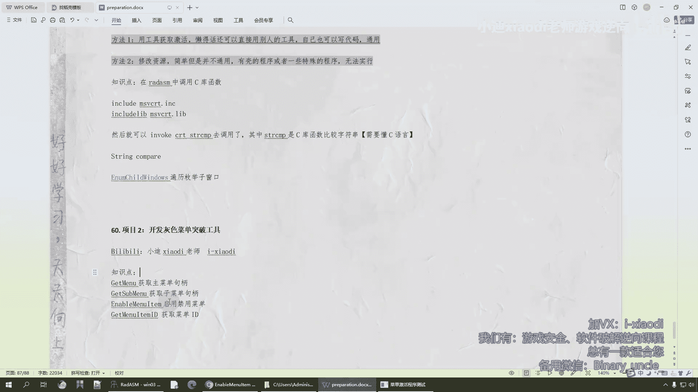

如果希望禁用某个菜单项，可以把第三个参数换成 `MF_DISABLED` 或 `MF_GRAYED`。不过在咱们这个工具里，目标就是启用，所以直接使用 `MF_ENABLED` 即可。  

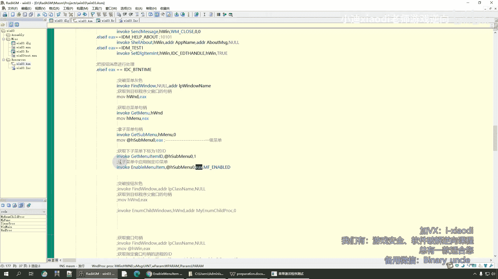

## 📜 完整代码示例  

把上述步骤合并起来，配合一个简单的按钮触发逻辑，就构成了完整的灰色菜单突破工具。我们把它放在一个按钮的点击事件中，这样每次点击按钮就能立即生效。  

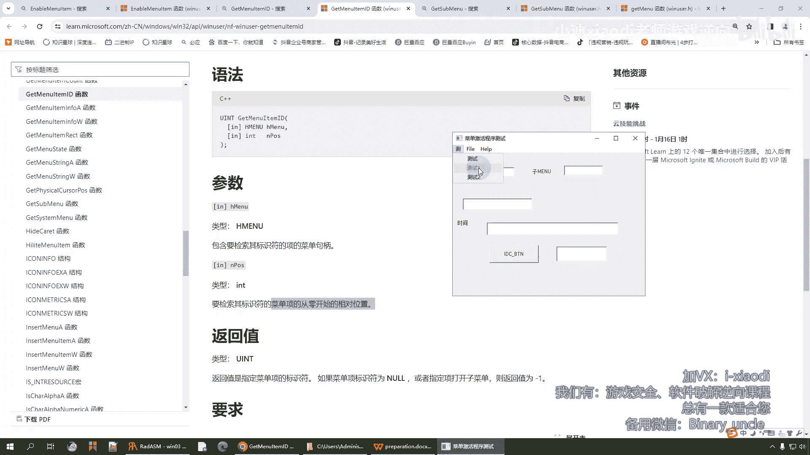

以下是完整的代码片段：  

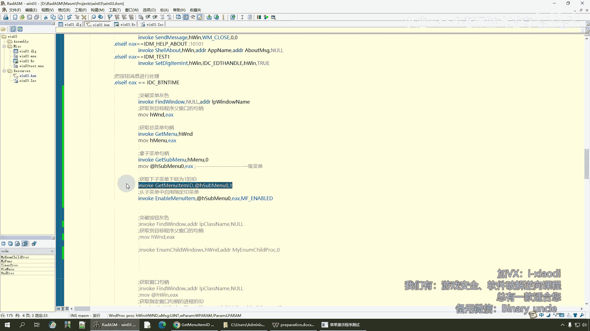

```cpp  
void EnableGrayMenu(HWND hButton) {  
    // 1. 获取主窗口句柄  
    HWND hWnd = FindWindow(NULL, "菜单激活程序测试");  
    if (hWnd == NULL) return;  

    // 2. 获取菜单句柄  
    HMENU hMenu = GetMenu(hWnd);  
    if (hMenu == NULL) return;  

    // 3. 获取子菜单句柄（第一个顶级菜单“测”）  
    HMENU hSubMenu = GetSubMenu(hMenu, 0);  
    if (hSubMenu == NULL) return;  

    // 4. 获取“测试一”的菜单项 ID（位置索引为1）  
    UINT menuID = GetMenuItemID(hSubMenu, 1);  

    // 5. 启用该菜单项  
    EnableMenuItem(hSubMenu, menuID, MF_ENABLED);  
}  
```  

注意：如果程序运行后发现启用的不是想要的菜单项，请调整 `GetSubMenu` 和 `GetMenuItemID` 中的索引参数，逐个尝试即可。  

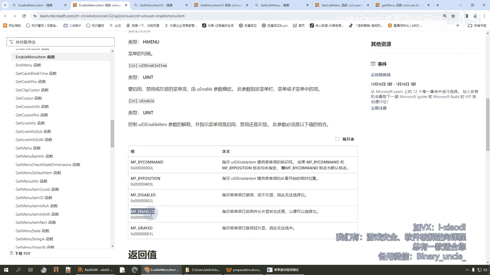

## ✅ 测试与效果  

现在我们把写好的程序跑起来。打开目标程序“菜单激活程序测试”，可以看到“测试一”是灰色的。然后运行我们自己的突破工具，点击窗体上的按钮，触发上面的代码。  

在点击按钮的瞬间，奇迹出现了——原本灰色的“测试一”立刻变成了正常的黑色，可以点击了！这说明我们的突破工具已经成功修改了菜单项的状态。整个过程中没有涉及复杂的子窗口消息，也不需要比较字符串，比按钮突破还要简单。  


## 📝 总结  

本节课我们重点学习了如何开发灰色菜单突破工具，核心思路就是用 Win32 API 直接操作菜单句柄。我们依次调用了 `FindWindow`、`GetMenu`、`GetSubMenu`、`GetMenuItemID` 和 `EnableMenuItem` 这五个函数，实现了对灰色菜单项的强制启用。  

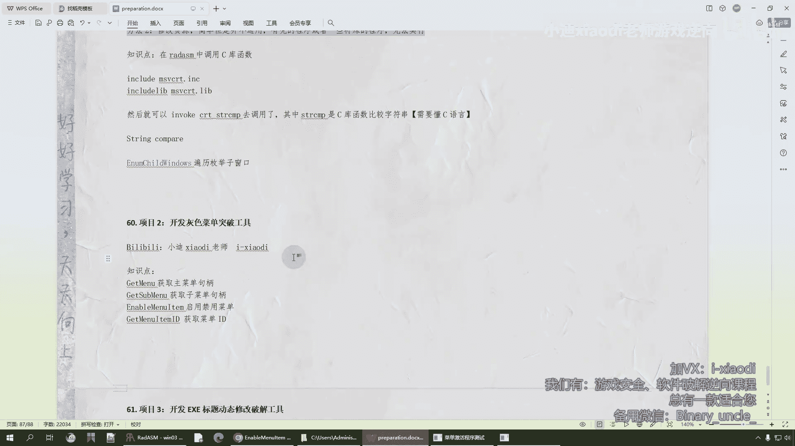

与灰色按钮突破不同，菜单突破需要操纵菜单句柄而不是窗口句柄，因此通用的按钮工具往往无效。自己写程序虽然需要多写几行代码，但胜在精准可控。大家回去之后，不妨把这段代码自己写一遍，并尝试修改索引来启用其他菜单项，加深对 Windows 菜单结构的理解。  
