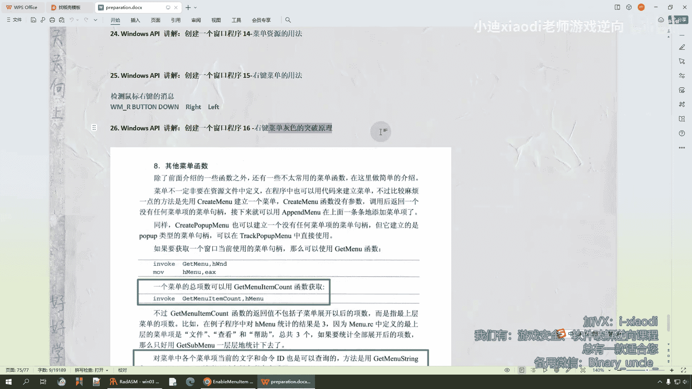

# 🧰 小白软件破解反汇编逆向工程师2023最新：第26课：Windows API讲解——创建窗口程序16：右键菜单灰色的突破原理

大家好，我是小迪老师。在本节课中，我们将要学习第26课 Windows API讲解中创建窗口程序16的内容，主题是右键菜单灰色的突破原理。简单说，本课会接着上节课的右键菜单用法，弄清楚菜单为什么会被置灰禁用，以及怎样通过 Windows API 把灰色菜单重新启用，让原本点不上的功能变成可以点击、可以选择的状态。对初学者来说，可以先把菜单理解成窗口上的功能入口，而“灰色”只是这个入口当前的状态被设置成了不可用，并不是这个入口消失了。下面我们就从回顾开始，一步一步把这个问题拆开。

## 🔙 小白软件破解反汇编逆向工程师2023最新：第26课：回顾右键菜单的灰色禁用

上节课我们讲到了右键菜单的用法，在视频的最后，我们了解到菜单可以变成灰色，而灰色就是一种禁用状态。既然本课要突破灰色菜单，就要先知道灰色状态是怎么来的，所以本节先回顾菜单编辑和禁用状态的形成过程。回顾完这些基础操作后，后面的突破思路会更容易理解。

下面是回顾右键菜单编辑和禁用状态的具体操作步骤，大家可以对照原文一起看：

- 对于一个菜单来说，如果要编辑它，可以在资源编辑器（原文提到的 read aM）里双击 menu 这个资源就可以了。


- 对于想要禁用的菜单，直接选中它，然后点击“非激活”并勾选上，再点击确定就可以了。

- 这样生成程序后，可以看到“测试一”这个菜单项处于被禁用状态。被禁用就是怎么点都点不上，它是一种不可用状态。

从上面的操作可以看出，灰色菜单并不是程序坏掉了，而是菜单项的状态被改成了不可用。回顾到这里，我们已经知道灰色禁用是怎么形成的，本节中我们来看看怎样突破这种灰色菜单。

## 🛠️ 小白软件破解反汇编逆向工程师2023最新：第26课：突破灰色菜单的核心函数

回顾完灰色禁用的形成过程，本节中我们来看看突破灰色菜单需要调用什么函数。今天我们要了解的是这种禁用状态怎么突破。因为有一些软件是收费的，收费时有试用期，在试用期里所有菜单都可以用；过了试用期，有些菜单就可能没法点了。所以我们要突破这个没法点的限制，让它能够被点击，让这些功能可以无限制使用，这就是本课的方向。突破灰色菜单的方法很简单，直接调用 `EnableMenuItem` 这个函数就可以了。

`EnableMenuItem` 的功能是启用、禁用或灰显指定的菜单项。对于被禁用或灰显的菜单项，我们只需要切换它的状态，把状态调整为启用就可以了。为了更直观地理解，可以先看下面这个函数形式：

```cpp
BOOL EnableMenuItem(
    HMENU hMenu,
    UINT uIDEnableItem,
    UINT uEnable
);
```

这个函数一共有三个参数。下面是三个参数的作用说明，以下是具体解释：

- 第一个参数是菜单句柄，这里要填的是针对性的子菜单句柄。比如刚才那个软件里，下标为 0 的菜单被禁用了，我们就要获取它的子菜单句柄。下标为 0 时用 `GetSubMenu` 把 0 填进去；如果是 File 被禁用，就把它改成 1；如果是 Help，就把它改成 2。

- 对于我们这个程序来说，要填的是“测试”这个菜单的子菜单句柄。因为“测试”在上面是下标 0，所以通过 `GetSubMenu` 得到 `HSubMenu`，把 `HSubMenu` 填进第一个参数。

- 第二个参数是菜单的 ID。这个 ID 一开始可能不知道，先不用管它，后面再通过 API 获取。

- 第三个参数是控制菜单项状态的。在众多状态里，只有启用状态是我们需要的。比如禁用状态下无法选择，启用状态下可以选中，所以这里填启用状态即可。

这里要特别注意，原文口误说“第三个参数是 ID”，实际第二个参数才是菜单 ID，第三个参数是启用状态。理解这三个参数后，核心问题就变成了第二个参数 ID 怎么获取。知道了函数和参数后，下一步就是拿到正确的子菜单句柄和菜单项 ID。

## 🧩 小白软件破解反汇编逆向工程师2023最新：第26课：获取子菜单句柄与菜单项ID

上一节介绍了 `EnableMenuItem` 和三个参数，本节中我们来看看怎样获取子菜单句柄和菜单项 ID。第二个参数 ID 的获取很简单，也有一个 API 函数可以做到，就是 `GetMenuItemID`。它的作用是检索位于菜单中指定位置的菜单项的菜单标识符，也就是获取菜单项的 ID。调用时把子菜单句柄 `HSubMenu` 填给它就可以了。第二个参数是要检索标识符的菜单项从零开始的相对位置，这里一定要注意“从零开始”。

获取菜单项 ID 的步骤可以拆成下面几步，以下是具体说明：

- 对于“测试”这个菜单，它是下标 0；对于“测试一”，它是下标 1。如果要获取“测试一”的 ID，就把 1 填进 `GetMenuItemID` 的位置参数。

- 这个位置填 1，表示相对位置，通过它就可以获取到“测试一”的 ID。

- 获取到“测试一”的 ID 后，把这个 ID 交给 `EnableMenuItem` 的第二个参数，再针对这个 ID 设置启用状态，这样就把“测试一”启用了。

可以把整个过程用下面的代码形式表示：

```cpp
HMENU hSubMenu = GetSubMenu(hMenu, 0);          // 获取“测试”子菜单句柄
UINT id = GetMenuItemID(hSubMenu, 1);           // 获取“测试一”的菜单项 ID
EnableMenuItem(hSubMenu, id, MF_ENABLED);       // 把“测试一”设为启用
```

上面的代码里，`GetSubMenu` 负责拿子菜单句柄，`GetMenuItemID` 负责拿菜单项 ID，`EnableMenuItem` 负责把状态改成启用。用大白话说，就是先找到“测试”这组菜单，再找到里面的“测试一”，最后把它从“不可点”改成“可点”。拿到句柄和 ID 后，还要把它放到右键消息处理中执行，才能看到实际效果。

## ✅ 小白软件破解反汇编逆向工程师2023最新：第26课：在右键消息中执行并验证效果

上一节我们拿到了子菜单句柄和菜单项 ID，本节中我们来看看怎样在右键消息里执行并验证效果。怎么判断突破是否成功？现在是在右键菜单的消息过滤里执行这段代码，所以当我们点击鼠标右键时，这段代码就会执行。点击右键后再查看菜单，可以看到“测试一”已经可以点了，它从灰色变成了可以点击、可以选中的状态。这个过程很简单，就是调用 `EnableMenuItem` 这个函数。

验证时要注意，子菜单中灰色按钮的顺序是从零开始的第几个，然后通过 `GetMenuItemID` 获取返回值，返回值就是 ID。把这个 ID 通过 `EnableMenuItem` 传进去，再设置启用状态就可以了。经过这一步，灰色菜单的突破就算完成了。验证成功后，我们再补充几个常用菜单函数，方便以后分析类似程序。

## 📚 小白软件破解反汇编逆向工程师2023最新：第26课：其他常用菜单函数

验证成功后，本节中我们再来补充几个常用菜单函数。除了刚才讲的内容，还有一些其他菜单函数。比如 `GetMenuItemCount` 可以获取一个菜单的总项数，也就是一共有几项。下面是几个常见用法说明，以下是具体介绍：

- 如果从总的菜单来看，`GetMenu` 直接填窗口句柄，那么获取到的是“测试”“File”和“Help”一共三项，所以返回值是 3。

- 如果 `GetMenu` 填的是子菜单句柄，情况就不一样。比如填的是 File 这个子菜单，那么项数就是 1；填的是 Help 这个子菜单，项数也是 1；而总的菜单项数还是 3。

- 所以这个函数不仅可以获取总窗口菜单的项数，还可以获取子菜单的项数。

另外还有一个 `GetMenuString`，它可以获取菜单文本，也是通过顺序序号来获取的。比如可以通过 `GetMenuString` 获取到“测试一”这样的字符串。除了这些，其他内容就没有了。这些函数不复杂，但能帮助我们更清楚菜单结构。最后我们总结本课。

## 🧾 小白软件破解反汇编逆向工程师2023最新：第26课：总结



本节课中，我们一起学习了第26课 Windows API讲解中创建窗口程序16的内容：右键菜单灰色的突破原理。我们回顾了在资源编辑器里双击 menu 资源、把菜单项设置为“非激活”从而形成灰色禁用状态的操作；也了解了收费软件试用期过后菜单可能无法点击的背景。突破灰色菜单的核心是调用 `EnableMenuItem`，用 `GetSubMenu` 获取针对性的子菜单句柄，用 `GetMenuItemID` 按从零开始的相对位置获取菜单项 ID，再把 ID 和 `MF_ENABLED` 传给 `EnableMenuItem`，从而把灰色菜单改成可点击状态。最后还补充了 `GetMenuItemCount` 获取菜单项数、`GetMenuString` 获取菜单文本等常用函数。大家回去之后可以自己测试一下，我们下期再见。

