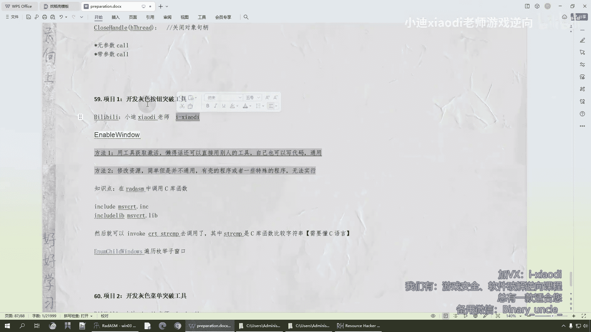

# 🛠️ 小白软件破解反汇编逆向工程师2023最新：项目1：开发灰色按钮突破工具


在本节课中我们将要学习第59课项目一：开发灰色按钮突破工具。大家好，我是小迪老师，我的哔哩哔哩账号是小迪小迪老师，微信是爱杠小迪。如果想加入全套的星球社区专属视频学习，可以抓紧联系我，现在是低价阶段。灰色按钮在日常软件逆向破解分析中非常常见，所谓灰色按钮，就是看起来存在、但处于未激活状态、无法点击的按钮。本节课会围绕这个现象，介绍两种突破思路，并重点讲解如何自己写代码实现通用突破。


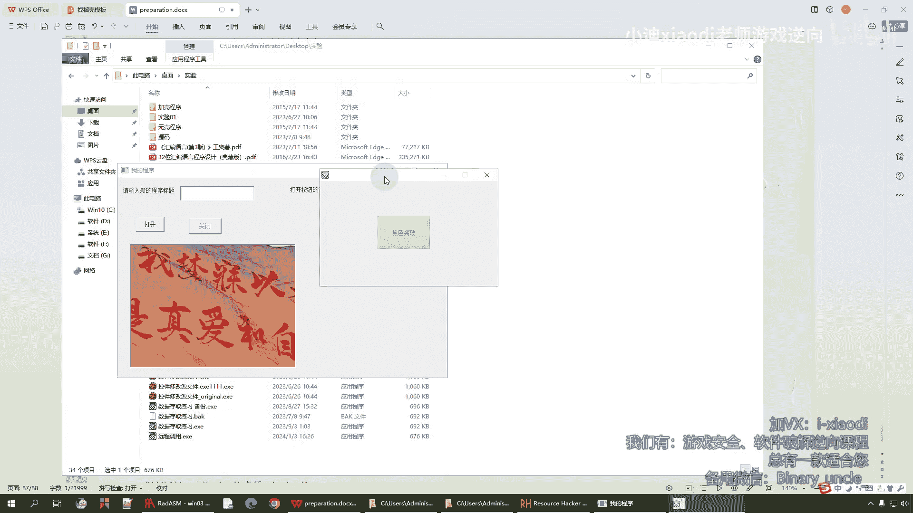

## 🧩 小白软件破解反汇编逆向工程师2023最新：项目1：灰色按钮的共性与识别


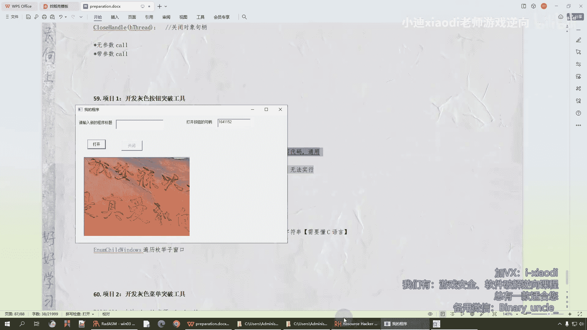

上一节我们说明了课程背景，本节中我们来看看灰色按钮到底有什么共性。我准备了两个程序，一个是“灰色按钮”，一个是“灰色突破”。观察这两个程序可以发现，它们的共同点是按钮没有办法点击，按钮处于一种未激活的状态。比如界面里的“打开”按钮可以点击，而“关闭”按钮点不了。很多软件功能如果没有经过验证，就不允许用户点击，而我们现在要做的突破，就是强制突破这种灰色的验证状态。


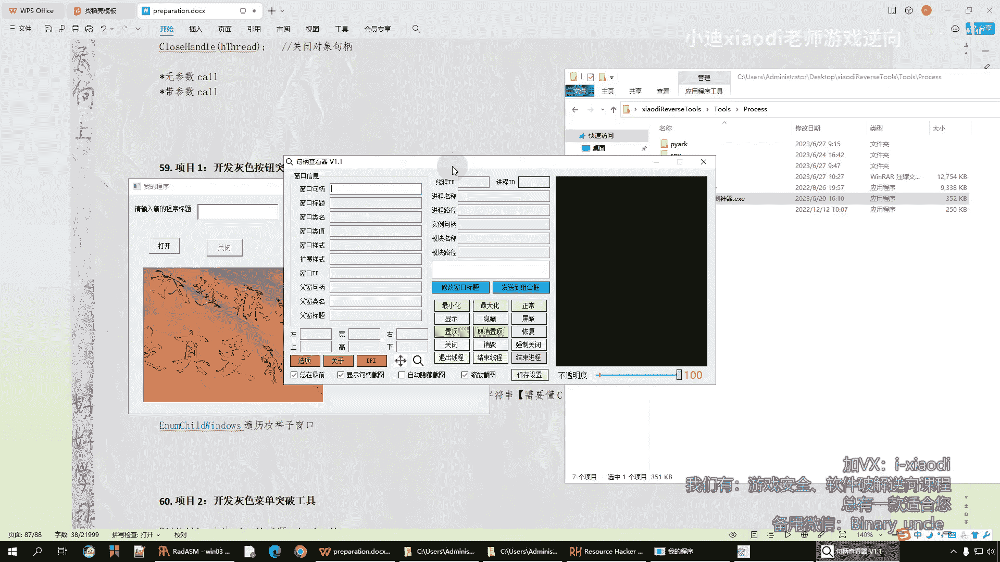

下面列出本节课准备的两个示例程序，方便后续对比操作。


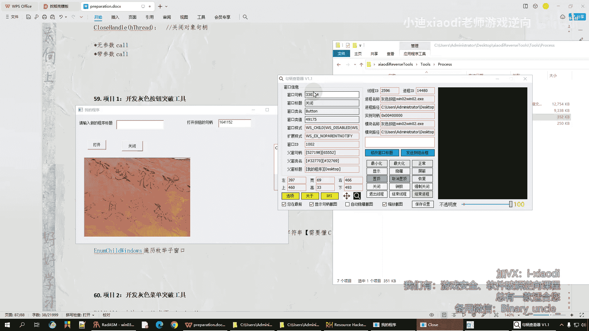

- 示例程序一：灰色按钮。
- 示例程序二：灰色突破。


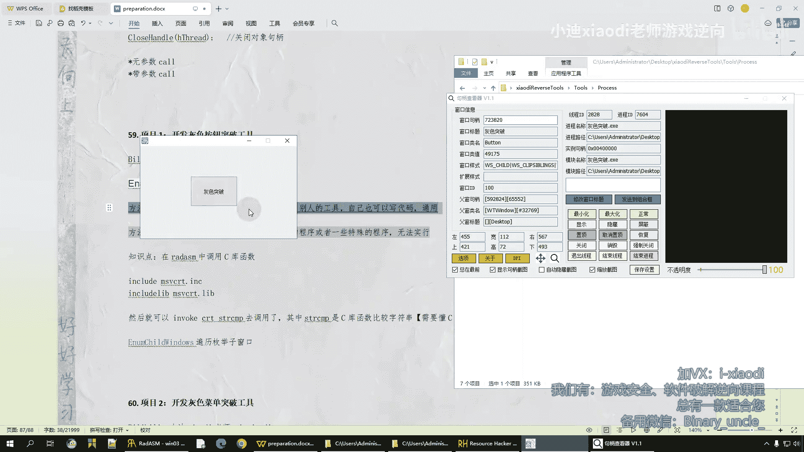

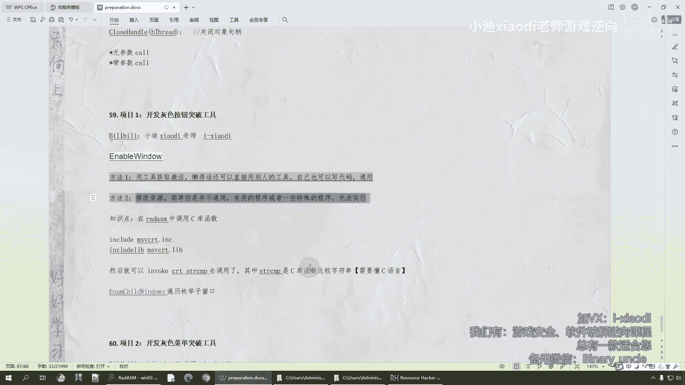

这个突破过程整体比较简单，常见方法有两种。第一种方法是用工具去获取激活，如果比较懒，可以直接用别人的工具；如果想真正学到本事，就可以自己写代码。第一种方法非常通用。第二种方法是修改资源，它也非常简单，但并不通用，有壳的程序或者一些特殊程序没有办法使用这种方法。接下来我们先看第一种方法，也就是用工具去激活灰色按钮。


## 🧰 小白软件破解反汇编逆向工程师2023最新：项目1：用工具激活灰色按钮


上一节我们认识了灰色按钮的共性，本节中我们来看看第一种方法：用工具激活。工具包中有一个“窗口信息查看探测神器”，运行这个工具后，把它的放大镜拖到目标按钮上，再点击“恢复”，就可以尝试激活灰色按钮。这个操作比较直观，适合先理解现象，再进入代码实现。


下面是使用窗口信息查看探测神器的操作步骤。


1. 运行“窗口信息查看探测神器”。
2. 把工具中的放大镜拖到“关闭”按钮上。
3. 点击“恢复”，观察灰色按钮是否变为可点击状态。


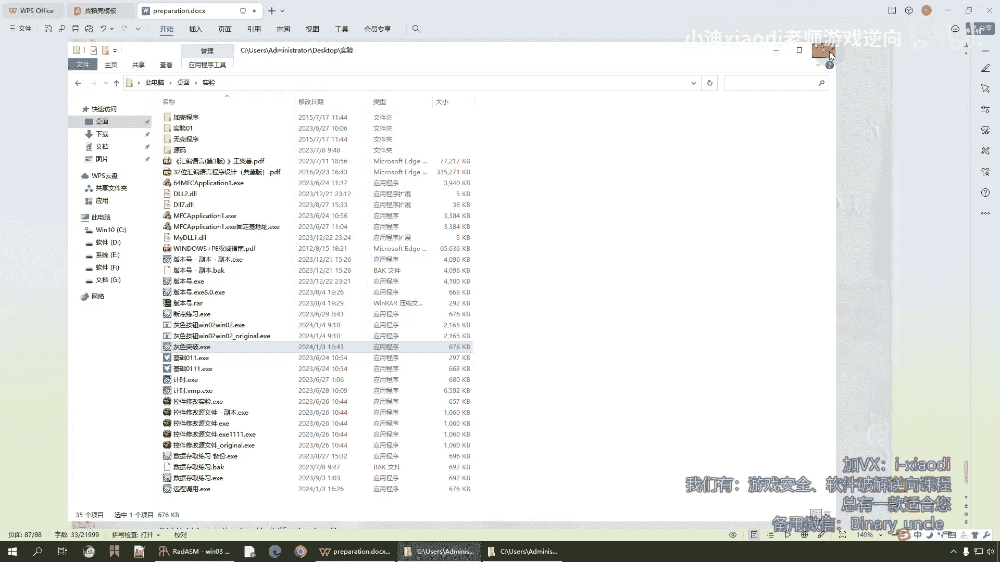

操作第一个程序时，把放大镜拖到“关闭”按钮上，点击“恢复”，可以看到灰色按钮变为可点击状态。接着看第二个程序，把放大镜拖到“灰色突破”相关按钮上，再点击“恢复”，也可以看到按钮变为可点击状态。用工具去处理灰色按钮比较简单，也比较通用。不过如果想真正掌握原理，还是需要自己写代码实现。


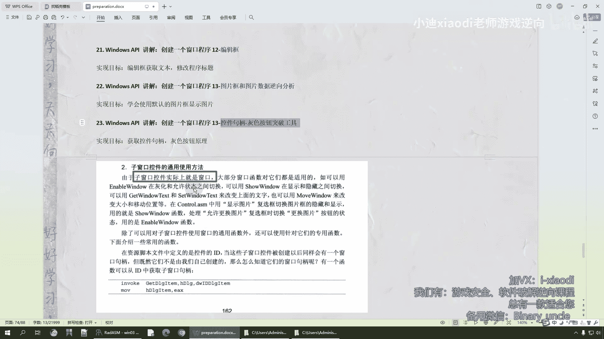

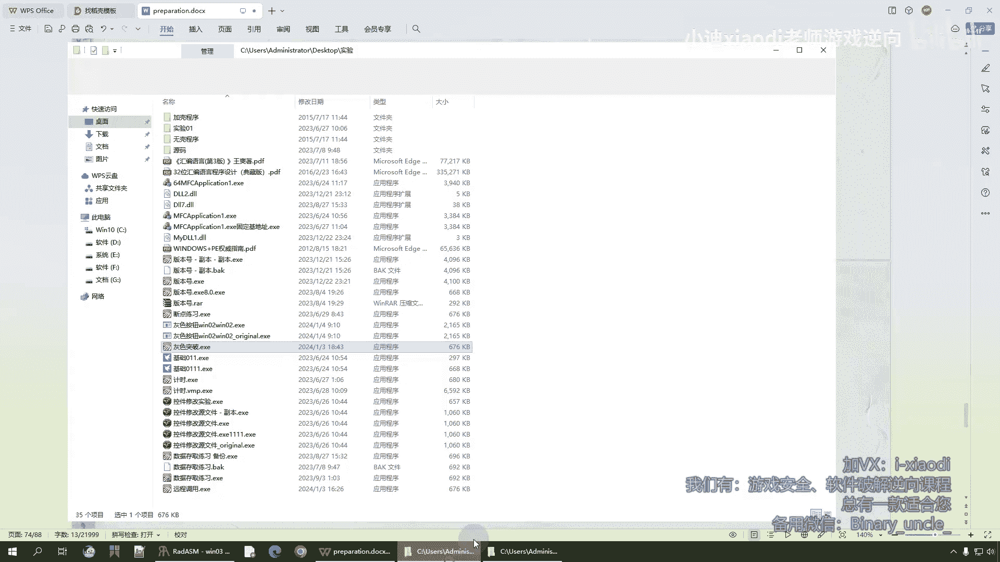

## 🧱 小白软件破解反汇编逆向工程师2023最新：项目1：修改资源突破灰色按钮


上一节我们使用了现成工具，本节中我们来看看第二种方法：修改资源。修改资源使用 Resource Hacker 这类工具，操作简单，但并不通用。我们把程序直接拖进 Resource Hacker，找到对应界面资源，然后修改按钮属性，就可以尝试去掉灰色状态。


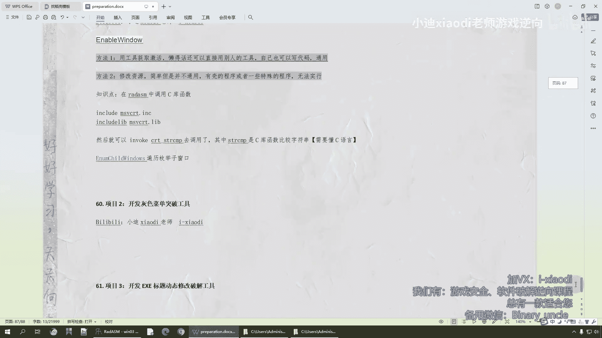

下面是使用 Resource Hacker 修改第一个程序资源的基本步骤。


1. 用 Resource Hacker 打开第一个程序。
2. 找到 `win02 dialog` 这个界面资源，点击查看界面。
3. 观察“关闭”按钮，它明显是灰色的，而“打开”按钮可以点击。
4. 对比两个按钮的属性，发现“打开”按钮属性比较正常。
5. 查看“关闭”按钮属性，发现其中有 `WS_DISABLED`，也就是禁用属性。
6. 删除 `WS_DISABLED`，然后编译并保存。
7. 运行修改后的程序，观察“关闭”按钮是否变为可点击。


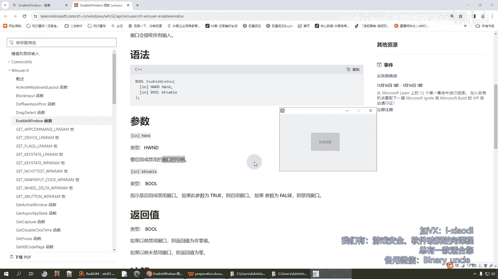

运行原来的 `original` 程序时，关闭按钮仍然是灰色；运行修改后的程序时，可以看到“关闭”按钮可以点击了。这就是修改资源的方法。接着看第二个程序“灰色突破”，这个程序就不通用。因为在该程序的 `dialog` 资源里找不到对应界面。它是一个易语言程序，明明运行时有界面，也有“灰色突破”按钮，但在资源里找不到这个界面，在其他地方也找不到。因此修改资源并不通用，只限于个别程序，所以我更推荐大家使用第一种方法，也就是用工具激活，或者进一步自己写代码实现激活。


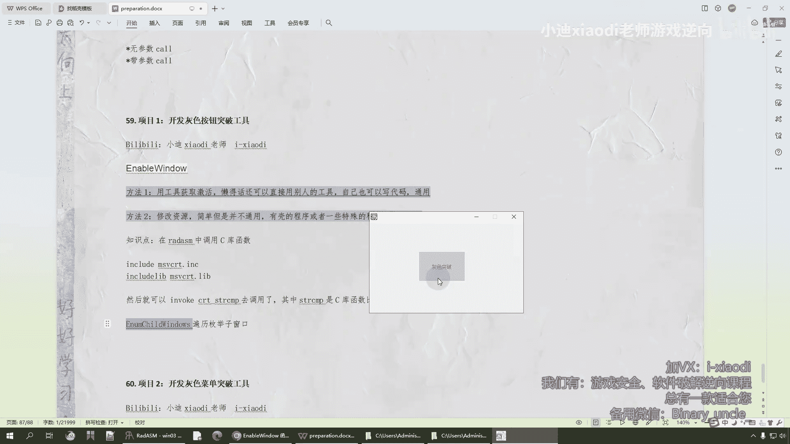

## ⚙️ 小白软件破解反汇编逆向工程师2023最新：项目1：按钮也是窗口与 EnableWindow 原理


上一节我们看到了修改资源的局限，本节中我们来看看灰色按钮突破的核心原理。之前在第23集里讲到过控件句柄和灰色按钮突破，当时提到子窗口控件实际上就是窗口，按钮本身就是窗口。打开目标程序后，整体界面是一个窗口，而按钮虽然小，但四四方方，也是一个窗口。按钮这个小窗口归属于整体大窗口，所以大窗口可以理解为父窗口，小窗口就是子窗口。


窗口的禁用和启用使用的是 `EnableWindow` 函数。直接调用这个函数，就可以启用或禁用指定窗口或控件。对于按钮来说，我们需要的参数就是按钮的句柄；第二个参数如果为 `TRUE`，就启用按钮，从而突破灰色；如果为 `FALSE`，按钮就会变为灰色禁用状态。核心概念可以用下面的代码表示。


```c
EnableWindow(hWndButton, TRUE);   // 启用按钮，突破灰色状态
EnableWindow(hWndButton, FALSE);  // 禁用按钮，使按钮变灰
```


因此，今天的关键点就是获取按钮的句柄。只要拿到目标按钮的句柄，再调用 `EnableWindow`，就可以把灰色按钮强制改成可点击状态。接下来我们看看如何通过遍历子窗口来找到按钮句柄。


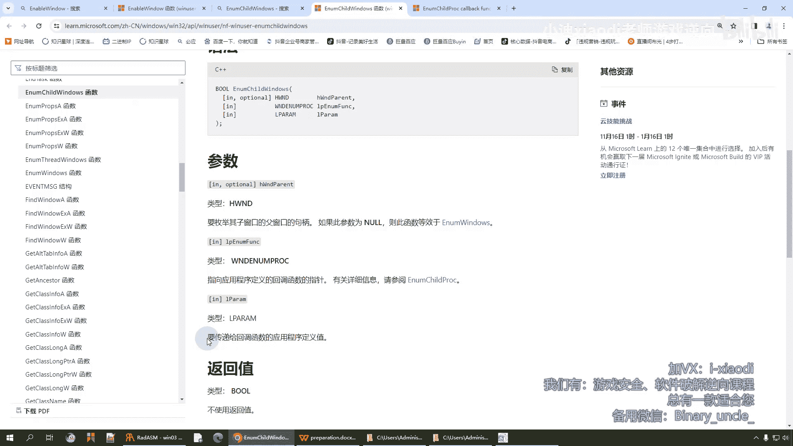

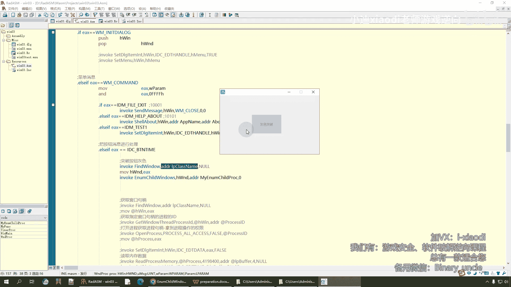

## 🔎 小白软件破解反汇编逆向工程师2023最新：项目1：用 EnumChildWindows 遍历子窗口


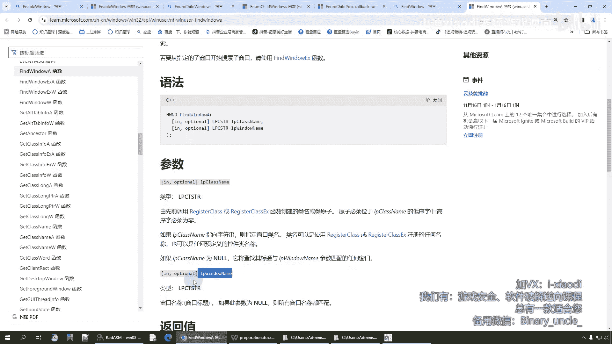

上一节我们明确了 `EnableWindow` 的作用，本节中我们来看看如何找到按钮句柄。获取按钮句柄可以使用 `EnumChildWindows` 函数来遍历子窗口。所谓子窗口，就是归属于父窗口的小窗口。整体程序界面是父窗口，按钮是子窗口，父窗口和子窗口的关系可以理解为父亲和儿子的关系，这样理解比较直接。


`EnumChildWindows` 的作用是：把父窗口句柄传递给子窗口枚举过程，再通过应用程序定义的回调函数，枚举属于指定父窗口的所有子窗口。这个函数会自动遍历，一直持续到最后一个子窗口被枚举完成，不需要我们手动控制循环。也就是说，父窗口下面有几个子控件、子窗口，它就会枚举多少个，直到全部跑完。


下面是 `EnumChildWindows` 主要参数的含义说明。


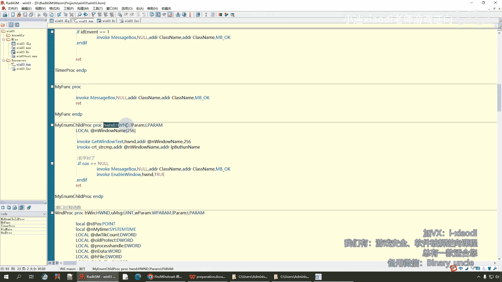

- 第一个参数是父窗口句柄，这个句柄可以通过 `FindWindow` 获取。
- 第二个参数是指向应用程序定义的回调函数的指针，需要我们自己写一个回调函数。
- 第三个参数是传递给回调函数的应用程序定义值，默认填 `0` 即可。


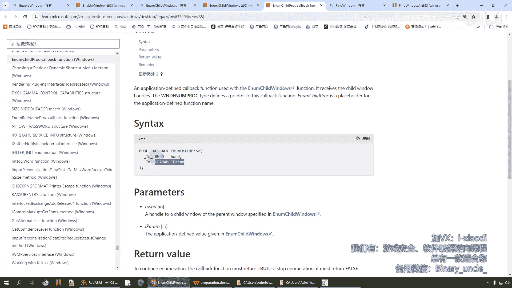

回调函数的原型大致有两个参数，写好后把函数指针传给 `EnumChildWindows` 即可。进入回调函数后，程序会自动枚举并遍历窗口。遍历过程中，我们需要比较当前子窗口是不是目标按钮，比较方式可以通过窗口文本判断。这里就需要使用 `GetWindowText` 获取窗口文本，再通过文本比较确认是否是我们想要操作的控件。


## 🪟 小白软件破解反汇编逆向工程师2023最新：项目1：用 FindWindow 获取父窗口句柄


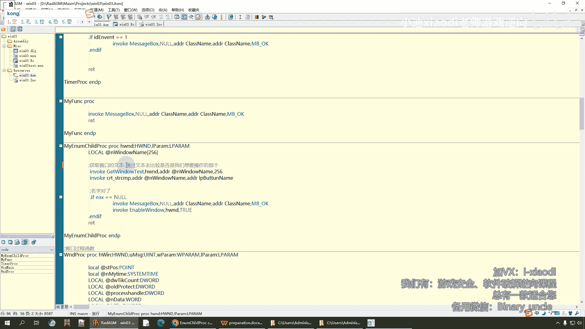

上一节我们介绍了子窗口遍历，本节中我们来看看父窗口句柄怎么获取。对于目标程序来说，它可能没有窗口标题，没有标题时可以使用类名。`FindWindow` 有两个参数，第一个参数是类名，第二个参数是窗口名；如果程序没有窗口名，就把类名填进去。类名可以通过窗口信息查看工具获取，例如拖动工具查看窗口类名，可以看到类名是 `WTWindow`。这个类名已经提前定义好，所以这里没有疑问。


获取父窗口句柄的代码可以写成下面这样。


```c
HWND hParent = FindWindow(L"WTWindow", NULL);
```


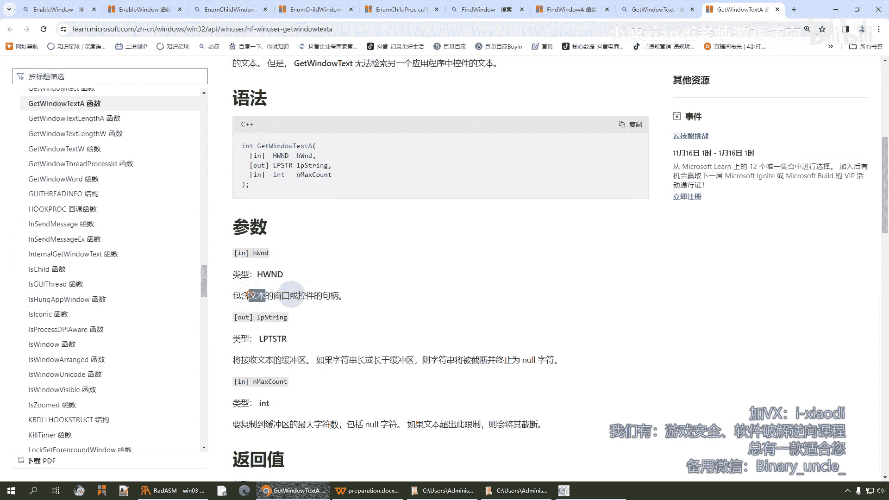

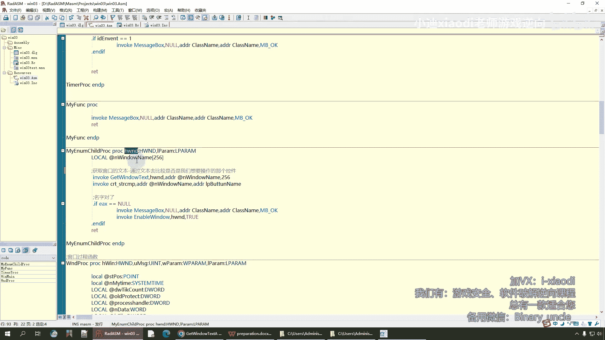

调用 `FindWindow` 后，就获取到了目标程序父窗口的句柄。可以把它保存到一个全局变量 `HWND` 中，这个全局变量就是父窗口句柄。父窗口句柄有了之后，直接把它作为 `EnumChildWindows` 的第一个参数传进去即可。第二个参数传入回调函数地址，也就是类似 `ADDR 回调函数` 的写法。回调函数可以直接写，开发环境会自动补上结束标记；它有两个参数，把这两个参数直接照着函数原型抄过来即可。进入回调函数后，它就会自动枚举并遍历窗口。


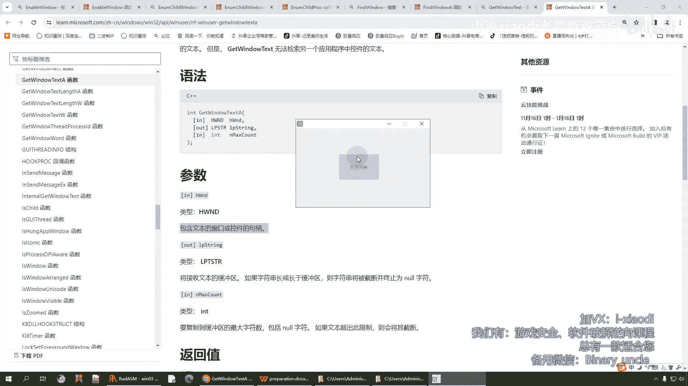

## 🧠 小白软件破解反汇编逆向工程师2023最新：项目1：获取窗口文本并用 strcmp 比较


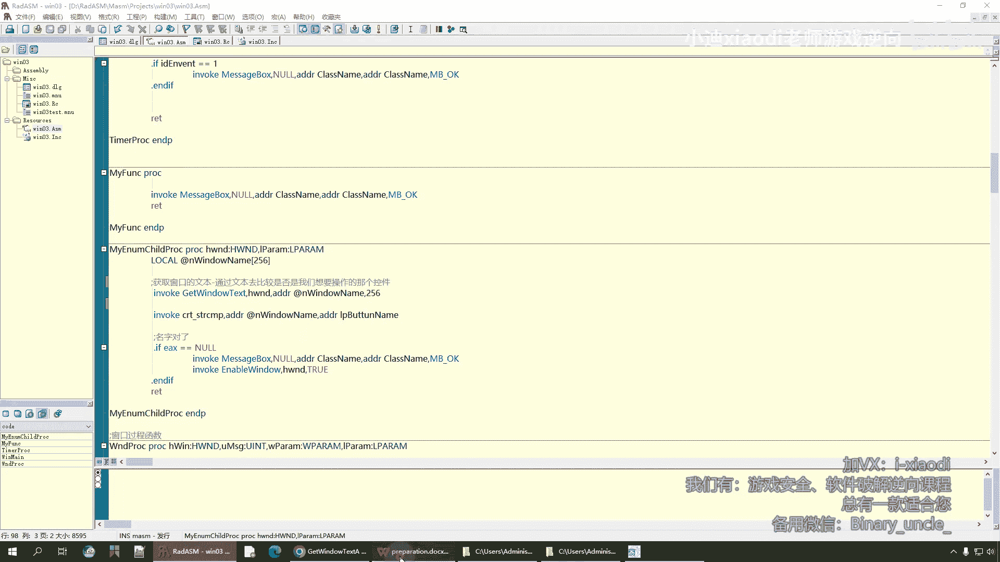

上一节我们拿到了父窗口句柄，本节中我们来看看如何在回调函数里判断目标按钮。遍历窗口时需要做比较，比如这是第一个窗口，那是第二个窗口，只有比较之后才能知道哪一个按钮是目标按钮。比较可以通过文本完成，因此需要调用 `GetWindowText` 获取窗口文本，再通过文本比较判断是否是我们想要操作的控件。


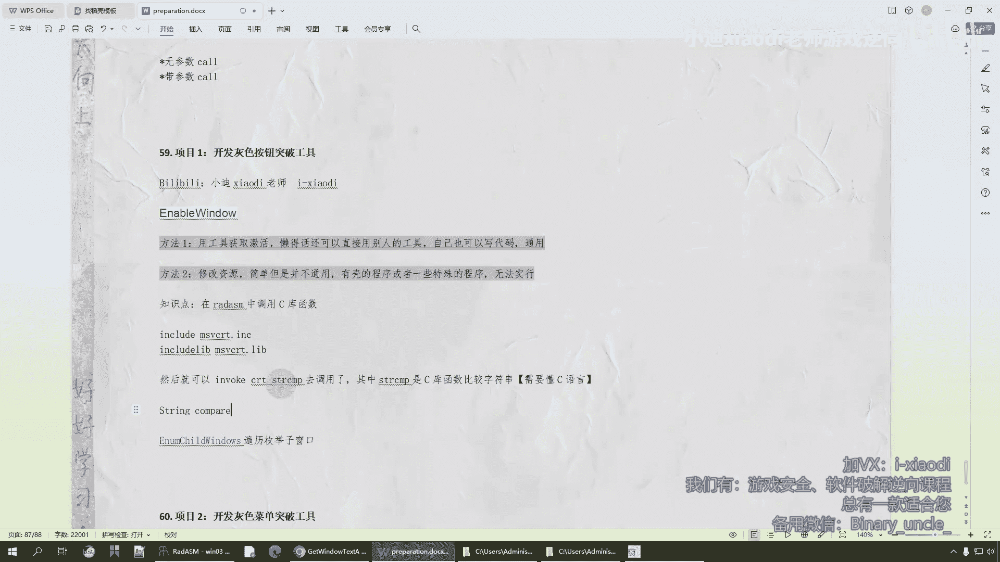

`GetWindowText` 的第一个参数是文本窗口或控件的句柄，遍历时直接把当前 `hWnd` 传进去即可。第二个参数是输出缓冲区，用来保存读出来的文本。比如通过第一个句柄读出来一个标题，通过第二个句柄读出来“灰色突破”，那么“灰色突破”这个文本就需要保存下来。保存文本可以开一个长度为 256 的字符数组，原文说 256 个字节肯定够用。第三个参数是最大字符数，填 `256` 即可。这样就能获取到标题文本，或者说窗口文本。


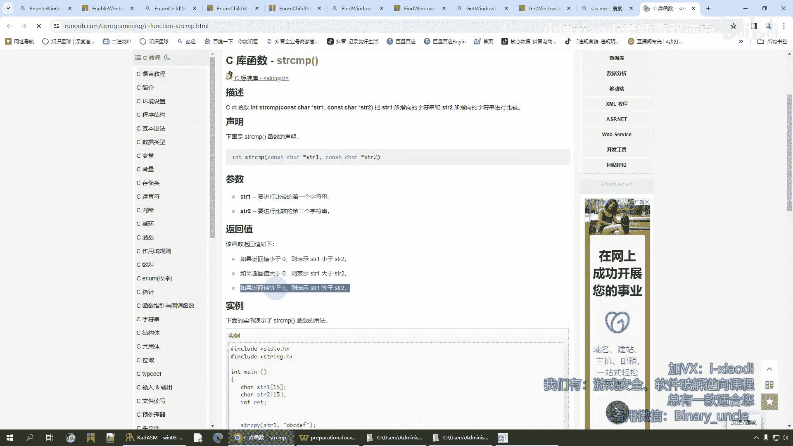

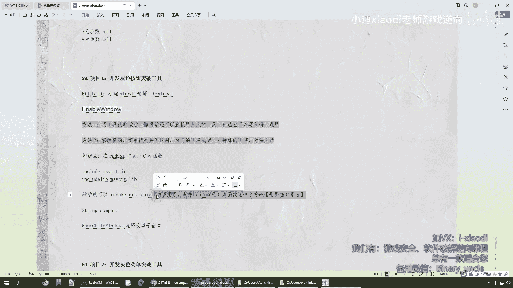

获取文本后需要做字符串比较，C 语言中可以使用 `strcmp`。`strcmp` 用来比较两个字符串，给它两个参数，参数一是第一个字符串，参数二是第二个字符串，然后比较这两个字符串。如果返回值等于 `0`，说明两个字符串相等。如果对 C 语言感兴趣，可以了解它是 C 库函数；想系统学习 C 语言，可以在网易云课堂搜索“C语言辅助”，会自动出现“C语言零基础入门游戏辅助开发实践”，这是小迪老师的课程。在哔哩哔哩下单是 98/99，能便宜 100 元，想要学习可以抓紧下单，课程讲得非常系统，这里不多展开，大家可以自己去看。


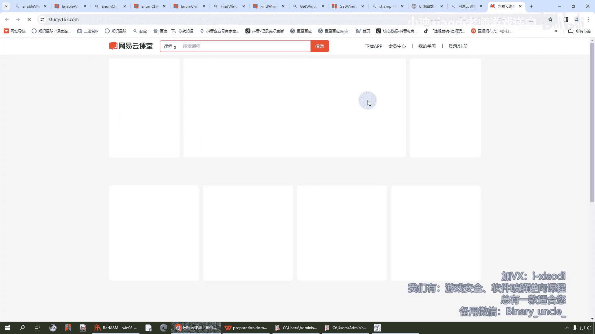

比较字符串时需要注意，C 库函数没有办法直接被汇编调用。需要先包含两个东西，也就是把相关 `include` 内容复制到代码的 `include` 区域，粘贴进去。调用时要在前面加上 `CRT_`，再加上 C 函数名才可以调用。如果对 C 语言完全陌生，可以按两步处理：第一步先包含相关库，第二步使用 `invoke CRT_strcmp` 做字符串比较。核心调用可以写成下面这样。


```asm
; 先包含 C 库相关声明，原文要求包含两个东西
include msvcrt.inc
includelib msvcrt.lib

; 调用时加上 CRT_ 前缀
invoke CRT_strcmp, addr windowName, addr szButtonText
```


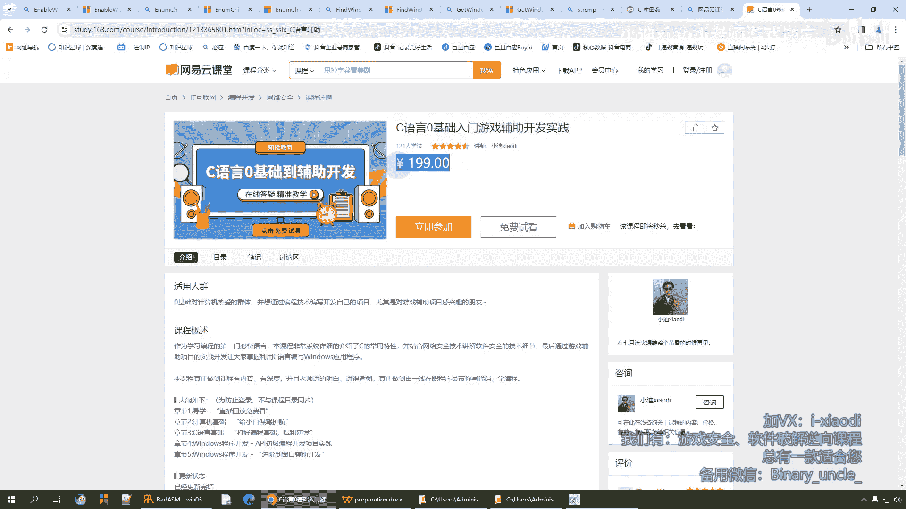

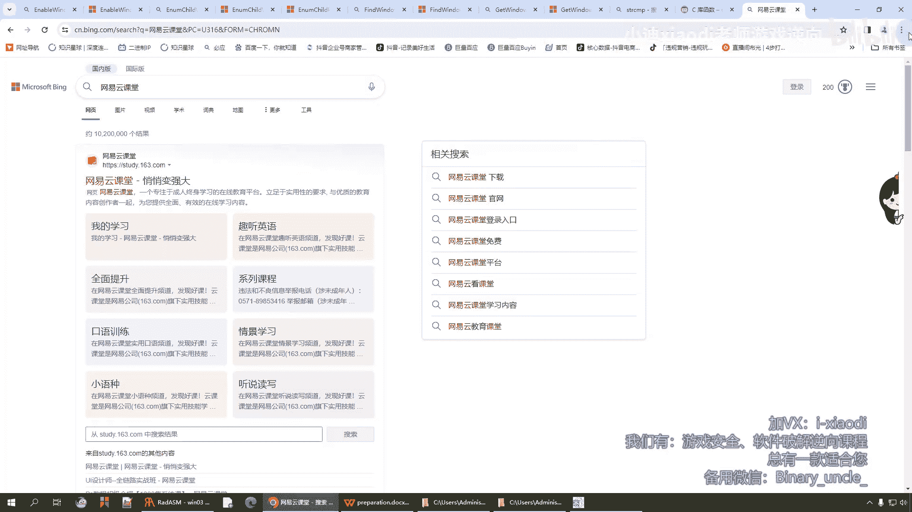

在比较时，第一个字符串是窗口名字，第二个字符串是按钮名字，比如“灰色突破”。需要提前定义“灰色突破”这个字符串，定义好之后就可以直接比较。伪代码逻辑可以写成下面这样。


```c
WCHAR windowName[256] = {0};
GetWindowTextW(hWnd, windowName, 256);

if (CRT_strcmp(windowName, L"灰色突破") == 0)
{
    MessageBoxW(NULL, L"找到了", L"提示", MB_OK);
    EnableWindow(hWnd, TRUE);
}
```


如果 `strcmp` 返回 `0`，说明两个字符串相等，也就说明找到了“灰色突破”按钮。找到之后可以先弹一个简单弹窗，说明已经找到目标，然后直接调用 `EnableWindow`。此时传入的 `HWND` 就是遍历到的控件句柄，把第二个参数改成 `TRUE`，按钮就被启用了。下面进行运行测试。


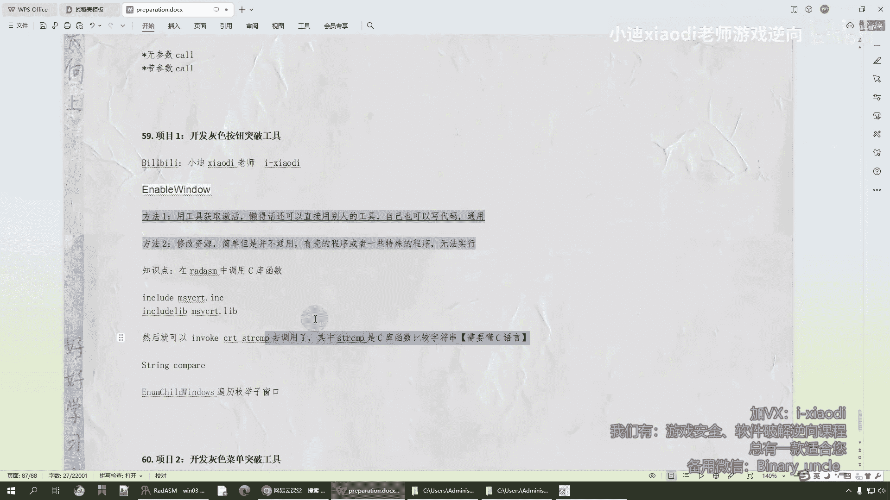

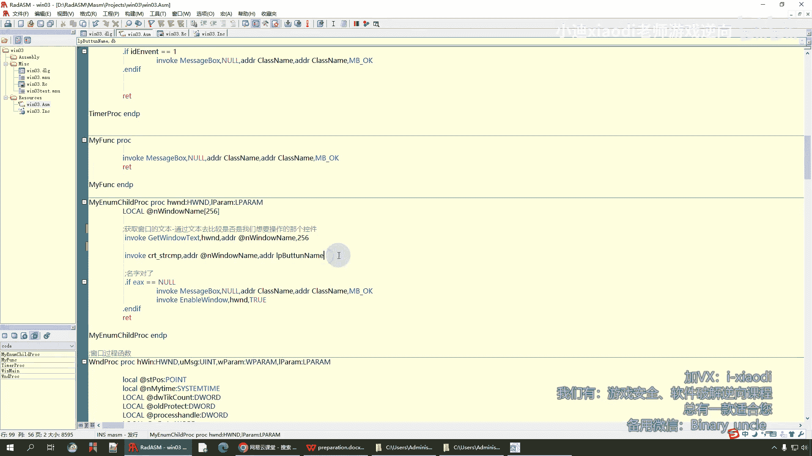

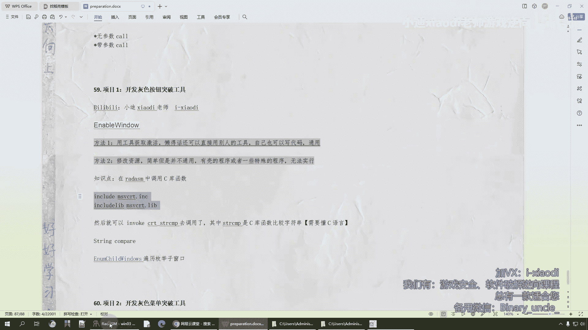

## ✅ 小白软件破解反汇编逆向工程师2023最新：项目1：运行验证通用突破效果


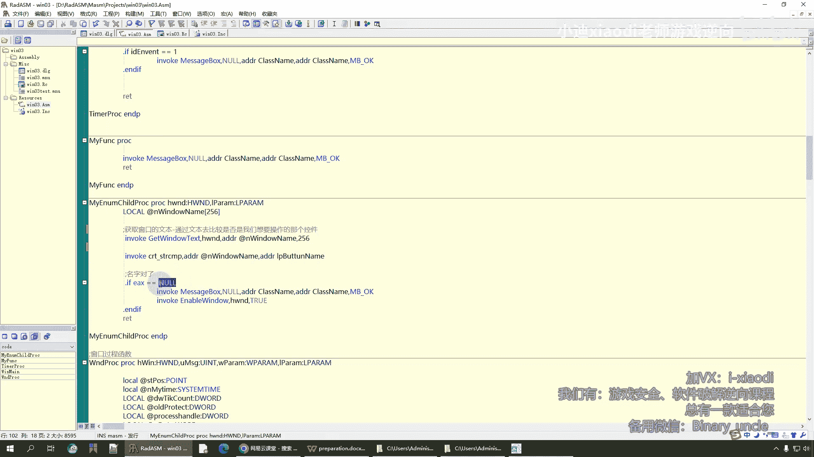

上一节我们完成了文本比较和按钮启用逻辑，本节中我们来看看实际运行效果。运行程序后点击触发按钮，会先弹出提示窗口，弹窗结束后可以看到灰色按钮已经被突破，按钮变为可点击状态。这个流程就是通用性较强的灰色按钮突破方式。这里用到的内容比较多，下面做一个总结。


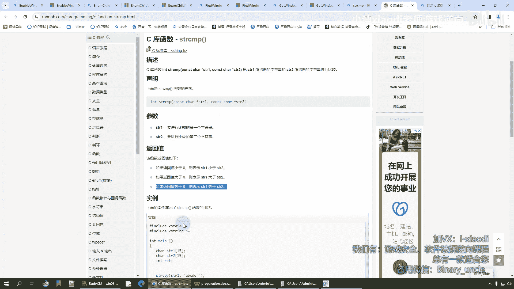

下面是本节课实现通用突破时涉及的关键点列表。


- 使用 `EnumChildWindows` 枚举子窗口。
- 使用 `FindWindow` 获取父窗口句柄。
- 使用 `GetWindowText` 获取窗口或控件文本。
- 使用 `strcmp` 比较文本，返回 `0` 表示字符串相等。
- 使用 `EnableWindow(hWnd, TRUE)` 启用按钮，突破灰色状态。
- 调用 C 库函数前需要包含相关库，并在函数名前加 `CRT_`。


`strcmp` 是 C 语言函数，如果要在汇编代码中使用，必须先包含对应库，然后在 C 语言函数库名前加上 `CRT_` 才可以调用。这个细节很关键，也是很多初学者容易卡住的地方。通过这个项目也能看出，C 语言在逆向和辅助开发中还是非常有必要的。


## 📚 小白软件破解反汇编逆向工程师2023最新：项目1：课程延伸与学习建议


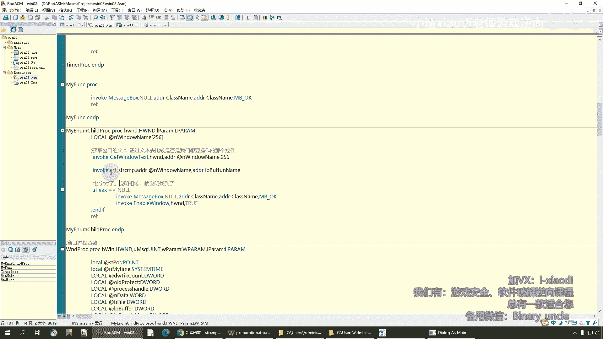


上一节我们总结了技术实现，本节中我们来看看课程延伸内容。如果对 C 语言感兴趣，欢迎在网易云课堂搜索“C语言辅助”，找到“C语言零基础入门游戏辅助开发”。如果想以 98 元优惠 100 元下单，可以私聊我的微信，哔哩哔哩工房也有链接。课程目录包括导学、软件逆向破解、计算机基础、C 语言从零开始、零基础编程、Windows API 编程、QQ 群发器等内容，也会涉及一些比较高级的内容。


下面是课程目录中涉及的主要学习方向，方便了解后续内容。


- 导学与软件逆向破解。
- 计算机基础。
- C 语言从零开始，零基础编程。
- Windows API 编程。
- QQ 群发器等内容。
- 游戏辅助开发。
- 按钮、编辑框、复选框、单选框、组合框等窗口界面开发，也会使用 C 语言开发。
- 天龙八部相关辅助开发。
- 网络游戏辅助开发。


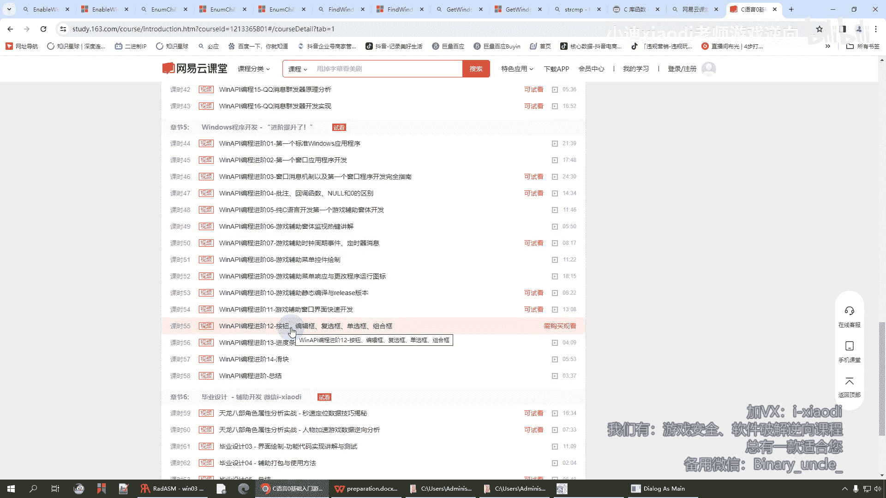

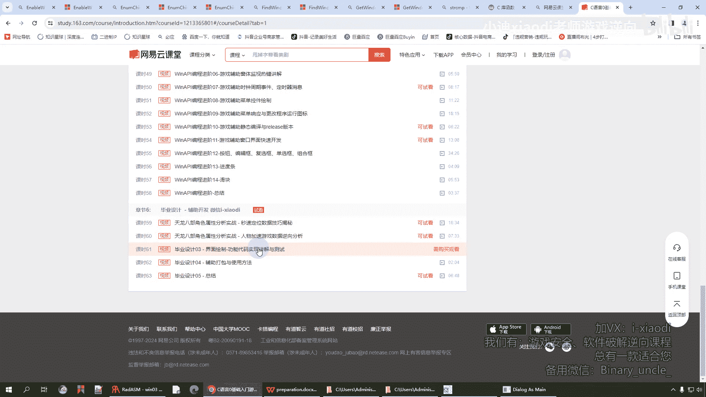

今天的内容是灰色按钮突破工具，这是第一个项目，使用频率比较高，所以会发现 C 语言还是非常有必要的。本节课中我们一起学习了灰色按钮的识别、两种突破方法、`EnableWindow` 原理、`EnumChildWindows` 遍历子窗口、`FindWindow` 获取父窗口句柄、`GetWindowText` 获取文本、`strcmp` 比较文本，以及最终启用按钮的完整流程。下集再见。

