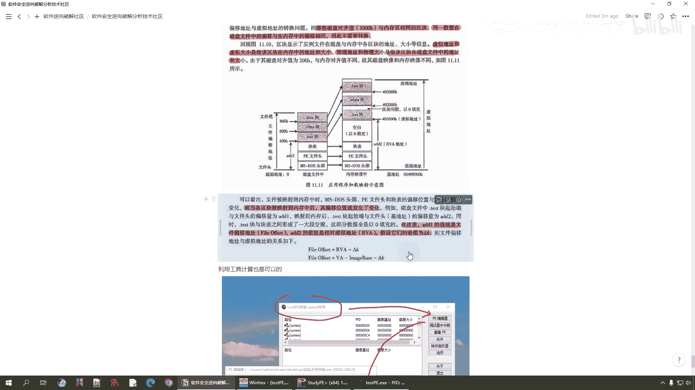
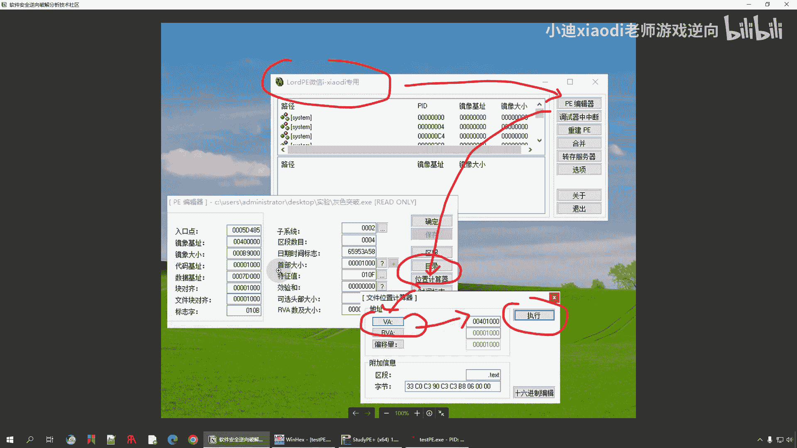
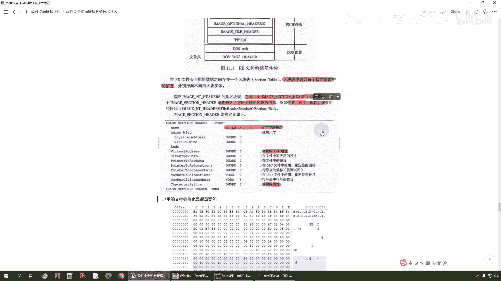

# 软件安全逆向工程：第六章 第七课：加壳脱壳基础：PE文件格式4：PE区块表

## 🧭 概述

在本节课中，我们将要学习PE文件格式中的区块表。这是软件安全逆向工程中非常关键的基础内容，因为无论是手动分析还是脱壳，都离不开对PE结构的理解。前面我们已经讲过DOS头、PE文件头这些部分，而紧跟着PE文件头的就是区块表。区块表相当于一个“目录”，记录了每个区块的名称、位置、大小、属性等信息。理解了它，你就能看懂一个程序在磁盘上和内存中是如何布局的，也能通过区块的名字快速判断程序是否加壳。本节我们会从区块表的结构讲起，再介绍常见的区块、区块合并、对齐值，最后看一看文件偏移与虚拟地址之间的转换。整体来说内容不难，只要跟着思路走，初学者也能完全看懂。

## 📋 一、回顾PE文件的整体框架

首先，我们来回顾一下PE文件的整体框架结构。前面已经学习过DOS头、PE文件头这些内容，整个PE文件从起始位置开始，依次排列着DOS头、PE文件头、区块表，然后是各个区块的实际数据。如果你有一张完整的PE结构图，会看到区块表紧跟在PE文件头之后。

区块表有一个非常明显的特征：一个区块对应一个表项。怎么理解这件事呢？我们把每个区块想象成一个人，比如说这里有1、2、3、4一共四个人，每个人都会有一些身份信息，比如姓名、身份证号、住址等等。这些身份信息不能随便乱放，而是要集中记录在一张表格里。区块表就是存放这些信息的表格。这张表格是有结构的，里面的每个成员都有固定的含义，比如位置、长度、属性等。所以，区块表并不是一堆杂乱的数据，而是一组有规则的结构体。

## 🧱 二、区块表的结构

接下来，我们来看区块表的具体结构。在Windows的PE文件中，每个区块都对应一个`IMAGE_SECTION_HEADER`结构体。这个结构体就是区块表里的一项，大小通常是40字节。它的定义可以用下面的代码表示：

```c
typedef struct _IMAGE_SECTION_HEADER {
    BYTE    Name[8];                 // 区块名称，8字节
    union {
        DWORD   PhysicalAddress;      // 物理地址
        DWORD   VirtualSize;          // 虚拟大小
    } Misc;
    DWORD   VirtualAddress;           // 区块的RVA地址
    DWORD   SizeOfRawData;            // 磁盘上数据的大小
    DWORD   PointerToRawData;         // 文件中的偏移
    DWORD   PointerToRelocations;     // 重定位表偏移
    DWORD   PointerToLinenumbers;     // 行号表偏移
    WORD    NumberOfRelocations;      // 重定位项数量
    WORD    NumberOfLinenumbers;      // 行号项数量
    DWORD   Characteristics;          // 区块属性
} IMAGE_SECTION_HEADER, *PIMAGE_SECTION_HEADER;
```

当然，这里我们不需要把每个字段都背下来，只需要关注几个重要的成员。

### 🏷️ 1. 区块名称（Name）

第一个成员是`Name`，也就是区块的名称。比如我们用WinHex打开实验程序，在偏移`140`的位置可以看到一个`.text`，这就是区块名。区块名一共占8个字节，那8个字节就是你看到的字符串，比如`.text`后面不足8字节的部分会用0补齐。

### 🔗 2. 联合体成员（Union）

第二个成员是一个`union`类型。如果你学过C/C++，会知道`union`虽然有两个成员，但它只占用其中一个成员的大小。这里它占用了4个字节。这4个字节在运行时表示虚拟大小，在文件加载时表示物理地址。简单说，它就是一个共用体，实际只占一份空间。

### 📍 3. 区块的RVA地址（VirtualAddress）

再往下这个成员是`VirtualAddress`，表示区块的RVA地址。RVA是相对虚拟地址，简单理解就是区块加载到内存后，相对于模块基址的偏移。比如`.text`段是代码段，它的RVA是`00001000`。怎么验证呢？你可以用StudyPE工具拖入程序，点击“区段”查看，能看到`1000`。也可以用x32dbg打开程序，点击“符号”标签，双击`.text`模块，能看到地址`1000`。或者点击“内存布局”，同样能看到`1000`。而`.data`数据段的RVA一般是`2000`，这些都可以通过工具查看。

### 📏 4. 尺寸与文件偏移

在`VirtualAddress`后面的4个字节是尺寸，也就是区块在磁盘上占用的实际大小。再往后4个字节是区块在文件中的偏移，也就是`PointerToRawData`。这个偏移表示区块的数据存放在文件中的哪个位置。比如`.text`区块的文件偏移是`00000400`，意思就是`.text`的内容从文件的`0x400`地址开始。你在WinHex里跳到`400`位置，看到`6A 00 18 95 01`这些字节，就是`.text`区段的实际内容。所以，通过这个字段，你可以直接找到区块在文件中的位置。

### 🎭 5. 区块属性（Characteristics）

最后一个比较重要的成员是区块属性`Characteristics`，但也不用死记硬背。区块属性表示该区块的权限和类型。比如我们回过头来看，`.data`开始的位置其实就是上一个区块的结束，而紧跟着的4个字节就是上一个区块的属性。例如`60000020`，这个值是通过或运算得到的，它表示该块包含可执行代码，并且是可读可执行的，所以它是一个代码段。具体含义以后用到时再查表就行，平时只要知道有这个东西即可。

每一个区块都是这样查看的：上一个区块的结尾就是下一个区块的开始，区块之间紧密排列，非常清晰。

## 🔍 三、如何查看区块表信息

了解了结构，我们来看一下怎么实际操作。用WinHex查看实验程序时，在偏移`140`处能看到`.text`，这也就是区块名的位置。用StudyPE查看时，拖入程序后点击“区段”按钮，就能看到每个区块的RVA、大小、偏移等详细信息。用x32dbg则可以通过“内存布局”或“符号”窗口来查看。总之，这些工具都可以让我们直观地看到区块表的内容。

我们需要知道，区块表的作用就是记录每个区块的基础信息，包括名称、虚拟地址、文件偏移、属性等。有了这些信息，PE加载器才能把正确的内容加载到正确的位置。

## 📚 四、常见的区块与肉眼查壳

接下来，我们介绍常见的区块。为什么要了解这些？因为我们经常要查壳，判断一个程序是否加壳。查壳可以用DIE工具，也可以用Exeinfo PE（也就是常说的ESEin）。一般我们先用Exeinfo PE，如果它识别不出来，再用DIE辅助。

当我们用Exeinfo PE打开一个程序时，会看到它的入口区段。比如打开一个实验程序，点击某个位置就能查看它的区块信息。常见的区块有这么几个：

- `.text`：代码段，存放可执行代码。
- `.data`：数据段，存放已初始化的全局变量和静态变量。
- `.rdata`：只读数据段，存放只读常量。
- `.idata`：输入表，存放导入函数的名称和地址。
- `.rsrc`：资源段，存放图标、对话框、字符串等资源。

除了这些，还有一些不常见的区块，比如`.reloc`（重定位表）、`.tls`（线程局部存储）等。这些简单了解一下就行，平时遇到时知道它们是什么就可以了。

我们经常靠区块名称来查壳。如果你查壳时发现程序里的区块名字都在上面这个常见列表里，那它基本上就是没有加壳的。反之，如果你发现有一些区块的名字没有出现在这个列表里，比如出现了一些奇怪的数字或者乱码，那就要当心了，这个程序很可能加了壳。咱们来验证一个例子：打开一个加了VMP壳的程序，你会发现`.text`、`.data`、`.rdata`这些常见区块都有，但同时还出现了像`123`这样的诡异区段名。这种名字没有出现在常见区块列表里，所以这三个区段都是可疑区段，大概率就是有壳的。然后再用工具一查，果然是VMP（VMProtect）壳。所以，记住常见区块，就可以用肉眼初步判断有没有壳，这是基础技能之一。

## 🧩 五、区块合并

还有一个概念叫区块合并，简单了解一下就行。什么是区块合并？就是两个区块如果属性相似或一致，它们可以合并成一个区块。比如，有的程序你会发现它只有一个`.text`区块，没有`.data`、`.rdata`这些。那怎么回事？可能就是把只读数据合并到了`.text`里。假如你看到一个程序没有`.rdata`，它有可能就是把只读数据合并到别的区块里了。

这种情况并不常见，但如果你碰见了，要知道可能是做了合并操作。合并区块是为了减少区块数量或优化内存占用，但并不会影响程序的正常运行。所以，看到程序区块很少，不要觉得奇怪，它可能就是把相似属性的区块合在了一起。

## 📐 六、区块的对齐值

下面我们来看区块的对齐值。这个概念也很重要，但理解起来不难。什么是内存对齐？你可以想象家里的门框和门：门是长方形的，门框也是长方形的，两者才能严丝合缝。如果门框是长方形的，门却是三角形的，那就合不上，还会造成内存浪费，也不安全。内存对齐能让程序更健壮、更美观，也更好寻址。


在32位程序中，内存页是按4KB排列的，也就是`0x1000`字节。在64位程序中，内存页是按8KB排列的，也就是`0x2000`字节。所以，32位PE文件的区块内存对齐值一般为`0x1000`，每个区块是从`0x1000`的倍数位置开始的。比如某个`.text`区块在磁盘中的偏移是`0x400`，但加载到内存中之后，它的起始地址就变成了`0x1000`。为什么？因为内存中的区块必须按页对齐，所以原本紧凑排列的数据在内存中会拉开距离。

我们来看一个例子：在磁盘上，`.text`段的内容起始于`0x400`，但是当程序加载到内存后，它的内容起始于`0x401000`？不，更准确地说，RVA变成了`0x1000`。你对比一下磁盘和内存的地址，就会发现差距正好是对齐后产生的空白。这些空白区域通常用零填充。所以，程序在内存里的布局和磁盘上的布局并不是完全一样的，这就是对齐带来的效果。

对于64位程序来说，一般对齐值是`0x2000`。比如你看到一个64位程序，它的区块RVA依次是`0x1000`、`0x3000`、`0x5000`，相差正好是`0x2000`。这说明它按`0x2000`对齐了。简单了解一下这个对齐的概念即可。

## 🔄 七、文件偏移与虚拟地址转换

最后，我们来看文件偏移与虚拟地址的转换。这部分简单了解就行，不做硬性要求。有的同学一看到计算公式就紧张，其实不用，听一听就能懂。


有些PE文件为了减小体积，磁盘对齐值可能不是`0x1000`，而是`0x200`。这时，文件偏移和虚拟地址之间就不再是简单的对应关系，而是需要换算。我们来看一张图：左边是程序在磁盘上的样子，文件头从位置0开始，各个区块紧密排列，文件偏移从0到文件尾。右边是程序加载到内存后的样子，由于对齐机制，原本在磁盘上偏移`0x400`的内容，到了内存中可能变成了RVA `0x1000`。同时，PE头、DOS头这些还是保留在原来的位置，而区块之间则多出了一些以零填充的空白间隙。

一般情况下，磁盘对齐值和内存对齐值相同，所以文件偏移和RVA之间是固定差值的，这个差值可以用下面的公式表示：

```text
文件偏移 = RVA - VirtualAddress + PointerToRawData
```

或者，如果区块的`VirtualAddress`和`PointerToRawData`的差值恒定，那么也可以写成：



```text
文件偏移 = RVA - ΔK
```

其中`ΔK = VirtualAddress - PointerToRawData`。在大多数简单程序中，这个差值可能是0，因为两者一一对应。比如我们在WinHex里看到`0x140`位置是`.text`，在x32dbg的内存布局中也同样能看到`0x40140`这样的地址（RVA `0x140`）。所以，一般情况下直接对应就行。

如果遇到有差异的情况，可以用工具计算。在这里推荐一个工具：`loPE`。使用方法很简单：先打开PE编辑器，加载程序后点击“位置计算器”，输入VA（虚拟地址）或RVA，点击执行，它就能自动计算出对应的文件偏移量、区块信息等。这个工具不需要硬性掌握，但用起来很方便，还可以显示入口点等信息，感兴趣的同学可以下载玩玩。

## 🎯 总结



本节课中，我们一起学习了PE文件格式中的区块表。我们首先回顾了PE文件的整体框架，然后详细介绍了区块表的结构，包括名称、联合体、RVA地址、文件偏移和属性等重要成员。接着，我们通过实际工具演示了如何查看区块表的信息。随后，我们认识了常见的区块名称，并学习了如何利用它们肉眼初步判断程序是否加壳。之后，我们了解了区块合并的概念，明白了为什么有些程序区块很少。我们还介绍了区块对齐值，知道了内存和磁盘中地址不同的原因。最后，我们简单了解了文件偏移与虚拟地址之间的转换方法，以及辅助计算工具的使用。



总的来说，本节最重要的知识点是常见区块的名称和特征。因为在实际查壳过程中，我们经常需要根据区块名来判断程序有没有加壳。只要把这些常见区块记在脑子里，看到奇怪的区段名时，就能立刻提高警惕。至于其他的结构细节和地址转换公式，暂时用不到也没关系，但心里要有个印象。后续课程中，我们还会深入接触更多与PE文件相关的概念，打好这个基础，后面的学习就会更顺利。我们下期再见。
