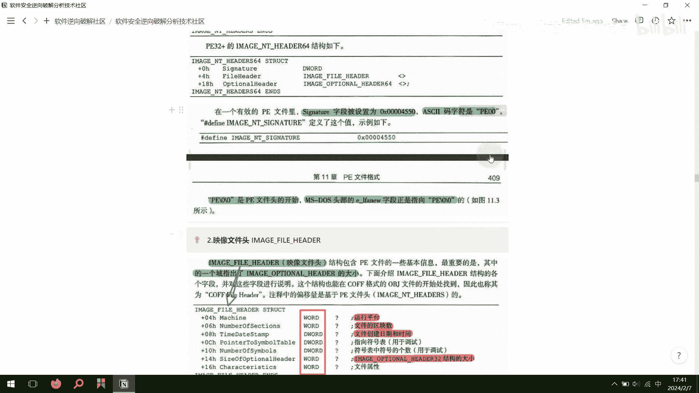
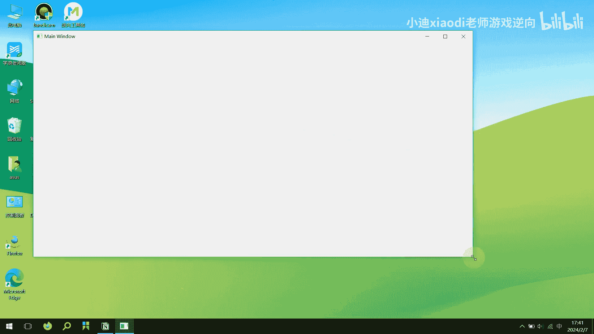
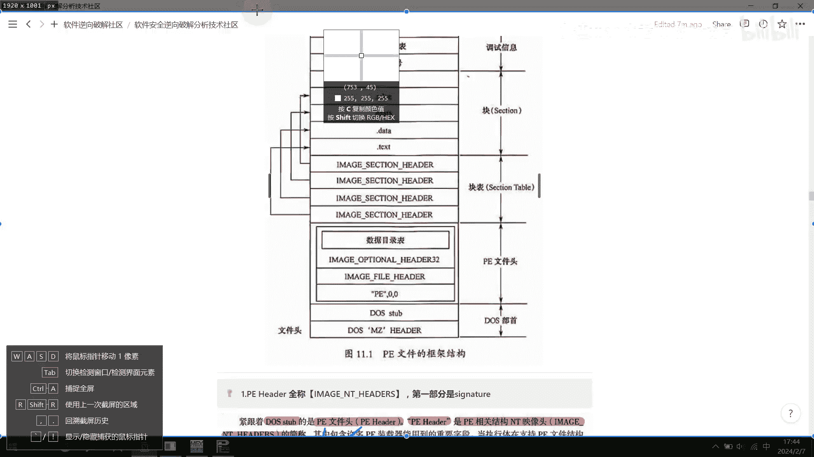
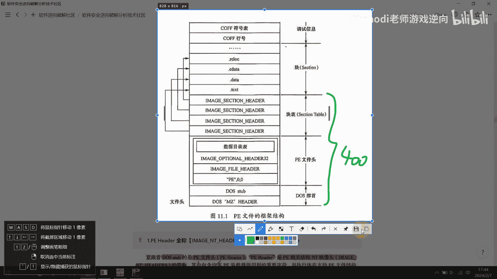
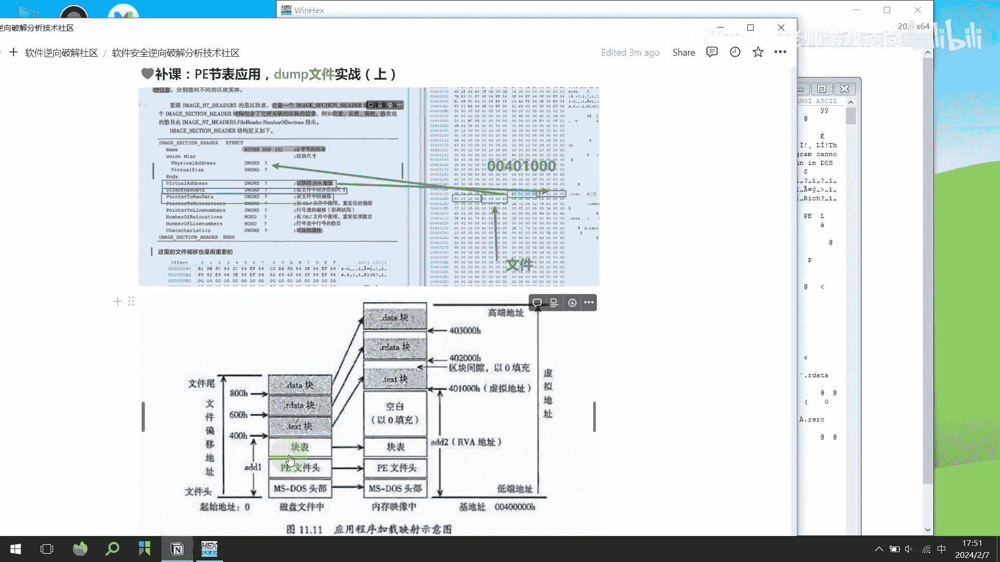
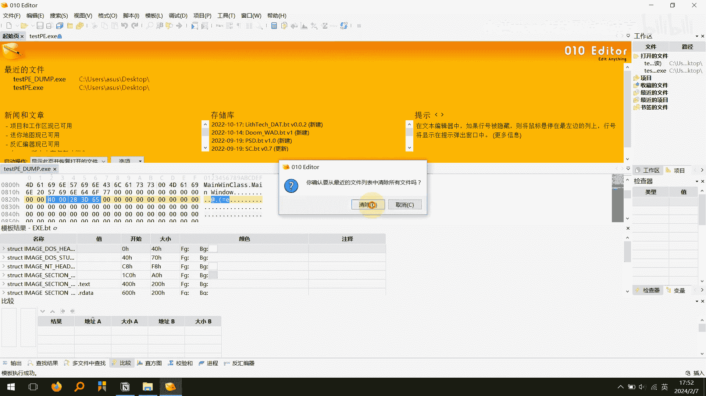
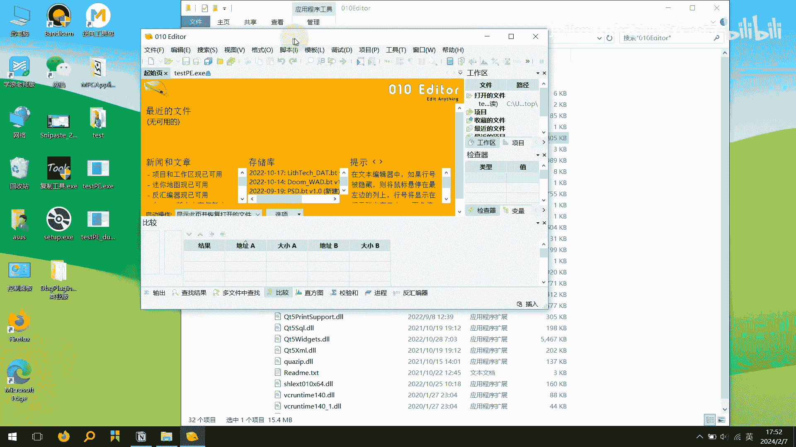
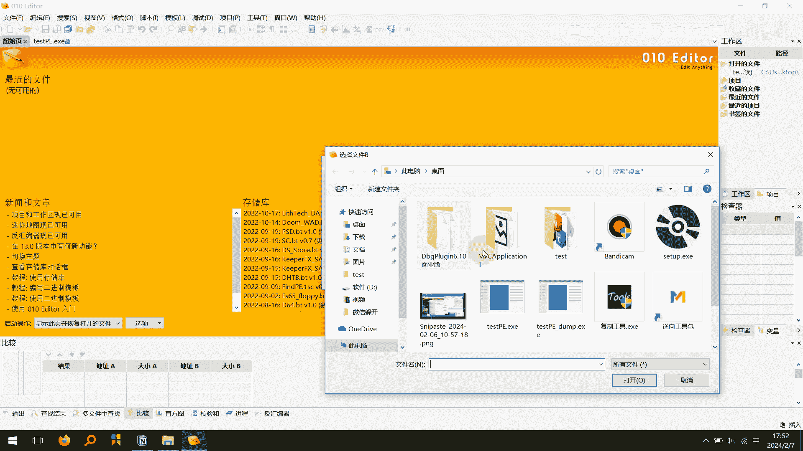
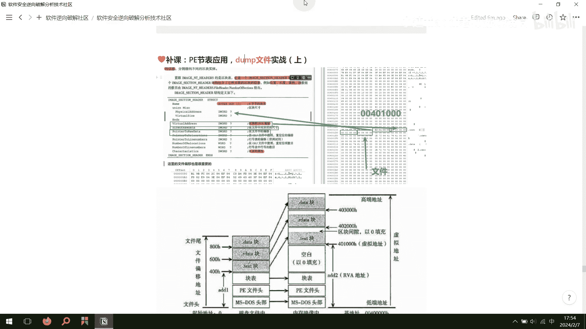

## 🧭 小白软件安全逆向破解分析2024最新：1：dump文件与内存映射基础

在本节课中我们将要学习PE节表应用与dump文件实战的基础内容，对应软件安全逆向破解分析技术社区的第三次补课。这个主题对脱壳非常重要，尤其是刚开始接触脱壳的同学，需要先把dump文件这个基础环节理解清楚。

很多同学在网上看脱壳视频时，经常看到教程要找到OEP，然后执行dump，但一些视频并没有把脱壳原理讲明白。本节会一步一步梳理脱壳的整体基础，让初学者知道每一步在做什么，而不是只记按钮和工具。


接下来我们先解决第一个问题：dump文件是什么。脱壳时常见的第一步是找到OEP，然后dump文件，dump文件就是其中一个关键步骤。为了理解dump，先看一张熟悉的图，这张图就是之前讲过的应用程序加载并映射到内存中的结构图。

> 原文用图说明磁盘程序加载到内存后，PE头、DOS头、节表和各节区之间的对应关系。

从上面的图可以理解，磁盘上原本有一个程序，它静态地放在硬盘或磁盘中。程序运行起来后会被加载到内存中，加载过程按照一定结构展开：块表对应块表，PE头对应PE头，MS-DOS头对应DOS头，text节对应text节，data节对应data节，中间可能有一些区块间隙，用零填充。整体就是按照这样的架构展开。

这个过程就是运行程序，也就是把一个静态文件扩展到内存中。那么反过来，是否存在一种操作，可以从内存中把数据原封不动地扒回来？这种反方向过程是存在的，它就叫dump文件。

dump文件的基本含义是：从已经运行起来的内存中，把程序数据取出来，再放回本地文件。别人的程序可能加了壳，但运行起来后数据会展开，dump就是把已经展开的数据按照PE文件结构格式保存回磁盘文件，也可以理解为逆向还原到磁盘文件中。

```text
磁盘文件 --运行加载--> 内存镜像
内存镜像 --dump--> 磁盘文件
```

dump文件有很多工具可以做，但这里先不借助工具，而是手动操作，把原理弄清楚。要把内存中的数据扒出来并保存到本地，必须依赖PE文件结构，所以需要熟悉PE结构的格式。

手动dump是有顺序的，可以先从头部开始，也就是先扒PE文件头。回顾PE文件头时，可选映像头中偏移0x54的位置有一个非常重要的字段，叫SizeOfHeaders。这个字段表示MS-DOS头、PE头和区块表的总大小。

```c
SizeOfHeaders = MS_DOS头 + PE头 + 区块表总大小
```

这个字段很重要，因为它把头部总大小计算出来了。PE头、DOS头和区块表都已经包含在这部分数据中，所以先保存这一整部分信息，再保存节的信息。节的信息来自节表，节表中存放了每个节的大小和位置。

以下是手动dump的两步思路：

1. 第一步保存区块表、PE头和DOS头这一整段头部信息。
2. 第二步根据节表保存每个节的数据信息。





上一节我们理清了dump的方向和两步思路，本节中我们来看看实验环境和PE头字段的具体位置。

## 📌 小白软件安全逆向破解分析2024最新：2：PE头字段与SizeOfHeaders

上一节介绍了dump文件的基本概念和手动dump的两步思路，本节中我们来看看实验程序、内存查看工具以及PE头中SizeOfHeaders字段的定位方法。

实验程序是test PE，先把它运行起来。查看内存可以使用WinHex，关闭无关窗口后，点击打开RAM，RAM就是内存。然后选中进程testPE.exe，展开后点击确定，就能看到运行中的内存，例如从00400000开始的地址区域。

接下来找偏移0x54处的字段。比较熟悉的是加0x18的标志字，这里可以看到PE头。PE头中能看到0D01050C、0B01、050C等内容，其中050C是链接器版本号，05是主版本号，0C是次版本号，0x18处是标志字。如果不熟悉，可以把文件拖到StudyPE中查看PE头，对照050C、05、0C、18等位置。

继续看0x58附近是checksum，总大小字段是四个字节，值为00000400，也就是总大小0x400。这个总大小表示MS-DOS头、PE头和区块表加起来一共0x400字节，所以拷贝0x400个字节即可。



```text
可选映像头偏移 0x54 处的字段 = SizeOfHeaders
本实验 SizeOfHeaders = 0x00000400
需要拷贝头部字节数 = 0x400
```



上一节定位了SizeOfHeaders并确认头部总大小为0x400，本节中我们来看看如何把这个头部拷贝到新文件里。

## 🧪 小白软件安全逆向破解分析2024最新：3：手动拷贝PE头

上一节确认了PE头部总大小是0x400字节，本节中我们来看看在WinHex中复制这0x400字节并保存成dump文件的第一步操作。

以下是拷贝PE头的操作步骤：

1. 从内存第一个字节开始选中，向下查到0x400字节，鼠标滑轮移动到3F0到400的位置。
2. 按Ctrl+C复制这0x400字节。
3. 弹出提示时点击确定，不需要管其他选项。
4. 新建一个文件，大小使用默认4096，点击确定。
5. 在新文件第一个字节处按Ctrl+V粘贴，再点击确定。
6. 按Ctrl+S保存文件，命名并保存为dump.exe。

这样就把头部0x400字节内容保存下来了，第一步完成。保存后可以点击放大继续查看，并把窗口拉长，方便后续操作。接下来要保存节表信息，因为区块表、PE头和DOS头已经保存完，下面要保存每个节的数据。

上一节完成了PE头的拷贝和保存，本节中我们来看看节表结构以及如何按节表把每个节的数据拷贝到dump文件。

## 🧱 小白软件安全逆向破解分析2024最新：4：按节表拷贝各节数据

上一节完成了头部0x400字节的保存，本节中我们来看看节表结构，并按节表中的RVA、大小和文件偏移把每个节的数据拷贝到dump文件。

原文用截图对照节表字段，目的是让节表结构更清楚。节表结构中首先是8字节块名，后面是物理地址字段，这个物理地址并不重要；再往后四个字节对应节表中的一个字段，然后RVA地址对应另一个字段，对齐后的尺寸表示大小，再往后是文件中的偏移。

```c
struct IMAGE_SECTION_HEADER {
    char  Name[8];           // 8字节块名
    DWORD PhysicalAddress;   // 物理地址，通常不重要
    DWORD VirtualSize;       // 对应字段之一
    DWORD VirtualAddress;    // RVA地址
    DWORD SizeOfRawData;     // 对齐后尺寸/大小
    DWORD PointerToRawData;  // 文件中的偏移
    // 其余字段省略
};
```

例如第一个节的RVA地址是00001000，加载到内存后就是00401000，这正是代码段，比较熟悉。于是从内存00401000位置拷贝0x200字节，也就是00000200字节，到dump文件偏移00000400的位置。为了讲清楚，原文把图复制到下方并向下插入，边看边操作。

以下是四个节区的拷贝思路：

1. 第一个text节：从内存0x401000拷贝0x200字节到dump文件偏移0x400。
2. 第二个节：从内存0x402000拷贝0x200字节到dump文件偏移0x600。
3. 第三个节：从内存0x403000拷贝0x200字节到dump文件偏移0x800。
4. 第四个资源节：程序没有资源数据，所以不拷贝。

具体操作时，先在WinHex中转到地址00401000，选中0x200字节，向下拉到200字节位置，按Ctrl+C复制，再到文件偏移0x400处按Ctrl+V粘贴并确定。第二个节同样处理，从00402000拷贝0x200字节到0x600。第三个节从00403000拷贝0x200字节到0x800。最后一个节块名为8411，物理地址和00404000等字段存在，但没有数据，因此不用拷贝。

这里别忘了查看节区数量，原文中区块数量是0004，也就是四个区块，从名字也能看出是四个节。至此PE头0x400字节拷贝完成，代码段、数据段、只读数据段和资源段也按节表处理完成。

上一节按节表拷贝了各节数据，本节中我们来看看保存dump文件、运行验证以及与原始文件比较差异。

## 💾 小白软件安全逆向破解分析2024最新：5：保存dump文件并验证运行

上一节完成了头部和各节数据的拷贝，本节中我们来看看保存文件、运行dump文件，并比较它与原始程序的差异。



拷贝完成后按Ctrl+S保存，提示是否更新时点击是。这个文件就是从内存中拷贝并还原出来的dump文件。运行这个dump文件可以看到程序能够启动，说明手动dump出来的文件是可以运行的。

比较文件大小会发现，dump文件与原程序大小不完全一样，但这不影响运行。比较文件可以使用Leon Editor，这个工具已经上传到星球。运行Leon Editor后，点击工具，先清空文件列表，再点击比较文件，分别打开两个文件并执行比较。

以下是验证与比较的要点：





1. dump文件可以正常运行。
2. dump文件与原程序大小可能不同，但不影响运行。
3. 使用Leon Editor比较两个文件时会显示差异，例如一处显示8E2或1，另一处显示B04C。
4. 这些差异说明脱壳后的文件与原程序不会完全一样，但程序仍然可以运行。



所以脱壳时，加了壳的程序经过脱壳后，与原程序并不一定完全一致，但只要不影响运行就可以继续后续处理。这也是脱壳中非常重要的基础知识：运行中的程序从中转出来，这个过程就叫dump文件。

上一节完成了手动dump和运行验证，本节中我们来看看真实工具脱壳流程中dump按钮、OEP和输入表修复所处的位置。

## 🛠️ 小白软件安全逆向破解分析2024最新：6：工具脱壳中的dump与后续修复

上一节用手动方式完成了dump文件并验证了运行，本节中我们来看看网上常见脱壳教程里工具dump的流程，以及后续为什么还要修复输入表。

网上一些脱壳视频会先运行一个可能有壳的程序，然后附加进程，或者把程序拖进工具，点击相关按钮。你往往会看到工具中有dump按钮，有时还会要求填入OEP，OEP就是程序的入口点，也就是重新入库的位置，然后执行dump并保存文件。保存后运行，程序通常仍然可以运行。

工具中还会出现import，也就是输入表。接下来需要讲输入表修复，修复输入表后再完成脱壳，整个流程就水到渠成。这类脱壳内容之所以常见、受欢迎，是因为它涉及一整套分析步骤，需要一步一步把概念和操作都搞定。

本节只是dump文件实战的上篇，dump文件本身还有一些容易踩坑的地方，下篇继续说明。临近新年，祝新年快乐，下期再见。



本节课中我们一起学习了dump文件的概念、内存映射关系、SizeOfHeaders字段、手动拷贝PE头、按节表拷贝各节数据、保存并运行dump文件，以及工具脱壳中dump与输入表修复的后续位置。掌握这些基础后，再看脱壳教程中的OEP、dump和import等步骤，会更容易理解每一步的目的和顺序。

