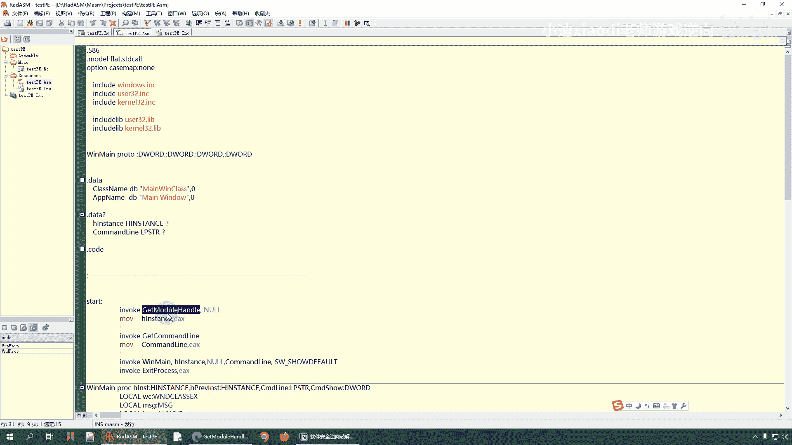
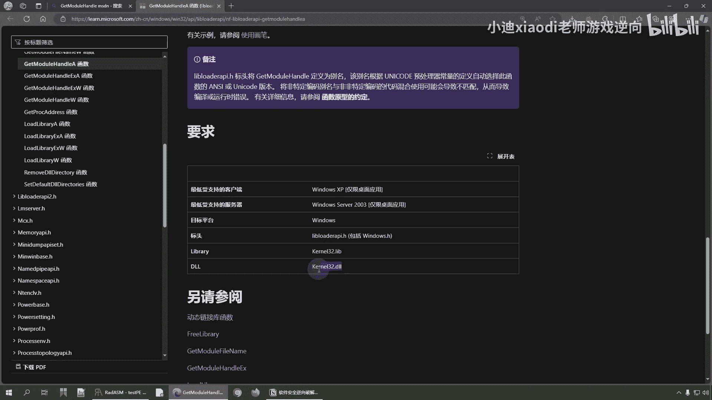
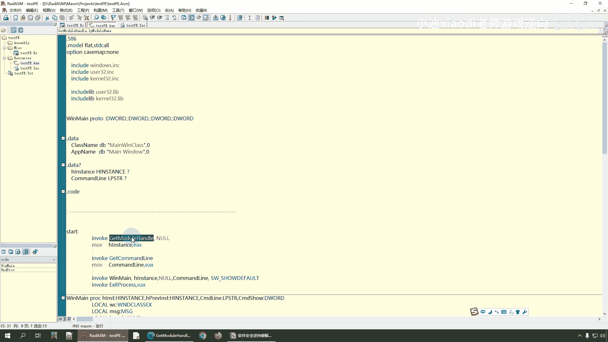
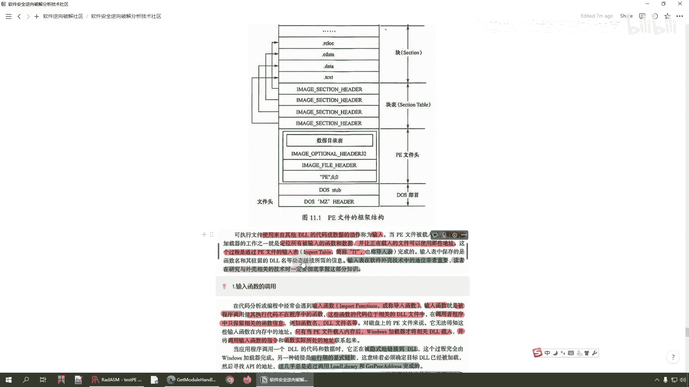
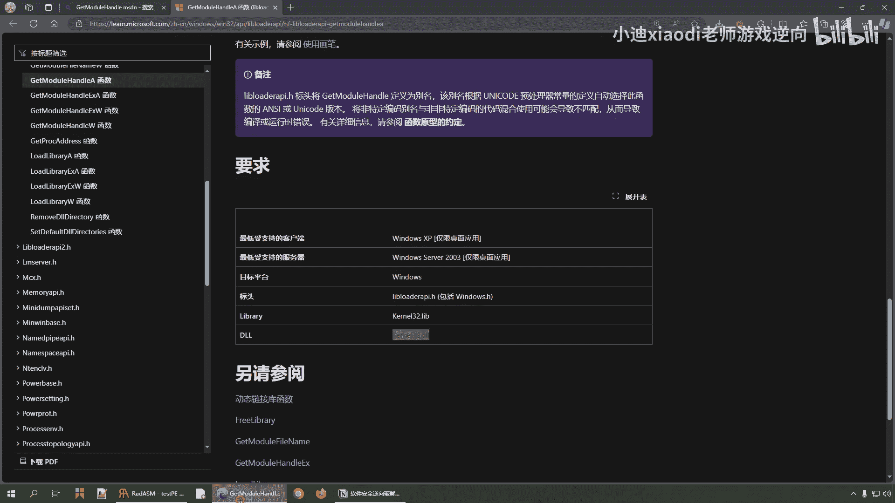
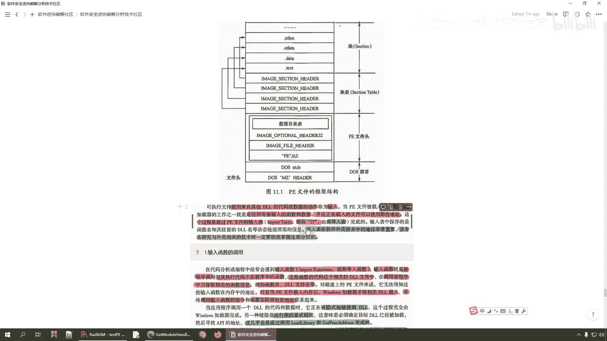

# 🧩 小白软件破解逆向反汇编安全工程师2024最新：第六章第八讲：PE文件结构之输入表


在本节课中我们将要学习PE文件结构中的输入表。课程来自小迪老师的软件安全逆向破解分析技术社区，学习软件安全逆向破解可以找小迪老师。今天是第六章高级进阶逆向分析技术的第八讲，主题是壳技术中的PE文件格式第5部分：输入表。为了把输入表讲清楚，我们会先回顾前几节课的补课内容，再理解“输入”的概念、程序对DLL的依赖、Windows加载器如何定位输入，以及输入表到底保存了什么。对初学者来说，这些内容前后关联很强，先打好框架基础，后面才更容易听懂。


## 🧭 小白软件破解逆向反汇编安全工程师2024最新：第六章第八讲：课程概述与补课回顾


前几节课属于补课内容。补课很重要，它有助于我们了解PE文件的框架结构。PE文件框架结构可以分为DOS部首、PE文件头、节表和节，这些部分共同构成了一个PE文件的基本骨架。只看这张结构图会比较抽象，所以需要结合前面的课程慢慢理解。以下是PE文件框架结构的主要组成部分：


- DOS部首
- PE文件头
- 节表
- 节


上节课我们做了一件非常重要的事情：把运行中的程序内存数据扒出来、抠出来，然后保存到本地。这样做的结果是，运行中的程序数据被我们保存回本地，形成了一个磁盘上的静态文件。这种操作逻辑或者说这种技术手段，叫作Dump文件。Dump文件的知识基础，就是你对整个PE文件框架结构的了解。因此补课是有必要的，前边讲了相关内容，后边才能听懂，整个学习过程是环环相扣的。上一节我们回顾了PE框架和Dump文件，本节中我们来看看输入表和“输入”的概念。


## 🔍 小白软件破解逆向反汇编安全工程师2024最新：第六章第八讲：什么是输入


在讲输入表之前，先不要管输入表具体是什么东西，我们先讲第一个概念：输入。什么是输入？可执行文件使用其他DLL的代码或数据的动作，称为输入。这个定义可以用下面这个公式表示：


\[
输入 = 可执行文件使用其他DLL的代码或数据的动作
\]


也就是说，一个可执行文件在运行过程中，只要用到了别的DLL里的代码或数据，就已经发生了输入动作。对初学者来说，先理解“依赖关系”很关键，因为后面的输入表就是围绕这些依赖关系展开的。下面用自己写程序运行依赖Windows函数的例子来说明。


想一下可执行文件，比如我们自己写一个程序，有没有依赖别人的DLL代码或数据？有。这里的“别人”也指Windows操作系统，Windows操作系统也包含在内。比如我们自己写了一个程序，这个程序运行起来依赖什么东西？我们会发现它实际上需要依赖一些Windows函数。比如程序退出需要依赖ExitProcess，程序一开始获取实例句柄需要调用GetModuleHandle，而GetModuleHandle是一个Windows API函数。相关调用可以用下面的代码简单表示：




```c
ExitProcess(...);          // 程序退出相关依赖
GetModuleHandle(...);      // 获取实例句柄，Windows API
```


可以在网上查一下这个API，点击链接后，在文档最下面会说明kernel32.dll。这里的kernel32.dll是什么意思？意思是这个函数的声明也好、信息也好，是放在kernel32.dll这个DLL里面的。所以我们自己开发程序的时候，依赖了微软的一些DLL代码和数据，有依赖就有输入的动作。由此可知，可执行文件在运行的时候，基本上都会有输入动作。理解了输入概念之后，本节继续看看Windows加载器如何定位这些输入。


## ⚙️ 小白软件破解逆向反汇编安全工程师2024最新：第六章第八讲：Windows加载器与输入表定位


这里再次强调输入。程序运行的时候，Windows加载器的工作之一，就是定位所有被输入的函数和数据，并让正在载入的文件可以使用那些地址。这个过程可以用下面的关系表示：


\[
Windows加载器 \rightarrow 定位输入函数和数据 \rightarrow 让载入文件使用对应地址
\]


因为我用到了这些函数和数据，所以系统要正确定位到它们。比如我想吃苹果，我要知道苹果在哪里，才能吃，才能填饱肚子，这是一个非常简单的道理。整个定位过程，是通过PE的输入表来完成的。PE的输入表英文是Import Table，简称IT，也称导入表。因此看到输入表和导入表，这两个东西是一码事。相关概念可以写成：


\[
PE输入表 = Import Table = IT = 导入表
\]




定位过程完成后，输入表里具体保存了哪些信息，就是接下来要理解的内容。


## 📦 小白软件破解逆向反汇编安全工程师2024最新：第六章第八讲：输入表保存的内容与重要性


输入表中保存了动态链接所需要的一些东西，比如函数名以及驻留的DLL名等。以下是输入表中常见保存的信息：


- 函数名
- 驻留的DLL名
- 动态链接所需的其他信息


比如程序调用GetModuleHandle，输入表会保存这个函数名；GetModuleHandle在kernel32.dll里面，所以输入表又会把kernel32.dll这个DLL名保存进去。一个Windows程序的正常运行，需要依赖Windows，而Windows又依赖这些DLL文件，这些DLL文件以及函数的信息，就保存在输入表里面。输入表保存内容的关系可以简单表示为：




\[
输入表内容 \supseteq \{函数名, 驻留的DLL名, 动态链接所需信息\}
\]




因此，输入表在软件外壳技术以及软件技术中的地位非常重要。如果我们想了解软件技术以及外壳相关的技术知识，就一定要彻底掌握、讲明白输入表这部分内容。掌握这些基础后，再继续往下学习会更顺畅。




## 🧾 小白软件破解逆向反汇编安全工程师2024最新：第六章第八讲：课程总结




本节课中我们一起学习了PE文件结构中的输入表。我们回顾了PE文件框架结构和Dump文件，理解了输入是可执行文件使用其他DLL代码或数据的动作，看到了程序运行对Windows API和DLL的依赖，知道了Windows加载器会定位被输入的函数和数据，并让正在载入的文件使用对应地址，也明确了PE输入表就是导入表，保存函数名、驻留的DLL名等动态链接所需信息，并且在软件外壳技术和软件技术中非常重要。

