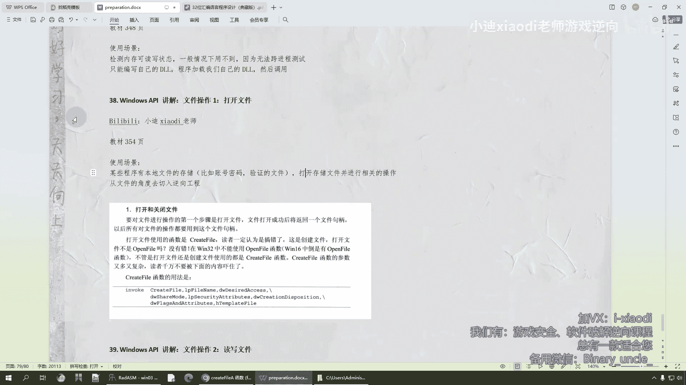

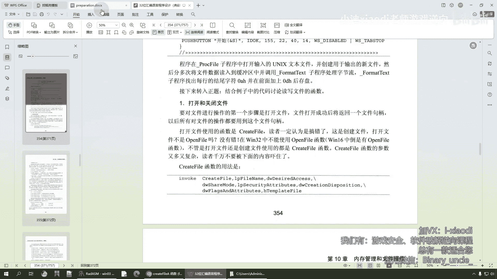

# 🧭 小白软件破解逆向反汇编工程师2023最新：5.38文件操作1：软件/游戏/外挂/打开文件操作文件原理


在本节课中我们将要学习第38课“文件操作一：打开文件”，对应教材第354页。本课由小迪老师讲解，在哔哩哔哩可以搜索到小迪老师的账号。建议先打开教材预习，再看视频；如果教材中有看不明白的地方，再重点看视频对应部分。今天核心目标是把“打开文件”的原理讲清楚，从正向开发的角度切入逆向工程，理解程序打开文件时到底做了什么。


上一段我们说明了本课目标，本节中我们来看看文件操作的使用场景。某些程序会在本地保存文件，例如账号密码验证文件，或者其他数据库文件，这些内容会放在本地。程序通过打开存储文件并进行读取等操作，进一步完成账号登录或其他功能。因此需要了解打开文件的原理，也需要了解程序打开文件的原理。要理解这些原理，可以自己写一个程序，从文件角度切入逆向工程。教材说明，对文件进行操作的第一步就是打开文件。病毒、木马、外挂、电脑微信、其他游戏都一样，要对文件进行操作，第一步就是打开文件。文件打开成功后会返回一个文件句柄，以后所有对文件的操作都需要使用这个文件句柄。


上一段提到文件句柄，本节中我们来看看它和进程句柄的相似之处。调用 `ReadProcessMemory`、`WriteProcessMemory` 或其他进程相关函数时，通常都需要一个进程句柄；得到进程句柄后，才能对进程进行相关操作。对文件进行操作也一样，需要先拿到文件句柄。文件句柄的获取方式是调用打开文件函数。打开文件使用的函数是 `CreateFile`。有人会认为这里搞错了，因为 `CreateFile` 看起来是创建文件，打开文件不是应该用 `OpenFile` 吗？教材说明没有错，在 Win32 中不能使用 `OpenFile` 函数，不管是打开文件还是创建文件，都使用 `CreateFile` 函数，这是微软的规定。今天的主要工作就是了解 `CreateFile` 这个函数如何运转。


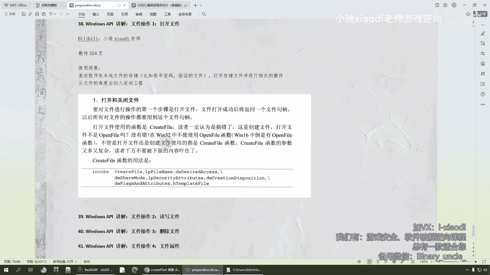

文件操作的核心流程可以用下面的公式表示：


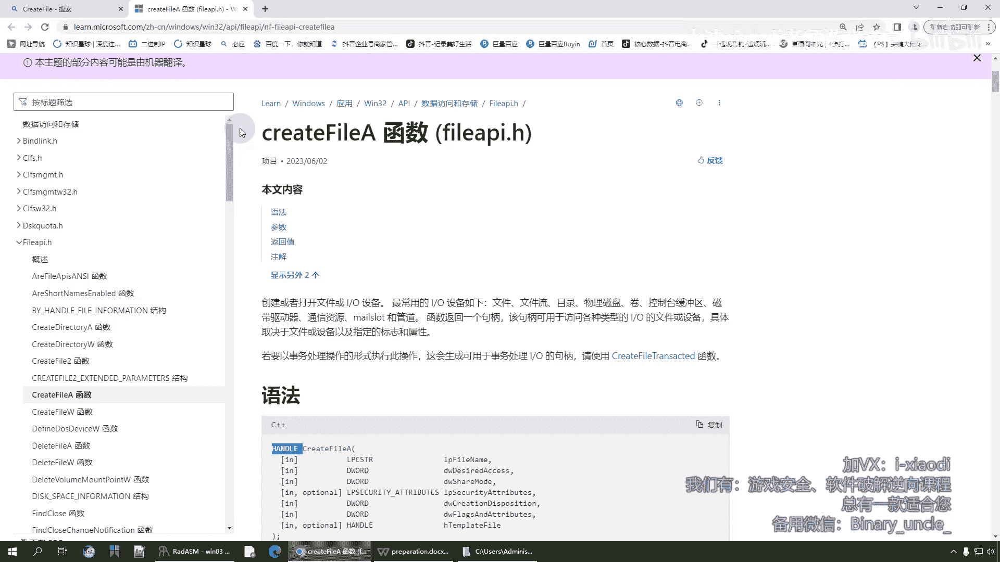

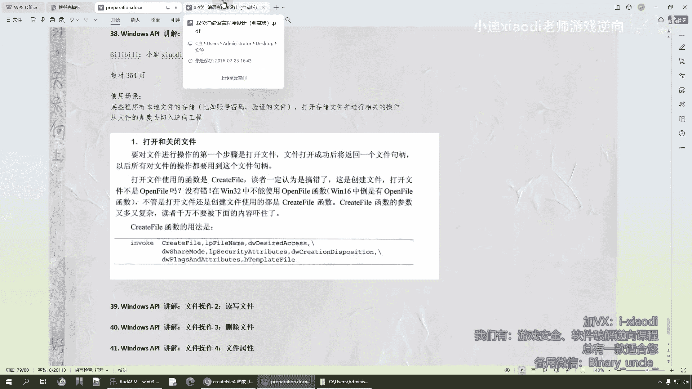

```text
文件操作流程 = 打开文件 → 获得文件句柄 → 读写/操作文件 → CloseHandle 关闭句柄
```


## 🧩 小白软件破解逆向反汇编工程师2023最新：5.38.1：CreateFile 能处理的对象


上一节我们明确了学习目标和使用场景，本节中我们来看看 `CreateFile` 到底能打开哪些对象。打开微软官方文档时，可以直接在 B 站搜索，搜索结果中第一个就是微软官方文档。官方文档说明，`CreateFile` 用于创建或打开文件或 I/O 设备。以下是 `CreateFile` 能够处理的主要对象。


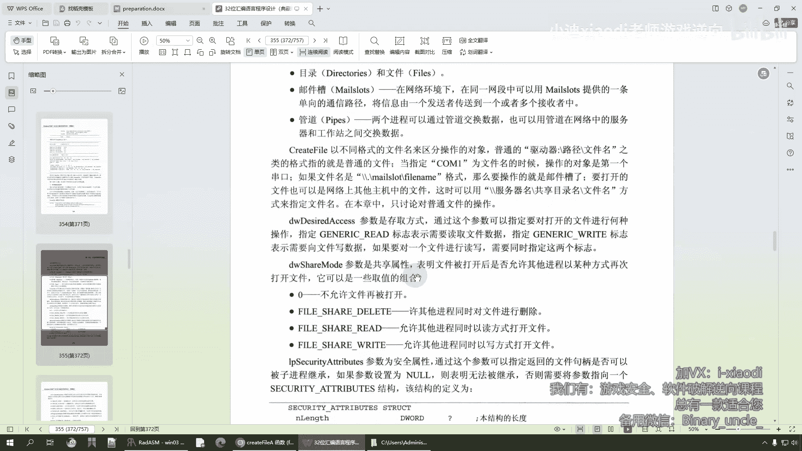

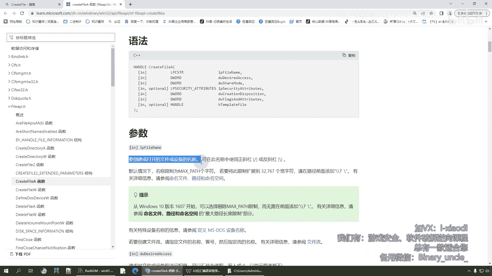

- 文件。
- 文件流。
- 目录。
- 物理磁盘卷。
- 控制台缓冲区。
- 磁带驱动器。
- 通信资源。
- 管道。


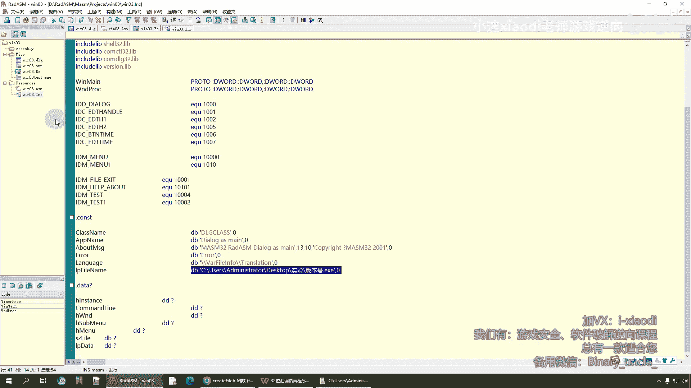

从这些对象可以看出，`CreateFile` 的能力很强，并不只是用来打开普通文件。教材里解释得很清楚：控制台是 Windows 中类似 MS-DOS 方式的界面窗口；通信设备包括串口设备；目录和文件也属于可处理对象。我们使用 Windows 操作系统时，和普通文件打交道最多，所以本课主要操作普通文件。邮件槽也可以使用这个函数，在网络环境下，同一网段中可以通过邮件槽提供一条单向通信路径，把信息从一个发送者传到一个或多个接入者。管道也可以使用这个函数，两个进程可以通过管道交换数据，也可以在网络中的服务器和工作站之间交换数据。这个函数能力很强，今后碰到文件打开、邮件槽、串口通信等情况，都可以下 `CreateFile` 断点。


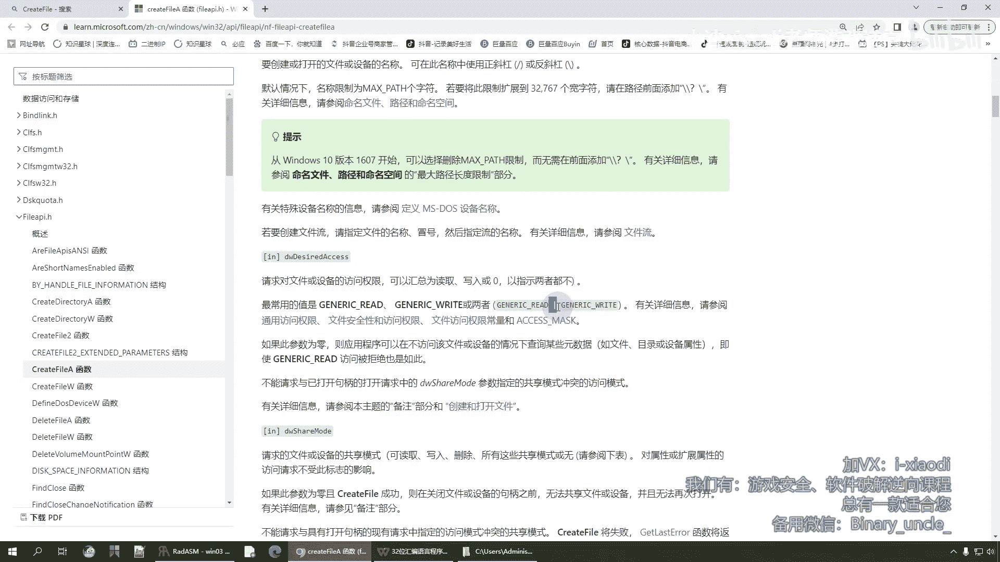

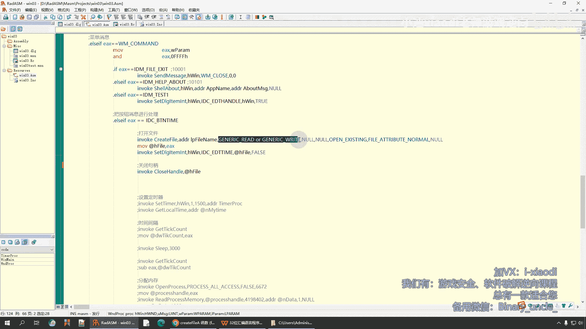

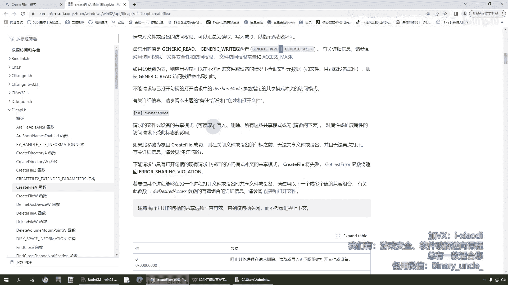

## 🛠️ 小白软件破解逆向反汇编工程师2023最新：5.38.2：CreateFile 的参数逐个拆解


上一节我们看了 `CreateFile` 的能力范围，本节中我们来看看它的参数。教材和官方文档会对每个参数进行讲解，为了便于初学者理解，可以先看一个简化后的函数原型：


```c
HANDLE CreateFile(
    LPCSTR lpFileName,
    DWORD dwDesiredAccess,
    DWORD dwShareMode,
    LPSECURITY_ATTRIBUTES lpSecurityAttributes,
    DWORD dwCreationDisposition,
    DWORD dwFlagsAndAttributes,
    HANDLE hTemplateFile
);
```


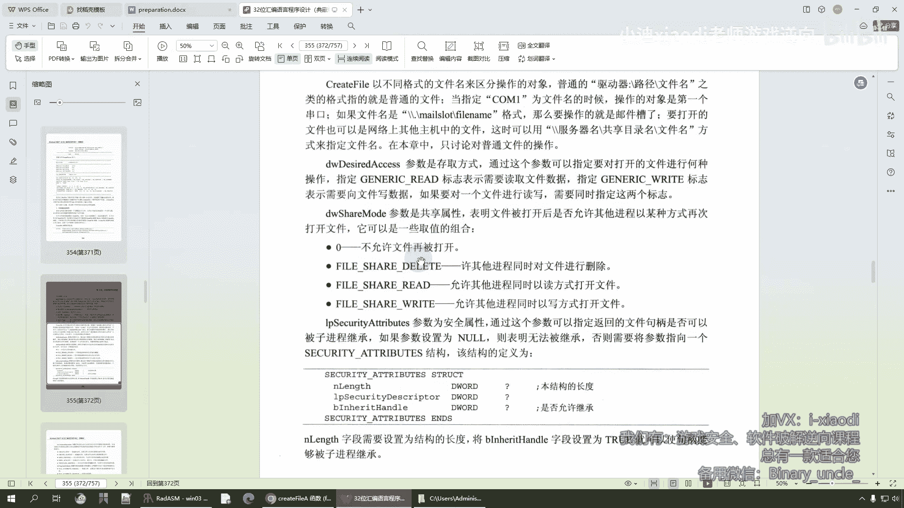

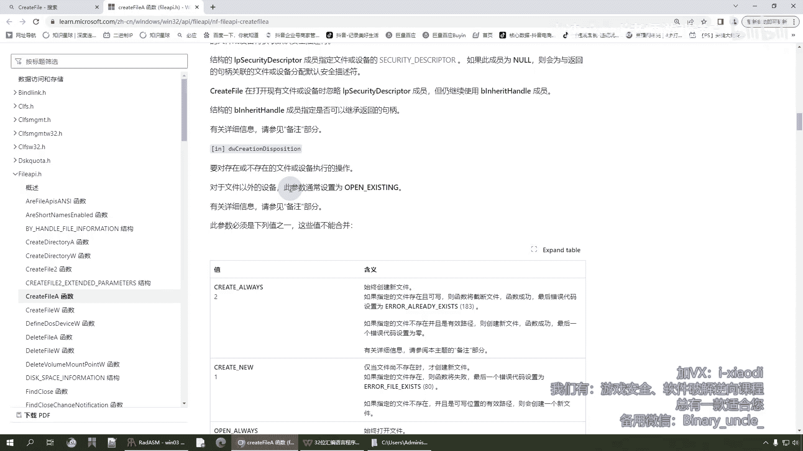

这个原型看起来参数很多，但常用参数并不复杂。以下是七个参数的大白话解释。


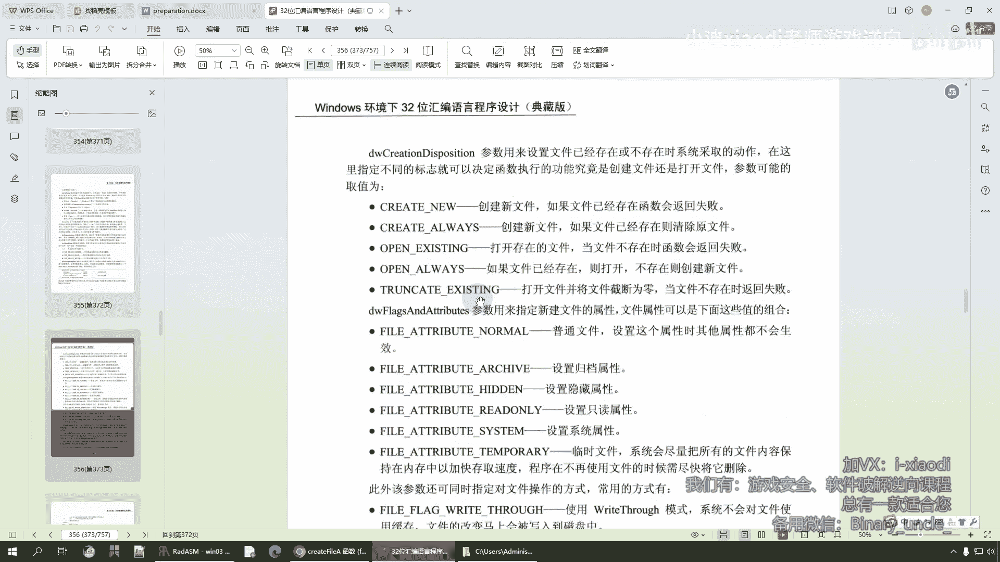

- 第一个参数是 `lpFileName`，表示要打开或创建的设备名称，通常直接传入一个路径。例如要打开文件夹里的一个版本号文件，可以定义一个常量，把路径传进去即可，这一步很简单。
- 第二个参数是 `dwDesiredAccess`，表示请求对文件或设备的访问权限，可以汇总为读取、写入或 0。最常用的是 `GENERIC_READ` 和 `GENERIC_WRITE`，前者是读，后者是写，也可以读写都要。一般来说读写都要，可以用按位或连接，也就是 `GENERIC_READ | GENERIC_WRITE`。
- 第三个参数是 `dwShareMode`，表示请求文件或设备的共享模式，可读取、写入、删除。这个参数决定要不要把文件共享给别人。教材说明，填 0 表示不允许文件被其他进程打开；`FILE_SHARE_DELETE` 允许其他进程对文件进行删除；`FILE_SHARE_READ` 允许以读方式打开；`FILE_SHARE_WRITE` 允许以写方式打开。要不要共享看个人需求。可以用吃饭做比喻：吃饭时允许别人把碗拿走，就相当于允许共享；如果像护食的狗一样不想让别人碰，就填 0，不允许文件再被打开。
- 第四个参数是 `lpSecurityAttributes`，表示指向安全属性结构的指针，此参数可以为 `NULL`。不需要管其他内容，直接填 `NULL` 即可。
- 第五个参数是 `dwCreationDisposition`，表示要对存在或不存在的文件或设备进行的操作。对文件以外的设备，此参数通常设置为特定值。这个结构比较麻烦，一般打开存在的文件时使用打开已存在文件的选项；当文件不存在时会返回失败。一般我们就是打开存在的文件，因为当前文件的确存在；没有文件就打开失败，失败就失败，失败是成功之母。
- 第六个参数是 `dwFlagsAndAttributes`，表示文件或设备的属性，有默认值。一般填默认值即可，也就是 `FILE_ATTRIBUTE_NORMAL`，表示正常默认属性。
- 第七个参数是 `hTemplateFile`，表示具有访问权限的模板文件句柄，此参数可以为 `NULL`。直接填 `NULL` 即可。默认能填 `NULL` 就填 `NULL`，默认能使用默认值就使用默认值。


这些参数中，路径最简单，访问权限通常读写都要，共享模式按需求设置，安全属性和模板文件句柄通常填 `NULL`，创建方式一般选择打开已存在文件，文件属性一般使用默认值。参数设置完成后，直接获取返回值，返回值就是文件打开句柄。


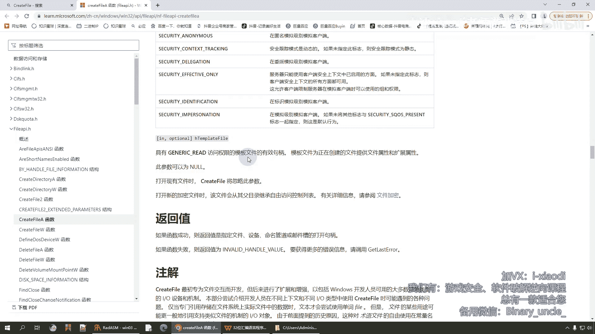

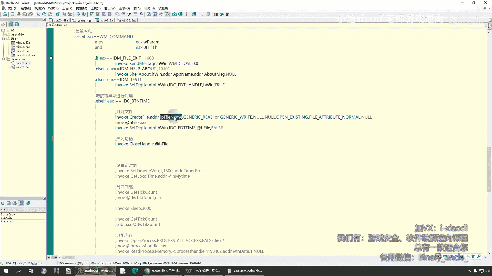

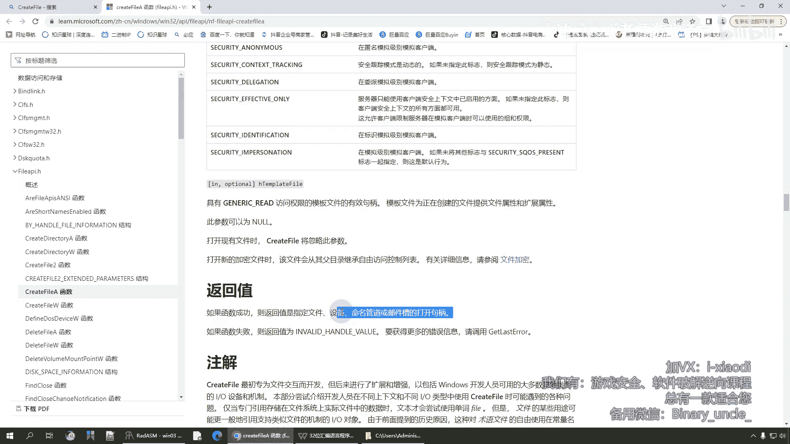

## 💾 小白软件破解逆向反汇编工程师2023最新：5.38.3：保存句柄、打印句柄与关闭句柄


上一节我们拆解了 `CreateFile` 的参数，本节中我们来看看拿到句柄之后如何处理。得到打开句柄之后，就可以进一步对文件进行相关操作，想进行什么后续操作都可以。得到句柄后，最好先把句柄保存起来。原文使用 `DWORD` 保存 `HANDLE` 类型的文件句柄，在汇编层面可以通过 `mov` 把句柄存入变量，再通过输出函数把 `hFile` 打印出来。可以用下面的代码示意：


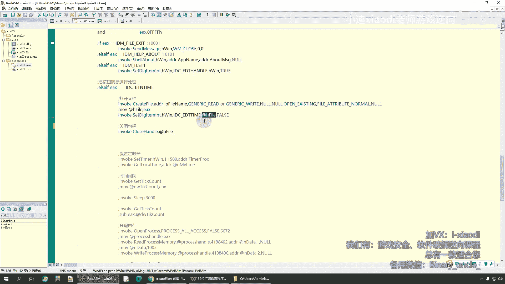

```c
HANDLE hFile = CreateFile(
    "version.txt",
    GENERIC_READ | GENERIC_WRITE,
    0,
    NULL,
    OPEN_EXISTING,
    FILE_ATTRIBUTE_NORMAL,
    NULL
);

DWORD dwHandleValue = (DWORD)hFile;
printf("%lu\n", dwHandleValue);

CloseHandle(hFile);
```


打印句柄还没有结束。打开文件之后，最好关闭句柄。教材后面提到了 `CloseHandle`，它用于关闭打开的对象句柄。打开文件会得到一个句柄，使用完之后最好关闭。可以用生活场景理解：打开水龙头放水，放完水要关闭水龙头；打开门进去，最后要关上门。如果一个大型程序打开了很多文件却都不关闭，每打开一个文件就获得一个句柄，句柄会对内存造成占用。大型程序的内存非常宝贵，电脑内存有限，程序特别大时占用资源也特别多，可能造成资源浪费，甚至造成内存泄露、程序崩溃和极其不稳定的现象。因此每次打开文件获得对象之后，使用完就关闭，做一个文明人。


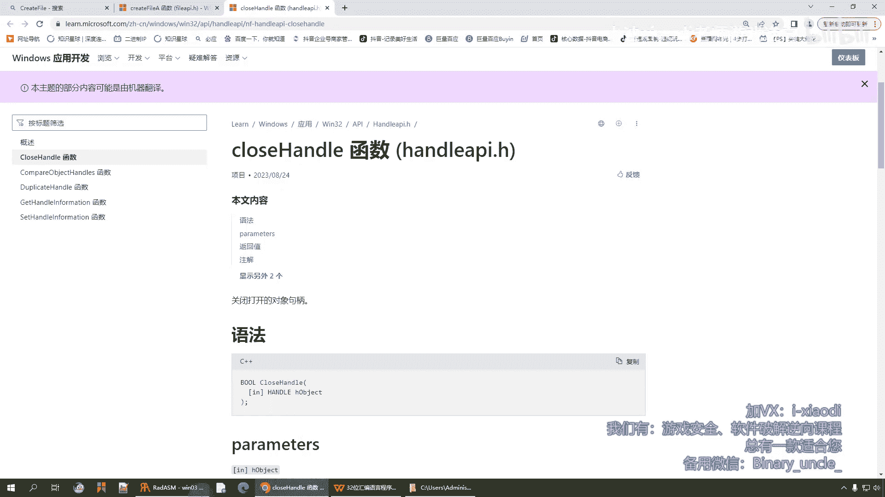

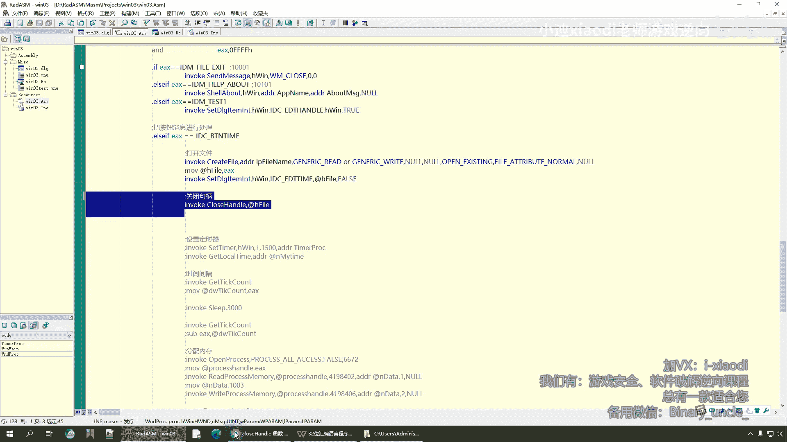

完成代码后测试运行，打开文件后可以看到 `1132`，这个值就是文件的一个句柄。如果能出现正常的值，说明文件打开句柄是正确的。这个测试过程并不复杂，重点是把“打开文件、获得句柄、保存句柄、打印句柄、关闭句柄”这一套流程走通。


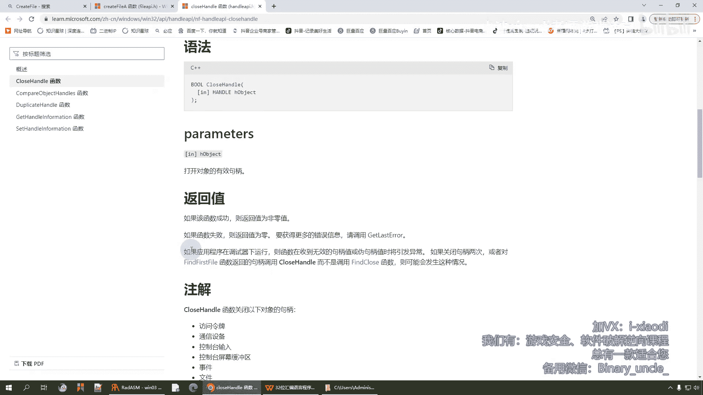

## ✅ 小白软件破解逆向反汇编工程师2023最新：5.38.4：本课小结与练习提示


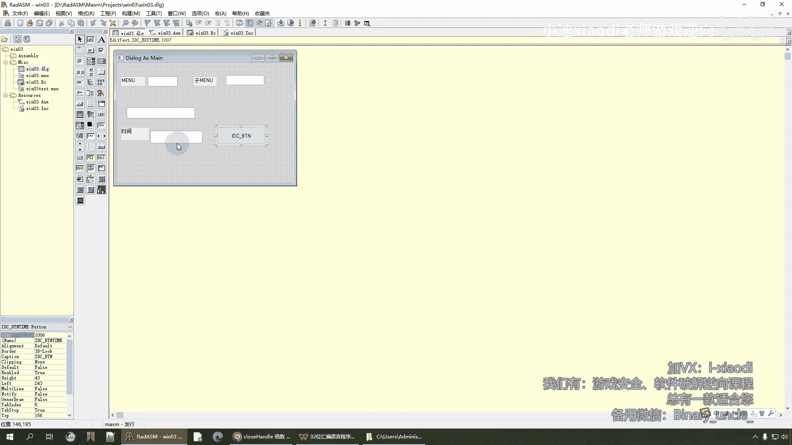

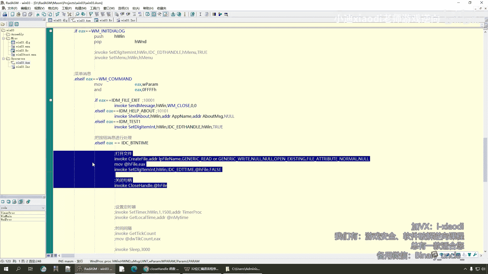

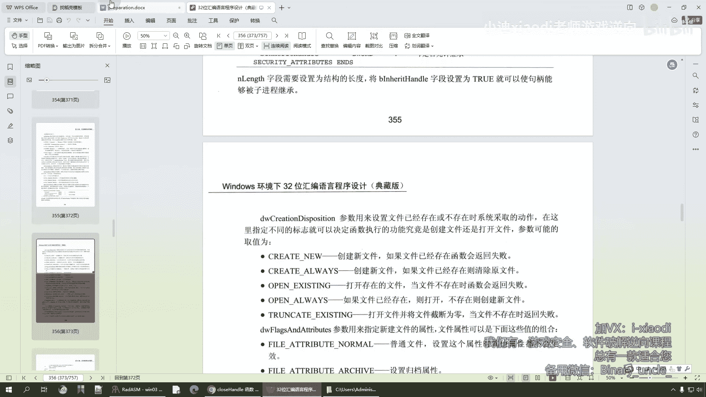

到这里，核心内容已经讲完，本节中我们来做总结并提示练习。今天的内容是打开文件，整体比较简单。我们更改了上节课的代码，在按钮消息处理中直接加入编号 `1234` 和 `4` 号线相关处理，用这个方式完成本课示例。本节课中我们一起学习了文件操作的第一步打开文件，了解了本地文件存储、账号密码验证和数据库文件等使用场景，理解了文件句柄与进程句柄的相似之处，掌握了 `CreateFile` 可以处理文件、目录、控制台、串口、邮件槽和管道等对象，逐个拆解了七个参数，并完成了保存句柄、打印句柄和 `CloseHandle` 关闭句柄的流程。测试运行时看到 `1132` 这样的正常句柄值，就说明文件打开成功。下期再见。

