# 🧰 小白软件破解逆向反汇编工程师2023最新：第39课：文件操作二——读写文件与本地文件原理

本课由小迪老师讲解，对应哔哩哔哩账号“小迪小迪老师”，视频编号为BV16N411G7Po。本节是第39课“文件操作二：读写文件”，重点放在打开文件、读取本地文件、写入本地文件的原理与API调用上。本课内容也对应教材第359页，想要获取教材可以关注账号；建议先自行阅读教材第359页，遇到不懂的地方再回看视频，针对性地学习。若在其他平台看到本内容，欢迎回到B站关注；目前团队没有做其他平台，其他平台内容可能是盗版。在本节课中我们将会学习读写文件的使用场景、ReadFile与WriteFile的基本关系、ReadFile五个参数的填写方法，以及用WinHex验证读取结果的方式。

## 📌 小白软件破解逆向反汇编工程师2023最新：第39课：课程背景与学习目标

上一段概述已经说明了本课的账号、教材和视频信息，本节主要把学习目标和使用场景讲清楚。读写文件的使用场景在上节课已经提到过，一方面是为了了解别人怎么操作文件、背后的原理是什么；另一方面是为了实践，也就是今天要讨论的怎么去写一个程序给别人用。总结起来，使用场景有两个：第一是理论学习，第二是实践操作。

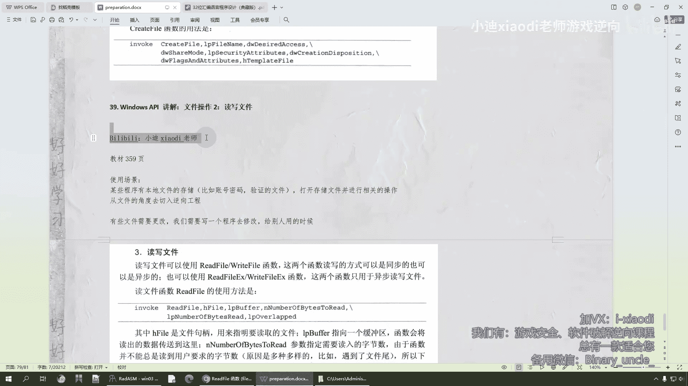

以下是本课先要明确的两个使用场景：

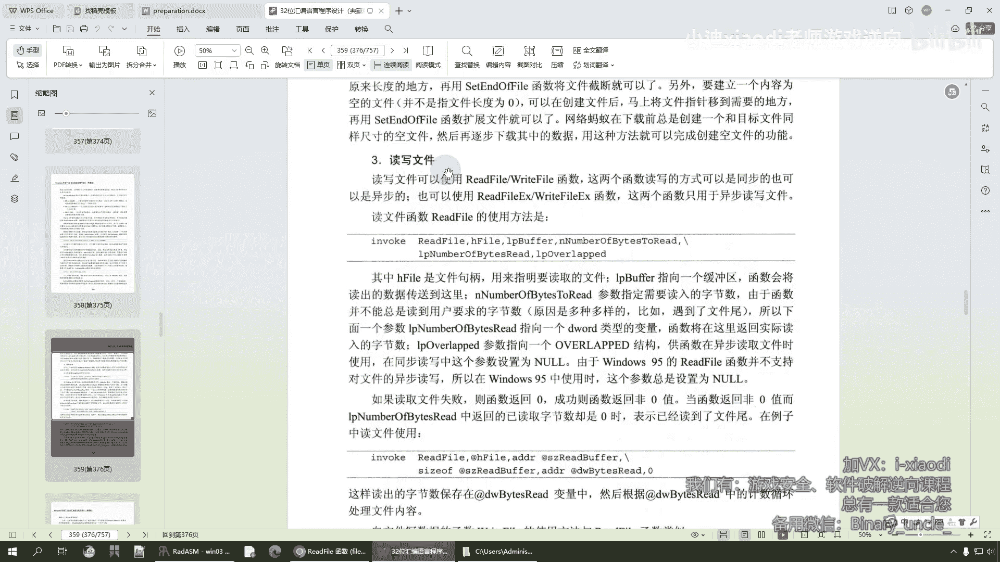

- 理论场景：了解别人操作文件时调用了哪些函数、整体原理是怎样的。

- 实践场景：如果确实有需求，需要写一个程序去修改别人的文件或者自己的文件，就要知道这种需求应该如何实现。

在明确使用场景之后，还需要了解读写文件真正对应的API函数。读写文件使用的API函数是`ReadFile`和`WriteFile`，其中`ReadFile`负责读文件，`WriteFile`负责写文件，这两个函数是相对应、相辅相成的。今天先讲读文件，写文件相信大家一定能够写出来，因此本课会留一个作业：自己回去使用`WriteFile`完成写文件练习。今天先重点讲解`ReadFile`。

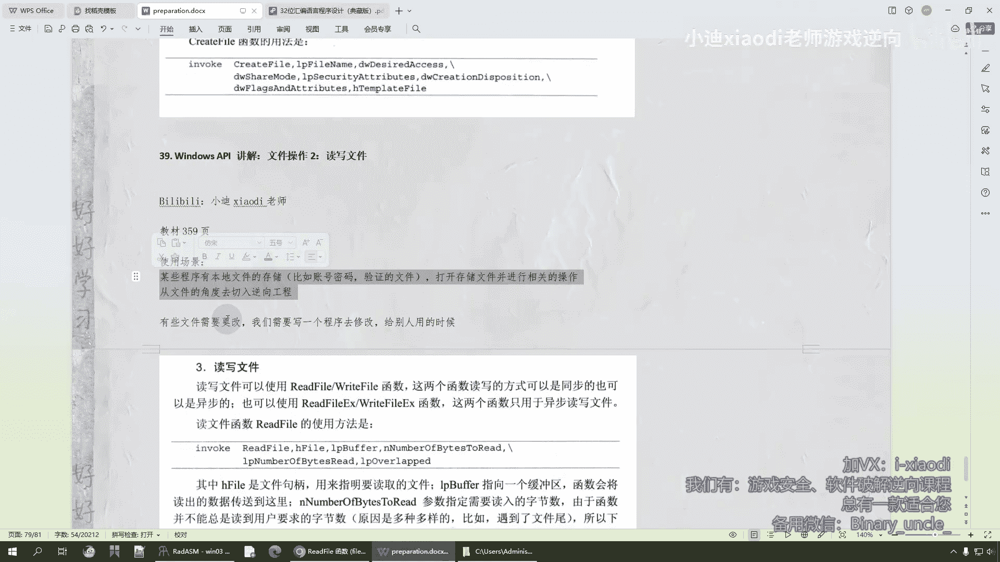

## 🧩 小白软件破解逆向反汇编工程师2023最新：第39课：读写文件API总览

上一节明确了理论和实践两个场景，本节来看看读写文件对应的API总览。看到一个API函数时，可以直接上Bing搜索，Bing是微软的搜索引擎。在Bing上搜索时，弹出的结果没有广告，不像百度一搜全是百度广告；Bing上来弹出的就是微软官方的API函数文档，点进去即可。文档对`ReadFile`的说明是：从指定的文件或输入输出设备读取数据，也就是读数据的一个函数。这个函数有5个参数。

以下是`ReadFile`和`WriteFile`的基本函数原型，先建立整体印象：

```c
BOOL ReadFile(
  HANDLE hFile,
  LPVOID lpBuffer,
  DWORD nNumberOfBytesToRead,
  LPDWORD lpNumberOfBytesRead,
  LPOVERLAPPED lpOverlapped
);

BOOL WriteFile(
  HANDLE hFile,
  LPCVOID lpBuffer,
  DWORD nNumberOfBytesToWrite,
  LPDWORD lpNumberOfBytesWritten,
  LPOVERLAPPED lpOverlapped
);
```

从原型可以看出，`ReadFile`和`WriteFile`的参数结构很接近，都是先传文件句柄，再传缓冲区，再传字节数，后面跟着接收字节数的指针和异步结构指针。理解这个结构后，再逐个看参数就不会觉得乱。下面进入`ReadFile`的参数拆解。

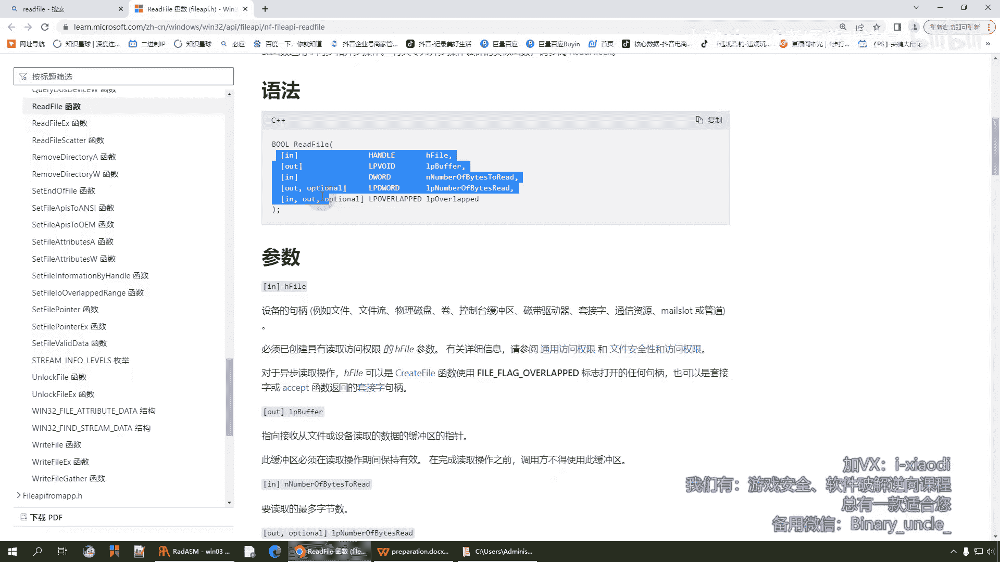

## 🔍 小白软件破解逆向反汇编工程师2023最新：第39课：ReadFile参数拆解

上一节从整体上看了`ReadFile`和`WriteFile`的函数原型，本节把`ReadFile`的五个参数逐项拆开。第一个参数是设备的句柄，上节课已经讲到，直接调用`CreateFile`就可以得到句柄。打开文件后得到的是文件句柄，代码里的`hFile`就是文件句柄，它就是`CreateFile`的返回值。

以下是`ReadFile`五个参数在本课中的填写思路：

- 第一个参数`hFile`：文件句柄，由`CreateFile`打开文件后返回。

- 第二个参数`lpBuffer`：指向接收从文件或设备读取的数据的缓冲区的指针。这个参数带有`out`含义，入参是我们传入的，`out`表示数据从函数传出，所以读出来的数据要传出来放到一个地方，这个地方需要定义一个局部变量。

- 第三个参数`nNumberOfBytesToRead`：要读取的最多字节数。本课先读4个字节，因此这里填4。

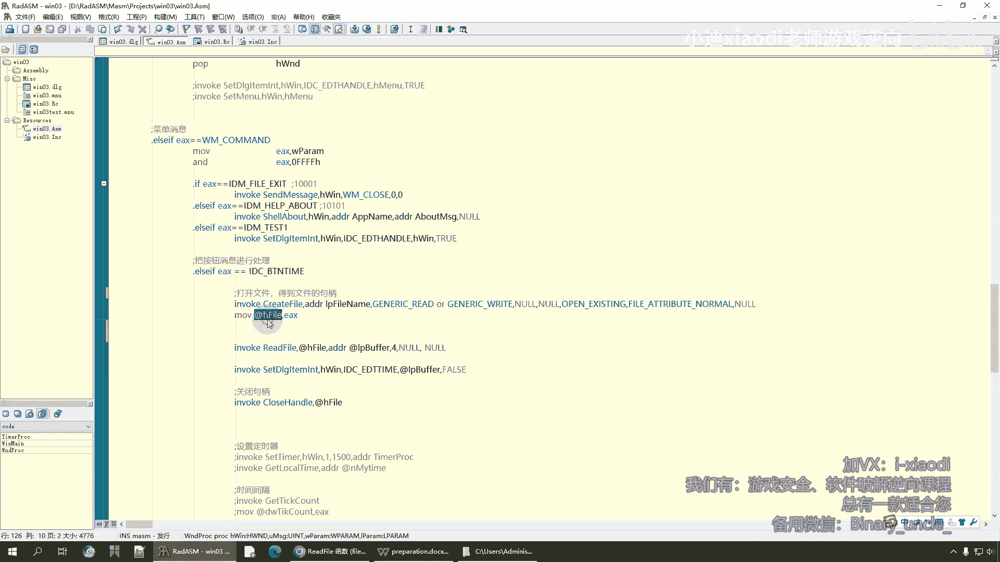

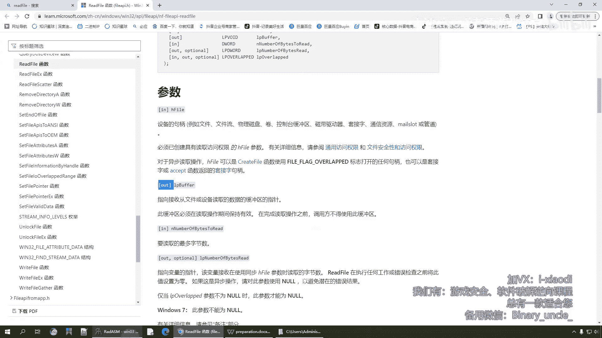

- 第四个参数`lpNumberOfBytesRead`：指向变量的指针，该变量接收同步读取的字节数。异步操作暂时不用管；本课读4个字节就是4个字节，不需要处理同步之外的复杂情况，按简易演示可以先填`NULL`，只要知道它用于接收实际读取的字节数即可。

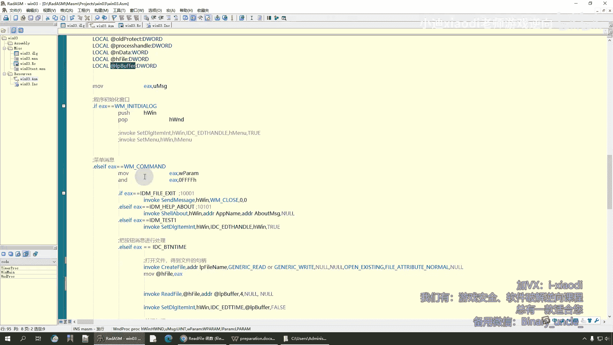

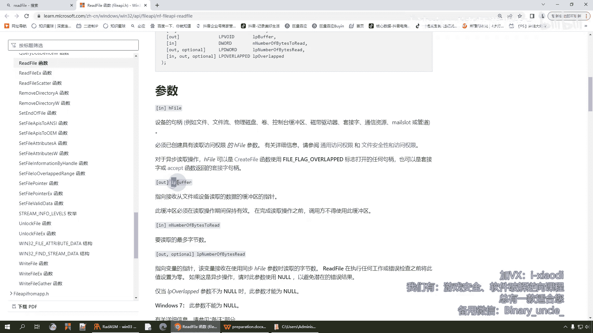

- 第五个参数`lpOverlapped`：如果使用重叠I/O就传对应结构，否则不用管，直接填`NULL`。默认能填`NULL`的地方就填`NULL`。

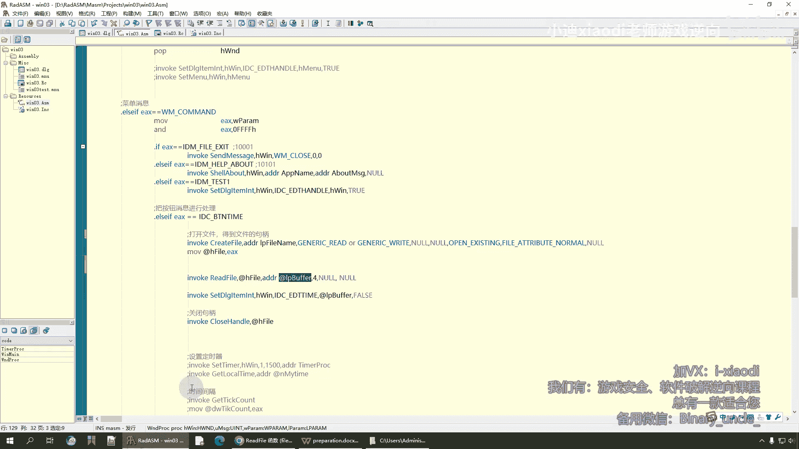

第二个参数需要重点说明。可以在上面定义一个局部变量`lpBuffer`，它的类型可以是`DWORD`，而`DWORD`是4个字节，4字节是非常常见的一种数据类型。这个参数本质上是指针类型，见到指针参数就把地址传进去，像套公式一样把`&lpBuffer`填进去即可。下面是本课简易读取4个字节的代码示意：

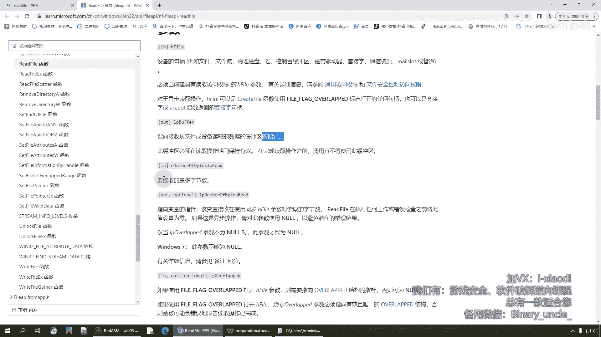

```c
HANDLE hFile = CreateFile(
  L"test.exe",
  GENERIC_READ,
  FILE_SHARE_READ,
  NULL,
  OPEN_EXISTING,
  FILE_ATTRIBUTE_NORMAL,
  NULL
);

DWORD lpBuffer = 0;

ReadFile(
  hFile,
  &lpBuffer,
  4,
  NULL,
  NULL
);

CloseHandle(hFile);
```

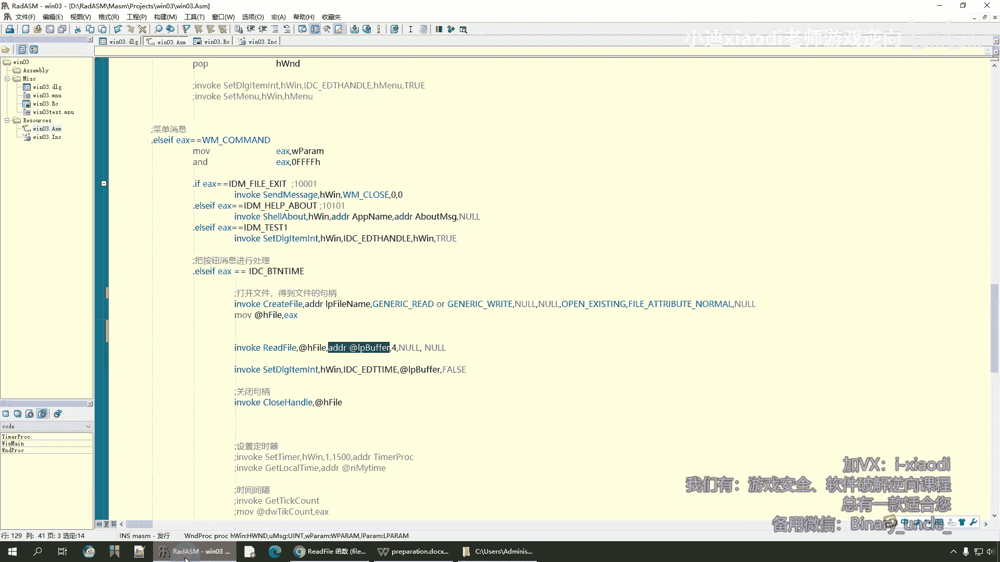

填完之后，数据就放在第二个参数指向的缓冲区里，也就是放在`lpBuffer`里。接下来应该用编辑块把`lpBuffer`显示出来，显示之后关闭文件句柄。这样读文件的完整流程就清楚了：先打开文件拿句柄，再把句柄传给`ReadFile`读数据，最后关闭句柄。理解这些参数后，下一节进行动手实验。

## 🧪 小白软件破解逆向反汇编工程师2023最新：第39课：动手实验与WinHex验证

上一节已经把`ReadFile`的参数和调用流程拆开，本节实际运行程序验证读取结果。实验读取的是同文件夹里的文件，构建并运行程序后，可以看到读取结果。程序读出的关键数值是`9460301`，这个数值可以用来验证读取是否正确。查看时可以使用WinHex，工具包里有这个工具；如果之前打开过一些程序，可以先关掉，再把目标文件重新拖进来。

以下是本课实验中的验证步骤：

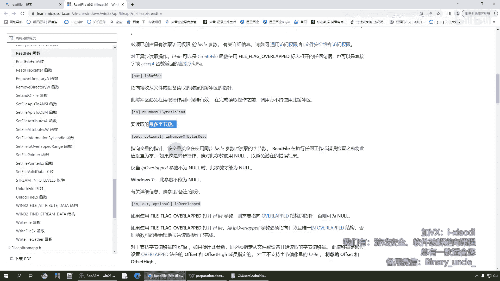

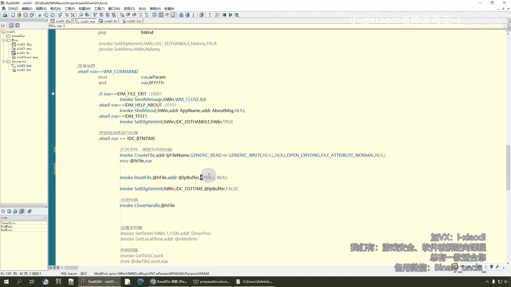

- 用WinHex打开目标文件，观察文件开头的字节。

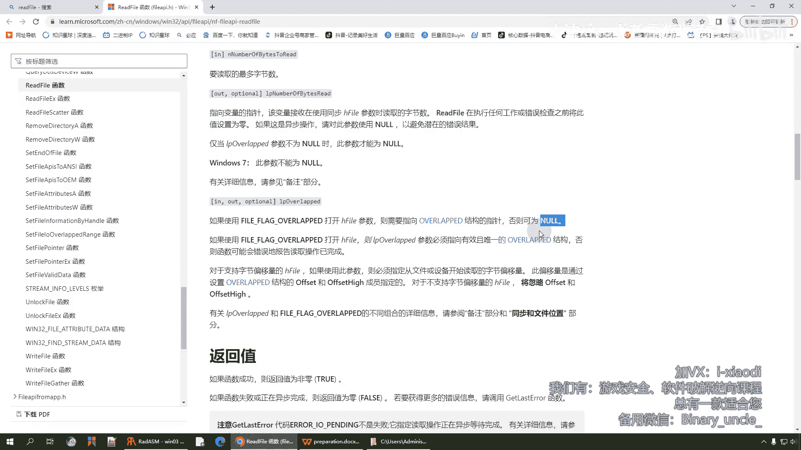

- 从文件第一个字节开始读，读取开头4个字节。

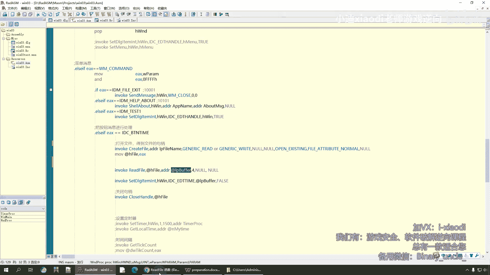

- 文件中看到的字节顺序和按`DWORD`显示的顺序可能相反，因为需要按小端方式倒序观察。

- 把字节转换为`0x00905A4D`，对应十进制就是`9460301`，与程序读出的结果一致。

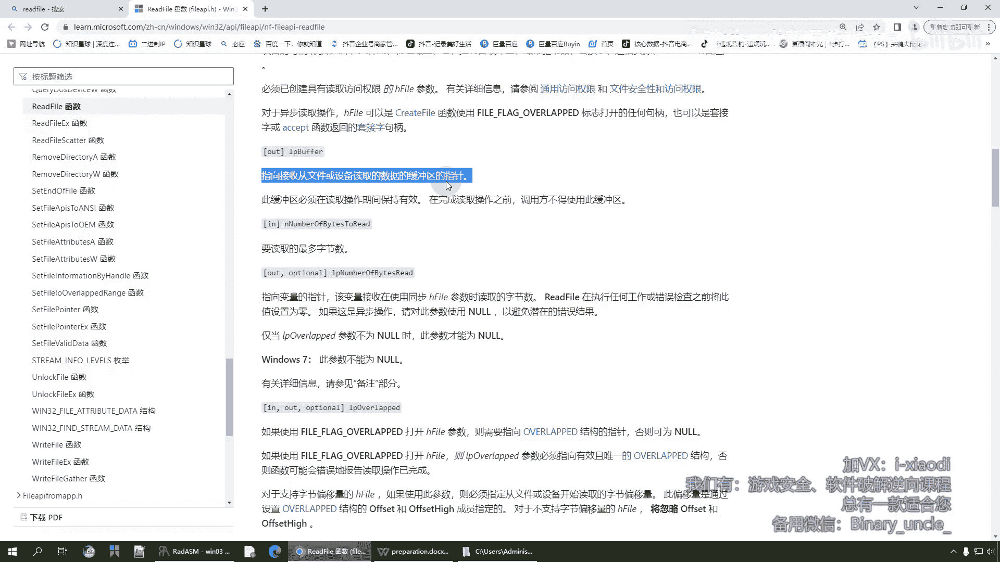

课堂演示中提到的`4D5A9090`，重点在于说明要观察文件开头的4个字节；真正把数据显示出来时，需要按小端方式倒序理解。转换时可以按课堂演示把显示结果整理为`00 90 5A 4D`，得到`0x00905A4D`，十进制就是`9460301`。查看这个数值时，也可以把它理解为程序读取到的版本号线索，它来自我们自己的程序读取结果。本课验证的核心关系可以写成下面的形式：

```c
0x00905A4D == 9460301
```

实验说明，如果一个程序要读取本地文件，通常会调用两个函数：第一步用`CreateFile`拿到句柄，第二步把句柄传给`ReadFile`，这样才能完成读取。这就是读文件的基本原理。反过来说，如果程序对文件进行写入操作，就会调用`WriteFile`，因此`WriteFile`自然就成为本课留下的作业。

## 📝 小白软件破解逆向反汇编工程师2023最新：第39课：WriteFile作业与课程总结

上一节通过WinHex验证了`ReadFile`的读取结果，本节看看`WriteFile`的作业和本课总结。`WriteFile`同样有5个参数，整体结构与`ReadFile`很接近。第一个参数是文件句柄；第二个参数是写入数据的缓冲区，里面包含要写入文件的数据；第三个参数是要写入的字节数；第四个参数用于接收实际写入的字节数，简易演示可以填`NULL`；第五个参数在没有重叠I/O需求时也填`NULL`。写入完成后，可以用`if`语句判断返回值，检查写入是否成功。

以下是`WriteFile`作业中需要掌握的参数对应关系：

- 第一个参数：文件句柄，通常由`CreateFile`得到。

- 第二个参数：写入数据缓冲区，把要写入文件的数据放进去。

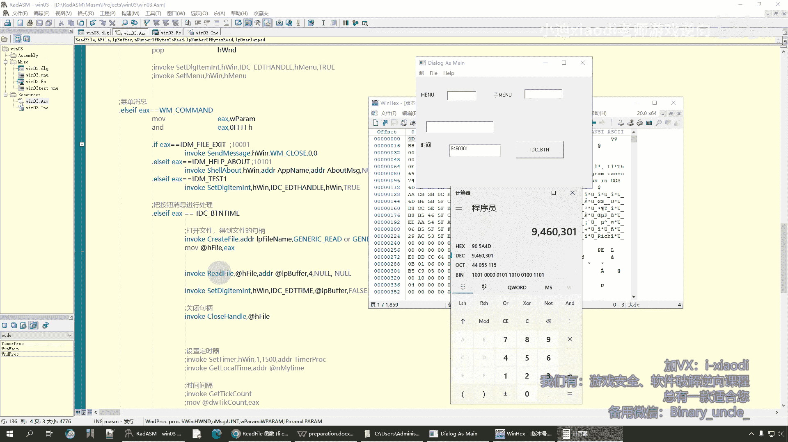

- 第三个参数：写入字节数，决定一次写入多少数据。

- 第四个参数：接收实际写入字节数的变量指针，简易写法可填`NULL`。

- 第五个参数：重叠I/O结构指针，没有异步需求时填`NULL`。

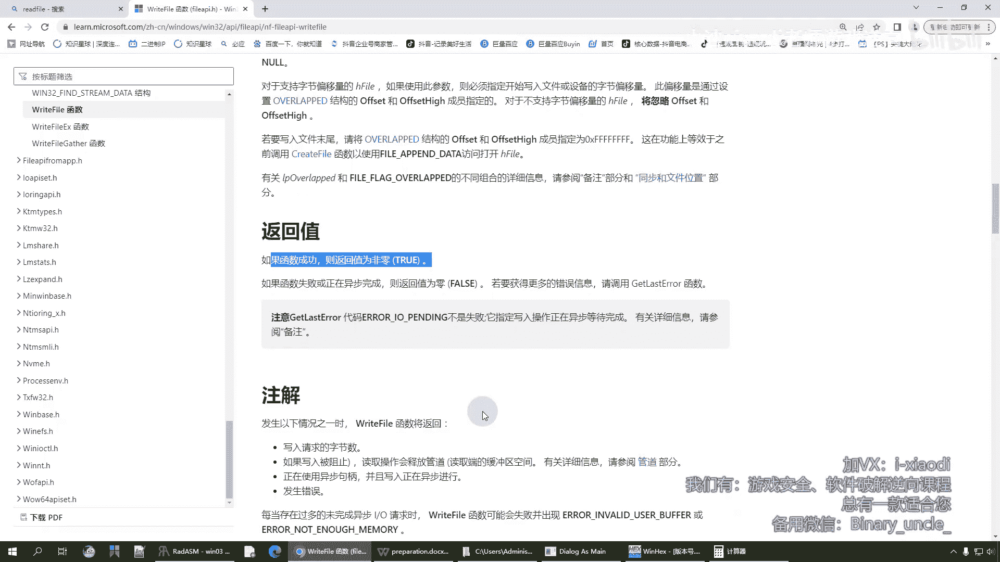

`WriteFile`的调用示意如下：

```c
DWORD data = 0x12345678;

BOOL ok = WriteFile(
  hFile,
  &data,
  4,
  NULL,
  NULL
);

if (!ok) {
  // 写入失败处理
}
```

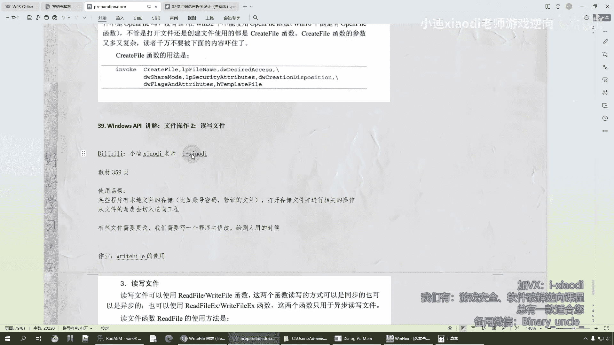

今天的内容是读写文件操作，整体并不复杂，关键是把“句柄、缓冲区、字节数、返回信息、异步结构”这几个位置对应清楚。本课如果有任何疑问，欢迎在右下角加入知识星球，加入微信，关注微信“I杠小迪”。本节课中我们一起学习了读写文件的两个使用场景、`ReadFile`与`WriteFile`的对应关系、`ReadFile`五个参数的填写方法，以及用WinHex验证本地文件读取结果的完整流程。下期再见。

