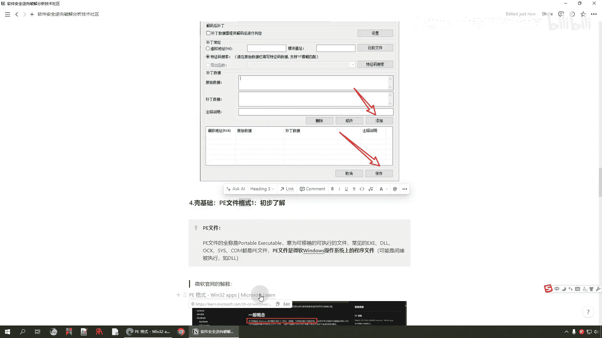
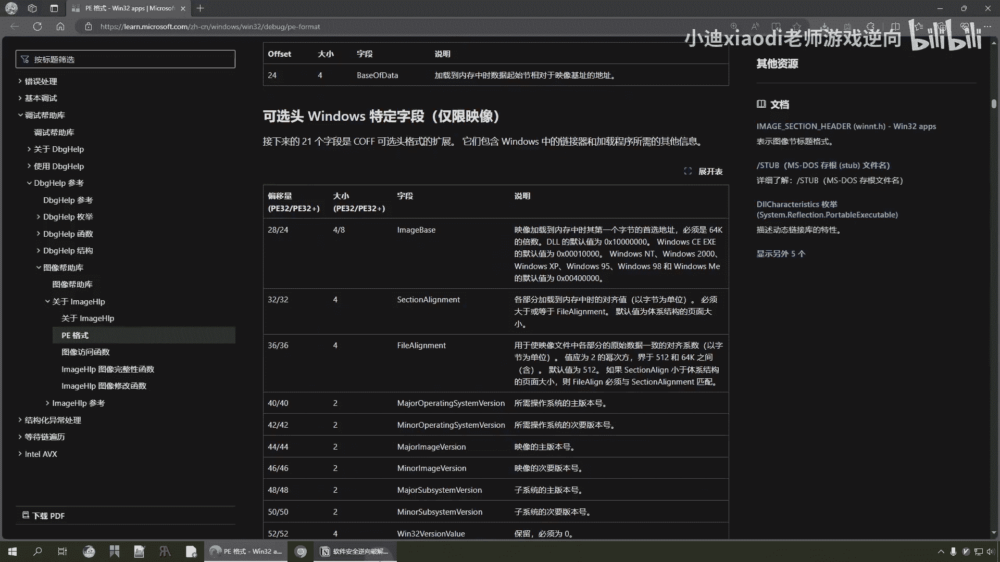
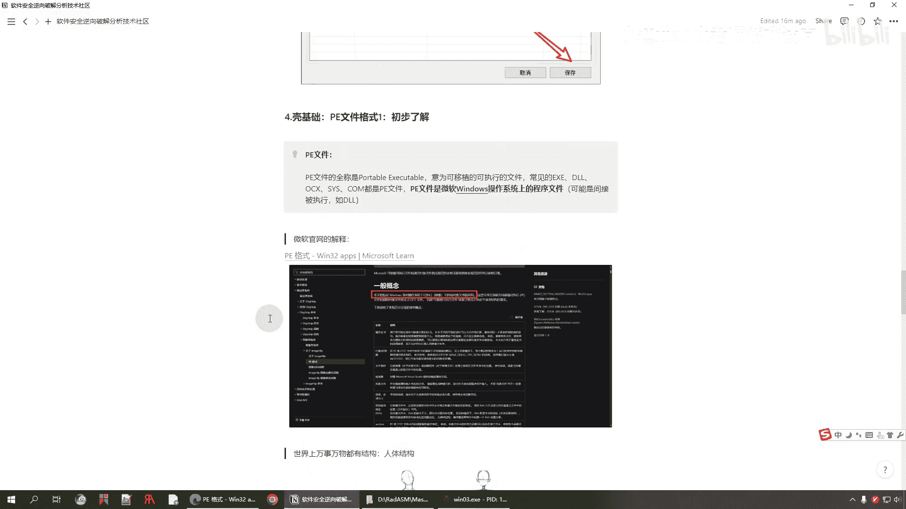

# 🧩 小白软件破解逆向反汇编逆向工程师2024最新：壳基础：PE文件格式1：初步了解


大家好，我是小迪老师，欢迎大家收看软件安全逆向破解分析技术社区的第六章高级进阶逆向分析技术的第四章壳基础。在本节课中，我们将要学习壳基础中的PE文件格式初步了解，重点认识PE文件是什么、PE文件大致有什么结构，以及PE文件运行起来以后会用到的模块、模块基址、虚拟地址和相对虚拟地址等概念。讲到此处，我非常激动，因为我们终于迎来了与加壳脱壳相关的一些技术，也就是壳基础。有了这个基础之后，我们就可以进一步了解加壳脱壳的原理，并进一步对这些技术进行复现。今天讲解的内容是PE文件格式的初步了解，内容可能有点多，大家回去慢慢消化。


## 📦 小白软件破解逆向反汇编逆向工程师2024最新：壳基础：PE文件格式1：1. 什么是PE文件


我们先看一下什么是PE文件。PE文件全称是Portable Executable，意思是可移植的可执行文件。简单说，它就是Windows系统里常见程序文件所采用的一种标准格式。常见的一些PE文件包括EXE文件、DLL文件、OCX文件、SYS文件、COM文件等，这些都属于PE文件。PE文件是微软Windows操作系统上的程序文件，是微软Windows特有的一种文件格式。这个文件具备一定的格式，也具备一定的结构。


PE文件常见的类型如下，这些类型在Windows开发和逆向分析中经常遇到：

- EXE文件：常见的可执行程序文件。

- DLL文件：动态链接库文件。



- OCX文件：常见的控件或组件文件。

- SYS文件：常见的系统驱动相关文件。



- COM文件：常见的命令或可执行相关文件。


了解常见类型以后，我们再看官方说明。微软官网其实给出了一个比较权威的解释，原文提到可以打开这个链接查看。下面这段引用保留了原文中关于规范介绍的核心含义：


> 本规范介绍Windows系列操作系统下可执行文件和对象文件的结构，这些文件分别可移植可执行PE文件以及规范中提到的其他对象文件等内容，简单了解即可。


这个微软官网规范肯定是最权威、最全面的，但它同样可能看起来不好理解，所以需要我们给大家讲一下。接下来我们看看PE文件的结构和格式。


## 🏗️ 小白软件破解逆向反汇编逆向工程师2024最新：壳基础：PE文件格式1：2. PE文件的结构


结构、格式这些概念并不神秘。世界上万事万物都有结构，比如人体有结构，有脑袋，有脖子，有上半身，有下半身，人体就是由各种各样的关节、各种各样的器官组成这样一个结构。程序也是一样的，有了结构之后，才能更好地规划、处理、运转整个机体，运转整个程序，处理各种各样的代码和数据。所以PE文件也有结构。从大致宏观结构来看，PE文件有头，通过图示可以看到，一个PE文件的结构大致分为PE文件头和区块数据，上面是头，下面是区块数据。


PE文件结构进一步详细展示如下，核心是PE文件头、区块表和区块。整个框架结构可以分为五个部分，但DOS部首是16位程序的残留，现在的程序都是32位，计算机已经发展到32位甚至64位，所以这个部分并不重要。最后还有一个调试信息，这个调试信息也不重要。因此新的核心可以理解为三个部分：PE文件头、区块表和区块。


```text
PE文件框架结构示意
├─ DOS头/DOS部首（16位程序残留，当前环境下不重要）
├─ PE文件头
├─ 区块表
├─ 区块数据
└─ 调试信息（通常不重要）

核心三部分
├─ PE文件头
├─ 区块表
└─ 区块
```


另外一点要注意，PE文件不是只在磁盘上待着，它要运行起来，它要跑起来。所以它运行起来之后具备哪些特性，我们需要知道。下面我们进入运行后的映射与拉伸部分。


## 🧠 小白软件破解逆向反汇编逆向工程师2024最新：壳基础：PE文件格式1：3. 运行后的映射与拉伸


磁盘文件一旦被载入内存，磁盘上的数据结构布局和内存中的数据结构布局基本一致。比如磁盘上有一个文件，它放在你的磁盘上，那么它运行起来以后，它的结构里也有PE文件头，也有区块表，也有区块，只不过运行起来之后它会被拉伸，它会被拉长。先了解它有一个拉伸的概念即可。在磁盘上从这个数据结构中寻找一些内容，几乎都能在这个被载入的内存映射文件中找到相同的信息，但数据的相对位置可能会改变。不管怎样，对所有表现出来的信息，都允许进行从磁盘文件偏移到内存偏移的转换。也就是说，磁盘文件运行起来以后，该有的结构都有，只是它在内存中的布局可能被拉伸，位置也可能发生变化。


理解磁盘文件和内存映射之间的关系以后，我们还需要知道，PE文件运行起来之后就不叫PE文件了，它有一个新的名字叫做模块。下面我们看看模块以及模块基址相关概念。


## 🔍 小白软件破解逆向反汇编逆向工程师2024最新：壳基础：PE文件格式1：4. 模块与模块基址


PE文件运行起来之后，它就不叫PE文件了，它有一个新的名字叫做模块。模块的起始地址又称为模块基址。比如有一个程序，打开x32dbg，把它拖过来，点击符号，点击符号后会发现这个名字就是模块。所以当程序运行起来之后，这个文件就不叫那个PE文件了，它就叫模块。模块的起始地址又称为模块基址。左边的00400000又叫模块句柄。模块句柄也叫基址，或者叫基地址。模块句柄不仅叫基址或基地址，它还有一个名字叫做实例句柄。


在调试器里观察运行后的程序时，会涉及下面几个称呼，它们指的对象相近但说法不同：

- 模块：PE文件运行起来之后的新名字。

- 模块基址：模块的起始地址。

- 模块句柄：例如左侧显示的00400000。

- 基址或基地址：模块句柄的另一种叫法。

- 实例句柄：模块句柄的另一种叫法。


那么模块句柄怎么获取？之前讲到过，可以通过`GetModuleHandle`这样一个API去获取它的基址，或者获取它的模块，或者获取它的实例句柄。可以用下面的代码形式理解：


```c
HMODULE hModule = GetModuleHandle(NULL);        // 获取当前模块句柄/基址
HMODULE hModule2 = GetModuleHandle("xxx.exe");  // 按模块名获取模块句柄/基址
```


现在双击这个模块，来到这个模块的反汇编代码位置。最左边这一栏都是每一条汇编代码所对应的内存地址。这个内存地址又不叫内存地址，它又有新的名字叫做虚拟地址。下面我们进入虚拟地址部分。


## 📐 小白软件破解逆向反汇编逆向工程师2024最新：壳基础：PE文件格式1：5. 虚拟地址


这个内存地址又叫虚拟地址，为什么呢？因为这个PE文件被系统加载器映射到内存中，每个程序都有自己的00401000，都有自己的虚拟空间。所以这个虚拟空间的地址又称为虚拟地址，因为每个程序都有。比如再看一个程序，做断点练习，点击符号，双击模块，可以看到每个程序都有它自己的00401000。所以这个东西是虚的，不是说系统上只有这一处，每个程序都有自己的一个空间，所以又叫虚拟空间。


理解虚拟地址以后，最后再看相对虚拟地址。教材上的解释可能不是很明白、不是很清楚，直接看实例会更直观。下面我们进入相对虚拟地址与公式部分。


## 📊 小白软件破解逆向反汇编逆向工程师2024最新：壳基础：PE文件格式1：6. 相对虚拟地址与公式


比如点击符号，会发现这个基址是00400000。这个模块是某个exe模块。如果双击这个模块，会发现它来到00401000。为什么呢？因为为了避免在PE文件中出现绝对内存地址，它引入了一个相对地址的概念。比如假如一个EXE文件从00400000处载入，那么它的代码区块开始于00401000。这个EXE从哪里载入？它是从00400000载入的。但是我们双击过去，它的代码是00401000。那么这个RVA，也就是相对虚拟地址，是多少？就是1000。通过这个例子可以直接看出来，相对虚拟地址的值是1000。


核心公式如下：


```text
VA = ImageBase + RVA
虚拟地址 = 基地址 + 相对虚拟地址
```




这个公式比较简单，眼见为实，一眼就能看出来。到这里，今天的内容就讲完了。本节课中我们一起学习了壳基础PE文件格式1的初步了解，内容包括什么是PE文件、PE文件的大致结构、运行后的映射与拉伸、模块与模块基址、虚拟地址以及相对虚拟地址公式。今天的内容可能有点多，大家回去慢慢消化，我们下集再见。
