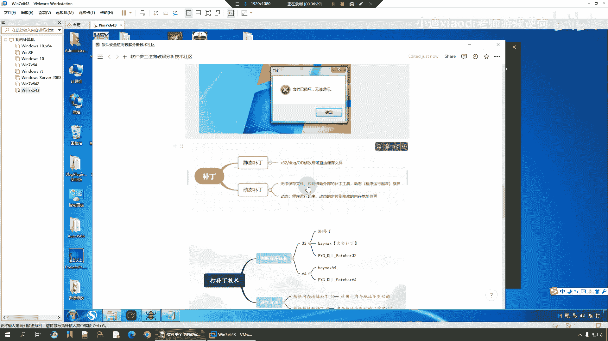
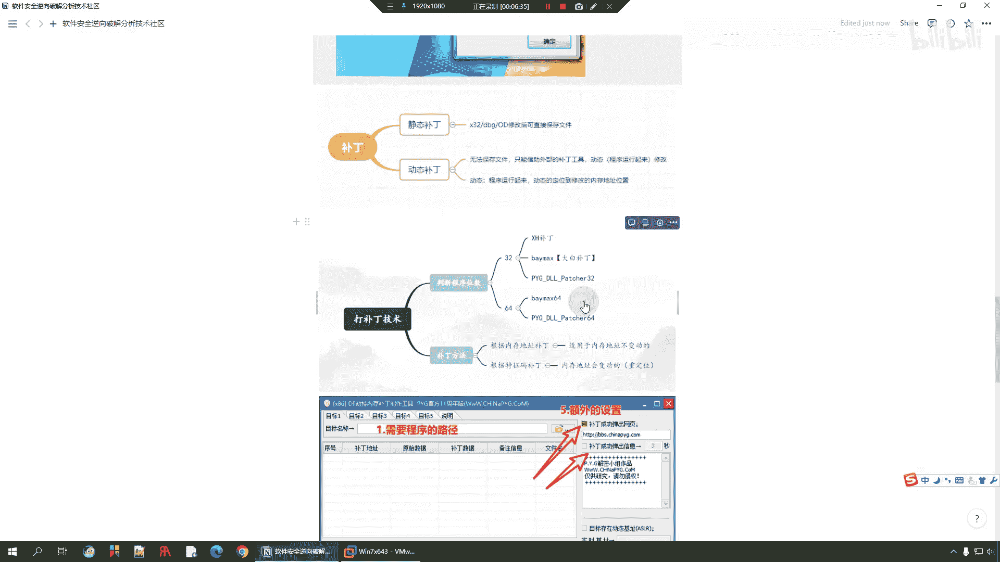
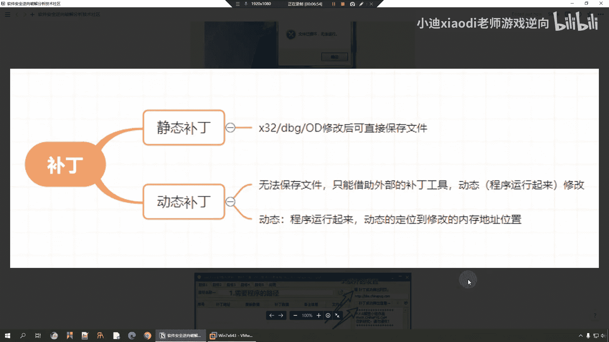
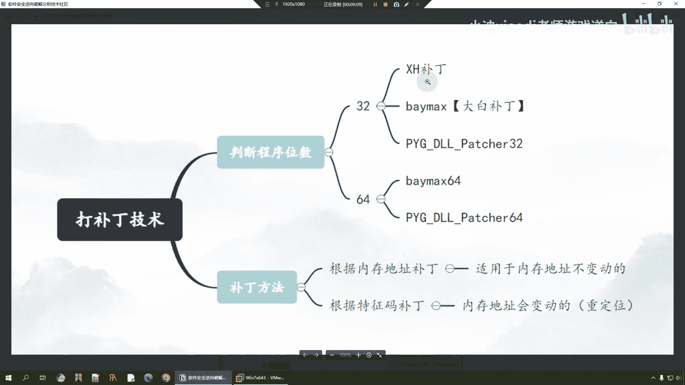
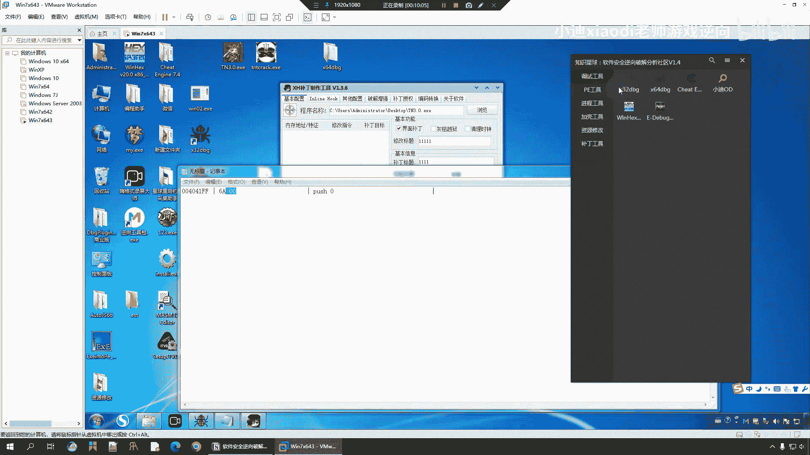
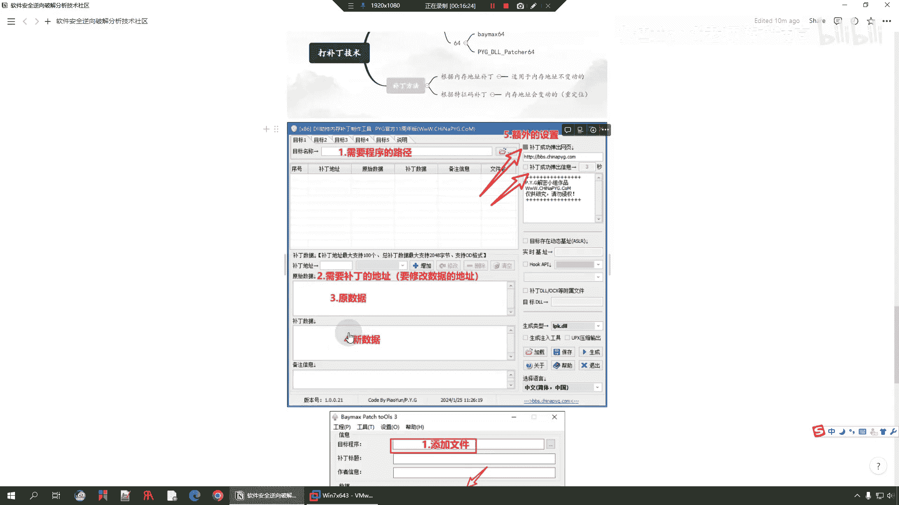
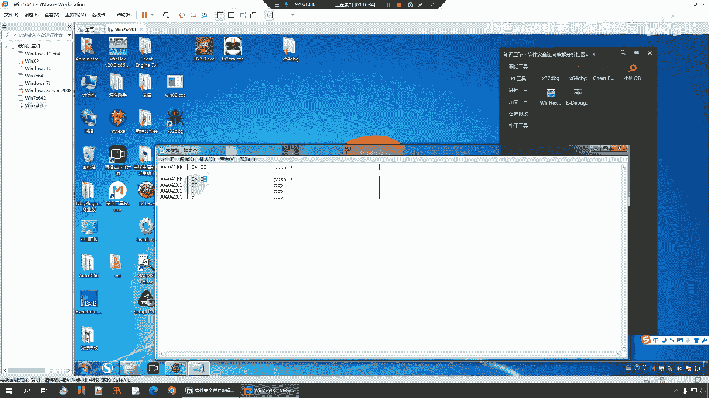
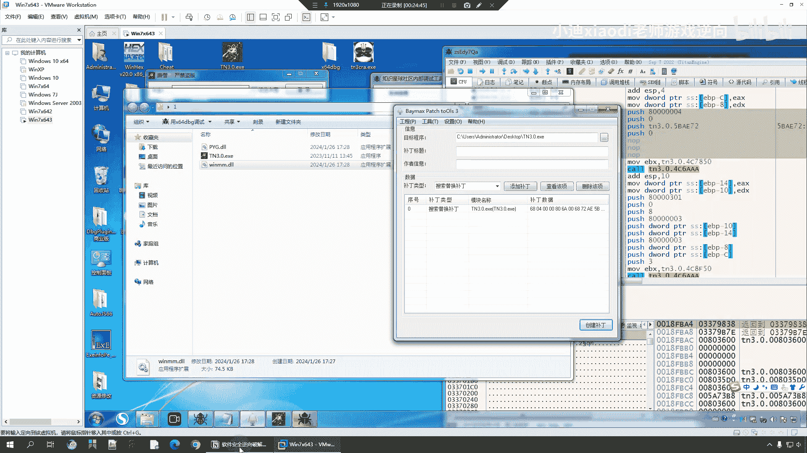
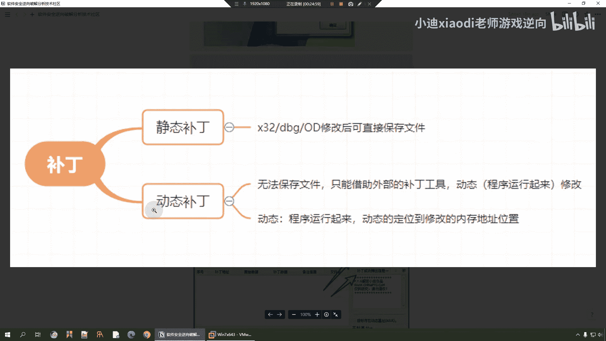
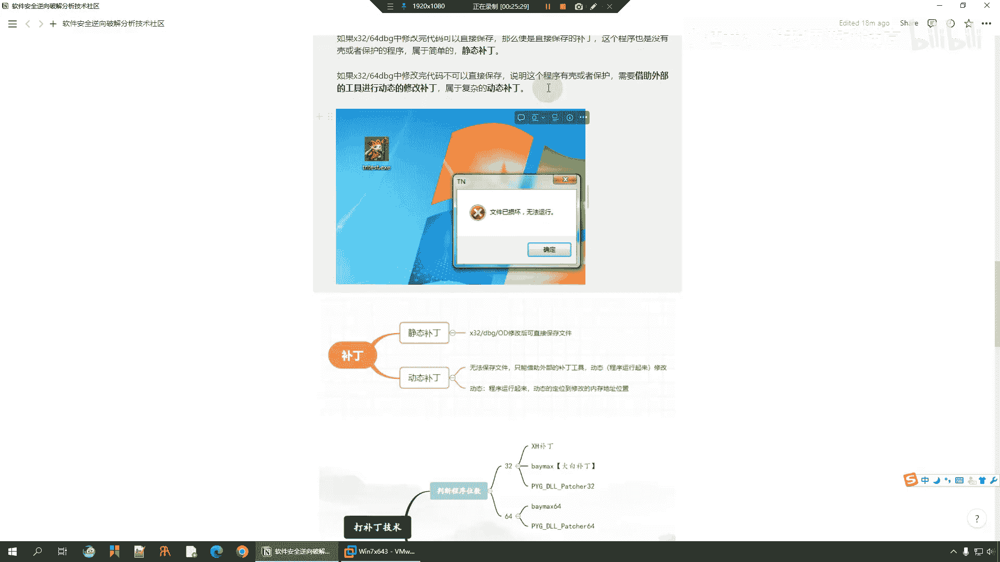

# 🧩 小白软件破解逆向反汇编逆向工程师2024最新：第六章：第三节：打补丁技术实战梳理

在本节课中，我们将学习打补丁技术。课程会先说明什么是打补丁，再区分静态补丁和动态补丁，然后通过 x32dbg、拆屎补丁工具、DLL 劫持内存补丁制作工具和大白补丁等工具，完整走一遍静态补丁失败、动态补丁成功的实战流程，最后总结内存地址补丁和特征码补丁的用法。如果希望系统学习软件安全、软件逆向破解，想自己破解小软件，可以联系社区微信加入社区；年前是最低价格，联系后可获取最新优惠价格。下面进入正式内容。


## 🛠️ 小白软件破解逆向反汇编逆向工程师2024最新：第六章：第三节：一、打补丁技术是什么

上一段做了课程概述，本节先看打补丁技术的定义。原文对打补丁技术的定义是：

> 打补丁技术就是对程序的某个内存地址的数据或代码进行修改并保存的技术手段。

这句话的重点在“修改之后并且保存”。之前分析一些软件时，会对程序进行修改，但修改后能不能直接保存，决定了它属于静态补丁还是动态补丁。可以把核心概念先写成下面这个公式：

\[
打补丁技术 = 修改内存地址处的数据或代码 + 保存修改结果
\]

如果修改后可以直接保存，就属于静态补丁。如果不能保存，或者保存之后程序运行不了，就需要依赖外部工具进行动态修改，这种属于动态补丁。也就是说，静态补丁和动态补丁不是两种完全不同的修改动作，而是根据“能不能保存并正常运行”来区分的两种落地方式。理解这个定义后，下一节我们来看静态补丁和动态补丁的具体区别。


## 🧷 小白软件破解逆向反汇编逆向工程师2024最新：第六章：第三节：二、静态补丁与动态补丁的区别

上一节弄清了打补丁技术的定义，本节来看两类补丁的区分。静态补丁的核心是修改后可直接保存文件，或者保存完文件后程序能够运行。动态补丁的核心是程序不能直接保存文件，或者保存文件后无法运行，只能借助外部第三方工具，在程序运行时动态修改内存。可以用下面两个公式概括：

\[
静态补丁 = 修改内存 + 可直接保存 + 保存后可运行
\]

\[
动态补丁 = 修改内存 + 不能直接保存或保存后不能运行 + 借助外部工具动态修改
\]

以下是两种补丁的简要对照，先建立整体印象。

- 静态补丁：使用 x32dbg 或 OD 等工具修改后，可以直接保存文件；保存后的文件能够运行，说明静态补丁具有可行性。

- 动态补丁：针对无法保存文件，或者保存文件后无法运行的情况，借助外部工具进行动态修改；程序运行起来后，动态定位到被修改的内存地址位置。

动态补丁里的“动态定位”由补丁工具完成，操作者不需要手工研究它如何动态定位，按照补丁工具的配置填写即可。静态补丁和动态补丁的基本区别清楚后，下一节我们先用静态补丁实战，看看静态补丁在什么情况下会失败。


## 🧪 小白软件破解逆向反汇编逆向工程师2024最新：第六章：第三节：三、静态补丁实战：从反调试到保存失败

上一节区分了静态补丁和动态补丁，本节用 x32dbg 做一次静态补丁实战。打开工具包，工具包里有 x32dbg。先运行目标程序，再尝试用“文件—附加”附加程序。附加时出现“发生内部错误”，这说明程序有反调试。反调试不一定只提示 `debugger has been found running in your system`，也可能表现为其他乱七八糟的错误；这类现象比较常见，看到后要立即想到是反调试导致的，程序随后也会退出。

以下是应对反调试和制作静态补丁的操作步骤，按顺序执行即可。

- 使用课程提供的工具，在工具中打开 x32dbg 运行，再打开辅助工具，然后点击“文件—附加”，此时程序不会出错。



- 点击符号，双击目标位置，右键搜索当前模块字符串，寻找值得修改的位置。示例中找到 `1970-1-1`，它很像程序或 VIP 的到期时间。





- 双击进入该位置，看到 `push ebp` 等内容，后面有一个负值，还有一个 `push 1`。尝试把 `push 1` 改成 `push 0`。

- 按空格进入编辑，把 `push 1` 改成 `push 0`，左侧对应机器码会同步变化，然后点击确定。

- 修改长度较短时，剩余字节可能被翻译成乱码代码。可以使用“恢复选区”，把多余代码改成 `nop`。原文还提到 `push 1` 后面的字节是 `BB` 一类，修改时要按实际机器码核对。

- 编辑时勾选“剩余字节以 NOP 填充”，把多余字节填充为 `nop`，点击确定，修改就完整了。

改写关系可以用下面代码表示：

```asm
push 1   ->   push 0
6A 01    ->   6A 00 90 90 90
```

这次一共改了 5 个字节。点击补丁位置的“修补文件”，给文件起名，例如 `TN3.0`、`test.exe`，保存后提示 5 个补丁已经应用，图标也正常显示。记录修改地址为 `4041FF`，可复制选区到记事本保存。随后关掉所有程序，运行修改后的程序，出现“文件已损坏，无法运行”。看到这个结果就知道静态补丁打不上。静态补丁失败后，只能借助外部工具做动态补丁。下一节我们来看动态补丁需要哪些工具，以及如何判断程序位数和壳。


## 🧰 小白软件破解逆向反汇编逆向工程师2024最新：第六章：第三节：四、补丁工具怎么选：位数、壳和补丁方式



上一节静态补丁保存后无法运行，本节转入动态补丁前的准备工作。打补丁需要很多工具，使用工具也要遵循一定思维逻辑。首先判断程序位数：程序是 32 位，就使用 32 位常用补丁工具；程序是 64 位，就使用对应的 64 位补丁工具。以下是工具选择与补丁方式的要点，先判断再动手。

- 32 位程序常用三个补丁工具；64 位程序常用两个补丁工具。其中 BayMax 又叫大白补丁，看到这个别名不要陌生。

- 补丁方法有两种。第一种是根据内存地址补丁，适用于内存地址不变动的情况。第二种是根据特征码补丁，适用于内存地址会变动的情况。



补丁方法可以用下面公式概括：

\[
地址补丁 = 内存地址固定 + 直接填写地址
\]

\[
特征码补丁 = 内存地址会变动 + 搜索一段特征字节
\]

接着查壳。用 ExeInfo 查壳，先看区段是否异常。示例中代码段、资源段之外还有两个陌生区段，正常程序没有这些区段，因此程序有异常。工具显示 `unknown` 排壳，找不到具体是什么加壳内容，但提示 `protector`，说明有保护壳，只是不知道保护壳是什么。此时用 DIE 工具进一步查壳，把程序拖进去，显示 `safe engine`，说明它的壳是 safe engine 保护壳。查壳时可以 ExeInfo 和 DIE 配合使用。知道程序有壳后，一般使用动态打补丁技术。工具和壳判断清楚后，下一节用拆屎补丁工具做一次动态补丁实战。


## 🩹 小白软件破解逆向反汇编逆向工程师2024最新：第六章：第三节：五、拆屎补丁工具实战：动态定位内存地址

上一节完成了位数、壳和补丁方式的判断，本节使用拆屎补丁工具实战。找到拆屎补丁工具，把目标软件拖进来，工具会显示程序路径。以下是拆屎补丁工具的动态补丁配置与验证流程，按顺序填写和测试。

- 修改标题：例如把标题改成 `111`。程序是 EXE 程序。

- 填写内存地址：填入刚才记录的地址 `4041FF`。

- 填写修改指令：先运行程序并附加，找到 `1970` 所在位置，按空格进入二进制编辑，把后面代码改成 `0`，剩余字节以 `nop` 填充并确定，复制修改后的选区。修改指令为 `6A00909090`，也就是 `6A00` 加三个 `90`。填入后点击添加。

- 生成补丁：点击生成补丁，起名例如 `TN3.C2A.exe`，保存。

运行补丁时，如果直接点击“运行并破解”出现“已经停止工作”，说明该位置可能不支持直接破解。可以先运行目标程序，再点击“已运行破解”，工具会检测程序状态，然后点击破解，破解成功，标题也改了。用 x32dbg 附加程序，跳转到 `4041FF` 查看，内存地址修改成功。动态补丁的原理就是程序运行起来后，由补丁工具把该内存地址的数据改掉。拆屎补丁工具还提供很多自定义配置，以下是常见配置项，可按需求选用。

- 修改图标和右侧图片，右侧图片可以换成群二维码等图片。

- 右图可以添加网站链接，点击图片弹出网址；右图可以设置气泡提示。

- 程序运行后弹出信息框，例如提示加群；运行后弹网页；破解后弹信息框；破解后弹网页；临时信息中填写 QQ 号。

- 修改皮肤界面，工具提供多种界面可选；设置补丁破解延迟；查看补丁界面概览。

- 检测调试器反调试，可以让程序死机、格盘或蓝屏；还可以给程序加壳。

- 破解增强支持拖拽破解，鼠标按住补丁右侧图片拖拽到程序上即可。

- 补丁授权可以启用。示例中到期日期从 1 月 26 日改到 1 月 31 日，失效日期也到 1 月 31 日，注册码使用简单授权，并填写密钥因子。先生成补丁并运行，程序会提示机器码，让客户复制机器码；密钥根据密钥因子生成，激活后实现一机一码，一台电脑对应一个注册码。



拆屎补丁工具功能较多，下一节我们看另一个 DLL 劫持内存补丁制作工具。


## 🔗 小白软件破解逆向反汇编逆向工程师2024最新：第六章：第三节：六、DLL 劫持内存补丁制作工具

上一节拆屎补丁工具的自定义功能很丰富，本节看 DLL 劫持内存补丁制作工具。原文口述为“DL 劫持内存补丁制作工具”，通常指 DLL 劫持补丁。它的用法和前面大同小异。以下是 DLL 劫持补丁工具的关键填写项，重点是数据长度一致。



- 把需要破解的程序路径放到工具中。

- 填写补丁地址。

- 填写原数据和补丁数据。原数据和新数据长度要一致。前面破解时修改的是 `6A00909090`，共 5 个字节，因此原数据填 5 个字节，新数据也填 5 个字节。

长度一致可以写成下面关系：

```text
原数据长度 = 新数据长度 = 5 字节
原数据示例：6A 01 ?? ?? ??
新数据示例：6A 00 90 90 90
```

填写完成后点击生成即可。这个工具也支持补丁成功弹出网页、补丁成功弹出信息等额外设置，但自定义属性没有拆屎补丁工具多。DLL 劫持补丁工具介绍完后，下一节我们看大白补丁，并重点处理特征码和延迟时机。


## 🐻 小白软件破解逆向反汇编逆向工程师2024最新：第六章：第三节：七、大白补丁实战：特征码、延迟与依赖文件

上一节看了 DLL 劫持补丁工具，本节使用大白补丁。大白补丁即 BayMax。运行大白补丁，把文件添加进去，选择“搜索替换补丁”，填写原数据和补丁数据，添加并保存即可。以下是使用大白补丁制作和谐补丁的实战流程，包含特征码处理和延迟设置。

- 补丁工具启动后会有弹窗。如果不想要弹窗，点击设置，勾选“补丁启动不弹窗”。工具还可以选择英文、俄语等语言。

- 把程序拖过来，选择搜索替换补丁，点击添加补丁。填写原数据。先运行程序并附加，跳转到目标地址。

- 因为 `push 1` 在程序中很多，直接搜索 `push 1` 会搜出很多结果，容易改错。小诀窍是把特征改长一点。选中连续字节，右键二进制复制；也可以用 CE 或内存布局中的“搜索匹配特征”搜索，查看能搜出多少。示例中只搜索出一块，说明特征较唯一。

- 把 `push 1` 改成 `6A00909090`。按空格把值改成 `0`，确定后拉选字节，右键二进制复制并粘贴。长度一定要一致。可以加注释说明“改的是 1970 那边的 push”，然后点击添加并保存搜索替换补丁。

- 设置已经完成，点击创建补丁，点击确定。补丁名字叫和谐补丁。在桌面新建一个文件夹，把目标程序复制一份到该文件夹，把和谐补丁也放到同一文件夹，创建成功。

- 运行和谐补丁，会出现弹窗，选择“执行补丁”，提示补丁成功，工具会把一些文件释放到该目录。关闭后运行目标程序。

- 检查修改时发现修改失败。原因可能是程序运行后时机不成熟。双击补丁设置，选择“补丁数据需程序解码后判定”，等待时间设置为 2000 毫秒，即 2 秒，确定并保存，然后重新创建补丁。

- 再次运行和谐补丁，执行补丁成功，运行程序并等待 2 秒，让补丁修改目标地址。随后用 x32dbg 附加程序，跳转到目标地址查看，修改成功。

延迟关系可以写成下面公式：

\[
补丁生效时机 = 程序运行后 + 等待 2000 毫秒（2 秒）
\]

这个延迟要灵活运用。如果希望程序运行后自动完成破解，可以设置延迟 2 秒。测试完成后，和谐补丁可以删掉，删掉后目标程序仍然处于破解状态；但两个 DLL 文件要保留，它们是重要的依赖文件，不要删除。到这里，静态补丁、动态补丁和常用补丁工具都走完了，下一节做总结。


## 📌 小白软件破解逆向反汇编逆向工程师2024最新：第六章：第三节：八、本节总结

上一节完成了大白补丁和延迟时机的实战，本节总结今天的内容。补丁分为两种：静态补丁和动态补丁。静态补丁是修改后可以直接保存文件，或者保存之后程序可以直接运行；如果保存后不能运行，就直接换动态补丁。动态补丁是程序运行起来后，动态定位到修改的内存位置。动态定位有两种方法：第一种是内存地址不变动时，直接填写内存地址；第二种是内存地址会变动时，填写特征码。核心结论可以写成下面公式：



\[
先判断：能保存且能运行 \rightarrow 静态补丁
\]

\[
否则：程序运行时定位并修改 \rightarrow 动态补丁
\]

\[
动态定位 = 固定地址补丁 \quad 或 \quad 特征码补丁
\]





本节课中我们一起学习了打补丁技术的定义、静态补丁与动态补丁的区别、反调试处理、静态补丁保存失败的判断、工具位数与查壳、拆屎补丁工具、DLL 劫持内存补丁制作工具、大白补丁、特征码补丁、延迟设置和依赖文件保留。如果希望深入学习软件安全逆向破解分析基础，可以联系社区微信，年前有优惠；课程为 2024 最新视频教学。下期再见。

