# 🧭 小白软件破解逆向反汇编逆向工程师2025最新：第十讲：基础突破02 修改数据与内存权限


大家好，我是小刘老师；学习软件安全逆向可以找小李老师。有朋友会疑问：讲逆向有这么多人听，这个逆向到底能干什么。逆向可以突破一些软件的限制，也可以分析一些软件。比如有一个游戏辅助的网络验证卡密软件，必须购买它的卡密才能登录，没有卡密就登录不上，这时就可以尝试突破这个软件的限制。另一种情况是自己开发一个软件并加上卡密，如果有人破解你的软件，就需要学习这门技术，提高软件的防护程度，防止软件被破解，维护自己的权益。学习这门技术后，仅做技术交流，自己使用，不要进行传播。零基础也可以学习，课程从零基础开始讲起。本节是第十讲基础突破02，主题是修改数据与内存权限。课程以真实的网络验证卡密辅助软件为例，而且该软件带有强壳；现在不了解什么是壳也没有关系，左侧内容会讲到。在以往视频内容中讲过，一个程序主要由两部分构成：代码和数据。代码属于操作者，数据属于被操作者。比如人使用手机，人是使用手机的一方，要做手机的主人。代码是操作者，数据是被操作者；有操作者和被操作者，软件的生态系统就完善了。本节内容主要分四部分：内存地址数据的修改、修改后的恢复、修改后无法保存的处理、内存权限。下面围绕这四个环节逐个讲解。


**核心关系可以用下面的公式表示：**

```text
程序 = 代码 + 数据
代码 = 操作者
数据 = 被操作者
数据定位 = 内存地址
```


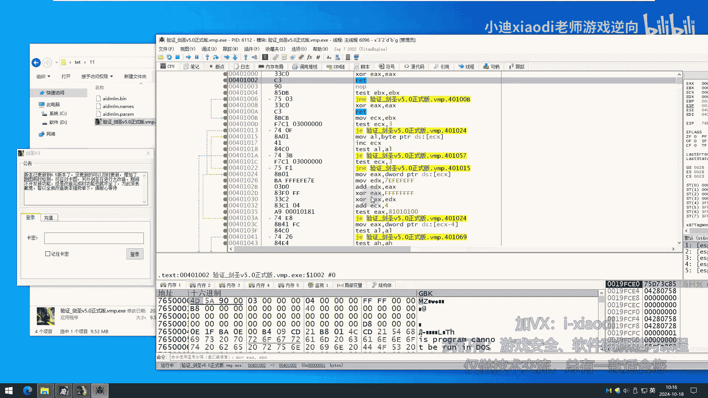

上一部分说明了程序由代码和数据构成，本节来看第一部分：内存地址数据的修改。数据放在内存中，内存空间很大，需要标识某一片数据属于谁，内存地址就是用来标识数据的。因此修改一个数据，首先要找到它对应的内存地址。想要更改数据，就要找到数据的内存地址。


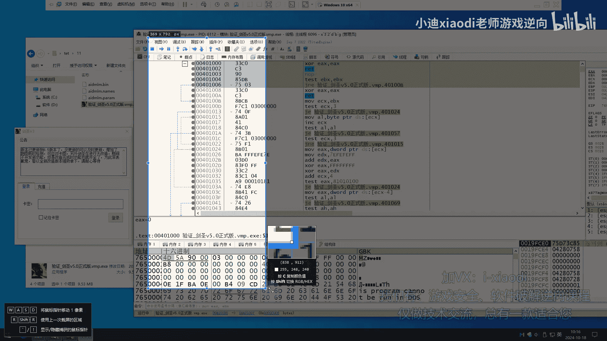

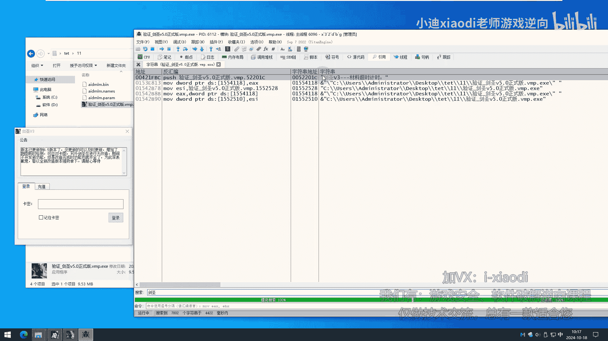

**修改字符串数据的定位关系可以表示为：**

```text
字符串 = 文本数据
字符串数据存放在内存中
字符串地址用于标识该字符串数据
修改数据 -> 先找到内存地址
```


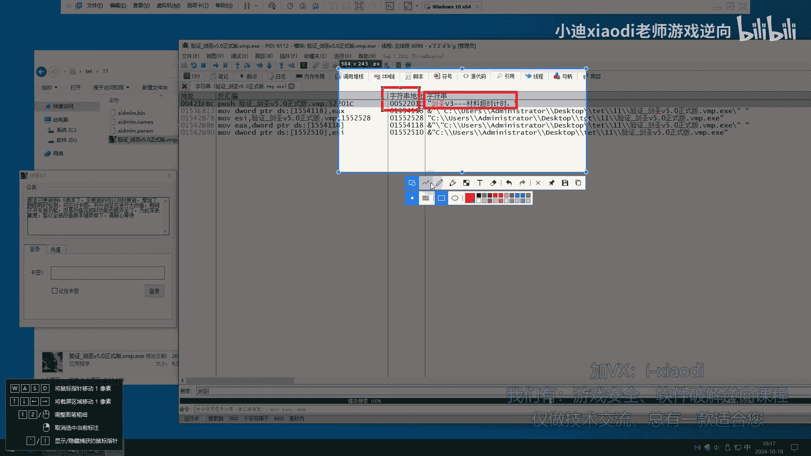

如果想学习并了解这个软件，可以加入右下角的社区，联系加入社区后可以获取所有课件；拿到课件后可以更好地练习。接下来运行这个软件。打开工具包，工具包中有一个调试分析工具，之前讲过如何使用。运行软件和调试工具后，当前两者互相独立。点击文件，点击附加，找到目标软件，点击附加，工具就会把软件“拿捏住”，两者浑然一体，可以进入软件内部，相当于一种寄生状态。查看程序数据时，这个程序叫剑圣，点击符号，出现剑圣，双击过来。这里左边是代码，最左边是代码的内存地址，这些是代码内存地址；另一边是数据的内存地址。这些内容上节课讲过，本节用上了。


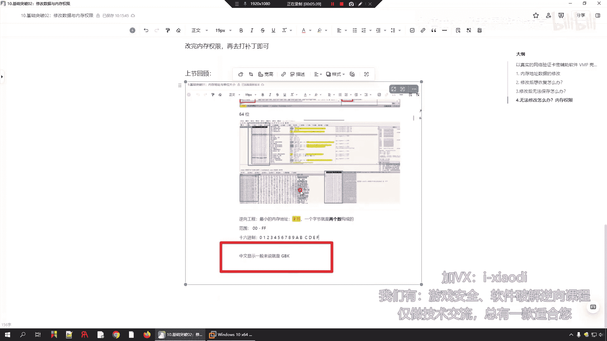

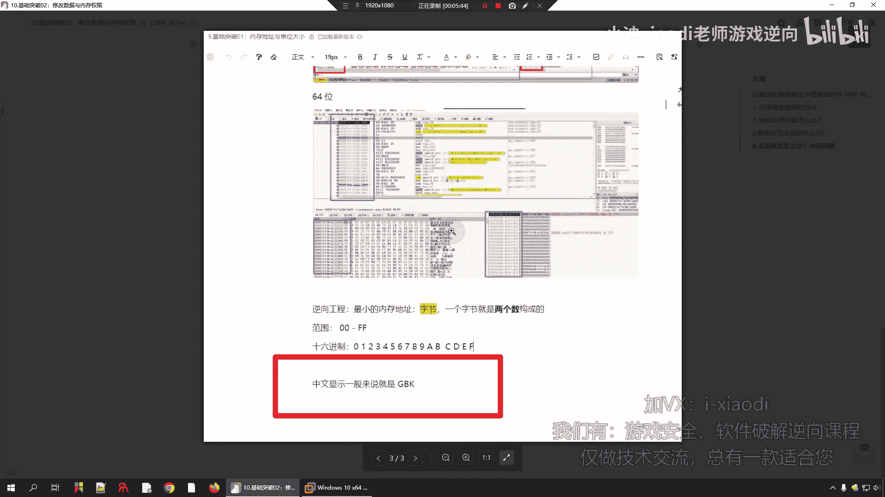

接下来进行实际搜索和修改。鼠标右键搜索当前模块字符串，这是之前讲过的操作。搜索“剑圣”，可以看到一个“剑圣”，字符串地址显示为522201C/52201C。字符串是文本，也就是一段话，右侧这个字符串的地址是52201C。字符串属于数据，这个数据放在内存中，是一种存储关系。双击过来后会显示谁使用了这个字符串；可以看到代码这边引用了该字符串。当前还不了解代码，后面会讲，本节先了解数据。这里也会显示数据地址52201C。鼠标右键在内存窗口中转到，这就是内存窗口。如果地址显示不全，可以拖动窗口。如果显示乱码，说明中文显示类型需要调整；在这个工具中中文一般使用GBK。鼠标右键点击16进制，找到代码页，在里面找到GBK，点击确定，就可以看到GBK中文显示。此时中文显示正常，说明又学会一个操作，可以给自己鼓励。


现在要修改数据，把“剑圣”修改成“小迪”。可以先拖动窗口，多拖几行、多拖几个字节都没有关系。鼠标右键选择二进制编辑，这就是修改内存的一种方式。修改时，哪里能正常显示，就在哪里改；如果某些位置看不明白，就不要在那里改，要在能正常显示的地方改。把“剑圣”改成“小迪”，更改完成后内容会变成红色。修改成功的标准就是变成红色。


以上完成了定位和修改，接下来看修改后的恢复。修改错误时，比如把小迪改成了小李、大迪或迪迦，就需要恢复。恢复方法是先选中修改区域，然后鼠标右键恢复选区。选中后鼠标右键恢复选区，就可以恢复。试一下恢复选区，内容恢复成“剑圣”，恢复操作就是这么简单。


恢复操作之后，本节来看修改后无法保存怎么办。修改完成后，可以点击位置去打补丁。先修改一下，例如二进制编辑改成“小迪”。修改后要保存到原程序，点击创口贴，点击修补文件，随便起名字叫111。工具会提示：改了四个字节，但有零个应用。这说明修改失败了。修改失败的情形就是这样。遇到这种情况，可以使用补丁工具去动态修改；保存问题也可以解决，后面再讲动态保存补丁。先讲如何动态修改。


**动态补丁的基本思路可以表示为：**

```text
原特征码 -> 搜索定位内存地址 -> 二进制编辑修改 -> 长度保持一致 -> 写入补丁
```


每次打开程序后，可以先恢复选区。打开补丁工具，先关掉工具再重新打开，查看流程。程序要先运行起来，把原来的程序拖过来，原来的程序不要。拖入后点击打开进程，这里会提示原特征码。什么是特征码，后面马上讲。实际操作时，把这一行复制一下，鼠标右键二进制编辑复制，把这一行内容添加到补丁工具。然后搜索，发现只有一个结果，搜索到的地址刚好是52201C。要修改成“小迪”，先编辑；注意长度一定要一致。查看最后位置到哪里，最后到C4/C1附近。在二进制编辑中点击复制，然后增加，显示修改前和修改后的内容。可以先恢复选区，然后点击开启/关闭补丁试一下；会发现修改失败，没有修改上。此时点击强制提权写入，再修改，就可以修改成功。如果发现修改不上，就强制提权写入，然后再修改。通过这种方式实现动态修改。


动态修改的用途在于：每次打开程序都要跳转到对应位置修改，比较麻烦；补丁工具可以保存配置。当前已经有配置后，保存配置，例如保存到文件夹中，名字叫111或“剑圣”，点击保存，保存成功。然后把程序关掉，重新运行软件，也重新打开工具。把程序拖过来，点击打开进程，点击读取配置，选择“剑圣”。然后搜索原特征，地址52201C就是这个位置。点击强制提权写入，点击开启补丁，修改成功。每次可以用这个工具快速定位数据，实现动态写入。


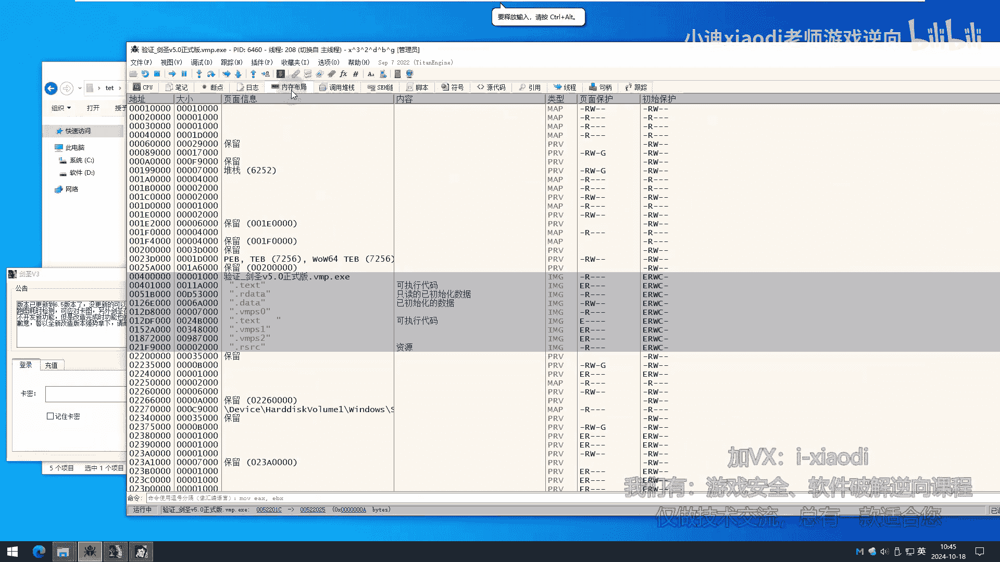

上一节讲了动态补丁，本节来看第四部分：内存权限。用一些工具修改别的内存数据时，可能出现无法修改、改不动的情况。可以使用本工具强制提权写入，但最好了解底层原理和底层逻辑，底层原理就是内存权限，简单了解即可。回到DPG，点击内存布局，可以看到这个游戏辅助软件大概的内存空间。在右边可以看到页面保护。页面保护中的字母不一样，字母有含义，也说明不同内存空间之间存在差异，不是一模一样的。差异就体现在这些字母中，了解这些字母即可。这些字母是英文单词首字母的大写。E表示执行，执行专指代码，因为只有代码才能执行，数据不能执行。R表示读，W表示写，G表示保护。看到E就是可执行；看到R就是可读；RW是读写权限；R是只读权限；ER是可执行且可读；ERW是可执行、可读、可写。它们可以相互组合。这部分今天简单了解，回去可以自己练习。


**常见页面保护字母可以表示为：**

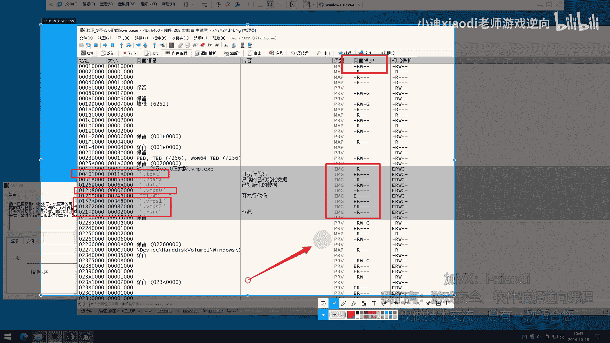

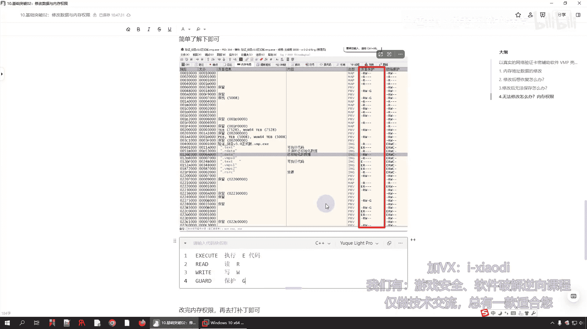

```text
E = Execute = 执行，通常对应代码
R = Read = 读
W = Write = 写
G = 保护
R  = 只读
RW = 可读可写
ER = 可执行可读
ERW = 可执行可读可写
```


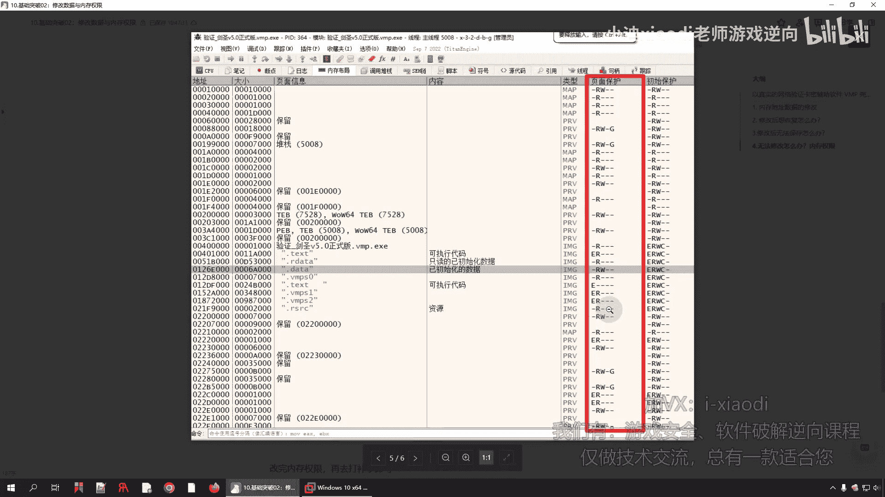

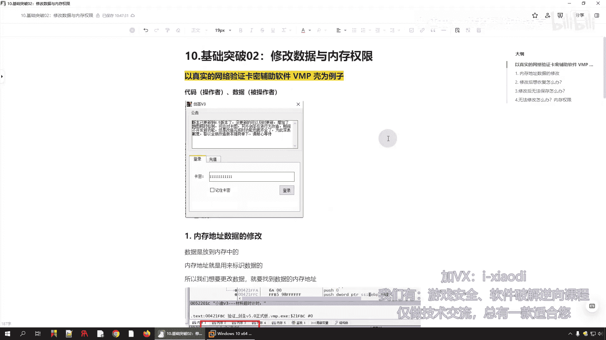

本节课程中一起学习了四部分内容：内存地址数据的修改、修改后的恢复、修改后无法保存时使用补丁工具动态修改、内存权限的含义。课程以真实网络验证卡密辅助软件为例，演示了定位字符串地址、二进制编辑、恢复选区、动态补丁和强制提权写入等操作。学习后仅做技术交流，自己使用，不要传播。回去后可以自己练习并简单了解内存权限，下节再见。

