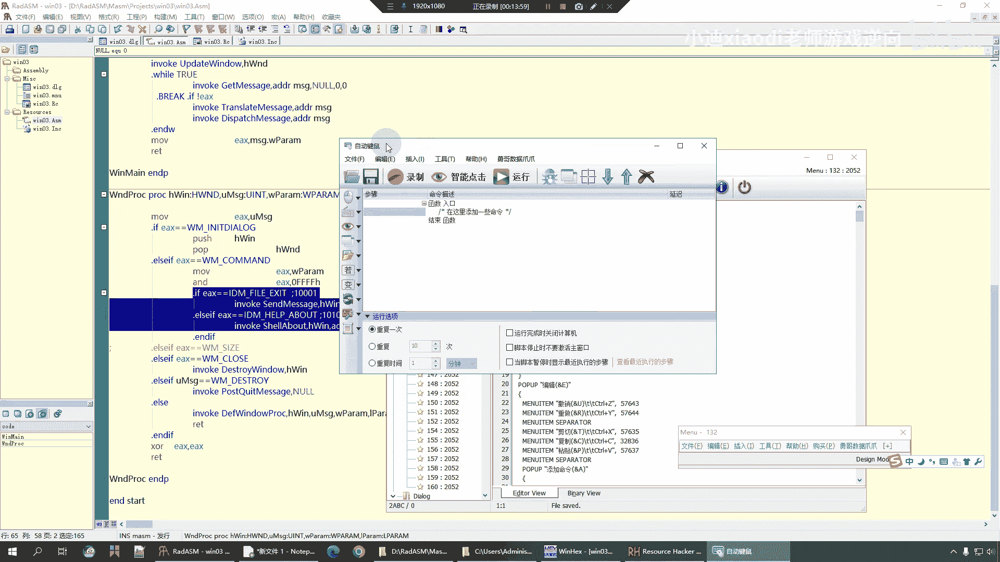

# 小白软件破解逆向安全反汇编工程师2024最新：00：课程概述与学习目标 📌

在本节课中我们将要学习“菜单”这一主题。菜单就是打开一个程序后，窗口顶部出现的“文件、编辑、搜索、视图”这一栏，点击这些栏目可以执行相应功能。本期内容围绕菜单资源的识别、打开、编辑、消息调用、Hook 补代码以及修改别人程序菜单展开。理解这条链路后，再看程序顶部的菜单栏，就不会只把它当成一个普通界面元素，而会知道它背后对应资源定义和消息处理逻辑。下面从最基础的概念开始。


## 小白软件破解逆向安全反汇编工程师2024最新：01：认识菜单与资源文件 🧩


上一节概述了本期要学习的内容，本节来看看什么是菜单以及菜单和资源文件的关系。菜单是程序窗口上方的一栏，常见项包括文件、编辑、搜索、视图等，通过点击这些项可以实现功能。从汇编角度理解，如果用汇编写程序，菜单在设计窗口时并不容易直接显示出来，也没有一个很直观的体现。实际开发中，菜单通常通过菜单编辑器编辑，最终编辑到资源文件里，常见就是 `.rc` 资源文件。资源文件可以打开查看，一般可以用 Resource Hacker 这类资源编辑工具打开，视频里也演示了尝试打开资源文件的过程。

以下是本节需要先建立的基本认识：

- 菜单是程序顶部的功能栏，常见有文件、编辑、搜索、视图等项目。
- 从汇编视角看，菜单在设计窗口时不容易直接显示，需要借助菜单编辑器编辑。
- 菜单最终会进入资源文件，原文口播中的“2C、2CRES、2RC2C”可统一理解为 `.rc` 资源文件。
- 资源文件可以被工具打开，视频中使用 Resource Hacker 这类工具进行演示。
- 把 `.rc` 文件和 `dlg.rc` 拖入工具后，可以看到它对应的就是界面资源。
- `.rc` 里的界面资源看起来简单，本质并不复杂。

> 原文口播里的“2C”“2CRES”“2RC2C”等说法，可统一理解为 `.rc` 资源文件；口播里的“dlog/dog/dlg”可理解为对话框资源。

本节说明菜单并不是一个神秘控件，它背后对应资源文件。下一节我们继续深入，看看菜单资源为什么说本质就是纯文本。

## 小白软件破解逆向安全反汇编工程师2024最新：02：菜单资源的本质与打开方式 📄

上一节认识了菜单和资源文件的关系，本节来看看菜单资源的本质以及多种打开方式。把菜单资源拖过来后可以看到，它没有多少复杂内容。用 V hack 这类工具拖入查看，会发现里面主要就是一些文本定义，并没有特别复杂的结构。甚至可以用鼠标右键选择记事本直接打开，看到的内容仍然是一堆定义。比如 `IDM_...` 这样的名字对应一个 ID 号码，可以把它理解成“名字对号码”：这是名字，这是号码；再往下还有整体结构，例如 `BEGIN`、`POPUP "file"`、`exit` 这样的定义。

以下是菜单资源本质的相关要点：

- 菜单资源拖入工具后可以看到内容并不复杂。
- 用 V hack 这类工具拖入查看，会发现主要内容就是文本。
- 可以用鼠标右键选择记事本直接打开资源文件。
- 文件里是名字和 ID 号码的对应关系，例如 `IDM_...` 对应某个编号。
- 文件里还有整体结构定义，例如 `BEGIN`、`POPUP "file"`、`exit`。
- 菜单资源的本质就是一堆定义，这些定义放在资源文件里。
- 这个文件本质就是一堆文本，没有别的特殊内容。
- 菜单资源不需要额外图片，是 Windows 程序开发提供的一种纯文本资源。
- 菜单原理就是纯文本定义实现，纯文本定义实现就是它的核心。
- 可以有多种方式打开 `.rc` 文件，VS2019 提供的菜单编辑器只是其中一种更人性化的方式。
- VS2019 的菜单编辑器不是记事本方式，而是提供更友好的界面去编辑里面的文本。

下面用一段简化代码描述菜单资源的结构，实际内容会因程序不同而变化：

```rc
BEGIN
  POPUP "file"
  BEGIN
    MENUITEM "exit", IDM_EXIT
  END
  POPUP "help"
  BEGIN
    MENUITEM "about", IDM_HELP
  END
END
```

本节明白了菜单资源本质是纯文本定义，不需要额外图片。下一节我们来看看菜单资源在程序里是怎样被调用和筛选的。

## 小白软件破解逆向安全反汇编工程师2024最新：03：菜单消息调用与ID过滤 📨

上一节说明了菜单资源本质是纯文本定义，本节来看看菜单的调用逻辑。菜单的调用并不复杂，主程序的主界面里并没有直接写一大堆调用代码，它实际上是在监控每一个菜单栏菜单消息。比如程序里有一个 `File -> Exit`，首先 `command` 对应菜单消息，也就是 `WM_COMMAND` 消息。如果收到的是菜单消息，程序就在这里进行过滤，过滤的核心就是菜单项的号码。比如 `exit` 的号码是 `10001`，如果号码是 `exit` 对应号码，就执行相应动作；如果号码是 `help` 对应号码 `10101`，就调用另一个函数。每个号码对应一个功能，`SendMessage` 会调用一个 API 函数，`ShellAbout` 也会调用一个 API 函数，程序根据号码进行筛选。

以下是菜单消息调用的关键逻辑：

- 主程序主界面没有直接调用菜单功能，而是监控菜单栏消息。
- `command` 对应菜单消息，常见消息是 `WM_COMMAND`。
- 收到菜单消息后，程序会过滤菜单项号码。
- `exit` 的号码在视频口播中出现 `10001` 与 `1001` 的差异，实际以资源中看到的 ID 为准。
- `help` 的号码是 `10101`，不同号码对应不同功能。
- `SendMessage` 调用一个 API 函数，`ShellAbout` 调用一个 API 函数。
- 构建并运行后可以看到，选择 `File -> Exit` 会执行关闭逻辑。
- 如果是 `exit`，程序会调用 `SendMessage`，发送 `WM_CLOSE` 关闭窗口。
- 如果是 `IDM_HELP` 或 `about`，程序会调用对应函数。
- 整体逻辑就是根据菜单消息里的 ID 号码筛选并执行动作。


可以用下面的公式概括菜单消息筛选逻辑：

\[
\text{处理动作}(id)=
\begin{cases}
WM\_CLOSE, & id = \text{IDM\_EXIT}\\
ShellAbout(\cdots), & id = \text{IDM\_HELP}\\
\text{执行自定义功能}, & id = \text{新增菜单ID}
\end{cases}
\]

也可以用简化代码表示：

```c
if (msg == WM_COMMAND) {
    switch (LOWORD(wParam)) {
        case IDM_EXIT:
            SendMessage(hWnd, WM_CLOSE, 0, 0);
            break;
        case IDM_HELP:
            ShellAbout(hWnd, ...);
            break;
        case 10002:
            /* 执行新增 open 菜单功能 */
            break;
    }
}
```

本节理解了菜单消息和 ID 过滤的关系。下一节我们动手修改自己的程序菜单，看看资源编辑器怎样添加菜单项。

## 小白软件破解逆向安全反汇编工程师2024最新：04：修改自己的程序菜单 🛠️

上一节介绍了菜单消息调用和 ID 过滤，本节来修改自己程序的菜单。视频里已经生成了一个自己的程序，修改时使用 Resource Hacker 这类工具把程序拖过来。菜单对应的英文是 `menu`，对话框对应的英文是 `dialog`，口播里也会说成 `dlog/dog/dlg`。在工具里可以看到 `dialog` 资源和 `menu` 资源。添加菜单项时，可以勾选 `design mode`，也就是设计模式。勾选后就可以点击菜单资源进行编辑，双击可以添加内容，例如添加一个 `open`。还可以添加图片。先加标题时使用 `caption`，`caption` 就是标题，比如已有 `exit`，再添加一个 `open`。菜单项还有 ID，ID 需要起名或编号；视频里看到 `exit` 的 ID 有 `0` 和 `10001` 等不同说法，实际以当前资源为准。为了顺着编号来，可以给新项 `10002`。菜单项下方还有一些额外选项，一般不需要修改，直接点击 `OK` 即可。点击 `OK` 后可以看到添加了一个 `open`。

以下是修改自己程序菜单的操作要点：

- 使用 Resource Hacker 这类工具把程序拖入。
- 菜单对应英文 `menu`，对话框对应英文 `dialog`。
- 在工具里可以看到 `dialog` 和 `menu` 资源。
- 勾选 `design mode` 设计模式后，可以点击并编辑菜单资源。
- 双击可以添加菜单项，例如添加 `open`。
- 菜单项可以加图片，也可以设置 `caption` 标题。
- 新菜单项需要设置 ID，视频里给 `open` 使用 `10002` 顺着编号。
- 菜单项下方有额外选项，一般不需要处理，直接点击 `OK`。
- 点击 `OK` 后可以看到新增了 `open` 菜单项。
- 不仅可以竖向往下添加，还可以横向添加菜单项。
- 横向添加时如果双击点不动，可以鼠标右键选择 `insert`。
- 通过 `insert` 可以起标题，例如帮助、视图等。
- 视频里添加了“视图”菜单项，点击 `OK` 后出现。
- 在视图里还可以双击添加子项，例如模仿原程序添加“工具栏”。
- 添加工具栏后点击 `OK`，然后点击 `compile` 编译。
- 编译后点击保存，直接保存资源修改。
- 保存后运行自己的程序，可以看到新增菜单项已经出现。
- 此时菜单项还没有代码，例如 `File -> open` 还没有对应功能代码。

下面用简化结构表示新增菜单项和 ID 的关系：

```rc
POPUP "file"
BEGIN
  MENUITEM "exit", 10001
  MENUITEM "open", 10002
END

POPUP "视图"
BEGIN
  MENUITEM "工具栏", 11000
END
```

本节完成了自己程序菜单的添加和保存。下一节我们来看看怎样用 Hook 给新增菜单补上功能代码。

## 小白软件破解逆向安全反汇编工程师2024最新：05：用Hook给新增菜单补功能 🪝

上一节修改了自己程序的菜单，但新增菜单还没有代码，本节来看看怎样给新增菜单补功能。要给程序做额外处理，需要用到 Hook 技术。如果具备一定反汇编能力，会知道怎样在程序里添加处理逻辑。基本思路是在程序里做 Hook，把菜单消息先拦截到，然后判断菜单项 ID。视频里新增的 `open` 菜单项编号口播出现 `1002` 与 `10002` 的差异，实际以资源编辑器里看到的 ID 为准。工具栏项的 ID 也需要额外修改，因为工具栏项最终也要通过一个数字 ID 来筛选。工具栏里的 ID 需要改成一个数字，例如 `10`、`1011`、`11000`，视频里把工具栏 ID 设置为 `11000`。改完后点击 `compile` 编译，先关闭正在运行的程序，再保存并运行。运行后工具栏对应的 ID 就是 `11000`。过滤时查看 `File -> Exit` 的号码，视频口播出现 `1001` 与 `10001` 的差异，可以注释一下实际 ID。不同菜单项根据不同的 ID 进行过滤，然后把处理代码添加进来。

以下是使用 Hook 补功能的关键步骤：

- 新增菜单只有界面资源还不够，还需要代码处理消息。
- 需要用到 Hook 技术拦截菜单消息。
- 拦截到 `WM_COMMAND` 后，判断菜单项 ID。
- 视频里新增 `open` 的 ID 口播有 `1002` 与 `10002` 差异，实际以资源中 ID 为准。
- 工具栏项的 ID 也需要修改，因为工具栏项需要通过数字 ID 筛选。
- 可以把工具栏 ID 设置为 `11000` 这类不冲突的数字。
- 修改后点击 `compile` 编译，先关闭程序，再保存并运行。
- 运行后确认工具栏 ID 为 `11000`。
- 过滤时查看 `File -> Exit` 的 ID，视频口播出现 `1001` 与 `10001` 差异，实际以资源为准。
- 根据不同的 ID 过滤消息，并把对应代码添加进去。
- 需要写一个 Hook，让消息先经过自己的处理逻辑。

下面用伪代码描述 Hook 判断 ID 的思路：

```c
Hook_Message(...) {
    if (msg == WM_COMMAND) {
        if (id == 10002) {
            /* 处理新增 open 菜单 */
        }
        if (id == 11000) {
            /* 处理工具栏 */
        }
    }
    return CallNextHookEx(...);
}
```

本节说明了新增菜单功能的实现离不开 Hook 和 ID 判断。下一节我们换一个对象，看看怎样分析别人的程序并修改它的菜单。

## 小白软件破解逆向安全反汇编工程师2024最新：06：分析并修改别人的程序菜单 🔍

上一节在自己程序上完成了菜单修改和 Hook 思路，本节来看看别人的程序怎样处理。别人的程序同样可以用 Resource Hacker 这类工具分析。首先把程序拿过来，通过工具查看后发现 `dialog` 资源看起来不特别对，之前分析时也发现一个现象：关键字符串在 `dlg` 中，之前已经看到它在这个 `dlg` 里。把 `dlg` 拖过来后，可以看到 `menu` 就是菜单，`dialog` 就是窗口界面，程序界面里出现“自动键鼠”等内容。运行程序对照界面，可以看到资源里的界面和运行界面很像。继续往下看，界面里还有一些英文提示文本。双击查看资源内容，可以看到“查找图片”等各种各样的东西，都在资源里。主要关注 `menu`，点击查看菜单资源。视频里提到“透儿”对应工具里的内容，工具项在这里没有直接显示，继续往下看，才看到文件、编辑、帮助等菜单项。逐项查看包括编辑、撤销、工具、热键、运行等，发现不是目标项，再往下看，应该还有替换相关项。继续往下走，应该就是那个菜单资源，`menu` 里有些项可能没有显示出来。查看文件相关菜单项，其中有“编译为EXE”和“退出”。

以下是分析别人程序菜单的操作要点：

- 别人的程序也可以使用 Resource Hacker 这类工具分析。
- 把程序拖入工具后，先查看 `dialog` 资源。
- 最初看 `dialog` 时感觉不特别对，之前分析发现关键字符串在 `dlg` 中。
- 把 `dlg` 拖过来后，可以看到 `menu` 是菜单，`dialog` 是窗口界面。
- 资源里能看到“自动键鼠”等界面内容。
- 运行程序对照界面，资源界面和运行界面很像。
- 界面里还有一些英文提示文本。
- 双击资源可以查看“查找图片”等内容，这些内容都在资源里。
- 主要关注 `menu` 菜单资源。
- 工具相关菜单项里可能没有直接显示目标内容，需要继续往下查看。
- 菜单项里可以看到文件、编辑、帮助、撤销、工具、热键、运行、替换等内容。
- 有些菜单项可能没有显示出来，需要结合文件菜单查看。
- 文件菜单里有“编译为EXE”和“退出”等项。

接下来给别人的程序添加菜单项。视频里添加的是“勇哥数据抓抓”，口播中也出现“勇哥数据转码”“数据转染”等说法，可理解为同一个新增菜单名称。添加时点击加号并双击，先复制一下名称。ID 需要写，因为后面要通过 ID 过滤功能，ID 必须写。查看退出项的 ID 是 `32802`，为了不冲突，可以写 `32803`，`32803` 应该不会冲突，于是把 ID 设置为 `32803`。确认后“勇哥数据转码”就出来了。然后在这里使用 `insert` 添加“勇哥数据转码”，这个菜单项的 ID 可以先给 `0`，因为后面还可以在子项里添加内容。双击子项，把名称设为“抓抓”，再给子项起一个不重复的 ID，例如 `10086`，点击 `OK`。这时点击编译可能不行，需要先把程序关掉，关掉后再编译。编译没有问题，显示 `succeed`，然后保存，直接保存。运行程序后，可以看到“勇哥数据转码”菜单项已经出现。

以下是给别人的程序添加菜单项的关键点：

- 添加菜单项时可以点击加号并双击。
- 新增菜单名称可以是“勇哥数据抓抓”，口播中的“数据转码/数据转染”可理解为同一菜单名称。
- 菜单项 ID 需要写，因为后面要通过 ID 过滤功能。
- 查看退出项 ID 是 `32802`。
- 为了不冲突，新增菜单项 ID 使用 `32803`。
- 确认后“勇哥数据转码”菜单项出现。
- 使用 `insert` 添加“勇哥数据转码”。
- 这个菜单项 ID 可以先给 `0`，后面还可以添加子项。
- 双击子项，把名称设为“抓抓”。
- 子项 ID 不能重复，视频里使用 `10086`。
- 点击 `OK` 后完成子项添加。
- 点击编译可能失败，需要先关闭程序。
- 关闭程序后再编译，显示 `succeed`。
- 保存后运行程序，可以看到“勇哥数据转码”菜单项出现。
- 如果还要添加功能，需要在这里做 Hook 技术，写额外代码。
- 还需要让程序加载你的代码，这需要写额外内容，也需要一定技术。

本节完成了别人程序菜单的分析、添加、编译和运行验证。下一节我们对本期内容做总结。

## 小白软件破解逆向安全反汇编工程师2024最新：07：总结与回顾 ✅



上一节完成了别人程序菜单的添加和运行验证，本节对本期内容做总结。本节课中我们一起学习了菜单的基本概念、菜单资源和 `.rc` 文件的关系、菜单资源的纯文本本质、Resource Hacker 和 VS2019 菜单编辑器的使用方式、`WM_COMMAND` 菜单消息和 ID 过滤逻辑、修改自己程序菜单的步骤、用 Hook 给新增菜单补功能的思路，以及分析并修改别人程序菜单的流程。菜单看起来只是程序顶部的一栏，但它背后是资源定义、ID 号码和消息处理共同组成的链路；理解这条链路后，添加菜单项、修改标题、调整 ID、编译保存和运行验证都会更清晰。本期先讲菜单，下一集再见。

