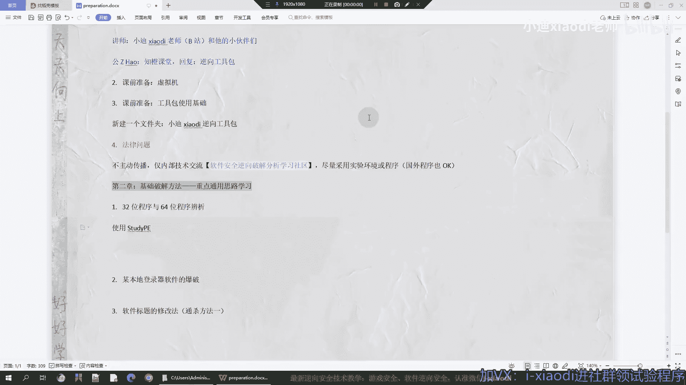
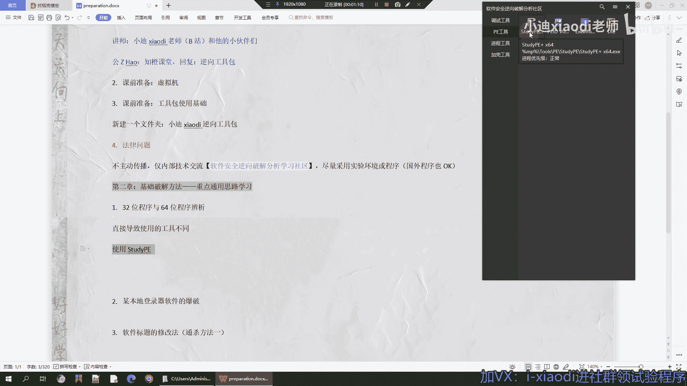
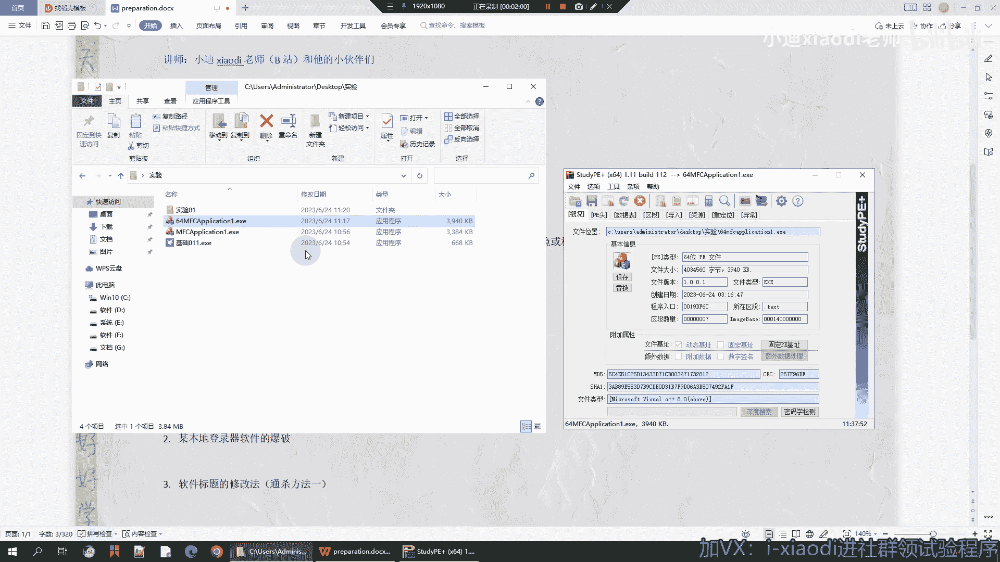
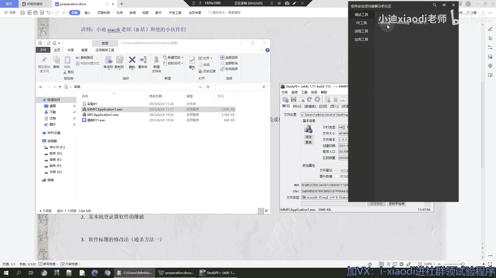
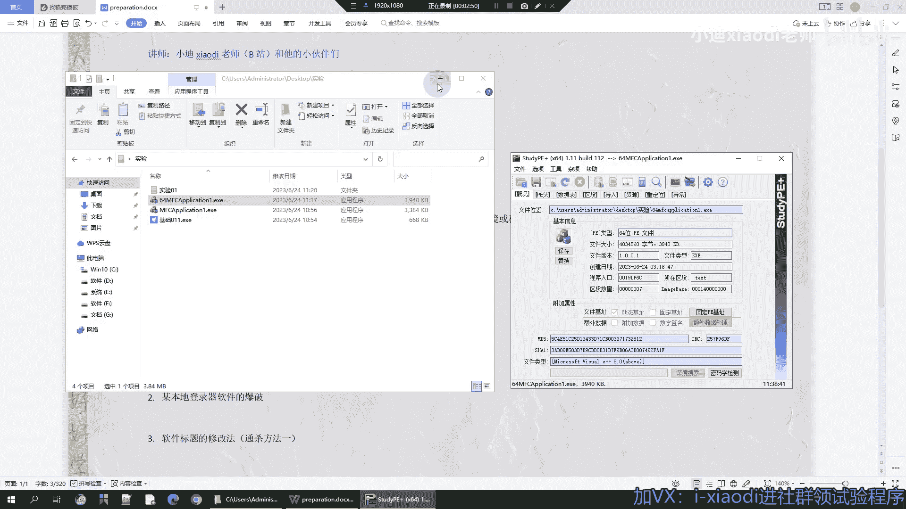
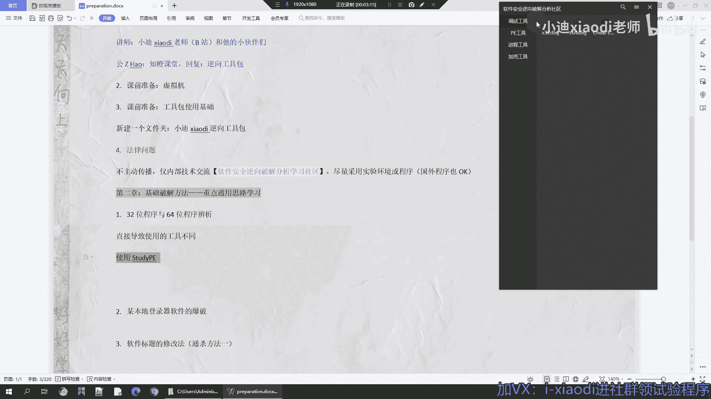

# 🧭 小白软件破解逆向工程师2023最新：01：x32和x64程序的辨析



在本节课中我们将要学习第二章“基础破解方法、重点通用思路”的第一节课内容，也就是32位程序与64位程序的辨析。现在进入第二章学习后，先要建立一个基本认识：操作系统有32位和64位之分，程序同样也有32位和64位之分。这个区别会直接影响我们后续使用的工具，所以它不是一个小细节，而是拿到软件后要先做的判断工作。如果不先判断程序位数，就可能在错误的工具上反复尝试，浪费很多时间，方向也容易跑偏。

程序位数与工具选择之间的关系可以用下面的代码表示：

```text
32位程序 -> 32位工具
64位程序 -> 64位工具
```

从上面的关系可以看出，32位程序对应32位工具，64位程序对应64位工具。因此拿到一个软件时，第一步工作就是查看它到底是32位程序还是64位程序。确认是32位程序，就找32位工具；确认是64位程序，就找64位工具。接下来我们来看看具体怎么辨析一个程序到底是32位还是64位，以及为什么需要先做这个判断。

## 🧩 小白软件破解逆向工程师2023最新：01-1：为什么程序位数会影响工具选择

上一节我们说明了本节课的整体目标和程序位数判断的重要性，本节中我们来看看程序位数为什么会直接影响工具选择。操作系统分为32位和64位，程序也分为32位和64位，这种差异会造成一个很直接的影响，那就是我们使用的工具不同。简单说，程序位数和工具位数要匹配，不能拿32位工具去处理64位程序，也不能拿64位工具去处理32位程序。

核心关系可以用公式表示为：`工具位数 = 程序位数`。也就是说，32位程序对应32位工具，64位程序对应64位工具。所以在实际破解或逆向分析之前，先判断程序位数，是为了让后面的工作有正确方向。拿到软件后先看它是32位还是64位，再去找对应工具，这样后续操作才不容易乱。下面我们进入实际判断方法，看看如何使用StudyPE查看程序位数。

## 🔍 小白软件破解逆向工程师2023最新：01-2：用StudyPE判断程序位数

上一节我们介绍了程序位数会影响工具选择，本节中我们来看看如何用StudyPE判断一个程序是32位还是64位。使用的工具是StudyPE，操作位置在工具包里。找到工具包后点击“PE工具”，其中有一个StudyPE，运行这个工具即可开始判断。为了演示判断过程，这里准备了三个实验程序，可以挨个进行测试。



以下是用StudyPE判断程序位数的操作步骤：

1. 把第一个实验程序直接拖到StudyPE窗口中，查看它的PE类型提示；如果提示为“32位PE文件”，说明它是32位程序。

2. 再把第二个实验程序拖过去，如果提示也是“32位PE文件”，说明它同样是32位程序。

3. 再把第三个实验程序拖过去，这时提示会发生变化，变成“64位PE文件”，说明它是64位程序。

通过上面的步骤可以看到，这三个实验程序中有两个是32位程序，一个是64位程序。有时不同程序在软件结构和架构上会有一些差异，这也是为什么需要实际查看PE类型，而不能只凭感觉判断。既然这三个软件分成了32位和64位两部分，那么它们对应的工具也就不一样。下面我们继续看调试工具上的直接差异，用拖拽测试来验证这个结论。

## 🛠️ 小白软件破解逆向工程师2023最新：01-3：用调试工具验证拖拽兼容性

上一节我们用StudyPE查看了程序位数，本节中我们来看看调试工具对32位程序和64位程序的兼容差异。点击调试工具，找到x32dbg和x64dbg，把两个工具都打开，就能看到它们本身就有差异，一个是32位调试工具，一个是64位调试工具。这个差异正好对应前面说的程序位数区别。

以下是拖拽测试的结果：



1. 把32位程序拖到x32dbg中，没有问题，可以拖入；刚开始测试时，先看能不能拖进去即可。



2. 把32位程序拖到x64dbg中，没有反应，说明64位工具不接受32位程序。

3. 把另一个32位程序也拖到x64dbg中，同样没有反应，进一步说明32位程序不能直接拖入64位工具。

4. 把64位程序拖到x64dbg中，可以拖进去，说明64位程序对应64位工具。

从测试结果可以看出，不同软件位数不同，对应的工具也不同。因此我们做的第一步就是辨析程序是32位还是64位，然后才能开始接下来的工作。这个方向性是正确的，不需要自己乱试。下面我们来说明课后实验安排和工具包获取方式。

## 📌 小白软件破解逆向工程师2023最新：01-4：课后实验与工具包获取

上一节我们通过拖拽测试验证了位数与工具的对应关系，本节中我们来看看课后需要完成的实验以及工具包获取事项。希望大家回去之后利用实验程序进行测试，实际用StudyPE拖拽查看PE类型，把32位和64位的判断流程走一遍。工具包已经发给大家，并且工具包会实时更新，预计今天也会更新一波。大家记得关注公众号，获取最新工具包，也可以私信加入社区，社区会提供实验环境和相关程序。

以下是课后实验和工具包获取建议：



1. 使用三个实验程序练习StudyPE拖拽判断，确认每个程序是32位还是64位。

2. 关注公众号，获取最新工具包，避免使用旧版本工具包。

3. 可以私信加入社区，社区提供实验环境和程序，方便后续练习。



完成这些课后练习后，就能更熟悉32位与64位程序的辨析流程。下面我们对本节课内容做一个总结。

## 🧾 小白软件破解逆向工程师2023最新：01-5：本节课总结

本节课中我们一起学习了32位程序与64位程序的辨析。操作系统有32位和64位之分，程序也有32位和64位之分，这个差异会直接导致使用的工具不同。核心关系是`32位程序 -> 32位工具`，`64位程序 -> 64位工具`。拿到软件后先判断位数，再选择对应工具。我们用StudyPE查看PE类型，通过拖拽实验程序看到两个32位程序和一个64位程序；又用x32dbg和x64dbg做拖拽测试，验证了32位程序拖入32位工具正常、32位程序拖入64位工具没有反应、64位程序拖入64位工具正常。最后还说明了课后用实验程序练习、关注公众号获取最新工具包、私信加入社区获取实验环境和程序。下期再见。
