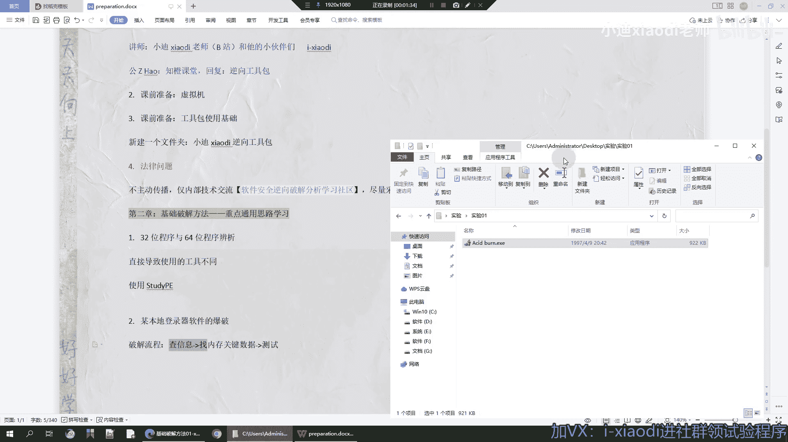
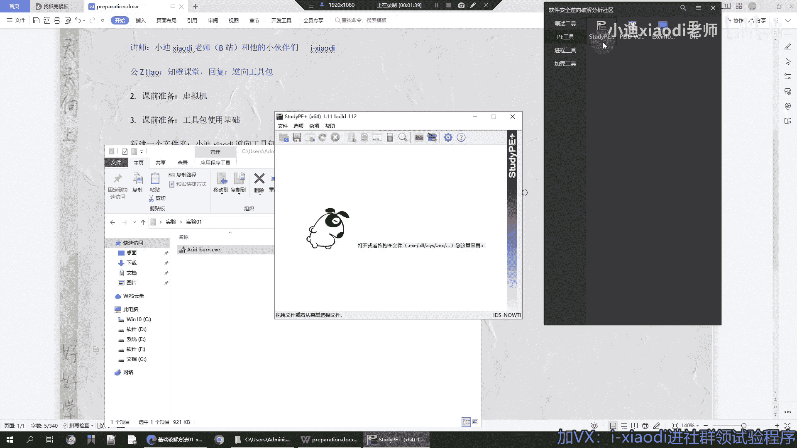
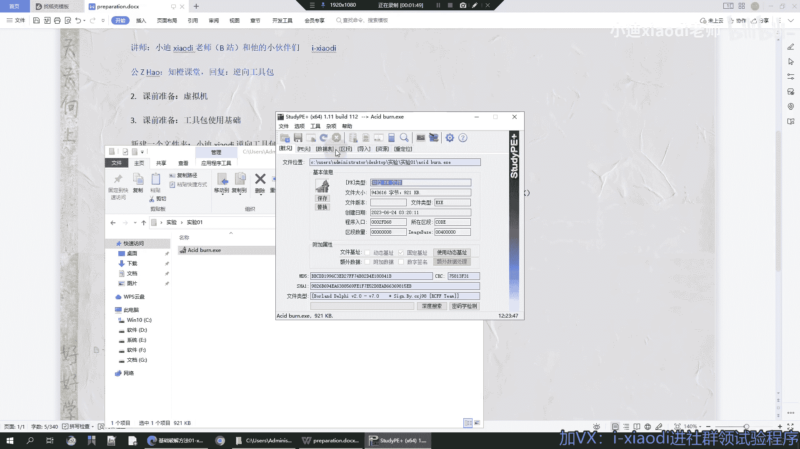
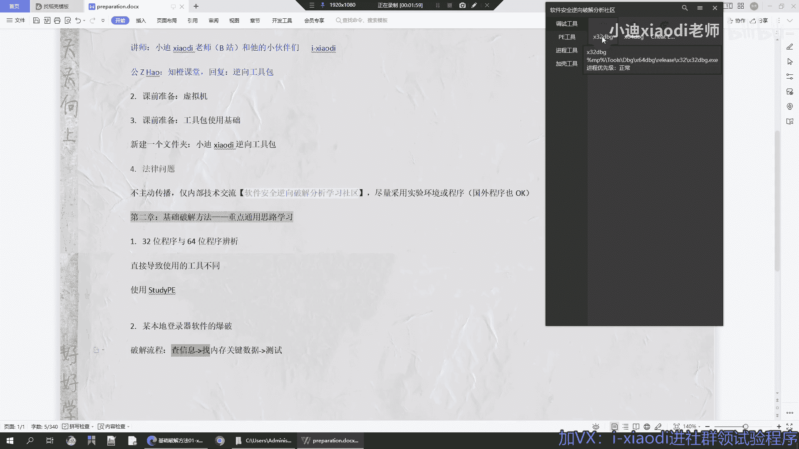
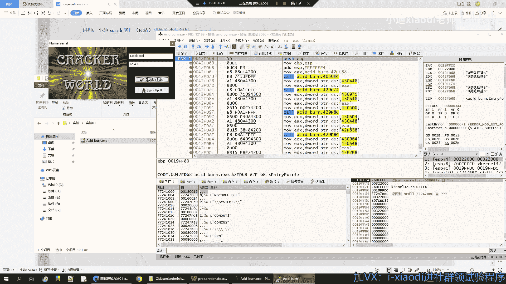
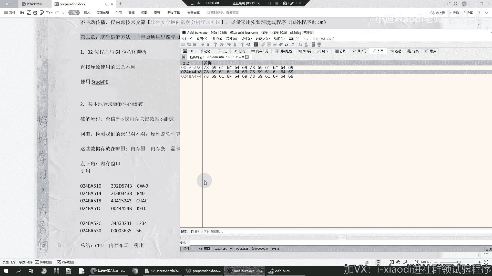

# 🧭 小白软件破解逆向工程师2023最新：02：某本地登录器软件的爆破实验

在本节课中我们将要学习本地登录器软件爆破的基本流程。课程会从软件获取方式讲起，随后认识软件运行界面，观察错误提示，再通过PE工具确认程序位数，使用32位调试工具加载程序，理解“软件计算密码与用户输入密码做比较”的校验逻辑，最后在内存中搜索关键数据并完成爆破验证。整个流程会尽量用直白的话说明，让初学者能够跟上每一步操作。

## 🧰 小白软件破解逆向工程师2023最新：02.1：获取实验软件与工具

在动手分析之前，先说明实验软件和工具的获取方式。原文说明可以通过社区和私信两种渠道获取实验材料，下面列出具体获取方式，方便需要练习的人自行选择。

获取软件与工具的方式如下，主要是通过微信社区和哔哩哔哩私信完成：

- 如果希望获取这个软件，可以联系讲者的微信，然后加入社区下载。
- 如果不想加微信，可以联系哔哩哔哩账号并发送私信，讲者会发送加入社区的方式，然后获取工具。
- 这个渠道也用于内部技术交流。

> 软件和工具主要用于内部技术交流与学习实验，获取方式以社区下载和私信沟通为主。

## 🖥️ 小白软件破解逆向工程师2023最新：02.2：认识软件运行界面与错误提示



上一节说明了实验材料的获取方式，本节查看软件本身并熟悉它的运行逻辑。先运行软件，会出现一个弹窗，界面中一共有三个按钮，点击第一个按钮后，软件提示输入名字和密码。



认识软件界面的操作过程如下，重点是观察输入与检查结果：

- 运行软件后会出现一个弹窗。
- 点击界面中的某个位置后，可以看到一共有三个按钮。
- 点击第一个按钮，软件提示“请输入你的名字”，然后提示输入密码。
- 名字输入“小迪小迪”，密码随便输入“123456”。
- 点击“check”按钮进行检查。
- 软件提示“incorrect”，意思是输入错误。



从界面表现可以推测，这个本地登录器软件的基本逻辑是：用户输入名字和密码，软件检查密码是否正确。当前输入“123456”得到错误提示，说明这个密码不是软件认可的正确密码。



## 🎯 小白软件破解逆向工程师2023最新：02.3：猜想爆破后的效果

上一节看到了软件的错误提示，本节先猜想爆破成功后的效果。爆破的目标是让软件在输入特定密码时不再提示错误，而是提示密码正确。原文猜测，点击检查按钮时，软件有可能提示“恭喜你，密码正确”，而当前显示的是“incorrect”，也就是错误。

爆破预期可以用一个简单公式描述，方便理解目标：

```text
预期效果 = 输入正确密码后提示 congratulations / good job
当前效果 = 输入 123456 后提示 incorrect
```

接下来要做的不是盲目修改，而是遵循一定的破解流程。第一步是查信息，确认软件是32位还是64位，因为上节课已经说明，32位和64位程序对应的工具不一样。



## 🔍 小白软件破解逆向工程师2023最新：02.4：使用PE工具确认程序位数

上一节确定了先查程序信息，本节使用PE工具确认位数。先关闭软件，然后使用课程提供的PE工具，原文称为“斯大PE”或“斯PE”。把软件拖到这个PE工具中，工具会显示“32位PE文件”，信息写得很清楚。

确认程序位数与工具选择的思路如下，先判断文件位数再选择调试工具：

- 关闭正在运行的软件。
- 使用提供的PE工具，原文提到“斯大PE”。
- 把软件拖到“斯PE”中。
- 工具显示这是32位PE文件。
- 因为程序是32位，所以选择32位工具。
- 选择32位工具后，分析方向就明确了。

这个过程可以用公式表示，先判断位数，再匹配工具：

```text
文件位数 = 32位 -> 使用32位调试工具
文件位数 = 64位 -> 使用64位调试工具
```

## 🛠️ 小白软件破解逆向工程师2023最新：02.5：使用32位调试工具加载并运行程序

上一节确认了程序是32位，本节使用32位调试工具加载程序。原文使用“32dbug”或“32debg”来称呼这个工具，可以理解为32位调试器。先运行32位调试工具，然后调整窗口大小，调整到自己觉得舒服的状态。

加载和运行程序的操作如下，重点是让程序从暂停状态进入运行状态：

- 运行32位调试工具。
- 调整调试工具窗口大小，调整到舒服的状态。
- 把32位软件拖到32位调试工具中，轻轻拖入即可。
- 程序拖入后，左下角会显示“已暂停”。
- “已暂停”表示程序拖入后处于暂停状态，还没有运行起来。
- 要让程序运行起来才能看到效果，所以点击小箭头运行按钮。
- 程序运行起来后，再点击软件界面中的按钮。
- 输入名字“小迪小迪”，密码“123456”，然后点击“check it”。

> “已暂停”表示程序已经加载但尚未运行，点击运行按钮后才能继续观察程序行为。

## 🧠 小白软件破解逆向工程师2023最新：02.6：理解密码校验逻辑与内存概念

上一节把程序运行起来并再次执行了检查操作，本节解释为什么要做这一步。点击“check it”后，需要思考一个问题：软件如何检测密码。基本逻辑是软件自己算出一个密码，然后把软件算出的密码与用户输入的密码做校验和比较。

密码校验的核心关系可以用公式描述：

```text
校验结果 = (软件计算密码 == 用户输入密码)
```

比较必须有两个对象才能进行。原文用了一个直白的例子：一个人无法比较“谁更高、谁更胖、谁更瘦、谁更漂亮”，必须是两个人才能做比较。因此可以建立最基本的概念：有一个东西会和用户输入做比较。

接下来要思考，这个用于比较的数据存放在哪里。计算机的一个基本常识是：程序运行着的东西存放在内存里。内存条是常见概念；显卡有显存，显存可以理解为显示用的内存。桌面上看到的文字，实际上是由一个个像素点汇集起来显示的，这些运行中、肉眼可见的内容都放在内存里。

内存与运行数据的关系可以用代码形式表示：

```text
运行中的数据 -> 内存
软件计算密码 -> 内存
用户输入密码 -> 内存
比较操作 -> 读取内存中的关键数据
```

因此，软件算出的密码和用户输入的“小迪小迪”“123456”都放在内存里。要找关键数据，就要用调试工具在内存中搜索“小迪小迪”和“123456”这些内容。概念清楚后，下一步就是进入内存布局，搜索内存中的关键数据。

## 🔎 小白软件破解逆向工程师2023最新：02.7：在内存布局中搜索关键数据

上一节理解了关键数据存放在内存中，本节开始实际搜索内存。调试工具界面中可以看到“内存布局”，点击这里进入内存布局。寻找关键数据的同义操作是“搜索”，可以通过鼠标右键打开菜单，然后选择“搜索匹配特征”。

搜索“小迪小迪”的流程如下，先进入内存布局，再使用匹配特征搜索：

- 点击“内存布局”。
- 在内存布局区域使用鼠标右键。
- 选择“搜索匹配特征”。
- 在输入位置输入名字“小迪小迪”。
- 点击确定开始搜索。
- 搜索结果显示若干条记录，原文提到搜出了3条。
- 双击某一条记录进行查看。
- 查看左下角区域，这里称为内存窗口。
- 双击时左下角会闪一下，显示的就是内存内容。
- 第一条记录中看不到关键信息，可以点击“引用”继续查看第二条。
- 点击“引用”后，第二条记录会闪一下，仍然查看左下角的内存窗口。
- 往下查看时，出现了一串类似密码的内容。
- 同时还出现了“123456”。

搜索和查看过程可以用代码形式概括：

```text
内存布局 -> 鼠标右键 -> 搜索匹配特征
输入：小迪小迪
确定 -> 得到搜索结果
双击条目 -> 查看左下角内存窗口
点击引用 -> 继续查看下一条
观察内存窗口 -> 查找类似密码的数据与 123456
```

> 左下角区域是内存窗口，双击搜索结果或点击引用时，主要观察这一块内容。

## 🧪 小白软件破解逆向工程师2023最新：02.8：复制关键数据并验证爆破结果

上一节在内存窗口中看到了类似密码的一串内容和“123456”，本节复制这些数据并验证。原文判断，这串内容像是软件算出的密码，然后与用户输入的密码做比较；“123456”正好出现在附近，因此有理由猜测这里就是校验相关的数据。

复制关键数据的过程如下，重点是选中有效区域并复制选定行：

- 观察内存窗口中的数据。
- 原文认为“T”和“K”看起来像垃圾数据。
- 密码“123456”后面的“4”以及“K”也被判断为可能是垃圾数据。
- 选择到“D”的位置。
- 鼠标右键，选择“复制选定的行”。
- 复制出来的内容会一行一行显示，先不用处理显示格式，后续再说明。
- 对“123456”也执行鼠标右键，选择“复制选定的行”。

完成复制后，可以尝试手动输入疑似正确密码“CW-9840-CRAACKED”。原文中的密码包含“CRAACKED”这一拼写，需要按原文保留。输入后点击检查，观察是否出现成功提示。

验证爆破结果的操作如下，用疑似正确密码替换“123456”进行测试：

- 如果输入“123456”，软件提示“sorry”，表示这个密码是错误的。
- 手动输入“CW-9840-CRAACKED”。
- 点击检查按钮。
- 软件提示“congratulations”，也就是恭喜。
- 同时提示“good job”，意思是干得不错。
- 填入“CW-9840-CRAACKED”后提示“good job”，说明这个密码被软件认可。
- 这样就把一个本地登录器软件爆破了。

验证结果可以用公式表示：

```text
输入 123456 -> sorry / incorrect
输入 CW-9840-CRAACKED -> congratulations / good job
```

## 📝 小白软件破解逆向工程师2023最新：02.9：课程总结与实验复盘

上一节完成了爆破验证，本节对整节课做总结。今天这节课学到的核心内容是破解流程：先查信息，再运行软件并了解检测逻辑，然后根据逻辑寻找内存关键数据，最后验证正确密码。

本次爆破实验的流程要点如下，按顺序复盘可以帮助初学者形成完整思路：

- 首先查信息，确认程序是32位还是64位。
- 查到程序是32位后，选择对应的32位工具。
- 运行软件，了解软件的运行逻辑和检测逻辑。
- 猜测检测逻辑是：软件算出一个密码，并与用户输入的密码做比较。
- 根据计算机常识，软件算出的密码和用户输入的密码都放在内存里。
- 使用调试工具寻找内存中的关键数据。
- 在“内存布局”中查找关键数据。
- 在内存布局中鼠标右键，选择“搜索匹配特征”。
- 在搜索输入的第一行输入“小迪小迪”。
- 搜索完成后，界面会显示“引用”。
- CPU窗口主要查看左下角这一块区域。
- 内存布局主要用于搜索关键数据。
- 引用用于继续查看搜索结果。
- 原文提到的“askK”“unicode”“UTF-8”等内容后续会讲，当前先了解搜索时在第一行输入内容。
- 实验程序放在社区中，可以联系微信或给哔哩哔哩发私信获取。
- 本课结束，下集再见。



本节课中我们一起学习了本地登录器软件爆破的基本流程，包括确认32位程序、使用32位调试工具、运行并观察检查逻辑、理解软件计算密码与用户输入密码的比较关系、在内存布局中搜索关键数据、复制疑似密码并输入“CW-9840-CRAACKED”完成验证。整个实验的核心可以归纳为：先查信息，再理解逻辑，然后在内存中寻找关键数据，最后用正确密码验证爆破效果。
